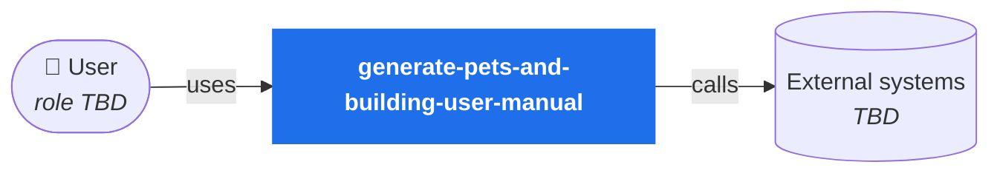
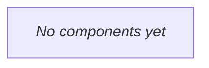

# generate-pets-and-building-user-manual · Architecture

- **Last updated:** 2026-11-20
- **Reflects:** no code; the app holds only generation instructions
- **Part of:** the system described in the [root architecture](../../../../docs/architecture/architecture.md)
- **Decisions:** [app ADRs](adr/README.md) · [root ADRs](../../../../docs/architecture/adr/README.md) · **Metrics:** [latest](metrics/latest.md)

> This document describes the inside of the generate-pets-and-building-user-manual app as it is *now*. What the app reads and writes, and which libraries it uses, is declared at system level in the root [components.json](../../../../docs/architecture/components.json) and shown in the root architecture's system map; don't repeat it here, link to it. Components inside the app come from this folder's [components.json](components.json); the diagrams here must match it.

## 1. Purpose and scope

Holds the instructions used to generate the pets and building user manuals.

Its only content is [instructions/generation-instructions.md](../../instructions/generation-instructions.md): the user's requests, quoted word for word, and the conventions used to generate the manuals. It owns the dataset `user-manuals-pets-and-house-rules` (contract: [libs/contracts/user-manuals-pets-and-house-rules/](../../../../libs/contracts/user-manuals-pets-and-house-rules/README.md)). The manuals are generated by an LLM session that follows the instructions, not by code in this app.

What it deliberately does not do: it contains no code and no runtime, it doesn't answer questions about the manuals, and it doesn't build an ontology from them. Those jobs belong to the apps of idea 0001.

## 2. Context

Who uses this app, and which shared datasets, libraries and external systems it touches.



## 3. Components

An arrow `A --> B` means "A depends on B". No cycles.



| Component | Responsibility (one sentence) | May depend on | Code location |
|-----------|-------------------------------|---------------|---------------|
| _none yet_ | | | |

## 4. Coupling and modularity

<!-- coupling:begin (generated, do not edit) -->
_No dependencies between components measured yet._ _Nodes: name, Ca·Ce·I. Edges: number of import statements. Red: violation._

```mermaid
flowchart TD
```
<!-- coupling:end -->

## 5. Key runtime flows

_Sequence diagrams for the flows that matter most._

## 6. Configuration

| Variable | Defined in | Purpose |
|----------|------------|---------|
| _Base variables come from the root `.env.example`; list here only what this app adds or overrides._ | | |
