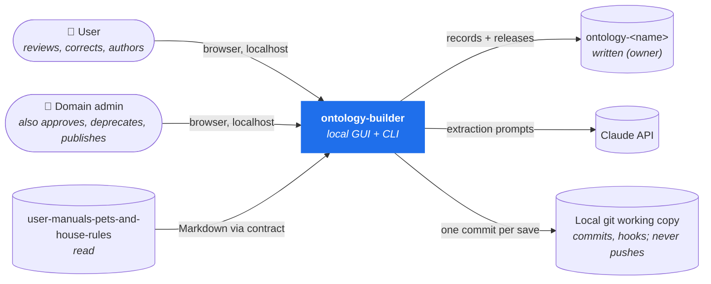
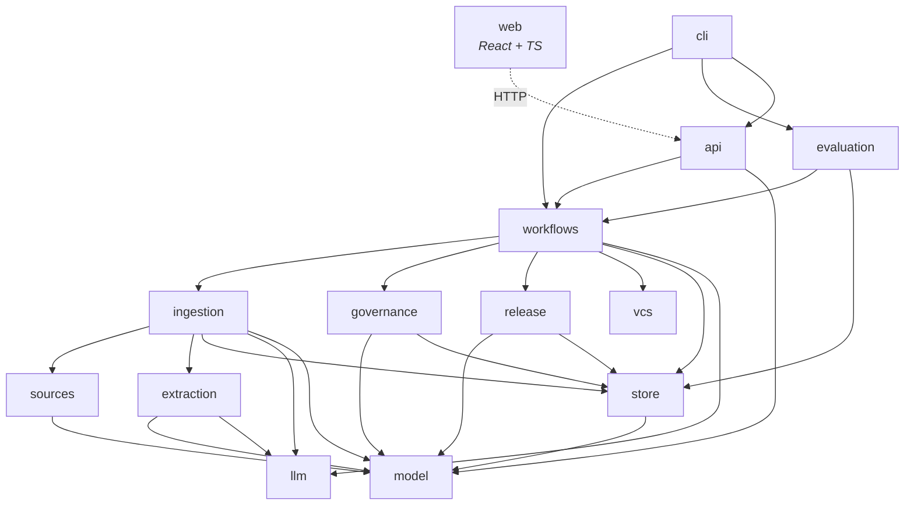
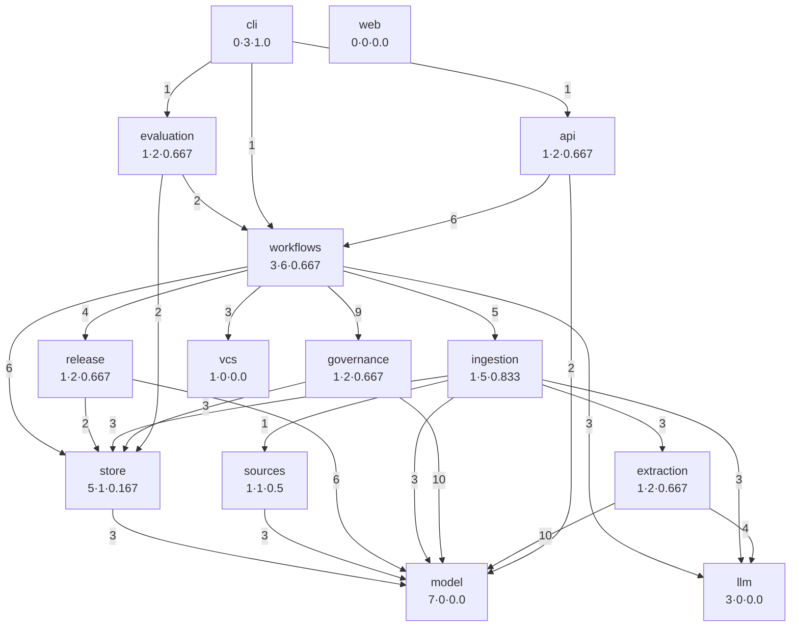
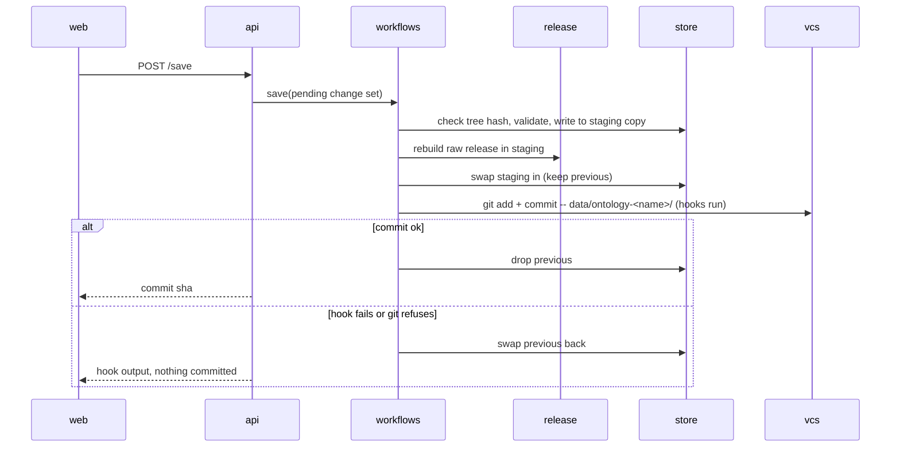

# ontology-builder · Architecture

- **Last updated:** 2026-11-22
- **Reflects:** the code built for [plan 0002](../../../../docs/specs/0002-ontology-builder/plan.md) (tasks T1–T30)
- **Part of:** the system described in the [root architecture](../../../../docs/architecture/architecture.md)
- **Decisions:** [app ADRs](adr/README.md) · [root ADRs](../../../../docs/architecture/adr/README.md) · **Metrics:** [latest](metrics/latest.md)

> This document describes the inside of the ontology-builder app as it is *now*. What the app reads and writes, and which libraries it uses, is declared at system level in the root [components.json](../../../../docs/architecture/components.json) and shown in the root architecture's system map; don't repeat it here, link to it. Components inside the app come from this folder's [components.json](components.json); the diagrams here must match it.

## 1. Purpose and scope

Builds leveled ontologies from Markdown corpora and user statements, through LLM proposals, human review and governed releases ([spec 0002](../../../../docs/specs/0002-ontology-builder/spec.md)).

**What it does:**
- ingests Markdown corpora into source units with stable IDs;
- has Claude propose statements, terms, concepts, relations, rules, properties, levels, ignorable passages, synonyms and senses, each with evidence;
- lets users review and author content in a local GUI, and a domain admin approve it;
- commits every save to git;
- publishes a raw and a governed release (`ontology.ttl`, its JSON-LD twin `ontology.jsonld`, `level-N.md`, manifest) into `data/ontology-<name>/`.

**What it deliberately does not do (v1):** LLM abstraction of unstated concepts, contradiction or drift detection, diagram-based review (planned for v2), re-ingesting upgraded corpora, non-Markdown input, multi-user or server deployment, pushing to GitHub.

## 2. Context

## 3. Components

An arrow `A --> B` means "A depends on B". No cycles. `web` reaches `api` over HTTP only: `web/src/api/schema.gen.ts` holds types generated from the exported OpenAPI schema (`web/openapi.json`), and every call goes through openapi-fetch in `web/src/api/index.ts` (ADR-0011).

| Component | Responsibility (one sentence) | May depend on | Code location |
|-----------|-------------------------------|---------------|---------------|
| model | Defines the LinkML schema of every record and validates records against it. | — | `src/ontology_builder/model/` |
| store | Reads and writes the files of one ontology dataset, atomically. | model | `src/ontology_builder/store/` |
| sources | Splits Markdown documents and user statements into registered source units. | model | `src/ontology_builder/sources/` |
| llm | Calls Claude or replays recorded responses, and estimates tokens and cost. | — | `src/ontology_builder/llm/` |
| extraction | Turns source units into validated proposed elements with evidence and levels. | model, llm | `src/ontology_builder/extraction/` |
| ingestion | Runs one ingestion or on-demand extraction, resumable and all-or-nothing. | model, sources, extraction, store, llm (ADR-0008) | `src/ontology_builder/ingestion/` |
| governance | Applies review, authoring and governance actions under the role and status rules, recording each decision. | model, store | `src/ontology_builder/governance/` |
| release | Builds the raw and governed release files from the records. | model, store | `src/ontology_builder/release/` |
| vcs | Commits the changed files of one dataset path to the local git working copy. | — | `src/ontology_builder/vcs/` |
| workflows | Runs the app's use cases (create, ingest, review, save, publish) across the components below it. | ingestion, governance, release, vcs, store, llm (ADR-0009) | `src/ontology_builder/workflows/` |
| api | Exposes the use cases as a localhost JSON API and serves the built front end. | workflows, model | `src/ontology_builder/api/` |
| cli | Exposes the use cases as `ontology-builder` commands. | workflows, evaluation, api (ADR-0010) | `src/ontology_builder/cli/` |
| evaluation | Scores a live ingestion of the pet manuals against the answer key (the only component that may read it). | workflows, store | `src/ontology_builder/evaluation/` |
| web | Renders the review GUI in the browser and talks to the API only over HTTP. | (api over HTTP, generated types; ADR-0011) | `web/` |

## 4. Coupling and modularity

<!-- coupling:begin (generated, do not edit) -->
_Nodes: name, Ca·Ce·I. Edges: number of import statements. Red: violation._

<!-- coupling:end -->

## 5. Key runtime flows

**Pending changes** (ADR-0004): `workflows.open_ontology` takes the process lock (one process per work folder) and loads the change set. Every review, authoring or statement action changes only that change set, and the journal in the work folder is rewritten after each one, with the tree hash of the dataset it was made on. A process that stops before saving loses nothing: the next open re-applies the journal, unless the dataset changed since (then it refuses until the journal is discarded). Ingest, publish, scope edits and `build` refuse while changes are pending.

**Save** (ADR-0004):

**Ingestion** (ADR-0005): estimate → user confirms → pass 1 per document as two calls, A (verdicts, statements, terms, concepts, relations) and B (rules and properties referring to A's keys), with units cited by alias (ADR-0007; cached per batch in the work folder) → pass 2 term resolution → validate → one atomic write of the units, elements and run record → raw release → commit. An interrupted run resumes from the cache (`ingest --resume <run-id>`). Marking a passage not ignorable runs the same pipeline on just those units (on-demand extraction, FR-14), after its own estimate. Each run is one commit, with the raw release rebuilt before the swap.

**Evaluation** (FR-38): `evaluation` makes a workspace whose data and work folders are temporary, and `workflows.create_scratch` creates the ontology there with the frozen pet scope record, without git. It estimates all three manuals, asks for confirmation, then ingests each as its own corpus through the same `ingestion` runs (no raw release, no commit). Only after the last run does `evaluation` load the answer key, score the dataset item by item and write the dated report to `docs/evaluations/`.

**Publish** (domain admin, GUI only): the admin picks a version (default: the next minor) → the raw release is rebuilt → FR-35 dependency check. If an approved element refers to one that is not approved, the offenders go back to the GUI and only the raw rebuild is committed. Otherwise the governed release is built in staging from the approved snapshots, with its change log against the previous governed `ontology.ttl` and a publish decision → swap → one commit `Publish ontology <name> <version>`.

**Other commits:** `create` (domain admin) writes the dataset layout, the scope record and the first raw release, and removes the folder again if the commit fails; editing the scope record (domain admin) writes it with its decision and the rebuilt raw release; `build` rebuilds the raw release without a commit.

**Every API request** (T19): the Host must be `127.0.0.1:<port>` or `localhost:<port>` (else 400); a write needs `X-Ontology-Builder: 1` and, if the browser sends an Origin, a local one (else 403); the session cookie names the signed-in handle and role (else 401); only the first signed-in session may write, others are read-only (403); a governing request of a user is refused before it reaches `workflows` (403), and `governance` checks the role again. One request at a time works on the open ontology (a lock in the api). The api reads through `workflows` (`index`, `detail`, `corpora`, `scope`, `run`), which returns plain data, and maps the use cases' refusals to HTTP statuses: not found 404, governance 403, workflow or ingestion refusal 409, a failed run 502, the LLM unavailable 503.

## 6. Configuration

| Variable | Defined in | Purpose |
|----------|------------|---------|
| `ONTOLOGY_BUILDER_PORT` | `apps/ontology-builder/.env.example` | Port of the local GUI and API (binds to 127.0.0.1) |
| `ONTOLOGY_BUILDER_WORK_DIR` | `apps/ontology-builder/.env.example` | Git-ignored work folder: change-set journal, LLM response cache, process lock |
| `ONTOLOGY_BUILDER_LLM_MODE` | `apps/ontology-builder/.env.example` | `live`, `record` or `replay` (tests always replay) |
| `ANTHROPIC_API_KEY`, `CLAUDE_MODEL`, `SHARED_DATA_DIR` | root `.env.example` | Claude access, the model, and the root of the datasets |
