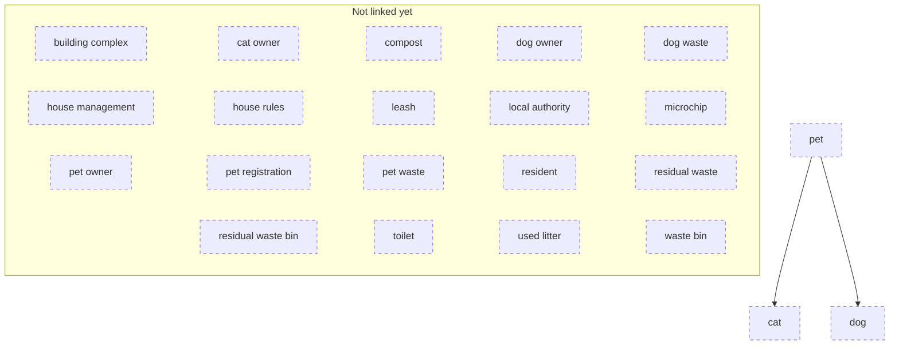
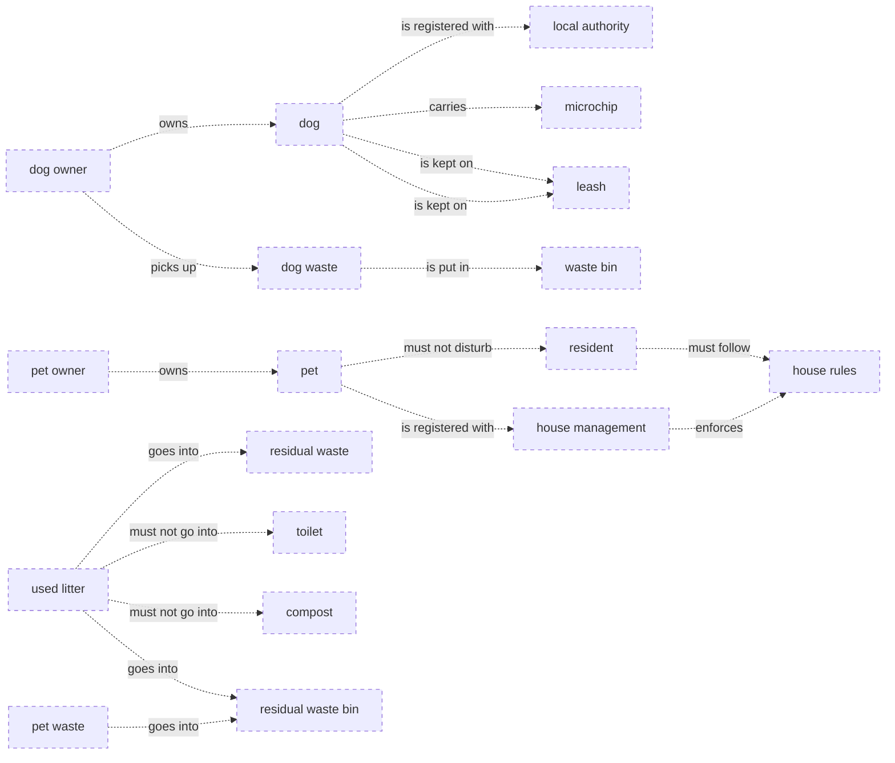

# pets-and-house-rules · level 1

**Version:** raw+2eff3b2 · **Release:** raw · This file holds level 1, the core of the domain.

Explain what it takes to own a dog or a cat in a residential complex, and which house rules apply to pets and their owners.

This is the raw release: it also holds elements that are not approved yet. They are marked
`● proposed` or `◐ waiting for approval`, and drawn dashed in the diagrams.

## Taxonomy

## Concepts and relations

## Concepts

### building complex · ● proposed

- **Level:** 1
- **Evidence:** [§19](#su_01M82H6T2T27Y7HH29TGSXAMMJ)

### cat · ● proposed

- **Synonyms:** cats
- **Is a:** [pet](#cn_01M82H94Y19DEFXTHPXP970KGB)
- **Level:** 1
- **Evidence:** [§1](#su_01M82GXF5BZJDB4QGXVFMJEB2X), [§6](#su_01M82GXF5BZJDB4QGXVFMJEB2Z), [§12](#su_01M82GXF5BZJDB4QGXVFMJEB33), [§14](#su_01M82GXF5CK27HSSNSY54SX5F3), [§15](#su_01M82GXF5CK27HSSNSY54SX5F5), [§16](#su_01M82GXF5CK27HSSNSY54SX5F7), [§17](#su_01M82H6T2SJCWQ88GWH3NA9WX7), [§22](#su_01M82H6T2T27Y7HH29TGSXAMMP), [§24](#su_01M82GXF5CK27HSSNSY54SX5F9), [§32](#su_01M82GXF5CK27HSSNSY54SX5FB), [§33](#su_01M82GXF5CK27HSSNSY54SX5FD), [§37](#su_01M82GXF5CK27HSSNSY54SX5FF), [§40](#su_01M82GXF5CK27HSSNSY54SX5FH)

### cat owner · ● proposed

- **Level:** 1
- **Evidence:** [§1](#su_01M82GXF5BZJDB4QGXVFMJEB2X), [§32](#su_01M82GXF5CK27HSSNSY54SX5FB)

### compost · ● proposed

- **Level:** 1
- **Evidence:** [§16](#su_01M82GXF5CK27HSSNSY54SX5F7)

### dog · ● proposed

- **Is a:** [pet](#cn_01M82H94Y19DEFXTHPXP970KGB)
- **Level:** 1
- **Evidence:** [§2](#su_01M82GHYMP28WWGVJCAF7BMQCE), [§3](#su_01M82GHYMP28WWGVJCAF7BMQCF), [§9](#su_01M82GHYMP28WWGVJCAF7BMQCQ), [§10](#su_01M82GHYMP28WWGVJCAF7BMQCS), [§11](#su_01M82GHYMP28WWGVJCAF7BMQCV), [§17](#su_01M82H6T2SJCWQ88GWH3NA9WX7), [§18](#su_01M82H6T2T27Y7HH29TGSXAMMH), [§19](#su_01M82H6T2T27Y7HH29TGSXAMMJ), [§20](#su_01M82H6T2T27Y7HH29TGSXAMMK), [§21](#su_01M82H6T2T27Y7HH29TGSXAMMM), [§23](#su_01M82GHYMQYRXNHXCXTMK9HDNY), [§26](#su_01M82GHYMQYRXNHXCXTMK9HDP3), [§27](#su_01M82GHYMQYRXNHXCXTMK9HDP5), [§29](#su_01M82GHYMQYRXNHXCXTMK9HDP7), [§30](#su_01M82GHYMQYRXNHXCXTMK9HDP9), [§31](#su_01M82GHYMQYRXNHXCXTMK9HDPB), [§35](#su_01M82GHYMQYRXNHXCXTMK9HDPD), [§36](#su_01M82GHYMQYRXNHXCXTMK9HDPE), [§38](#su_01M82GHYMR2WSZZZXCEPR86V3Q), [§39](#su_01M82GHYMR2WSZZZXCEPR86V3R), [§42](#su_01M82GHYMR2WSZZZXCEPR86V3T), [§43](#su_01M82GHYMR2WSZZZXCEPR86V3W)

### dog owner · ● proposed

- **Synonyms:** owner
- **Level:** 1
- **Evidence:** [§19](#su_01M82H6T2T27Y7HH29TGSXAMMJ), [§20](#su_01M82H6T2T27Y7HH29TGSXAMMK), [§21](#su_01M82H6T2T27Y7HH29TGSXAMMM), [§27](#su_01M82GHYMQYRXNHXCXTMK9HDP5), [§31](#su_01M82GHYMQYRXNHXCXTMK9HDPB), [§39](#su_01M82GHYMR2WSZZZXCEPR86V3R), [§43](#su_01M82GHYMR2WSZZZXCEPR86V3W)

### dog waste · ● proposed

- **Synonyms:** waste
- **Level:** 1
- **Evidence:** [§27](#su_01M82GHYMQYRXNHXCXTMK9HDP5)

### house management · ● proposed

Administers the buildings and enforces these rules.

- **Level:** 1
- **Evidence:** [§4](#su_01M82H6T2SJCWQ88GWH3NA9WX1), [§17](#su_01M82H6T2SJCWQ88GWH3NA9WX7), [§21](#su_01M82H6T2T27Y7HH29TGSXAMMM), [§28](#su_01M82H6T2T27Y7HH29TGSXAMMR), [§34](#su_01M82H6T2T27Y7HH29TGSXAMMW), [§41](#su_01M82H6T2T27Y7HH29TGSXAMN0), [§44](#su_01M82H6T2T27Y7HH29TGSXAMN2)

### house rules · ● proposed

- **Synonyms:** rules
- **Level:** 1
- **Evidence:** [§4](#su_01M82H6T2SJCWQ88GWH3NA9WX1)

### leash · ● proposed

- **Synonyms:** lead
- **Level:** 1
- **Evidence:** [§18](#su_01M82H6T2T27Y7HH29TGSXAMMH), [§25](#su_01M82GHYMQYRXNHXCXTMK9HDP1), [§26](#su_01M82GHYMQYRXNHXCXTMK9HDP3), [§43](#su_01M82GHYMR2WSZZZXCEPR86V3W)

### local authority · ● proposed

- **Level:** 1
- **Evidence:** [§3](#su_01M82GHYMP28WWGVJCAF7BMQCF), [§5](#su_01M82GHYMP28WWGVJCAF7BMQCN), [§43](#su_01M82GHYMR2WSZZZXCEPR86V3W)

### microchip · ● proposed

- **Synonyms:** microchipped
- **Level:** 1
- **Evidence:** [§3](#su_01M82GHYMP28WWGVJCAF7BMQCF), [§7](#su_01M82GXF5BZJDB4QGXVFMJEB31), [§42](#su_01M82GHYMR2WSZZZXCEPR86V3T)

### pet · ● proposed

A dog or a cat.

- **Level:** 1
- **Evidence:** [§17](#su_01M82H6T2SJCWQ88GWH3NA9WX7)

### pet owner · ● proposed

- **Level:** 1
- **Evidence:** [§17](#su_01M82H6T2SJCWQ88GWH3NA9WX7)

### pet registration · ● proposed

- **Level:** 1
- **Evidence:** [§17](#su_01M82H6T2SJCWQ88GWH3NA9WX7)

### pet waste · ● proposed

- **Is a:** waste
- **Level:** 1
- **Evidence:** [§28](#su_01M82H6T2T27Y7HH29TGSXAMMR)

### resident · ● proposed

Anyone who lives in one of the buildings: tenants, owners and their household members.

- **Synonyms:** residents
- **Level:** 1
- **Evidence:** [§4](#su_01M82H6T2SJCWQ88GWH3NA9WX1), [§8](#su_01M82H6T2SJCWQ88GWH3NA9WX3), [§13](#su_01M82H6T2SJCWQ88GWH3NA9WX5), [§17](#su_01M82H6T2SJCWQ88GWH3NA9WX7), [§34](#su_01M82H6T2T27Y7HH29TGSXAMMW)

### residual waste · ● proposed

- **Is a:** waste
- **Level:** 1
- **Evidence:** [§16](#su_01M82GXF5CK27HSSNSY54SX5F7), [§28](#su_01M82H6T2T27Y7HH29TGSXAMMR)

### residual waste bin · ● proposed

- **Level:** 1
- **Evidence:** [§28](#su_01M82H6T2T27Y7HH29TGSXAMMR)

### toilet · ● proposed

- **Level:** 1
- **Evidence:** [§16](#su_01M82GXF5CK27HSSNSY54SX5F7)

### used litter · ● proposed

- **Synonyms:** used cat litter
- **Is a:** litter, waste
- **Level:** 1
- **Evidence:** [§16](#su_01M82GXF5CK27HSSNSY54SX5F7), [§28](#su_01M82H6T2T27Y7HH29TGSXAMMR)

### waste bin · ● proposed

- **Level:** 1
- **Evidence:** [§27](#su_01M82GHYMQYRXNHXCXTMK9HDP5)

## Relations

### administers · ● proposed

- [house management](#cn_01M82H7HBZP5REB8E6N9M29JTH) — administers → building
- **Level:** 1
- **Evidence:** [§4](#su_01M82H6T2SJCWQ88GWH3NA9WX1)

### apply to · ● proposed

- [house rules](#cn_01M82H7HBZP5REB8E6N9M29JTQ) — apply to → building
- **Level:** 1
- **Evidence:** [§4](#su_01M82H6T2SJCWQ88GWH3NA9WX1)

### carries · ● proposed

- [dog](#cn_01M82GJP3CRKNX3DNJZDNANDWM) — carries → [microchip](#cn_01M82GJP3CRKNX3DNJZDNANDWP)
- **Level:** 1
- **Evidence:** [§3](#su_01M82GHYMP28WWGVJCAF7BMQCF)

### enforces · ● proposed

- [house management](#cn_01M82H7HBZP5REB8E6N9M29JTH) — enforces → [house rules](#cn_01M82H7HBZP5REB8E6N9M29JTQ)
- **Level:** 1
- **Evidence:** [§4](#su_01M82H6T2SJCWQ88GWH3NA9WX1)

### goes into · ● proposed

- [used litter](#cn_01M82H1MQPVEX27Q0YHCNZ9WE1) — goes into → [residual waste](#cn_01M82H1MQPVEX27Q0YHCNZ9WE3)
- **Level:** 1
- **Evidence:** [§16](#su_01M82GXF5CK27HSSNSY54SX5F7)

### goes into · ● proposed

- [pet waste](#cn_01M82HBAX7NMYFG8GE4P9Y56F6) — goes into → [residual waste bin](#cn_01M82HBAX7NMYFG8GE4P9Y56F8)
- **Level:** 1
- **Evidence:** [§28](#su_01M82H6T2T27Y7HH29TGSXAMMR)

### goes into · ● proposed

- [used litter](#cn_01M82H1MQPVEX27Q0YHCNZ9WE1) — goes into → [residual waste bin](#cn_01M82HBAX7NMYFG8GE4P9Y56F8)
- **Level:** 1
- **Evidence:** [§28](#su_01M82H6T2T27Y7HH29TGSXAMMR)

### is kept on · ● proposed

- [dog](#cn_01M82GJP3CRKNX3DNJZDNANDWM) — is kept on → [leash](#cn_01M82GPB8ZK0N7S1VR303H5EPB)
- **Level:** 1
- **Evidence:** [§43](#su_01M82GHYMR2WSZZZXCEPR86V3W)

### is kept on · ● proposed

- [dog](#cn_01M82GJP3CRKNX3DNJZDNANDWM) — is kept on → [leash](#cn_01M82GPB8ZK0N7S1VR303H5EPB)
- **Level:** 1
- **Evidence:** [§18](#su_01M82H6T2T27Y7HH29TGSXAMMH)

### is liable for · ● proposed

- [dog owner](#cn_01M82GR8C6YNAW05QP8GX3MF7P) — is liable for → damage
- **Level:** 1
- **Evidence:** [§43](#su_01M82GHYMR2WSZZZXCEPR86V3W)

### is put in · ● proposed

- [dog waste](#cn_01M82GQHZCWYDZ4FY134N19HRE) — is put in → [waste bin](#cn_01M82GQHZCWYDZ4FY134N19HRF)
- **Level:** 1
- **Evidence:** [§27](#su_01M82GHYMQYRXNHXCXTMK9HDP5)

### is registered with · ● proposed

- [dog](#cn_01M82GJP3CRKNX3DNJZDNANDWM) — is registered with → [local authority](#cn_01M82GJP3CRKNX3DNJZDNANDWN)
- **Level:** 1
- **Evidence:** [§3](#su_01M82GHYMP28WWGVJCAF7BMQCF)

### is registered with · ● proposed

- [pet](#cn_01M82H94Y19DEFXTHPXP970KGB) — is registered with → [house management](#cn_01M82H7HBZP5REB8E6N9M29JTH)
- **Level:** 1
- **Evidence:** [§17](#su_01M82H6T2SJCWQ88GWH3NA9WX7)

### lives in · ● proposed

- [resident](#cn_01M82H7HBZP5REB8E6N9M29JTG) — lives in → building
- **Level:** 1
- **Evidence:** [§4](#su_01M82H6T2SJCWQ88GWH3NA9WX1)

### may not be kept in · ● proposed

- [cat](#cn_01M82GY6D4FG58KKX81F7CX0F1) — may not be kept in → stairwell
- **Level:** 1
- **Evidence:** [§22](#su_01M82H6T2T27Y7HH29TGSXAMMP)

### may not be kept in · ● proposed

- [cat](#cn_01M82GY6D4FG58KKX81F7CX0F1) — may not be kept in → cellar
- **Level:** 1
- **Evidence:** [§22](#su_01M82H6T2T27Y7HH29TGSXAMMP)

### must be kept inside · ● proposed

- litter box — must be kept inside → flat
- **Level:** 1
- **Evidence:** [§22](#su_01M82H6T2T27Y7HH29TGSXAMMP)

### must follow · ● proposed

- [resident](#cn_01M82H7HBZP5REB8E6N9M29JTG) — must follow → [house rules](#cn_01M82H7HBZP5REB8E6N9M29JTQ)
- **Level:** 1
- **Evidence:** [§4](#su_01M82H6T2SJCWQ88GWH3NA9WX1)

### must not disturb · ● proposed

- [pet](#cn_01M82H94Y19DEFXTHPXP970KGB) — must not disturb → [resident](#cn_01M82H7HBZP5REB8E6N9M29JTG)
- **Level:** 1
- **Evidence:** [§17](#su_01M82H6T2SJCWQ88GWH3NA9WX7)

### must not go into · ● proposed

- [used litter](#cn_01M82H1MQPVEX27Q0YHCNZ9WE1) — must not go into → [toilet](#cn_01M82H1MQPVEX27Q0YHCNZ9WE4)
- **Level:** 1
- **Evidence:** [§16](#su_01M82GXF5CK27HSSNSY54SX5F7)

### must not go into · ● proposed

- [used litter](#cn_01M82H1MQPVEX27Q0YHCNZ9WE1) — must not go into → [compost](#cn_01M82H1MQPVEX27Q0YHCNZ9WE5)
- **Level:** 1
- **Evidence:** [§16](#su_01M82GXF5CK27HSSNSY54SX5F7)

### owns · ● proposed

- [pet owner](#cn_01M82H94Y19DEFXTHPXP970KGF) — owns → [pet](#cn_01M82H94Y19DEFXTHPXP970KGB)
- **Level:** 1
- **Evidence:** [§17](#su_01M82H6T2SJCWQ88GWH3NA9WX7)

### owns · ● proposed

- [dog owner](#cn_01M82GR8C6YNAW05QP8GX3MF7P) — owns → [dog](#cn_01M82GJP3CRKNX3DNJZDNANDWM)
- **Level:** 1
- **Evidence:** [§19](#su_01M82H6T2T27Y7HH29TGSXAMMJ), [§20](#su_01M82H6T2T27Y7HH29TGSXAMMK)

### picks up · ● proposed

- [dog owner](#cn_01M82GR8C6YNAW05QP8GX3MF7P) — picks up → [dog waste](#cn_01M82GQHZCWYDZ4FY134N19HRE)
- **Level:** 1
- **Evidence:** [§27](#su_01M82GHYMQYRXNHXCXTMK9HDP5)

## Rules

### Always pick up dog waste and bin it · ● proposed

owner **must** always pick up the dog's waste and put it in a waste bin

- **Refers to:** [dog waste](#cn_01M82GQHZCWYDZ4FY134N19HRE), [waste bin](#cn_01M82GQHZCWYDZ4FY134N19HRF), [dog owner](#cn_01M82GR8C6YNAW05QP8GX3MF7P), [picks up](#rl_01M82GQHZCWYDZ4FY134N19HRH), [is put in](#rl_01M82GQHZCWYDZ4FY134N19HRJ)
- **Applies to:** co_01M82GHYMN49VHXB6YMXXC893Z
- **Level:** 1
- **Evidence:** [§27](#su_01M82GHYMQYRXNHXCXTMK9HDP5)

### Dogs older than 4 months must be registered · ● proposed

dog **must** be registered with the local authority

- **When:** the dog is older than 4 months
- **Limit:** &gt; 4 months
- **Refers to:** [dog](#cn_01M82GJP3CRKNX3DNJZDNANDWM), [local authority](#cn_01M82GJP3CRKNX3DNJZDNANDWN), [is registered with](#rl_01M82GJP3CRKNX3DNJZDNANDWV)
- **Applies to:** co_01M82GHYMN49VHXB6YMXXC893Z
- **Level:** 1
- **Evidence:** [§3](#su_01M82GHYMP28WWGVJCAF7BMQCF)

### Dogs older than 4 months must carry a microchip · ● proposed

dog **must** carry a microchip

- **When:** the dog is older than 4 months
- **Limit:** &gt; 4 months
- **Refers to:** [dog](#cn_01M82GJP3CRKNX3DNJZDNANDWM), [microchip](#cn_01M82GJP3CRKNX3DNJZDNANDWP), [carries](#rl_01M82GJP3CRKNX3DNJZDNANDWW)
- **Applies to:** co_01M82GHYMN49VHXB6YMXXC893Z
- **Level:** 1
- **Evidence:** [§3](#su_01M82GHYMP28WWGVJCAF7BMQCF)

### Dogs on lead in yard, stairwells and lifts · ● proposed

dog owner **must** keep the dog on a lead at all times in the inner yard, the stairwells and the lifts

- **Refers to:** [dog](#cn_01M82GJP3CRKNX3DNJZDNANDWM), [leash](#cn_01M82GPB8ZK0N7S1VR303H5EPB), inner yard, stairwell, lift, [is kept on](#rl_01M82HA4JVD4MJZ6M8W4CVWNWA)
- **Applies to:** co_01M82H6T2RFZXKEGGF51P3J7NK
- **Level:** 1
- **Evidence:** [§18](#su_01M82H6T2T27Y7HH29TGSXAMMH)

### Every resident must follow the house rules · ● proposed

resident **must** follow the house rules

- **Refers to:** [resident](#cn_01M82H7HBZP5REB8E6N9M29JTG), [house rules](#cn_01M82H7HBZP5REB8E6N9M29JTQ), [must follow](#rl_01M82H7HC0Y79J6K9SG7H0Z9K8)
- **Applies to:** co_01M82H6T2RFZXKEGGF51P3J7NK
- **Level:** 1
- **Evidence:** [§4](#su_01M82H6T2SJCWQ88GWH3NA9WX1)

### House management enforces the house rules · ● proposed

house management **must** enforce the house rules

- **Refers to:** [house management](#cn_01M82H7HBZP5REB8E6N9M29JTH), [house rules](#cn_01M82H7HBZP5REB8E6N9M29JTQ), [enforces](#rl_01M82H7HC0Y79J6K9SG7H0Z9K7)
- **Applies to:** co_01M82H6T2RFZXKEGGF51P3J7NK
- **Level:** 1
- **Evidence:** [§4](#su_01M82H6T2SJCWQ88GWH3NA9WX1)

### Lead at most 2 metres · ● proposed

dog owner **must not** use a lead longer than 2 metres

- **Limit:** ≤ 2 m
- **Refers to:** [leash](#cn_01M82GPB8ZK0N7S1VR303H5EPB), [is kept on](#rl_01M82HA4JVD4MJZ6M8W4CVWNWA)
- **Applies to:** co_01M82H6T2RFZXKEGGF51P3J7NK
- **Level:** 1
- **Evidence:** [§18](#su_01M82H6T2T27Y7HH29TGSXAMMH)

### Leash in public places · ● proposed

dog owner **must** keep the dog on a leash in public places

- **When:** unless a sign allows free running
- **Refers to:** [dog](#cn_01M82GJP3CRKNX3DNJZDNANDWM), [leash](#cn_01M82GPB8ZK0N7S1VR303H5EPB), public place, free-running sign, [is kept on](#rl_01M82GV0DCSP2BSTQA19ENCPJC), is located in
- **Applies to:** co_01M82GHYMN49VHXB6YMXXC893Z
- **Level:** 1
- **Evidence:** [§43](#su_01M82GHYMR2WSZZZXCEPR86V3W)

### Litter boxes kept inside the flat · ● proposed

cat owner **must** keep litter boxes inside the flat

- **Refers to:** flat, litter box, [must be kept inside](#rl_01M82HAMBHA8TEWR617B2TSCX7)
- **Applies to:** co_01M82H6T2RFZXKEGGF51P3J7NK
- **Level:** 1
- **Evidence:** [§22](#su_01M82H6T2T27Y7HH29TGSXAMMP)

### No relieving in inner yard or flower beds · ● proposed

dog owner **must not** let the dog relieve itself in the inner yard or the flower beds

- **Refers to:** [dog](#cn_01M82GJP3CRKNX3DNJZDNANDWM), inner yard, flower bed
- **Applies to:** co_01M82H6T2RFZXKEGGF51P3J7NK
- **Level:** 1
- **Evidence:** [§19](#su_01M82H6T2T27Y7HH29TGSXAMMJ)

### No used litter in compost · ● proposed

cat owner **must not** put used litter into the compost

- **Refers to:** [used litter](#cn_01M82H1MQPVEX27Q0YHCNZ9WE1), [compost](#cn_01M82H1MQPVEX27Q0YHCNZ9WE5), [must not go into](#rl_01M82H1MQPVEX27Q0YHCNZ9WEA)
- **Applies to:** co_01M82GXF5A3M9Z44ZD3X2YY7HZ
- **Level:** 1
- **Evidence:** [§16](#su_01M82GXF5CK27HSSNSY54SX5F7)

### No used litter in toilet · ● proposed

cat owner **must not** put used litter into the toilet

- **Refers to:** [used litter](#cn_01M82H1MQPVEX27Q0YHCNZ9WE1), [toilet](#cn_01M82H1MQPVEX27Q0YHCNZ9WE4), [must not go into](#rl_01M82H1MQPVEX27Q0YHCNZ9WE9)
- **Applies to:** co_01M82GXF5A3M9Z44ZD3X2YY7HZ
- **Level:** 1
- **Evidence:** [§16](#su_01M82GXF5CK27HSSNSY54SX5F7)

### Pet must not disturb residents · ● proposed

pet owner **must** make sure that their pet does not disturb other residents

- **Refers to:** [resident](#cn_01M82H7HBZP5REB8E6N9M29JTG), [pet](#cn_01M82H94Y19DEFXTHPXP970KGB), [pet owner](#cn_01M82H94Y19DEFXTHPXP970KGF), [must not disturb](#rl_01M82H94Y19DEFXTHPXP970KGM)
- **Applies to:** co_01M82H6T2RFZXKEGGF51P3J7NK
- **Level:** 1
- **Evidence:** [§17](#su_01M82H6T2SJCWQ88GWH3NA9WX7)

### Pet waste goes into residual waste bin only · ● proposed

pet owner **must** put pet waste into the residual waste bin only

- **Refers to:** [pet waste](#cn_01M82HBAX7NMYFG8GE4P9Y56F6), [residual waste bin](#cn_01M82HBAX7NMYFG8GE4P9Y56F8), [goes into](#rl_01M82HBAX7NMYFG8GE4P9Y56FJ)
- **Applies to:** co_01M82H6T2RFZXKEGGF51P3J7NK
- **Level:** 1
- **Evidence:** [§28](#su_01M82H6T2T27Y7HH29TGSXAMMR)

### Register pet within 14 days · ● proposed

pet owner **must** register the pet (dog or cat) with the house management

- **When:** within 14 days of moving in or acquiring the pet
- **Limit:** ≤ 14 days
- **Refers to:** [house management](#cn_01M82H7HBZP5REB8E6N9M29JTH), [pet](#cn_01M82H94Y19DEFXTHPXP970KGB), [pet registration](#cn_01M82H94Y19DEFXTHPXP970KGH), [is registered with](#rl_01M82H94Y19DEFXTHPXP970KGJ)
- **Applies to:** co_01M82H6T2RFZXKEGGF51P3J7NK
- **Level:** 1
- **Evidence:** [§17](#su_01M82H6T2SJCWQ88GWH3NA9WX7)

### Take dogs outside the complex to relieve · ● proposed

dog owner **must** take the dog outside the building complex to relieve itself

- **Refers to:** [dog](#cn_01M82GJP3CRKNX3DNJZDNANDWM), [dog owner](#cn_01M82GR8C6YNAW05QP8GX3MF7P), [building complex](#cn_01M82HA4JVD4MJZ6M8W4CVWNW2)
- **Applies to:** co_01M82H6T2RFZXKEGGF51P3J7NK
- **Level:** 1
- **Evidence:** [§19](#su_01M82H6T2T27Y7HH29TGSXAMMJ)

### Used cat litter goes into residual waste bin only · ● proposed

cat owner **must** put used cat litter into the residual waste bin only

- **Refers to:** [used litter](#cn_01M82H1MQPVEX27Q0YHCNZ9WE1), [residual waste bin](#cn_01M82HBAX7NMYFG8GE4P9Y56F8), [goes into](#rl_01M82HBAX7NMYFG8GE4P9Y56FK)
- **Applies to:** co_01M82H6T2RFZXKEGGF51P3J7NK
- **Level:** 1
- **Evidence:** [§28](#su_01M82H6T2T27Y7HH29TGSXAMMR)

### Used litter into residual waste · ● proposed

cat owner **must** put used litter into the residual waste

- **Refers to:** [used litter](#cn_01M82H1MQPVEX27Q0YHCNZ9WE1), [residual waste](#cn_01M82H1MQPVEX27Q0YHCNZ9WE3), [goes into](#rl_01M82H1MQPVEX27Q0YHCNZ9WE8)
- **Applies to:** co_01M82GXF5A3M9Z44ZD3X2YY7HZ
- **Level:** 1
- **Evidence:** [§16](#su_01M82GXF5CK27HSSNSY54SX5F7)

## Properties

### Cat lifespan · ● proposed

- **Of:** [cat](#cn_01M82GY6D4FG58KKX81F7CX0F1)
- **lifespan:** 12 to 18 years
- **Level:** 1
- **Evidence:** [§1](#su_01M82GXF5BZJDB4QGXVFMJEB2X)

### Maximum lead length · ● proposed

- **Of:** [leash](#cn_01M82GPB8ZK0N7S1VR303H5EPB)
- **maximum length:** 2 m
- **Level:** 1
- **Evidence:** [§18](#su_01M82H6T2T27Y7HH29TGSXAMMH)

### Registration deadline · ● proposed

- **Of:** [pet registration](#cn_01M82H94Y19DEFXTHPXP970KGH)
- **deadline:** 14 days after moving in or acquiring the pet
- **Level:** 1
- **Evidence:** [§17](#su_01M82H6T2SJCWQ88GWH3NA9WX7)

### Scope of the house rules · ● proposed

- **Of:** [house rules](#cn_01M82H7HBZP5REB8E6N9M29JTQ)
- **applies to:** buildings A, B and C around the shared inner yard
- **Level:** 1
- **Evidence:** [§4](#su_01M82H6T2SJCWQ88GWH3NA9WX1)

## Statements

### Cat lifespan · ● proposed

A cat lives 12 to 18 years.

- **Level:** 1
- **Evidence:** [§1](#su_01M82GXF5BZJDB4QGXVFMJEB2X)

### Dog microchip · ● proposed

A dog older than 4 months must carry a microchip.

- **Level:** 1
- **Evidence:** [§3](#su_01M82GHYMP28WWGVJCAF7BMQCF)

### Dog registration · ● proposed

A dog older than 4 months must be registered with the local authority.

- **Level:** 1
- **Evidence:** [§3](#su_01M82GHYMP28WWGVJCAF7BMQCF)

### Dogs on lead in shared areas · ● proposed

Dogs must be kept on a lead at all times in the inner yard, the stairwells and the lifts.

- **Level:** 1
- **Evidence:** [§18](#su_01M82H6T2T27Y7HH29TGSXAMMH)

### House management administers buildings · ● proposed

The house management administers the buildings.

- **Level:** 1
- **Evidence:** [§4](#su_01M82H6T2SJCWQ88GWH3NA9WX1)

### House management enforces rules · ● proposed

The house management enforces these rules.

- **Level:** 1
- **Evidence:** [§4](#su_01M82H6T2SJCWQ88GWH3NA9WX1)

### Leash in public places · ● proposed

In public places, a dog must be kept on a leash unless a sign allows free running.

- **Level:** 1
- **Evidence:** [§43](#su_01M82GHYMR2WSZZZXCEPR86V3W)

### Litter boxes inside the flat · ● proposed

Litter boxes must be kept inside the flat.

- **Level:** 1
- **Evidence:** [§22](#su_01M82H6T2T27Y7HH29TGSXAMMP)

### Maximum lead length · ● proposed

The lead may not be longer than 2 metres.

- **Level:** 1
- **Evidence:** [§18](#su_01M82H6T2T27Y7HH29TGSXAMMH)

### No cats in stairwells or cellar · ● proposed

Cats may not be kept in the stairwells or the cellar.

- **Level:** 1
- **Evidence:** [§22](#su_01M82H6T2T27Y7HH29TGSXAMMP)

### No relieving in yard or flower beds · ● proposed

Dogs may not relieve themselves in the inner yard or the flower beds.

- **Level:** 1
- **Evidence:** [§19](#su_01M82H6T2T27Y7HH29TGSXAMMJ)

### Owner liable for damage · ● proposed

The dog owner is liable for any damage the dog causes.

- **Level:** 1
- **Evidence:** [§43](#su_01M82GHYMR2WSZZZXCEPR86V3W)

### Owners take dogs outside to relieve · ● proposed

Dog owners take their dogs outside the building complex to relieve themselves.

- **Level:** 1
- **Evidence:** [§19](#su_01M82H6T2T27Y7HH29TGSXAMMJ)

### Pet must not disturb residents · ● proposed

A pet owner must make sure that their pet does not disturb other residents.

- **Level:** 1
- **Evidence:** [§17](#su_01M82H6T2SJCWQ88GWH3NA9WX7)

### Pet registration deadline · ● proposed

Every pet (dog or cat) must be registered with the house management within 14 days of moving in or acquiring the pet.

- **Level:** 1
- **Evidence:** [§17](#su_01M82H6T2SJCWQ88GWH3NA9WX7)

### Pet waste into residual waste only · ● proposed

Pet waste and used cat litter go into the residual waste bin only.

- **Level:** 1
- **Evidence:** [§28](#su_01M82H6T2T27Y7HH29TGSXAMMR)

### Pick up dog waste · ● proposed

The owner must always pick up the dog's waste and put it in a waste bin.

- **Level:** 1
- **Evidence:** [§27](#su_01M82GHYMQYRXNHXCXTMK9HDP5)

### Resident definition · ● proposed

A resident is anyone who lives in one of the buildings: tenants, owners and their household members.

- **Level:** 1
- **Evidence:** [§4](#su_01M82H6T2SJCWQ88GWH3NA9WX1)

### Residents must follow rules · ● proposed

Every resident must follow these rules.

- **Level:** 1
- **Evidence:** [§4](#su_01M82H6T2SJCWQ88GWH3NA9WX1)

### Scope of the rules · ● proposed

These rules apply to buildings A, B and C around the shared inner yard.

- **Level:** 1
- **Evidence:** [§4](#su_01M82H6T2SJCWQ88GWH3NA9WX1)

### Used litter disposal · ● proposed

Used litter goes into the residual waste, never into the toilet or the compost.

- **Level:** 1
- **Evidence:** [§16](#su_01M82GXF5CK27HSSNSY54SX5F7)

## Evidence

**§1** · 01-before-you-get-a-cat.md › 1. Before You Get a Cat

> A cat lives 12 to 18 years. Cats are independent, but they still need daily attention, play and a clean environment. Plan for food, litter, yearly veterinary visits and someone to look after the cat when you travel.

**§2** · 01-before-you-get-a-dog.md › 1. Before You Get a Dog

> A dog lives 10 to 15 years. It needs daily exercise, company, training and veterinary care for its whole life. Before you get a dog, check that your home, your working hours and your budget fit the dog you want.

**§3** · 01-before-you-get-a-dog.md › 1. Before You Get a Dog

> A dog older than 4 months must be registered with the local authority and must carry a microchip.

**§4** · 01-scope-and-definitions.md › 1. Scope and Definitions

> These rules apply to buildings A, B and C around the shared inner yard. A **resident** is anyone who lives in one of the buildings: tenants, owners and their household members. The **house management** administers the buildings and enforces these rules. Every resident must follow them.

**§5** · 02-choosing-a-breed.md › 2. Choosing a Breed

> Some breeds are classified as dangerous by the local authority. Check the local list before you choose a breed.

**§6** · 02-indoor-or-outdoor-cat.md › 2. Indoor or Outdoor Cat

> Decide early whether your cat will be an indoor cat or an outdoor cat.

**§7** · 02-indoor-or-outdoor-cat.md › 2. Indoor or Outdoor Cat

> An **outdoor cat** goes outside on its own. It must be vaccinated and microchipped before it goes outside for the first time.

**§8** · 02-quiet-hours.md › 2. Quiet Hours

> Quiet hours are from 22:00 to 07:00 on weekdays and from 22:00 to 09:00 on weekends and public holidays. During quiet hours, residents must avoid noise that can be heard in other flats or in the inner yard, including music, drilling and persistent barking.

**§9** · 03-health-and-care/01-feeding.md › 3. Health and Care — 3.1 Feeding

> Feed an adult dog twice a day and a puppy three to four times a day. Fresh water must always be available. Chocolate, grapes, onions and xylitol are poisonous to dogs.

**§10** · 03-health-and-care/02-vaccination-and-the-veterinarian.md › 3. Health and Care — 3.2 Vaccination and the Veterinarian

> A puppy receives its first vaccinations at 8 weeks of age. The rabies vaccination is mandatory and must be renewed every year. Take your dog to the veterinarian for a check-up at least once a year.

**§11** · 03-health-and-care/03-grooming-and-hygiene.md › 3. Health and Care — 3.3 Grooming and Hygiene

> Brush your dog at least once a week; long-haired breeds need brushing every day. Trim the claws when you can hear them clicking on the floor. Wash your dog's bed and blankets once a week at 60 °C.

**§12** · 03-home-and-equipment.md › 3. Home and Equipment

> Every cat needs a litter box, a scratching post, food and water bowls placed away from the litter box, and a quiet place to sleep. Secure windows and balconies with a net, because cats can fall from height.

**§13** · 03-the-shared-inner-yard.md › 3. The Shared Inner Yard

> The inner yard is shared by all residents. Children may play there between 08:00 and 20:00. Bicycles must be parked in the bicycle racks only. Barbecues are allowed only in the marked barbecue area and never during quiet hours.

**§14** · 04-health-and-care/01-feeding.md › 4. Health and Care — 4.1 Feeding

> Feed an adult cat two to three small meals a day; kittens need four meals a day. Cats need meat-based food. Lilies, onions, chocolate and dog food are not suitable for cats; lilies are highly poisonous.

**§15** · 04-health-and-care/02-vaccination-and-the-veterinarian.md › 4. Health and Care — 4.2 Vaccination and the Veterinarian

> A kitten receives its first vaccinations at 8 weeks of age. A cat that goes outdoors must also be vaccinated against rabies, renewed every year. Neuter your cat at about 5 to 6 months of age. Visit the veterinarian at least once a year.

**§16** · 04-health-and-care/03-litter-box-hygiene.md › 4. Health and Care — 4.3 Litter Box Hygiene

> Provide one litter box per cat plus one extra. Remove clumps every day and replace all litter once a week. Used litter goes into the residual waste, never into the toilet or the compost.

**§17** · 04-pets/01-registering-pets.md › 4. Pets — 4.1 Registering Pets

> Every pet (dog or cat) must be registered with the house management within 14 days of moving in or acquiring the pet. A pet owner must make sure that their pet does not disturb other residents.

**§18** · 04-pets/02-dogs.md › 4. Pets — 4.2 Dogs

> Dogs must be kept on a lead at all times in the inner yard, the stairwells and the lifts. The lead may not be longer than 2 metres.

**§19** · 04-pets/02-dogs.md › 4. Pets — 4.2 Dogs

> Dogs may not relieve themselves in the inner yard or the flower beds. Dog owners take their dogs outside the building complex for this.

**§20** · 04-pets/02-dogs.md › 4. Pets — 4.2 Dogs

> The maximum time a dog may be left alone in a flat depends on the dog's education (training) and its specific breed. Owners are responsible for knowing the limit that applies to their dog.

**§21** · 04-pets/02-dogs.md › 4. Pets — 4.2 Dogs

> If a dog barks persistently while left alone, the house management may require the owner to arrange care.

**§22** · 04-pets/03-cats.md › 4. Pets — 4.3 Cats

> Cats may move freely in the inner yard. Cats may not be kept in the stairwells or the cellar. Litter boxes must be kept inside the flat.

**§23** · 04-puppy-basics.md › 4. Puppy Basics

> A puppy is a dog younger than 6 months. Puppies should not leave their mother before 8 weeks of age.

**§24** · 05-kittens.md › 5. Kittens

> A kitten is a cat younger than 6 months. Kittens should not leave their mother before 12 weeks of age. Let a new kitten explore one room first, then the rest of the flat. Kittens learn to use the litter box quickly if it is easy to reach.

**§25** · 05-walking-and-the-leash/01-choosing-a-leash.md › 5. Walking and the Leash — 5.1 Choosing a Leash

> Use a leash of 1.5 to 2 metres for everyday walks. A retractable leash is not suitable in busy streets. Attach the leash to a well-fitting collar or harness: you should be able to slide two fingers under the collar.

**§26** · 05-walking-and-the-leash/02-leash-training.md › 5. Walking and the Leash — 5.2 Leash Training

> Start leash training when the puppy is 8 to 10 weeks old. Reward the dog when the leash is loose, and stop walking when the dog pulls. Never jerk the leash.

**§27** · 05-walking-and-the-leash/03-daily-walks.md › 5. Walking and the Leash — 5.3 Daily Walks

> An adult dog needs at least two walks a day: 30 to 60 minutes in total for small breeds and up to 2 hours for large and working breeds. A puppy must be taken outside to relieve itself every 2 to 3 hours. Always pick up your dog's waste and put it in a waste bin.

**§28** · 05-waste-and-recycling.md › 5. Waste and Recycling

> Waste is sorted in the bin room of building B: paper, plastic, glass, organic waste and residual waste. Pet waste and used cat litter go into the residual waste bin only. Bulky items must be booked for collection with the house management.

**§29** · 06-being-a-good-lead-for-your-dog.md › 6. Being a Good Lead for Your Dog

> Your dog looks to you for direction. Be its lead: a calm, consistent and confident leader whose signals it can trust.

**§30** · 06-being-a-good-lead-for-your-dog.md › 6. Being a Good Lead for Your Dog

> Set clear rules (for example, whether the dog may lie on the sofa) and keep them.

**§31** · 06-being-a-good-lead-for-your-dog.md › 6. Being a Good Lead for Your Dog

> A dog that does not see its owner as a reliable lead may become anxious or try to take control.

**§32** · 06-play-and-behaviour.md › 6. Play and Behaviour

> Play with your cat for at least 15 minutes twice a day. A cat that scratches furniture usually needs a better scratching post, not punishment. Never punish a cat physically. A cat that suddenly stops using its litter box may be ill and should see a veterinarian.

**§33** · 07-grooming.md › 7. Grooming

> Short-haired cats groom themselves; brush them once a week to reduce hair in the flat. Long-haired cats need brushing every day to prevent matting. Do not bathe a cat unless the veterinarian advises it.

**§34** · 07-security-and-access.md › 7. Security and Access

> The main doors of each building stay closed and locked from 22:00 to 06:00; residents open them with their own key. Do not let strangers into the building. Lost keys must be reported to the house management at once.

**§35** · 07-training-and-commands.md › 7. Training and Commands

> Every dog should learn five basic commands: *sit*, *down*, *stay*, *come* and *leave it*. Train in short sessions of 5 to 10 minutes, several times a day, and always end with a success.

**§36** · 07-training-and-commands.md › 7. Training and Commands

> A dog training course with a certified trainer is recommended in the first year. Dogs of breeds classified as dangerous must pass an obedience test.

**§37** · 08-leaving-your-cat-alone.md › 8. Leaving Your Cat Alone

> An adult cat can stay alone for up to 24 hours if it has enough food, fresh water and a clean litter box. For longer absences, arrange for someone to visit the cat at least once a day.

**§38** · 08-leaving-your-dog-alone.md › 8. Leaving Your Dog Alone

> Dogs are social animals. **Never leave an adult dog alone at home for more than 6 hours.** Puppies should not be left alone for more than 2 hours.

**§39** · 08-leaving-your-dog-alone.md › 8. Leaving Your Dog Alone

> Before you leave, walk the dog, leave water and a safe chew toy, and keep your departure low-key. If your dog barks or howls while you are away, train it to be alone step by step, starting with a few minutes.

**§40** · 09-moving-house-with-a-cat.md › 9. Moving House with a Cat

> Cats are attached to their territory. On moving day, keep the cat in a closed room with its litter box. After the move, keep an outdoor cat indoors for at least 2 weeks before you let it outside, so that it learns its new home.

**§41** · 09-renovation-and-moving.md › 9. Renovation and Moving

> Noisy work such as drilling is allowed on weekdays from 08:00 to 12:00 and from 14:00 to 18:00, and on Saturdays from 09:00 to 12:00. Announce a move to the house management at least 7 days in advance, and protect the lift with the covers provided.

**§42** · 09-travelling-with-your-dog.md › 9. Travelling with Your Dog

> In a car, a dog must travel in a crate or wear a safety harness attached to the seat belt. Never leave a dog in a parked car in warm weather. For travel abroad, your dog needs a pet passport, a microchip and a valid rabies vaccination.

**§43** · 10-legal-obligations-and-responsibility.md › 10. Legal Obligations and Responsibility

> You are liable for any damage your dog causes. Third-party liability insurance for dog owners is strongly recommended, and it is mandatory for breeds classified as dangerous by the local authority. In public places, your dog must be kept on a leash unless a sign allows free running.

**§44** · 10-reporting-and-enforcement.md › 10. Reporting and Enforcement

> Report damage, noise complaints and rule violations to the house management in writing. Repeated violations after a written warning may lead to termination of the tenancy.
