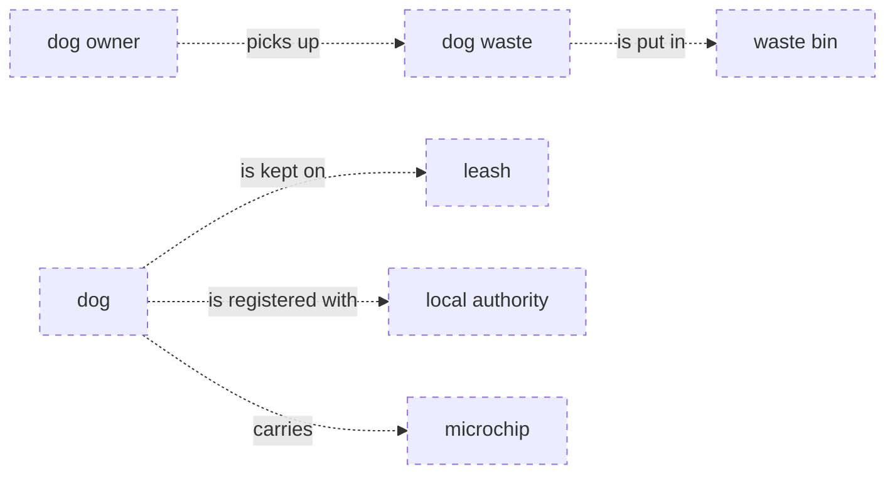

# pets-and-house-rules · level 1

**Version:** raw+e90c876 · **Release:** raw · This file holds level 1, the core of the domain.

Explain what it takes to own a dog or a cat in a residential complex, and which house rules apply to pets and their owners.

This is the raw release: it also holds elements that are not approved yet. They are marked
`● proposed` or `◐ waiting for approval`, and drawn dashed in the diagrams.

## Taxonomy

```mermaid
flowchart TB
    classDef draft stroke-dasharray: 5 5
    cn_01M82GJP3CRKNX3DNJZDNANDWM["dog"]
    cn_01M82GR8C6YNAW05QP8GX3MF7P["dog owner"]
    cn_01M82GQHZCWYDZ4FY134N19HRE["dog waste"]
    cn_01M82GPB8ZK0N7S1VR303H5EPB["leash"]
    cn_01M82GJP3CRKNX3DNJZDNANDWN["local authority"]
    cn_01M82GJP3CRKNX3DNJZDNANDWP["microchip"]
    cn_01M82GQHZCWYDZ4FY134N19HRF["waste bin"]
    class cn_01M82GJP3CRKNX3DNJZDNANDWM,cn_01M82GR8C6YNAW05QP8GX3MF7P,cn_01M82GQHZCWYDZ4FY134N19HRE,cn_01M82GPB8ZK0N7S1VR303H5EPB,cn_01M82GJP3CRKNX3DNJZDNANDWN,cn_01M82GJP3CRKNX3DNJZDNANDWP,cn_01M82GQHZCWYDZ4FY134N19HRF draft
```

## Concepts and relations

## Concepts

### dog · ● proposed

- **Level:** 1
- **Evidence:** [§1](#su_01M82GHYMP28WWGVJCAF7BMQCE), [§2](#su_01M82GHYMP28WWGVJCAF7BMQCF), [§4](#su_01M82GHYMP28WWGVJCAF7BMQCQ), [§5](#su_01M82GHYMP28WWGVJCAF7BMQCS), [§6](#su_01M82GHYMP28WWGVJCAF7BMQCV), [§7](#su_01M82GHYMQYRXNHXCXTMK9HDNY), [§9](#su_01M82GHYMQYRXNHXCXTMK9HDP3), [§10](#su_01M82GHYMQYRXNHXCXTMK9HDP5), [§11](#su_01M82GHYMQYRXNHXCXTMK9HDP7), [§12](#su_01M82GHYMQYRXNHXCXTMK9HDP9), [§13](#su_01M82GHYMQYRXNHXCXTMK9HDPB), [§14](#su_01M82GHYMQYRXNHXCXTMK9HDPD), [§15](#su_01M82GHYMQYRXNHXCXTMK9HDPE), [§16](#su_01M82GHYMR2WSZZZXCEPR86V3Q), [§17](#su_01M82GHYMR2WSZZZXCEPR86V3R), [§18](#su_01M82GHYMR2WSZZZXCEPR86V3T), [§19](#su_01M82GHYMR2WSZZZXCEPR86V3W)

### dog owner · ● proposed

- **Synonyms:** owner
- **Level:** 1
- **Evidence:** [§10](#su_01M82GHYMQYRXNHXCXTMK9HDP5), [§13](#su_01M82GHYMQYRXNHXCXTMK9HDPB), [§17](#su_01M82GHYMR2WSZZZXCEPR86V3R), [§19](#su_01M82GHYMR2WSZZZXCEPR86V3W)

### dog waste · ● proposed

- **Synonyms:** waste
- **Level:** 1
- **Evidence:** [§10](#su_01M82GHYMQYRXNHXCXTMK9HDP5)

### leash · ● proposed

- **Level:** 1
- **Evidence:** [§8](#su_01M82GHYMQYRXNHXCXTMK9HDP1), [§9](#su_01M82GHYMQYRXNHXCXTMK9HDP3), [§19](#su_01M82GHYMR2WSZZZXCEPR86V3W)

### local authority · ● proposed

- **Level:** 1
- **Evidence:** [§2](#su_01M82GHYMP28WWGVJCAF7BMQCF), [§3](#su_01M82GHYMP28WWGVJCAF7BMQCN), [§19](#su_01M82GHYMR2WSZZZXCEPR86V3W)

### microchip · ● proposed

- **Level:** 1
- **Evidence:** [§2](#su_01M82GHYMP28WWGVJCAF7BMQCF), [§18](#su_01M82GHYMR2WSZZZXCEPR86V3T)

### waste bin · ● proposed

- **Level:** 1
- **Evidence:** [§10](#su_01M82GHYMQYRXNHXCXTMK9HDP5)

## Relations

### carries · ● proposed

- [dog](#cn_01M82GJP3CRKNX3DNJZDNANDWM) — carries → [microchip](#cn_01M82GJP3CRKNX3DNJZDNANDWP)
- **Level:** 1
- **Evidence:** [§2](#su_01M82GHYMP28WWGVJCAF7BMQCF)

### is kept on · ● proposed

- [dog](#cn_01M82GJP3CRKNX3DNJZDNANDWM) — is kept on → [leash](#cn_01M82GPB8ZK0N7S1VR303H5EPB)
- **Level:** 1
- **Evidence:** [§19](#su_01M82GHYMR2WSZZZXCEPR86V3W)

### is liable for · ● proposed

- [dog owner](#cn_01M82GR8C6YNAW05QP8GX3MF7P) — is liable for → damage
- **Level:** 1
- **Evidence:** [§19](#su_01M82GHYMR2WSZZZXCEPR86V3W)

### is put in · ● proposed

- [dog waste](#cn_01M82GQHZCWYDZ4FY134N19HRE) — is put in → [waste bin](#cn_01M82GQHZCWYDZ4FY134N19HRF)
- **Level:** 1
- **Evidence:** [§10](#su_01M82GHYMQYRXNHXCXTMK9HDP5)

### is registered with · ● proposed

- [dog](#cn_01M82GJP3CRKNX3DNJZDNANDWM) — is registered with → [local authority](#cn_01M82GJP3CRKNX3DNJZDNANDWN)
- **Level:** 1
- **Evidence:** [§2](#su_01M82GHYMP28WWGVJCAF7BMQCF)

### picks up · ● proposed

- [dog owner](#cn_01M82GR8C6YNAW05QP8GX3MF7P) — picks up → [dog waste](#cn_01M82GQHZCWYDZ4FY134N19HRE)
- **Level:** 1
- **Evidence:** [§10](#su_01M82GHYMQYRXNHXCXTMK9HDP5)

## Rules

### Always pick up dog waste and bin it · ● proposed

owner **must** always pick up the dog's waste and put it in a waste bin

- **Refers to:** [dog waste](#cn_01M82GQHZCWYDZ4FY134N19HRE), [waste bin](#cn_01M82GQHZCWYDZ4FY134N19HRF), [dog owner](#cn_01M82GR8C6YNAW05QP8GX3MF7P), [picks up](#rl_01M82GQHZCWYDZ4FY134N19HRH), [is put in](#rl_01M82GQHZCWYDZ4FY134N19HRJ)
- **Applies to:** co_01M82GHYMN49VHXB6YMXXC893Z
- **Level:** 1
- **Evidence:** [§10](#su_01M82GHYMQYRXNHXCXTMK9HDP5)

### Dogs older than 4 months must be registered · ● proposed

dog **must** be registered with the local authority

- **When:** the dog is older than 4 months
- **Limit:** &gt; 4 months
- **Refers to:** [dog](#cn_01M82GJP3CRKNX3DNJZDNANDWM), [local authority](#cn_01M82GJP3CRKNX3DNJZDNANDWN), [is registered with](#rl_01M82GJP3CRKNX3DNJZDNANDWV)
- **Applies to:** co_01M82GHYMN49VHXB6YMXXC893Z
- **Level:** 1
- **Evidence:** [§2](#su_01M82GHYMP28WWGVJCAF7BMQCF)

### Dogs older than 4 months must carry a microchip · ● proposed

dog **must** carry a microchip

- **When:** the dog is older than 4 months
- **Limit:** &gt; 4 months
- **Refers to:** [dog](#cn_01M82GJP3CRKNX3DNJZDNANDWM), [microchip](#cn_01M82GJP3CRKNX3DNJZDNANDWP), [carries](#rl_01M82GJP3CRKNX3DNJZDNANDWW)
- **Applies to:** co_01M82GHYMN49VHXB6YMXXC893Z
- **Level:** 1
- **Evidence:** [§2](#su_01M82GHYMP28WWGVJCAF7BMQCF)

### Leash in public places · ● proposed

dog owner **must** keep the dog on a leash in public places

- **When:** unless a sign allows free running
- **Refers to:** [dog](#cn_01M82GJP3CRKNX3DNJZDNANDWM), [leash](#cn_01M82GPB8ZK0N7S1VR303H5EPB), public place, free-running sign, [is kept on](#rl_01M82GV0DCSP2BSTQA19ENCPJC), is located in
- **Applies to:** co_01M82GHYMN49VHXB6YMXXC893Z
- **Level:** 1
- **Evidence:** [§19](#su_01M82GHYMR2WSZZZXCEPR86V3W)

## Properties

_None at this level._

## Statements

### Dog microchip · ● proposed

A dog older than 4 months must carry a microchip.

- **Level:** 1
- **Evidence:** [§2](#su_01M82GHYMP28WWGVJCAF7BMQCF)

### Dog registration · ● proposed

A dog older than 4 months must be registered with the local authority.

- **Level:** 1
- **Evidence:** [§2](#su_01M82GHYMP28WWGVJCAF7BMQCF)

### Leash in public places · ● proposed

In public places, a dog must be kept on a leash unless a sign allows free running.

- **Level:** 1
- **Evidence:** [§19](#su_01M82GHYMR2WSZZZXCEPR86V3W)

### Owner liable for damage · ● proposed

The dog owner is liable for any damage the dog causes.

- **Level:** 1
- **Evidence:** [§19](#su_01M82GHYMR2WSZZZXCEPR86V3W)

### Pick up dog waste · ● proposed

The owner must always pick up the dog's waste and put it in a waste bin.

- **Level:** 1
- **Evidence:** [§10](#su_01M82GHYMQYRXNHXCXTMK9HDP5)

## Evidence

**§1** · 01-before-you-get-a-dog.md › 1. Before You Get a Dog

> A dog lives 10 to 15 years. It needs daily exercise, company, training and veterinary care for its whole life. Before you get a dog, check that your home, your working hours and your budget fit the dog you want.

**§2** · 01-before-you-get-a-dog.md › 1. Before You Get a Dog

> A dog older than 4 months must be registered with the local authority and must carry a microchip.

**§3** · 02-choosing-a-breed.md › 2. Choosing a Breed

> Some breeds are classified as dangerous by the local authority. Check the local list before you choose a breed.

**§4** · 03-health-and-care/01-feeding.md › 3. Health and Care — 3.1 Feeding

> Feed an adult dog twice a day and a puppy three to four times a day. Fresh water must always be available. Chocolate, grapes, onions and xylitol are poisonous to dogs.

**§5** · 03-health-and-care/02-vaccination-and-the-veterinarian.md › 3. Health and Care — 3.2 Vaccination and the Veterinarian

> A puppy receives its first vaccinations at 8 weeks of age. The rabies vaccination is mandatory and must be renewed every year. Take your dog to the veterinarian for a check-up at least once a year.

**§6** · 03-health-and-care/03-grooming-and-hygiene.md › 3. Health and Care — 3.3 Grooming and Hygiene

> Brush your dog at least once a week; long-haired breeds need brushing every day. Trim the claws when you can hear them clicking on the floor. Wash your dog's bed and blankets once a week at 60 °C.

**§7** · 04-puppy-basics.md › 4. Puppy Basics

> A puppy is a dog younger than 6 months. Puppies should not leave their mother before 8 weeks of age.

**§8** · 05-walking-and-the-leash/01-choosing-a-leash.md › 5. Walking and the Leash — 5.1 Choosing a Leash

> Use a leash of 1.5 to 2 metres for everyday walks. A retractable leash is not suitable in busy streets. Attach the leash to a well-fitting collar or harness: you should be able to slide two fingers under the collar.

**§9** · 05-walking-and-the-leash/02-leash-training.md › 5. Walking and the Leash — 5.2 Leash Training

> Start leash training when the puppy is 8 to 10 weeks old. Reward the dog when the leash is loose, and stop walking when the dog pulls. Never jerk the leash.

**§10** · 05-walking-and-the-leash/03-daily-walks.md › 5. Walking and the Leash — 5.3 Daily Walks

> An adult dog needs at least two walks a day: 30 to 60 minutes in total for small breeds and up to 2 hours for large and working breeds. A puppy must be taken outside to relieve itself every 2 to 3 hours. Always pick up your dog's waste and put it in a waste bin.

**§11** · 06-being-a-good-lead-for-your-dog.md › 6. Being a Good Lead for Your Dog

> Your dog looks to you for direction. Be its lead: a calm, consistent and confident leader whose signals it can trust.

**§12** · 06-being-a-good-lead-for-your-dog.md › 6. Being a Good Lead for Your Dog

> Set clear rules (for example, whether the dog may lie on the sofa) and keep them.

**§13** · 06-being-a-good-lead-for-your-dog.md › 6. Being a Good Lead for Your Dog

> A dog that does not see its owner as a reliable lead may become anxious or try to take control.

**§14** · 07-training-and-commands.md › 7. Training and Commands

> Every dog should learn five basic commands: *sit*, *down*, *stay*, *come* and *leave it*. Train in short sessions of 5 to 10 minutes, several times a day, and always end with a success.

**§15** · 07-training-and-commands.md › 7. Training and Commands

> A dog training course with a certified trainer is recommended in the first year. Dogs of breeds classified as dangerous must pass an obedience test.

**§16** · 08-leaving-your-dog-alone.md › 8. Leaving Your Dog Alone

> Dogs are social animals. **Never leave an adult dog alone at home for more than 6 hours.** Puppies should not be left alone for more than 2 hours.

**§17** · 08-leaving-your-dog-alone.md › 8. Leaving Your Dog Alone

> Before you leave, walk the dog, leave water and a safe chew toy, and keep your departure low-key. If your dog barks or howls while you are away, train it to be alone step by step, starting with a few minutes.

**§18** · 09-travelling-with-your-dog.md › 9. Travelling with Your Dog

> In a car, a dog must travel in a crate or wear a safety harness attached to the seat belt. Never leave a dog in a parked car in warm weather. For travel abroad, your dog needs a pet passport, a microchip and a valid rabies vaccination.

**§19** · 10-legal-obligations-and-responsibility.md › 10. Legal Obligations and Responsibility

> You are liable for any damage your dog causes. Third-party liability insurance for dog owners is strongly recommended, and it is mandatory for breeds classified as dangerous by the local authority. In public places, your dog must be kept on a leash unless a sign allows free running.
