# pets-and-house-rules · level 2

**Version:** raw+759da11 · **Release:** raw · This file holds levels 1 to 2; levels are cumulative.

Explain what it takes to own a dog or a cat in a residential complex, and which house rules apply to pets and their owners.

This is the raw release: it also holds elements that are not approved yet. They are marked
`● proposed` or `◐ waiting for approval`, and drawn dashed in the diagrams.

## Taxonomy

### Taxonomy of breed

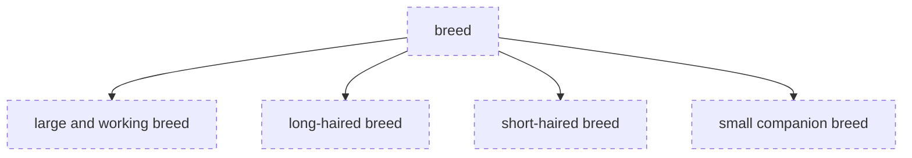

### Taxonomy of dog

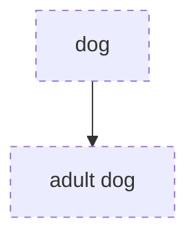

### Taxonomy of food poisonous to dogs

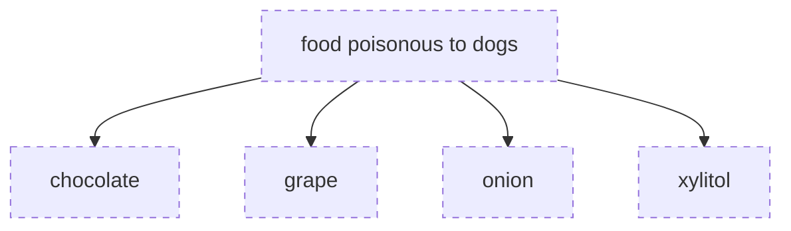

### Taxonomy of grooming

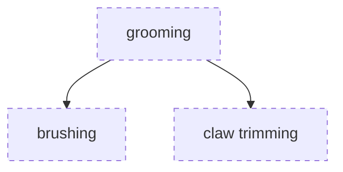

### Taxonomy of leash

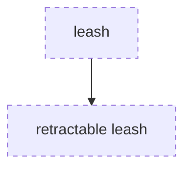

### Taxonomy of vaccination

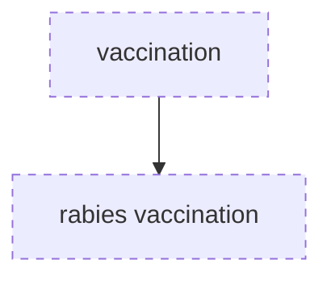

### Other concepts

### Other concepts

## Concepts and relations

### Relations under breed

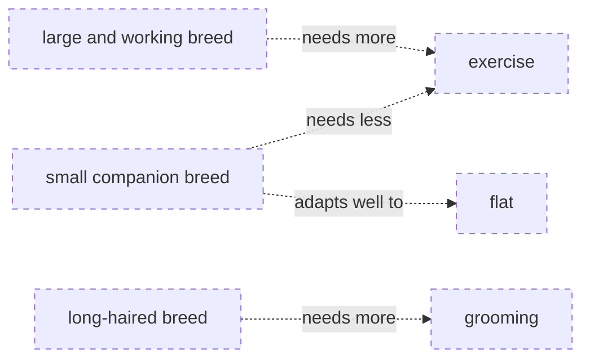

### Relations under dog

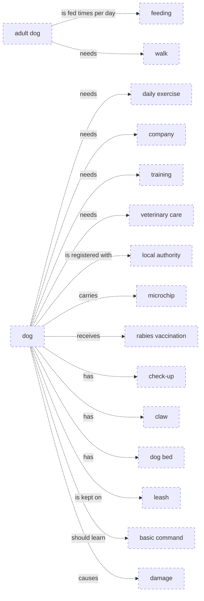

### Relations under dog training course

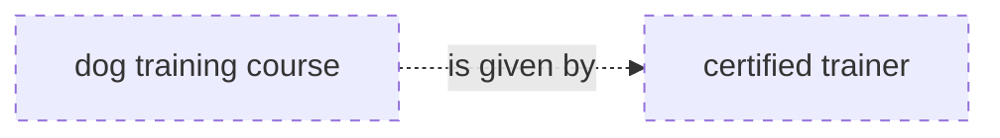

### Relations under dog waste

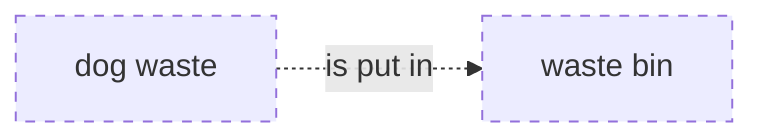

### Relations under family

### Relations under food poisonous to dogs

### Relations under free-running sign

### Relations under grooming

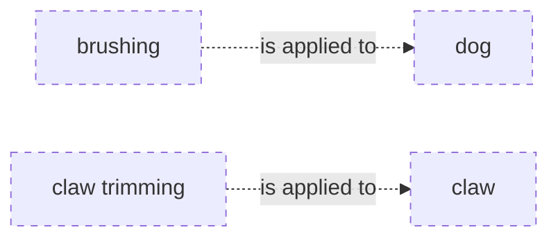

### Relations under leash

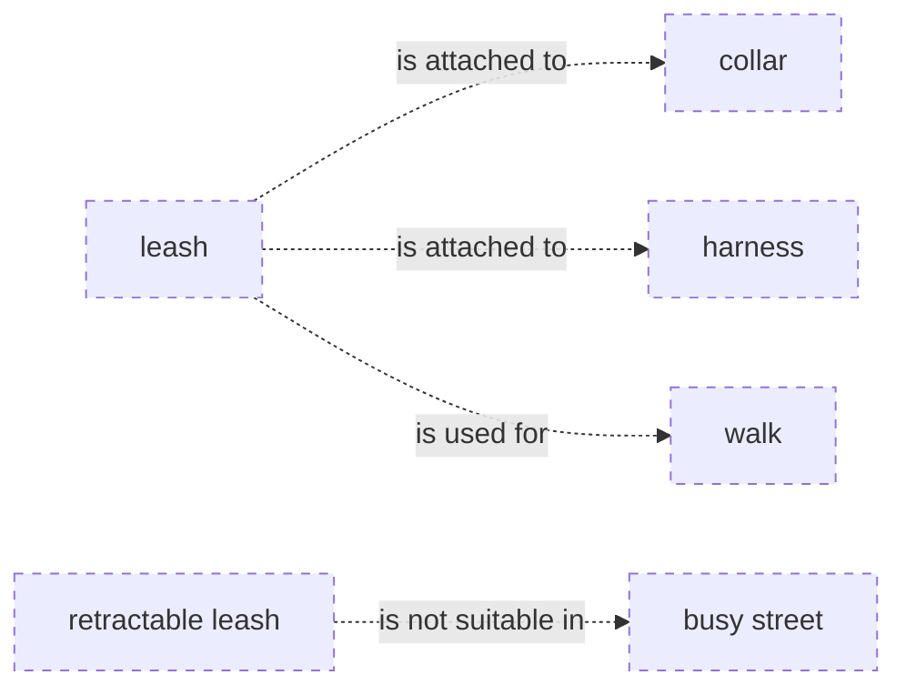

### Relations under leash training

### Relations under owner

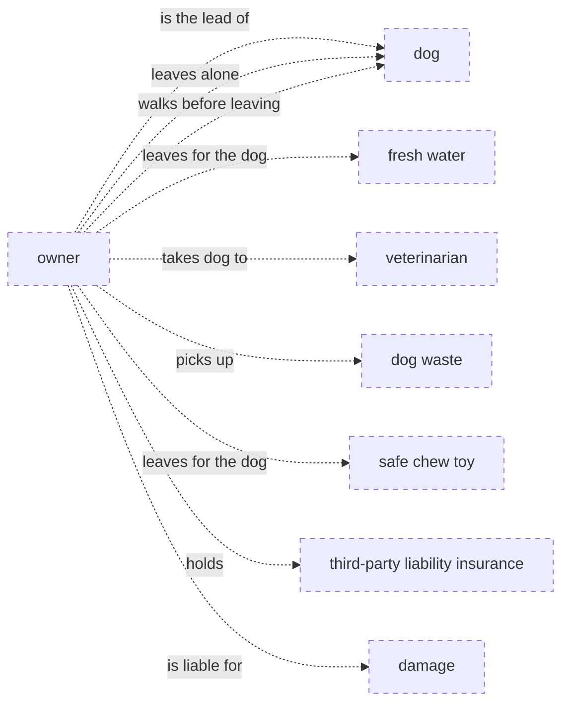

### Relations under reward

## Concepts

### adult dog · ● proposed

- **Is a:** [dog](#cn_01M82AC66KMJH32E2MQ3Z7ZBKM)
- **Level:** 2
- **Evidence:** [§8](#su_01M82ABDR1CAX5PFZ2HWSEQHBH), [§14](#su_01M82ABDR28HTPAFF4C44FRBZG), [§22](#su_01M82ABDR30PE47ZK8WSGY3HX2)

### basic command · ● proposed

- **Level:** 2
- **Evidence:** [§20](#su_01M82ABDR28HTPAFF4C44FRBZR)

### blanket · ● proposed

- **Synonyms:** blankets
- **Level:** 2
- **Evidence:** [§10](#su_01M82ABDR1CAX5PFZ2HWSEQHBN)

### breed · ● proposed

- **Level:** 2
- **Evidence:** [§3](#su_01M82ABDR1CAX5PFZ2HWSEQHBB), [§7](#su_01M82ABDR1CAX5PFZ2HWSEQHBF)

### brushing · ● proposed

- **Is a:** [grooming](#cn_01M82ACZDNRYXG7FZCA8KC7FD6)
- **Level:** 2
- **Evidence:** [§10](#su_01M82ABDR1CAX5PFZ2HWSEQHBN)

### busy street · ● proposed

- **Synonyms:** busy streets
- **Level:** 2
- **Evidence:** [§12](#su_01M82ABDR28HTPAFF4C44FRBZC)

### certified trainer · ● proposed

- **Level:** 2
- **Evidence:** [§21](#su_01M82ABDR28HTPAFF4C44FRBZS)

### check-up · ● proposed

- **Level:** 2
- **Evidence:** [§9](#su_01M82ABDR1CAX5PFZ2HWSEQHBK)

### chocolate · ● proposed

- **Is a:** [food poisonous to dogs](#cn_01M82ADJQKNCFSCKCDMA3H0R8A)
- **Level:** 2
- **Evidence:** [§8](#su_01M82ABDR1CAX5PFZ2HWSEQHBH)

### claw · ● proposed

- **Synonyms:** claws
- **Level:** 2
- **Evidence:** [§10](#su_01M82ABDR1CAX5PFZ2HWSEQHBN)

### claw trimming · ● proposed

- **Is a:** [grooming](#cn_01M82ACZDNRYXG7FZCA8KC7FD6)
- **Level:** 2
- **Evidence:** [§10](#su_01M82ABDR1CAX5PFZ2HWSEQHBN)

### collar · ● proposed

- **Level:** 2
- **Evidence:** [§12](#su_01M82ABDR28HTPAFF4C44FRBZC)

### command word · ● proposed

- **Level:** 2
- **Evidence:** [§16](#su_01M82ABDR28HTPAFF4C44FRBZK)

### company · ● proposed

- **Level:** 2
- **Evidence:** [§1](#su_01M82ABDR1CAX5PFZ2HWSEQHB8)

### daily exercise · ● proposed

- **Level:** 2
- **Evidence:** [§1](#su_01M82ABDR1CAX5PFZ2HWSEQHB8)

### damage · ● proposed

- **Level:** 2
- **Evidence:** [§25](#su_01M82ABDR30PE47ZK8WSGY3HX7)

### dog · ● proposed

A social animal.

- **Level:** 1
- **Evidence:** [§1](#su_01M82ABDR1CAX5PFZ2HWSEQHB8), [§2](#su_01M82ABDR1CAX5PFZ2HWSEQHB9), [§8](#su_01M82ABDR1CAX5PFZ2HWSEQHBH), [§9](#su_01M82ABDR1CAX5PFZ2HWSEQHBK), [§10](#su_01M82ABDR1CAX5PFZ2HWSEQHBN), [§11](#su_01M82ABDR28HTPAFF4C44FRBZ9), [§13](#su_01M82ABDR28HTPAFF4C44FRBZE), [§14](#su_01M82ABDR28HTPAFF4C44FRBZG), [§15](#su_01M82ABDR28HTPAFF4C44FRBZJ), [§19](#su_01M82ABDR28HTPAFF4C44FRBZP), [§20](#su_01M82ABDR28HTPAFF4C44FRBZR), [§21](#su_01M82ABDR28HTPAFF4C44FRBZS), [§22](#su_01M82ABDR30PE47ZK8WSGY3HX2), [§23](#su_01M82ABDR30PE47ZK8WSGY3HX3), [§24](#su_01M82ABDR30PE47ZK8WSGY3HX5), [§25](#su_01M82ABDR30PE47ZK8WSGY3HX7)

### dog bed · ● proposed

- **Synonyms:** bed
- **Level:** 2
- **Evidence:** [§10](#su_01M82ABDR1CAX5PFZ2HWSEQHBN)

### dog registration · ● proposed

- **Synonyms:** registered
- **Level:** 1
- **Evidence:** [§2](#su_01M82ABDR1CAX5PFZ2HWSEQHB9)

### dog training course · ● proposed

- **Level:** 2
- **Evidence:** [§21](#su_01M82ABDR28HTPAFF4C44FRBZS)

### dog waste · ● proposed

- **Synonyms:** waste
- **Level:** 1
- **Evidence:** [§14](#su_01M82ABDR28HTPAFF4C44FRBZG)

### exercise · ● proposed

- **Level:** 2
- **Evidence:** [§4](#su_01M82ABDR1CAX5PFZ2HWSEQHBC), [§5](#su_01M82ABDR1CAX5PFZ2HWSEQHBD)

### family · ● proposed

- **Level:** 2
- **Evidence:** [§16](#su_01M82ABDR28HTPAFF4C44FRBZK)

### feeding · ● proposed

- **Level:** 2
- **Evidence:** [§8](#su_01M82ABDR1CAX5PFZ2HWSEQHBH)

### flat · ● proposed

- **Synonyms:** flats
- **Level:** 2
- **Evidence:** [§4](#su_01M82ABDR1CAX5PFZ2HWSEQHBC)

### food poisonous to dogs · ● proposed

- **Synonyms:** poisonous
- **Level:** 2
- **Evidence:** [§8](#su_01M82ABDR1CAX5PFZ2HWSEQHBH)

### free-running sign · ● proposed

- **Synonyms:** sign allowing free running
- **Level:** 2
- **Evidence:** [§25](#su_01M82ABDR30PE47ZK8WSGY3HX7)

### fresh water · ● proposed

- **Synonyms:** water
- **Level:** 2
- **Evidence:** [§8](#su_01M82ABDR1CAX5PFZ2HWSEQHBH), [§23](#su_01M82ABDR30PE47ZK8WSGY3HX3)

### good behaviour · ● proposed

- **Level:** 2
- **Evidence:** [§18](#su_01M82ABDR28HTPAFF4C44FRBZN)

### grape · ● proposed

- **Synonyms:** grapes
- **Is a:** [food poisonous to dogs](#cn_01M82ADJQKNCFSCKCDMA3H0R8A)
- **Level:** 2
- **Evidence:** [§8](#su_01M82ABDR1CAX5PFZ2HWSEQHBH)

### grooming · ● proposed

- **Level:** 2
- **Evidence:** [§6](#su_01M82ABDR1CAX5PFZ2HWSEQHBE), [§10](#su_01M82ABDR1CAX5PFZ2HWSEQHBN)

### harness · ● proposed

- **Level:** 2
- **Evidence:** [§12](#su_01M82ABDR28HTPAFF4C44FRBZC)

### household rule for the dog · ● proposed

- **Level:** 2
- **Evidence:** [§17](#su_01M82ABDR28HTPAFF4C44FRBZM)

### large and working breed · ● proposed

- **Synonyms:** large and working breeds
- **Is a:** [breed](#cn_01M82ACZDNRYXG7FZCA8KC7FCX)
- **Level:** 2
- **Evidence:** [§5](#su_01M82ABDR1CAX5PFZ2HWSEQHBD)

### large breed · ● proposed

- **Level:** 2
- **Evidence:** [§14](#su_01M82ABDR28HTPAFF4C44FRBZG)

### lead (leader) · ● proposed

A calm, consistent and confident leader whose signals the dog can trust.

- **Level:** 2
- **Evidence:** [§15](#su_01M82ABDR28HTPAFF4C44FRBZJ), [§19](#su_01M82ABDR28HTPAFF4C44FRBZP)

### leash · ● proposed

- **Level:** 1
- **Evidence:** [§12](#su_01M82ABDR28HTPAFF4C44FRBZC), [§13](#su_01M82ABDR28HTPAFF4C44FRBZE), [§25](#su_01M82ABDR30PE47ZK8WSGY3HX7)

### leash training · ● proposed

- **Level:** 2
- **Evidence:** [§13](#su_01M82ABDR28HTPAFF4C44FRBZE)

### leaving the dog alone · ● proposed

- **Level:** 2
- **Evidence:** [§22](#su_01M82ABDR30PE47ZK8WSGY3HX2), [§23](#su_01M82ABDR30PE47ZK8WSGY3HX3)

### local authority · ● proposed

- **Level:** 1
- **Evidence:** [§2](#su_01M82ABDR1CAX5PFZ2HWSEQHB9), [§7](#su_01M82ABDR1CAX5PFZ2HWSEQHBF), [§25](#su_01M82ABDR30PE47ZK8WSGY3HX7)

### long-haired breed · ● proposed

- **Synonyms:** long-haired breeds
- **Is a:** [breed](#cn_01M82ACZDNRYXG7FZCA8KC7FCX)
- **Level:** 2
- **Evidence:** [§6](#su_01M82ABDR1CAX5PFZ2HWSEQHBE), [§10](#su_01M82ABDR1CAX5PFZ2HWSEQHBN)

### microchip · ● proposed

- **Level:** 1
- **Evidence:** [§2](#su_01M82ABDR1CAX5PFZ2HWSEQHB9), [§24](#su_01M82ABDR30PE47ZK8WSGY3HX5)

### onion · ● proposed

- **Synonyms:** onions
- **Is a:** [food poisonous to dogs](#cn_01M82ADJQKNCFSCKCDMA3H0R8A)
- **Level:** 2
- **Evidence:** [§8](#su_01M82ABDR1CAX5PFZ2HWSEQHBH)

### owner · ● proposed

- **Synonyms:** dog owner
- **Level:** 1
- **Evidence:** [§9](#su_01M82ABDR1CAX5PFZ2HWSEQHBK), [§14](#su_01M82ABDR28HTPAFF4C44FRBZG), [§19](#su_01M82ABDR28HTPAFF4C44FRBZP), [§23](#su_01M82ABDR30PE47ZK8WSGY3HX3), [§25](#su_01M82ABDR30PE47ZK8WSGY3HX7)

### public place · ● proposed

- **Level:** 2
- **Evidence:** [§25](#su_01M82ABDR30PE47ZK8WSGY3HX7)

### rabies vaccination · ● proposed

- **Is a:** [vaccination](#cn_01M82AE56ZYS5Y2Z0C35ECC9Y9)
- **Level:** 2
- **Evidence:** [§9](#su_01M82ABDR1CAX5PFZ2HWSEQHBK), [§24](#su_01M82ABDR30PE47ZK8WSGY3HX5)

### retractable leash · ● proposed

- **Is a:** [leash](#cn_01M82AFTZDSHCD0SK6T4N2YZW6)
- **Level:** 2
- **Evidence:** [§12](#su_01M82ABDR28HTPAFF4C44FRBZC)

### reward · ● proposed

- **Level:** 2
- **Evidence:** [§18](#su_01M82ABDR28HTPAFF4C44FRBZN)

### safe chew toy · ● proposed

- **Synonyms:** chew toy
- **Level:** 2
- **Evidence:** [§23](#su_01M82ABDR30PE47ZK8WSGY3HX3)

### short-haired breed · ● proposed

- **Synonyms:** short-haired breeds
- **Is a:** [breed](#cn_01M82ACZDNRYXG7FZCA8KC7FCX)
- **Level:** 2
- **Evidence:** [§6](#su_01M82ABDR1CAX5PFZ2HWSEQHBE)

### small breed · ● proposed

- **Level:** 2
- **Evidence:** [§14](#su_01M82ABDR28HTPAFF4C44FRBZG)

### small companion breed · ● proposed

- **Synonyms:** small companion breeds
- **Is a:** [breed](#cn_01M82ACZDNRYXG7FZCA8KC7FCX)
- **Level:** 2
- **Evidence:** [§4](#su_01M82ABDR1CAX5PFZ2HWSEQHBC)

### third-party liability insurance · ● proposed

- **Level:** 2
- **Evidence:** [§25](#su_01M82ABDR30PE47ZK8WSGY3HX7)

### training · ● proposed

- **Level:** 2
- **Evidence:** [§1](#su_01M82ABDR1CAX5PFZ2HWSEQHB8)

### training session · ● proposed

- **Level:** 2
- **Evidence:** [§20](#su_01M82ABDR28HTPAFF4C44FRBZR)

### unwanted behaviour · ● proposed

- **Level:** 2
- **Evidence:** [§18](#su_01M82ABDR28HTPAFF4C44FRBZN)

### vaccination · ● proposed

- **Level:** 2
- **Evidence:** [§9](#su_01M82ABDR1CAX5PFZ2HWSEQHBK)

### veterinarian · ● proposed

- **Level:** 2
- **Evidence:** [§9](#su_01M82ABDR1CAX5PFZ2HWSEQHBK)

### veterinary care · ● proposed

- **Level:** 2
- **Evidence:** [§1](#su_01M82ABDR1CAX5PFZ2HWSEQHB8)

### walk · ● proposed

- **Synonyms:** everyday walks
- **Level:** 2
- **Evidence:** [§12](#su_01M82ABDR28HTPAFF4C44FRBZC), [§14](#su_01M82ABDR28HTPAFF4C44FRBZG), [§23](#su_01M82ABDR30PE47ZK8WSGY3HX3)

### waste bin · ● proposed

- **Level:** 1
- **Evidence:** [§14](#su_01M82ABDR28HTPAFF4C44FRBZG)

### working breed · ● proposed

- **Level:** 2
- **Evidence:** [§14](#su_01M82ABDR28HTPAFF4C44FRBZG)

### xylitol · ● proposed

- **Is a:** [food poisonous to dogs](#cn_01M82ADJQKNCFSCKCDMA3H0R8A)
- **Level:** 2
- **Evidence:** [§8](#su_01M82ABDR1CAX5PFZ2HWSEQHBH)

## Relations

### adapts well to · ● proposed

- [small companion breed](#cn_01M82ACZDNRYXG7FZCA8KC7FCY) — adapts well to → [flat](#cn_01M82ACZDNRYXG7FZCA8KC7FD5)
- **Level:** 2
- **Evidence:** [§4](#su_01M82ABDR1CAX5PFZ2HWSEQHBC)

### carries · ● proposed

- [dog](#cn_01M82AC66KMJH32E2MQ3Z7ZBKM) — carries → [microchip](#cn_01M82AC66KMJH32E2MQ3Z7ZBKT)
- **Level:** 1
- **Evidence:** [§2](#su_01M82ABDR1CAX5PFZ2HWSEQHB9)

### causes · ● proposed

- [dog](#cn_01M82AC66KMJH32E2MQ3Z7ZBKM) — causes → [damage](#cn_01M82AM9P6EWS5D1VJCAH8Z7VF)
- **Level:** 2
- **Evidence:** [§25](#su_01M82ABDR30PE47ZK8WSGY3HX7)

### has · ● proposed

- [dog](#cn_01M82AC66KMJH32E2MQ3Z7ZBKM) — has → [check-up](#cn_01M82AE56ZYS5Y2Z0C35ECC9YC)
- **Level:** 2
- **Evidence:** [§9](#su_01M82ABDR1CAX5PFZ2HWSEQHBK)

### has · ● proposed

- [dog](#cn_01M82AC66KMJH32E2MQ3Z7ZBKM) — has → [claw](#cn_01M82AEQW4JVCNX0WEDNNR61W4)
- **Level:** 2
- **Evidence:** [§10](#su_01M82ABDR1CAX5PFZ2HWSEQHBN)

### has · ● proposed

- [dog](#cn_01M82AC66KMJH32E2MQ3Z7ZBKM) — has → [dog bed](#cn_01M82AEQW4JVCNX0WEDNNR61W5)
- **Level:** 2
- **Evidence:** [§10](#su_01M82ABDR1CAX5PFZ2HWSEQHBN)

### holds · ● proposed

- [owner](#cn_01M82AE56ZYS5Y2Z0C35ECC9Y8) — holds → [third-party liability insurance](#cn_01M82AM9P6EWS5D1VJCAH8Z7VA)
- **Level:** 2
- **Evidence:** [§25](#su_01M82ABDR30PE47ZK8WSGY3HX7)

### is applied to · ● proposed

- [claw trimming](#cn_01M82AEQW4JVCNX0WEDNNR61W2) — is applied to → [claw](#cn_01M82AEQW4JVCNX0WEDNNR61W4)
- **Level:** 2
- **Evidence:** [§10](#su_01M82ABDR1CAX5PFZ2HWSEQHBN)

### is applied to · ● proposed

- [brushing](#cn_01M82AEQW4JVCNX0WEDNNR61W1) — is applied to → [dog](#cn_01M82AC66KMJH32E2MQ3Z7ZBKM)
- **Level:** 2
- **Evidence:** [§10](#su_01M82ABDR1CAX5PFZ2HWSEQHBN)

### is attached to · ● proposed

- [leash](#cn_01M82AFTZDSHCD0SK6T4N2YZW6) — is attached to → [collar](#cn_01M82AFTZDSHCD0SK6T4N2YZW8)
- **Level:** 2
- **Evidence:** [§12](#su_01M82ABDR28HTPAFF4C44FRBZC)

### is attached to · ● proposed

- [leash](#cn_01M82AFTZDSHCD0SK6T4N2YZW6) — is attached to → [harness](#cn_01M82AFTZDSHCD0SK6T4N2YZW9)
- **Level:** 2
- **Evidence:** [§12](#su_01M82ABDR28HTPAFF4C44FRBZC)

### is fed times per day · ● proposed

- [adult dog](#cn_01M82ADJQKNCFSCKCDMA3H0R86) — is fed times per day → [feeding](#cn_01M82ADJQKNCFSCKCDMA3H0R88)
- **Cardinality:** at least 2, at most 2
- **Level:** 2
- **Evidence:** [§8](#su_01M82ABDR1CAX5PFZ2HWSEQHBH)

### is given by · ● proposed

- [dog training course](#cn_01M82AJ8HWH90DHFSC2JB20DFY) — is given by → [certified trainer](#cn_01M82AJ8HWH90DHFSC2JB20DFZ)
- **Level:** 2
- **Evidence:** [§21](#su_01M82ABDR28HTPAFF4C44FRBZS)

### is given for · ● proposed

- [reward](#cn_01M82AHPS6SQKW9E9EPJYC3KMT) — is given for → [good behaviour](#cn_01M82AHPS6SQKW9E9EPJYC3KMR)
- **Level:** 2
- **Evidence:** [§18](#su_01M82ABDR28HTPAFF4C44FRBZN)

### is kept on · ● proposed

- [dog](#cn_01M82AC66KMJH32E2MQ3Z7ZBKM) — is kept on → [leash](#cn_01M82AFTZDSHCD0SK6T4N2YZW6)
- **Level:** 1
- **Evidence:** [§25](#su_01M82ABDR30PE47ZK8WSGY3HX7)

### is liable for · ● proposed

- [owner](#cn_01M82AE56ZYS5Y2Z0C35ECC9Y8) — is liable for → [damage](#cn_01M82AM9P6EWS5D1VJCAH8Z7VF)
- **Level:** 1
- **Evidence:** [§25](#su_01M82ABDR30PE47ZK8WSGY3HX7)

### is located in · ● proposed

- [free-running sign](#cn_01M82AM9P6EWS5D1VJCAH8Z7VG) — is located in → [public place](#cn_01M82AM9P6EWS5D1VJCAH8Z7VE)
- **Level:** 2
- **Evidence:** [§25](#su_01M82ABDR30PE47ZK8WSGY3HX7)

### is not suitable in · ● proposed

- [retractable leash](#cn_01M82AFTZDSHCD0SK6T4N2YZW7) — is not suitable in → [busy street](#cn_01M82AFTZDSHCD0SK6T4N2YZWB)
- **Level:** 2
- **Evidence:** [§12](#su_01M82ABDR28HTPAFF4C44FRBZC)

### is poisonous to · ● proposed

- [food poisonous to dogs](#cn_01M82ADJQKNCFSCKCDMA3H0R8A) — is poisonous to → [dog](#cn_01M82AC66KMJH32E2MQ3Z7ZBKM)
- **Level:** 2
- **Evidence:** [§8](#su_01M82ABDR1CAX5PFZ2HWSEQHBH)

### is put in · ● proposed

- [dog waste](#cn_01M82AH1GXVV72WP99JQXMH6XS) — is put in → [waste bin](#cn_01M82AH1GXVV72WP99JQXMH6XT)
- **Level:** 1
- **Evidence:** [§14](#su_01M82ABDR28HTPAFF4C44FRBZG)

### is registered with · ● proposed

- [dog](#cn_01M82AC66KMJH32E2MQ3Z7ZBKM) — is registered with → [local authority](#cn_01M82AC66KMJH32E2MQ3Z7ZBKS)
- **Level:** 1
- **Evidence:** [§2](#su_01M82ABDR1CAX5PFZ2HWSEQHB9)

### is the lead of · ● proposed

- [owner](#cn_01M82AE56ZYS5Y2Z0C35ECC9Y8) — is the lead of → [dog](#cn_01M82AC66KMJH32E2MQ3Z7ZBKM)
- **Level:** 2
- **Evidence:** [§15](#su_01M82ABDR28HTPAFF4C44FRBZJ), [§19](#su_01M82ABDR28HTPAFF4C44FRBZP)

### is used for · ● proposed

- [leash](#cn_01M82AFTZDSHCD0SK6T4N2YZW6) — is used for → [walk](#cn_01M82AFTZDSHCD0SK6T4N2YZWA)
- **Level:** 2
- **Evidence:** [§12](#su_01M82ABDR28HTPAFF4C44FRBZC)

### leaves alone · ● proposed

- [owner](#cn_01M82AE56ZYS5Y2Z0C35ECC9Y8) — leaves alone → [dog](#cn_01M82AC66KMJH32E2MQ3Z7ZBKM)
- **Level:** 2
- **Evidence:** [§22](#su_01M82ABDR30PE47ZK8WSGY3HX2), [§23](#su_01M82ABDR30PE47ZK8WSGY3HX3)

### leaves for the dog · ● proposed

- [owner](#cn_01M82AE56ZYS5Y2Z0C35ECC9Y8) — leaves for the dog → [fresh water](#cn_01M82ADJQKNCFSCKCDMA3H0R89)
- **Level:** 2
- **Evidence:** [§23](#su_01M82ABDR30PE47ZK8WSGY3HX3)

### leaves for the dog · ● proposed

- [owner](#cn_01M82AE56ZYS5Y2Z0C35ECC9Y8) — leaves for the dog → [safe chew toy](#cn_01M82AK1Z9HNB4ZNT1JN5CCR6R)
- **Level:** 2
- **Evidence:** [§23](#su_01M82ABDR30PE47ZK8WSGY3HX3)

### needs · ● proposed

- [dog](#cn_01M82AC66KMJH32E2MQ3Z7ZBKM) — needs → [daily exercise](#cn_01M82AC66KMJH32E2MQ3Z7ZBKN)
- **Level:** 2
- **Evidence:** [§1](#su_01M82ABDR1CAX5PFZ2HWSEQHB8)

### needs · ● proposed

- [dog](#cn_01M82AC66KMJH32E2MQ3Z7ZBKM) — needs → [company](#cn_01M82AC66KMJH32E2MQ3Z7ZBKP)
- **Level:** 2
- **Evidence:** [§1](#su_01M82ABDR1CAX5PFZ2HWSEQHB8)

### needs · ● proposed

- [dog](#cn_01M82AC66KMJH32E2MQ3Z7ZBKM) — needs → [training](#cn_01M82AC66KMJH32E2MQ3Z7ZBKQ)
- **Level:** 2
- **Evidence:** [§1](#su_01M82ABDR1CAX5PFZ2HWSEQHB8)

### needs · ● proposed

- [dog](#cn_01M82AC66KMJH32E2MQ3Z7ZBKM) — needs → [veterinary care](#cn_01M82AC66KMJH32E2MQ3Z7ZBKR)
- **Level:** 2
- **Evidence:** [§1](#su_01M82ABDR1CAX5PFZ2HWSEQHB8)

### needs · ● proposed

- [adult dog](#cn_01M82ADJQKNCFSCKCDMA3H0R86) — needs → [walk](#cn_01M82AFTZDSHCD0SK6T4N2YZWA)
- **Cardinality:** at least 2
- **Level:** 2
- **Evidence:** [§14](#su_01M82ABDR28HTPAFF4C44FRBZG)

### needs less · ● proposed

- [small companion breed](#cn_01M82ACZDNRYXG7FZCA8KC7FCY) — needs less → [exercise](#cn_01M82ACZDNRYXG7FZCA8KC7FD7)
- **Level:** 2
- **Evidence:** [§4](#su_01M82ABDR1CAX5PFZ2HWSEQHBC)

### needs more · ● proposed

- [long-haired breed](#cn_01M82ACZDNRYXG7FZCA8KC7FD0) — needs more → [grooming](#cn_01M82ACZDNRYXG7FZCA8KC7FD6)
- **Level:** 2
- **Evidence:** [§6](#su_01M82ABDR1CAX5PFZ2HWSEQHBE)

### needs more · ● proposed

- [large and working breed](#cn_01M82ACZDNRYXG7FZCA8KC7FCZ) — needs more → [exercise](#cn_01M82ACZDNRYXG7FZCA8KC7FD7)
- **Level:** 2
- **Evidence:** [§5](#su_01M82ABDR1CAX5PFZ2HWSEQHBD)

### picks up · ● proposed

- [owner](#cn_01M82AE56ZYS5Y2Z0C35ECC9Y8) — picks up → [dog waste](#cn_01M82AH1GXVV72WP99JQXMH6XS)
- **Level:** 1
- **Evidence:** [§14](#su_01M82ABDR28HTPAFF4C44FRBZG)

### receives · ● proposed

- [dog](#cn_01M82AC66KMJH32E2MQ3Z7ZBKM) — receives → [rabies vaccination](#cn_01M82AE56ZYS5Y2Z0C35ECC9YA)
- **Level:** 2
- **Evidence:** [§9](#su_01M82ABDR1CAX5PFZ2HWSEQHBK)

### should learn · ● proposed

- [dog](#cn_01M82AC66KMJH32E2MQ3Z7ZBKM) — should learn → [basic command](#cn_01M82AJ8HWH90DHFSC2JB20DFW)
- **Cardinality:** at least 5, at most 5
- **Level:** 2
- **Evidence:** [§20](#su_01M82ABDR28HTPAFF4C44FRBZR)

### takes dog to · ● proposed

- [owner](#cn_01M82AE56ZYS5Y2Z0C35ECC9Y8) — takes dog to → [veterinarian](#cn_01M82AE56ZYS5Y2Z0C35ECC9YB)
- **Level:** 2
- **Evidence:** [§9](#su_01M82ABDR1CAX5PFZ2HWSEQHBK)

### uses · ● proposed

- [leash training](#cn_01M82AG9DZ4Q7M3Z8RX016AKWJ) — uses → [leash](#cn_01M82AFTZDSHCD0SK6T4N2YZW6)
- **Level:** 2
- **Evidence:** [§13](#su_01M82ABDR28HTPAFF4C44FRBZE)

### uses · ● proposed

- [family](#cn_01M82AHPS6SQKW9E9EPJYC3KMP) — uses → [command word](#cn_01M82AHPS6SQKW9E9EPJYC3KMN)
- **Level:** 2
- **Evidence:** [§16](#su_01M82ABDR28HTPAFF4C44FRBZK)

### walks before leaving · ● proposed

- [owner](#cn_01M82AE56ZYS5Y2Z0C35ECC9Y8) — walks before leaving → [dog](#cn_01M82AC66KMJH32E2MQ3Z7ZBKM)
- **Level:** 2
- **Evidence:** [§23](#su_01M82ABDR30PE47ZK8WSGY3HX3)

## Rules

### Adult dog alone at most 6 hours · ● proposed

owner **must not** leave an adult dog alone at home for more than 6 hours

- **Limit:** ≤ 6 h
- **Refers to:** [adult dog](#cn_01M82ADJQKNCFSCKCDMA3H0R86), [owner](#cn_01M82AE56ZYS5Y2Z0C35ECC9Y8), [leaving the dog alone](#cn_01M82AK1Z8YRQBGAGXAECRMD6W), [leaves alone](#rl_01M82AK1Z9HNB4ZNT1JN5CCR6V)
- **Applies to:** co_01M82ABDR0997QP7DGZPPDNF4H
- **Level:** 2
- **Evidence:** [§22](#su_01M82ABDR30PE47ZK8WSGY3HX2)

### Adult dog needs at least two walks a day · ● proposed

owner **must** take an adult dog for walks every day

- **When:** the dog is an adult dog
- **Limit:** ≥ 2 walks per day
- **Refers to:** [adult dog](#cn_01M82ADJQKNCFSCKCDMA3H0R86), [walk](#cn_01M82AFTZDSHCD0SK6T4N2YZWA), [needs](#rl_01M82AH1GXVV72WP99JQXMH6XW)
- **Applies to:** co_01M82ABDR0997QP7DGZPPDNF4H
- **Level:** 2
- **Evidence:** [§14](#su_01M82ABDR28HTPAFF4C44FRBZG)

### Always pick up dog waste and put it in a waste bin · ● proposed

owner **must** always pick up the dog's waste and put it in a waste bin

- **Refers to:** [owner](#cn_01M82AE56ZYS5Y2Z0C35ECC9Y8), [dog waste](#cn_01M82AH1GXVV72WP99JQXMH6XS), [waste bin](#cn_01M82AH1GXVV72WP99JQXMH6XT), [picks up](#rl_01M82AH1GXVV72WP99JQXMH6XX), [is put in](#rl_01M82AH1GXVV72WP99JQXMH6XY)
- **Applies to:** co_01M82ABDR0997QP7DGZPPDNF4H
- **Level:** 1
- **Evidence:** [§14](#su_01M82ABDR28HTPAFF4C44FRBZG)

### Attach leash to well-fitting collar or harness · ● proposed

dog owner **must** attach the leash to a well-fitting collar or harness

- **Refers to:** [leash](#cn_01M82AFTZDSHCD0SK6T4N2YZW6), [collar](#cn_01M82AFTZDSHCD0SK6T4N2YZW8), [harness](#cn_01M82AFTZDSHCD0SK6T4N2YZW9), [is attached to](#rl_01M82AFTZDSHCD0SK6T4N2YZWC), [is attached to](#rl_01M82AFTZDSHCD0SK6T4N2YZWD)
- **Applies to:** co_01M82ABDR0997QP7DGZPPDNF4H
- **Level:** 2
- **Evidence:** [§12](#su_01M82ABDR28HTPAFF4C44FRBZC)

### Brush dog at least once a week · ● proposed

dog owner **must** brush the dog at least once a week

- **Limit:** ≥ 1 times per week
- **Refers to:** [dog](#cn_01M82AC66KMJH32E2MQ3Z7ZBKM), [brushing](#cn_01M82AEQW4JVCNX0WEDNNR61W1), [is applied to](#rl_01M82AEQW4JVCNX0WEDNNR61W9)
- **Applies to:** co_01M82ABDR0997QP7DGZPPDNF4H
- **Level:** 2
- **Evidence:** [§10](#su_01M82ABDR1CAX5PFZ2HWSEQHBN)

### Brush long-haired breeds daily · ● proposed

dog owner **must** brush the dog every day

- **When:** the dog is of a long-haired breed
- **Limit:** = 1 times per day
- **Refers to:** [long-haired breed](#cn_01M82ACZDNRYXG7FZCA8KC7FD0), [brushing](#cn_01M82AEQW4JVCNX0WEDNNR61W1)
- **Applies to:** co_01M82ABDR0997QP7DGZPPDNF4H
- **Level:** 2
- **Evidence:** [§10](#su_01M82ABDR1CAX5PFZ2HWSEQHBN)

### Check fit before getting a dog · ● proposed

person who wants to get a dog **must** check that their home, working hours and budget fit the dog they want

- **When:** before getting a dog
- **Refers to:** [dog](#cn_01M82AC66KMJH32E2MQ3Z7ZBKM)
- **Applies to:** co_01M82ABDR0997QP7DGZPPDNF4H
- **Level:** 2
- **Evidence:** [§1](#su_01M82ABDR1CAX5PFZ2HWSEQHB8)

### Do not shout at unwanted behaviour · ● proposed

owner **must not** shout at the dog for unwanted behaviour

- **Refers to:** [owner](#cn_01M82AE56ZYS5Y2Z0C35ECC9Y8), [unwanted behaviour](#cn_01M82AHPS6SQKW9E9EPJYC3KMS)
- **Applies to:** co_01M82ABDR0997QP7DGZPPDNF4H
- **Level:** 2
- **Evidence:** [§18](#su_01M82ABDR28HTPAFF4C44FRBZN)

### Dog microchip · ● proposed

dog owner **must** ensure the dog carries a microchip

- **When:** the dog is older than 4 months
- **Limit:** &gt; 4 months
- **Refers to:** [dog](#cn_01M82AC66KMJH32E2MQ3Z7ZBKM), [microchip](#cn_01M82AC66KMJH32E2MQ3Z7ZBKT), [carries](#rl_01M82AC66KMJH32E2MQ3Z7ZBM1)
- **Applies to:** co_01M82ABDR0997QP7DGZPPDNF4H
- **Level:** 1
- **Evidence:** [§2](#su_01M82ABDR1CAX5PFZ2HWSEQHB9)

### Dog registration · ● proposed

dog owner **must** register the dog with the local authority

- **When:** the dog is older than 4 months
- **Limit:** &gt; 4 months
- **Refers to:** [dog](#cn_01M82AC66KMJH32E2MQ3Z7ZBKM), [local authority](#cn_01M82AC66KMJH32E2MQ3Z7ZBKS), [dog registration](#cn_01M82AC66KMJH32E2MQ3Z7ZBKV), [is registered with](#rl_01M82AC66KMJH32E2MQ3Z7ZBM0)
- **Applies to:** co_01M82ABDR0997QP7DGZPPDNF4H
- **Level:** 1
- **Evidence:** [§2](#su_01M82ABDR1CAX5PFZ2HWSEQHB9)

### Dog should learn five basic commands · ● proposed

dog **must** learn the five basic commands sit, down, stay, come and leave it

- **Refers to:** [dog](#cn_01M82AC66KMJH32E2MQ3Z7ZBKM), [basic command](#cn_01M82AJ8HWH90DHFSC2JB20DFW), [should learn](#rl_01M82AJ8HWH90DHFSC2JB20DG3)
- **Applies to:** co_01M82ABDR0997QP7DGZPPDNF4H
- **Level:** 2
- **Evidence:** [§20](#su_01M82ABDR28HTPAFF4C44FRBZR)

### End training with a success · ● proposed

owner **must** always end a training session with a success

- **Refers to:** [training session](#cn_01M82AJ8HWH90DHFSC2JB20DFX)
- **Applies to:** co_01M82ABDR0997QP7DGZPPDNF4H
- **Level:** 2
- **Evidence:** [§20](#su_01M82ABDR28HTPAFF4C44FRBZR)

### Everyday leash at least 1.5 m · ● proposed

dog owner **must** use a leash of at least 1.5 metres for everyday walks

- **When:** on everyday walks
- **Limit:** ≥ 1.5 m
- **Refers to:** [leash](#cn_01M82AFTZDSHCD0SK6T4N2YZW6), [walk](#cn_01M82AFTZDSHCD0SK6T4N2YZWA), [is used for](#rl_01M82AFTZDSHCD0SK6T4N2YZWE)
- **Applies to:** co_01M82ABDR0997QP7DGZPPDNF4H
- **Level:** 2
- **Evidence:** [§12](#su_01M82ABDR28HTPAFF4C44FRBZC)

### Everyday leash at most 2 m · ● proposed

dog owner **must** use a leash of at most 2 metres for everyday walks

- **When:** on everyday walks
- **Limit:** ≤ 2 m
- **Refers to:** [leash](#cn_01M82AFTZDSHCD0SK6T4N2YZW6), [walk](#cn_01M82AFTZDSHCD0SK6T4N2YZWA), [is used for](#rl_01M82AFTZDSHCD0SK6T4N2YZWE)
- **Applies to:** co_01M82ABDR0997QP7DGZPPDNF4H
- **Level:** 2
- **Evidence:** [§12](#su_01M82ABDR28HTPAFF4C44FRBZC)

### Feed an adult dog twice a day · ● proposed

owner **must** feed an adult dog twice a day

- **Limit:** = 2 times per day
- **Refers to:** [adult dog](#cn_01M82ADJQKNCFSCKCDMA3H0R86), [feeding](#cn_01M82ADJQKNCFSCKCDMA3H0R88), [is fed times per day](#rl_01M82ADJQKNCFSCKCDMA3H0R8G)
- **Applies to:** co_01M82ABDR0997QP7DGZPPDNF4H
- **Level:** 2
- **Evidence:** [§8](#su_01M82ABDR1CAX5PFZ2HWSEQHBH)

### Fresh water always available · ● proposed

owner **must** keep fresh water always available to the dog

- **Refers to:** [dog](#cn_01M82AC66KMJH32E2MQ3Z7ZBKM), [fresh water](#cn_01M82ADJQKNCFSCKCDMA3H0R89)
- **Applies to:** co_01M82ABDR0997QP7DGZPPDNF4H
- **Level:** 2
- **Evidence:** [§8](#su_01M82ABDR1CAX5PFZ2HWSEQHBH)

### Ignore unwanted behaviour instead of shouting · ● proposed

owner **must** ignore unwanted behaviour instead of shouting

- **Refers to:** [owner](#cn_01M82AE56ZYS5Y2Z0C35ECC9Y8), [unwanted behaviour](#cn_01M82AHPS6SQKW9E9EPJYC3KMS)
- **Applies to:** co_01M82ABDR0997QP7DGZPPDNF4H
- **Level:** 2
- **Evidence:** [§18](#su_01M82ABDR28HTPAFF4C44FRBZN)

### Keep departure low-key · ● proposed

owner **must** keep the departure low-key

- **When:** when leaving the dog alone
- **Refers to:** [owner](#cn_01M82AE56ZYS5Y2Z0C35ECC9Y8), [leaving the dog alone](#cn_01M82AK1Z8YRQBGAGXAECRMD6W)
- **Applies to:** co_01M82ABDR0997QP7DGZPPDNF4H
- **Level:** 2
- **Evidence:** [§23](#su_01M82ABDR30PE47ZK8WSGY3HX3)

### Leash in public places · ● proposed

dog owner **must** keep the dog on a leash in public places

- **When:** unless a sign allows free running
- **Refers to:** [dog](#cn_01M82AC66KMJH32E2MQ3Z7ZBKM), [leash](#cn_01M82AFTZDSHCD0SK6T4N2YZW6), [public place](#cn_01M82AM9P6EWS5D1VJCAH8Z7VE), [free-running sign](#cn_01M82AM9P6EWS5D1VJCAH8Z7VG), [is kept on](#rl_01M82AM9P6EWS5D1VJCAH8Z7VM), [is located in](#rl_01M82AM9P6EWS5D1VJCAH8Z7VN)
- **Applies to:** co_01M82ABDR0997QP7DGZPPDNF4H
- **Level:** 1
- **Evidence:** [§25](#su_01M82ABDR30PE47ZK8WSGY3HX7)

### Leave water and a safe chew toy · ● proposed

owner **must** leave water and a safe chew toy for the dog

- **When:** before leaving the dog alone
- **Refers to:** [fresh water](#cn_01M82ADJQKNCFSCKCDMA3H0R89), [owner](#cn_01M82AE56ZYS5Y2Z0C35ECC9Y8), [safe chew toy](#cn_01M82AK1Z9HNB4ZNT1JN5CCR6R), [leaves for the dog](#rl_01M82AK1Z9HNB4ZNT1JN5CCR6X), [leaves for the dog](#rl_01M82AK1Z9HNB4ZNT1JN5CCR6Y)
- **Applies to:** co_01M82ABDR0997QP7DGZPPDNF4H
- **Level:** 2
- **Evidence:** [§23](#su_01M82ABDR30PE47ZK8WSGY3HX3)

### Liability insurance recommended · ● proposed

dog owner **may** take out third-party liability insurance (strongly recommended)

- **Refers to:** [owner](#cn_01M82AE56ZYS5Y2Z0C35ECC9Y8), [third-party liability insurance](#cn_01M82AM9P6EWS5D1VJCAH8Z7VA), [holds](#rl_01M82AM9P6EWS5D1VJCAH8Z7VP)
- **Applies to:** co_01M82ABDR0997QP7DGZPPDNF4H
- **Level:** 2
- **Evidence:** [§25](#su_01M82ABDR30PE47ZK8WSGY3HX7)

### Never jerk the leash · ● proposed

owner **must not** jerk the leash

- **Refers to:** [leash](#cn_01M82AFTZDSHCD0SK6T4N2YZW6), [uses](#rl_01M82AG9DZ4Q7M3Z8RX016AKWQ)
- **Applies to:** co_01M82ABDR0997QP7DGZPPDNF4H
- **Level:** 2
- **Evidence:** [§13](#su_01M82ABDR28HTPAFF4C44FRBZE)

### No retractable leash in busy streets · ● proposed

dog owner **must not** use a retractable leash

- **When:** in busy streets
- **Refers to:** [retractable leash](#cn_01M82AFTZDSHCD0SK6T4N2YZW7), [busy street](#cn_01M82AFTZDSHCD0SK6T4N2YZWB), [is not suitable in](#rl_01M82AFTZDSHCD0SK6T4N2YZWF)
- **Applies to:** co_01M82ABDR0997QP7DGZPPDNF4H
- **Level:** 2
- **Evidence:** [§12](#su_01M82ABDR28HTPAFF4C44FRBZC)

### Owner is liable for dog damage · ● proposed

dog owner **must** be liable for any damage the dog causes

- **Refers to:** [owner](#cn_01M82AE56ZYS5Y2Z0C35ECC9Y8), [damage](#cn_01M82AM9P6EWS5D1VJCAH8Z7VF), [is liable for](#rl_01M82AM9P6EWS5D1VJCAH8Z7VH), [causes](#rl_01M82AM9P6EWS5D1VJCAH8Z7VJ)
- **Applies to:** co_01M82ABDR0997QP7DGZPPDNF4H
- **Level:** 1
- **Evidence:** [§25](#su_01M82ABDR30PE47ZK8WSGY3HX7)

### Owner must be the dog's lead · ● proposed

owner **must** be the dog's lead: a calm, consistent and confident leader whose signals it can trust

- **Refers to:** [dog](#cn_01M82AC66KMJH32E2MQ3Z7ZBKM), [owner](#cn_01M82AE56ZYS5Y2Z0C35ECC9Y8), [lead (leader)](#cn_01M82AHPS6SQKW9E9EPJYC3KMM), [is the lead of](#rl_01M82AHPS6SQKW9E9EPJYC3KMV)
- **Applies to:** co_01M82ABDR0997QP7DGZPPDNF4H
- **Level:** 2
- **Evidence:** [§15](#su_01M82ABDR28HTPAFF4C44FRBZJ)

### Rabies vaccination is mandatory · ● proposed

owner **must** have the dog vaccinated against rabies

- **Refers to:** [dog](#cn_01M82AC66KMJH32E2MQ3Z7ZBKM), [owner](#cn_01M82AE56ZYS5Y2Z0C35ECC9Y8), [rabies vaccination](#cn_01M82AE56ZYS5Y2Z0C35ECC9YA), [receives](#rl_01M82AE56ZYS5Y2Z0C35ECC9YG)
- **Applies to:** co_01M82ABDR0997QP7DGZPPDNF4H
- **Level:** 2
- **Evidence:** [§9](#su_01M82ABDR1CAX5PFZ2HWSEQHBK)

### Rabies vaccination renewed every year · ● proposed

owner **must** renew the dog's rabies vaccination every year

- **Limit:** ≤ 1 year
- **Refers to:** [dog](#cn_01M82AC66KMJH32E2MQ3Z7ZBKM), [rabies vaccination](#cn_01M82AE56ZYS5Y2Z0C35ECC9YA), [receives](#rl_01M82AE56ZYS5Y2Z0C35ECC9YG)
- **Applies to:** co_01M82ABDR0997QP7DGZPPDNF4H
- **Level:** 2
- **Evidence:** [§9](#su_01M82ABDR1CAX5PFZ2HWSEQHBK)

### Reward good behaviour immediately · ● proposed

owner **must** reward good behaviour immediately

- **Refers to:** [owner](#cn_01M82AE56ZYS5Y2Z0C35ECC9Y8), [good behaviour](#cn_01M82AHPS6SQKW9E9EPJYC3KMR), [reward](#cn_01M82AHPS6SQKW9E9EPJYC3KMT), [is given for](#rl_01M82AHPS6SQKW9E9EPJYC3KMX)
- **Applies to:** co_01M82ABDR0997QP7DGZPPDNF4H
- **Level:** 2
- **Evidence:** [§18](#su_01M82ABDR28HTPAFF4C44FRBZN)

### Reward the dog when the leash is loose · ● proposed

owner **must** reward the dog

- **When:** when the leash is loose
- **Refers to:** [dog](#cn_01M82AC66KMJH32E2MQ3Z7ZBKM), [leash](#cn_01M82AFTZDSHCD0SK6T4N2YZW6), [leash training](#cn_01M82AG9DZ4Q7M3Z8RX016AKWJ)
- **Applies to:** co_01M82ABDR0997QP7DGZPPDNF4H
- **Level:** 2
- **Evidence:** [§13](#su_01M82ABDR28HTPAFF4C44FRBZE)

### Set clear rules and keep them · ● proposed

owner **must** set clear rules for the dog (for example, whether it may lie on the sofa) and keep them

- **Refers to:** [dog](#cn_01M82AC66KMJH32E2MQ3Z7ZBKM), [owner](#cn_01M82AE56ZYS5Y2Z0C35ECC9Y8), [household rule for the dog](#cn_01M82AHPS6SQKW9E9EPJYC3KMQ)
- **Applies to:** co_01M82ABDR0997QP7DGZPPDNF4H
- **Level:** 2
- **Evidence:** [§17](#su_01M82ABDR28HTPAFF4C44FRBZM)

### Stop walking when the dog pulls · ● proposed

owner **must** stop walking

- **When:** when the dog pulls
- **Refers to:** [dog](#cn_01M82AC66KMJH32E2MQ3Z7ZBKM), [leash training](#cn_01M82AG9DZ4Q7M3Z8RX016AKWJ)
- **Applies to:** co_01M82ABDR0997QP7DGZPPDNF4H
- **Level:** 2
- **Evidence:** [§13](#su_01M82ABDR28HTPAFF4C44FRBZE)

### Total daily walk time for large and working breeds · ● proposed

owner **must** walk an adult large or working breed dog up to 2 hours in total per day

- **When:** the adult dog is of a large or working breed
- **Limit:** ≤ 2 hours per day
- **Refers to:** [adult dog](#cn_01M82ADJQKNCFSCKCDMA3H0R86), [walk](#cn_01M82AFTZDSHCD0SK6T4N2YZWA), [large breed](#cn_01M82AH1GXVV72WP99JQXMH6XQ), [working breed](#cn_01M82AH1GXVV72WP99JQXMH6XR)
- **Applies to:** co_01M82ABDR0997QP7DGZPPDNF4H
- **Level:** 2
- **Evidence:** [§14](#su_01M82ABDR28HTPAFF4C44FRBZG)

### Total daily walk time for small breeds · ● proposed

owner **must** walk an adult small-breed dog 30 to 60 minutes in total per day

- **When:** the adult dog is of a small breed
- **Refers to:** [adult dog](#cn_01M82ADJQKNCFSCKCDMA3H0R86), [walk](#cn_01M82AFTZDSHCD0SK6T4N2YZWA), [small breed](#cn_01M82AH1GXVV72WP99JQXMH6XP)
- **Applies to:** co_01M82ABDR0997QP7DGZPPDNF4H
- **Level:** 2
- **Evidence:** [§14](#su_01M82ABDR28HTPAFF4C44FRBZG)

### Training course recommended in first year · ● proposed

owner **may** attend a dog training course with a certified trainer

- **When:** in the dog's first year (recommended)
- **Refers to:** [dog training course](#cn_01M82AJ8HWH90DHFSC2JB20DFY), [certified trainer](#cn_01M82AJ8HWH90DHFSC2JB20DFZ), [is given by](#rl_01M82AJ8HWH90DHFSC2JB20DG4)
- **Applies to:** co_01M82ABDR0997QP7DGZPPDNF4H
- **Level:** 2
- **Evidence:** [§21](#su_01M82ABDR28HTPAFF4C44FRBZS)

### Training session at least 5 minutes · ● proposed

owner **must** train in sessions of at least 5 minutes

- **Limit:** ≥ 5 min
- **Refers to:** [training session](#cn_01M82AJ8HWH90DHFSC2JB20DFX)
- **Applies to:** co_01M82ABDR0997QP7DGZPPDNF4H
- **Level:** 2
- **Evidence:** [§20](#su_01M82ABDR28HTPAFF4C44FRBZR)

### Training session at most 10 minutes · ● proposed

owner **must** train in short sessions of at most 10 minutes, several times a day

- **Limit:** ≤ 10 min
- **Refers to:** [training session](#cn_01M82AJ8HWH90DHFSC2JB20DFX)
- **Applies to:** co_01M82ABDR0997QP7DGZPPDNF4H
- **Level:** 2
- **Evidence:** [§20](#su_01M82ABDR28HTPAFF4C44FRBZR)

### Trim claws when they click · ● proposed

dog owner **must** trim the dog's claws

- **When:** the claws can be heard clicking on the floor
- **Refers to:** [claw trimming](#cn_01M82AEQW4JVCNX0WEDNNR61W2), [claw](#cn_01M82AEQW4JVCNX0WEDNNR61W4), [is applied to](#rl_01M82AEQW4JVCNX0WEDNNR61W8)
- **Applies to:** co_01M82ABDR0997QP7DGZPPDNF4H
- **Level:** 2
- **Evidence:** [§10](#su_01M82ABDR1CAX5PFZ2HWSEQHBN)

### Two fingers fit under collar · ● proposed

dog owner **must** be able to slide two fingers under the collar

- **Limit:** = 2 fingers
- **Refers to:** [collar](#cn_01M82AFTZDSHCD0SK6T4N2YZW8)
- **Applies to:** co_01M82ABDR0997QP7DGZPPDNF4H
- **Level:** 2
- **Evidence:** [§12](#su_01M82ABDR28HTPAFF4C44FRBZC)

### Use the same command words every time · ● proposed

owner **must** use the same command words every time and make sure everyone in the family uses them too

- **Refers to:** [owner](#cn_01M82AE56ZYS5Y2Z0C35ECC9Y8), [command word](#cn_01M82AHPS6SQKW9E9EPJYC3KMN), [family](#cn_01M82AHPS6SQKW9E9EPJYC3KMP), [uses](#rl_01M82AHPS6SQKW9E9EPJYC3KMW)
- **Applies to:** co_01M82ABDR0997QP7DGZPPDNF4H
- **Level:** 2
- **Evidence:** [§16](#su_01M82ABDR28HTPAFF4C44FRBZK)

### Walk the dog before leaving · ● proposed

owner **must** walk the dog

- **When:** before leaving the dog alone
- **Refers to:** [owner](#cn_01M82AE56ZYS5Y2Z0C35ECC9Y8), [walk](#cn_01M82AFTZDSHCD0SK6T4N2YZWA), [walks before leaving](#rl_01M82AK1Z9HNB4ZNT1JN5CCR6W)
- **Applies to:** co_01M82ABDR0997QP7DGZPPDNF4H
- **Level:** 2
- **Evidence:** [§23](#su_01M82ABDR30PE47ZK8WSGY3HX3)

### Wash bed and blankets weekly at 60 °C · ● proposed

dog owner **must** wash the dog's bed and blankets once a week

- **Limit:** = 1 times per week
- **Refers to:** [dog bed](#cn_01M82AEQW4JVCNX0WEDNNR61W5), [blanket](#cn_01M82AEQW4JVCNX0WEDNNR61W6), [has](#rl_01M82AEQW4JVCNX0WEDNNR61WA)
- **Applies to:** co_01M82ABDR0997QP7DGZPPDNF4H
- **Level:** 2
- **Evidence:** [§10](#su_01M82ABDR1CAX5PFZ2HWSEQHBN)

### Yearly veterinary check-up · ● proposed

owner **must** take the dog to the veterinarian for a check-up at least once a year

- **Limit:** ≥ 1 per year
- **Refers to:** [dog](#cn_01M82AC66KMJH32E2MQ3Z7ZBKM), [owner](#cn_01M82AE56ZYS5Y2Z0C35ECC9Y8), [veterinarian](#cn_01M82AE56ZYS5Y2Z0C35ECC9YB), [check-up](#cn_01M82AE56ZYS5Y2Z0C35ECC9YC), [takes dog to](#rl_01M82AE56ZYS5Y2Z0C35ECC9YE), [has](#rl_01M82AE56ZYS5Y2Z0C35ECC9YF)
- **Applies to:** co_01M82ABDR0997QP7DGZPPDNF4H
- **Level:** 2
- **Evidence:** [§9](#su_01M82ABDR1CAX5PFZ2HWSEQHBK)

## Properties

### Adult dog feeding frequency · ● proposed

- **Of:** [adult dog](#cn_01M82ADJQKNCFSCKCDMA3H0R86)
- **feeding frequency:** 2 times per day
- **Level:** 2
- **Evidence:** [§8](#su_01M82ABDR1CAX5PFZ2HWSEQHBH)

### Collar fit · ● proposed

- **Of:** [collar](#cn_01M82AFTZDSHCD0SK6T4N2YZW8)
- **fit:** two fingers can slide under the collar
- **Level:** 2
- **Evidence:** [§12](#su_01M82ABDR28HTPAFF4C44FRBZC)

### Daily walk time of large breeds · ● proposed

- **Of:** [large breed](#cn_01M82AH1GXVV72WP99JQXMH6XQ)
- **total daily walk time:** up to 2 hours
- **Level:** 2
- **Evidence:** [§14](#su_01M82ABDR28HTPAFF4C44FRBZG)

### Daily walk time of small breeds · ● proposed

- **Of:** [small breed](#cn_01M82AH1GXVV72WP99JQXMH6XP)
- **total daily walk time:** 30 to 60 minutes
- **Level:** 2
- **Evidence:** [§14](#su_01M82ABDR28HTPAFF4C44FRBZG)

### Daily walk time of working breeds · ● proposed

- **Of:** [working breed](#cn_01M82AH1GXVV72WP99JQXMH6XR)
- **total daily walk time:** up to 2 hours
- **Level:** 2
- **Evidence:** [§14](#su_01M82ABDR28HTPAFF4C44FRBZG)

### Dog lifespan · ● proposed

- **Of:** [dog](#cn_01M82AC66KMJH32E2MQ3Z7ZBKM)
- **lifespan:** 10 to 15 years
- **Level:** 2
- **Evidence:** [§1](#su_01M82ABDR1CAX5PFZ2HWSEQHB8)

### Everyday leash length · ● proposed

- **Of:** [leash](#cn_01M82AFTZDSHCD0SK6T4N2YZW6)
- **length for everyday walks:** 1.5 to 2 m
- **Level:** 2
- **Evidence:** [§12](#su_01M82ABDR28HTPAFF4C44FRBZC)

### Exercise need of large and working breeds · ● proposed

- **Of:** [large and working breed](#cn_01M82ACZDNRYXG7FZCA8KC7FCZ)
- **exercise need:** more
- **Level:** 2
- **Evidence:** [§5](#su_01M82ABDR1CAX5PFZ2HWSEQHBD)

### Exercise need of small companion breeds · ● proposed

- **Of:** [small companion breed](#cn_01M82ACZDNRYXG7FZCA8KC7FCY)
- **exercise need:** less
- **Level:** 2
- **Evidence:** [§4](#su_01M82ABDR1CAX5PFZ2HWSEQHBC)

### Grooming need of long-haired breeds · ● proposed

- **Of:** [long-haired breed](#cn_01M82ACZDNRYXG7FZCA8KC7FD0)
- **grooming need:** more than short-haired breeds
- **Level:** 2
- **Evidence:** [§6](#su_01M82ABDR1CAX5PFZ2HWSEQHBE)

### Maximum time an adult dog may be alone · ● proposed

- **Of:** [adult dog](#cn_01M82ADJQKNCFSCKCDMA3H0R86)
- **maximum time alone at home:** 6 h
- **Level:** 2
- **Evidence:** [§22](#su_01M82ABDR30PE47ZK8WSGY3HX2)

### Mental work need of large and working breeds · ● proposed

- **Of:** [large and working breed](#cn_01M82ACZDNRYXG7FZCA8KC7FCZ)
- **mental work need:** more
- **Level:** 2
- **Evidence:** [§5](#su_01M82ABDR1CAX5PFZ2HWSEQHBD)

### Minimum walks per day for an adult dog · ● proposed

- **Of:** [adult dog](#cn_01M82ADJQKNCFSCKCDMA3H0R86)
- **minimum walks per day:** 2 walks
- **Level:** 2
- **Evidence:** [§14](#su_01M82ABDR28HTPAFF4C44FRBZG)

### Number of basic commands · ● proposed

- **Of:** [basic command](#cn_01M82AJ8HWH90DHFSC2JB20DFW)
- **count:** 5
- **Level:** 2
- **Evidence:** [§20](#su_01M82ABDR28HTPAFF4C44FRBZR)

### Qualities of a good lead · ● proposed

- **Of:** [lead (leader)](#cn_01M82AHPS6SQKW9E9EPJYC3KMM)
- **qualities:** calm, consistent and confident; signals the dog can trust
- **Level:** 2
- **Evidence:** [§15](#su_01M82ABDR28HTPAFF4C44FRBZJ)

### Rabies vaccination renewal interval · ● proposed

- **Of:** [rabies vaccination](#cn_01M82AE56ZYS5Y2Z0C35ECC9YA)
- **renewal interval:** 1 year
- **Level:** 2
- **Evidence:** [§9](#su_01M82ABDR1CAX5PFZ2HWSEQHBK)

### Space need of large and working breeds · ● proposed

- **Of:** [large and working breed](#cn_01M82ACZDNRYXG7FZCA8KC7FCZ)
- **space need:** more
- **Level:** 2
- **Evidence:** [§5](#su_01M82ABDR1CAX5PFZ2HWSEQHBD)

### Space need of small companion breeds · ● proposed

- **Of:** [small companion breed](#cn_01M82ACZDNRYXG7FZCA8KC7FCY)
- **space need:** less
- **Level:** 2
- **Evidence:** [§4](#su_01M82ABDR1CAX5PFZ2HWSEQHBC)

### Training session frequency · ● proposed

- **Of:** [training session](#cn_01M82AJ8HWH90DHFSC2JB20DFX)
- **frequency:** several times a day
- **Level:** 2
- **Evidence:** [§20](#su_01M82ABDR28HTPAFF4C44FRBZR)

### Training session length · ● proposed

- **Of:** [training session](#cn_01M82AJ8HWH90DHFSC2JB20DFX)
- **duration:** 5 to 10 min
- **Level:** 2
- **Evidence:** [§20](#su_01M82ABDR28HTPAFF4C44FRBZR)

### Wash temperature for bed and blankets · ● proposed

- **Of:** [Wash bed and blankets weekly at 60 °C](#ru_01M82AEQW4JVCNX0WEDNNR61WE)
- **washing temperature:** 60 °C
- **Level:** 2
- **Evidence:** [§10](#su_01M82ABDR1CAX5PFZ2HWSEQHBN)

## Statements

### Adult dog alone at most 6 hours · ● proposed

An adult dog must never be left alone at home for more than 6 hours.

- **Level:** 2
- **Evidence:** [§22](#su_01M82ABDR30PE47ZK8WSGY3HX2)

### Adult dog feeding frequency · ● proposed

An adult dog is fed twice a day.

- **Level:** 2
- **Evidence:** [§8](#su_01M82ABDR1CAX5PFZ2HWSEQHBH)

### Adult dog walk frequency · ● proposed

An adult dog needs at least two walks a day.

- **Level:** 2
- **Evidence:** [§14](#su_01M82ABDR28HTPAFF4C44FRBZG)

### Breeds differ · ● proposed

Breeds differ in size, energy and the care they need.

- **Level:** 2
- **Evidence:** [§3](#su_01M82ABDR1CAX5PFZ2HWSEQHBB)

### Check fit before getting a dog · ● proposed

Before you get a dog, check that your home, your working hours and your budget fit the dog you want.

- **Level:** 2
- **Evidence:** [§1](#su_01M82ABDR1CAX5PFZ2HWSEQHB8)

### Claw trimming · ● proposed

Trim the dog's claws when you can hear them clicking on the floor.

- **Level:** 2
- **Evidence:** [§10](#su_01M82ABDR1CAX5PFZ2HWSEQHBN)

### Collar fit check · ● proposed

You should be able to slide two fingers under the collar.

- **Level:** 2
- **Evidence:** [§12](#su_01M82ABDR28HTPAFF4C44FRBZC)

### Daily brushing for long-haired breeds · ● proposed

Long-haired breeds need brushing every day.

- **Level:** 2
- **Evidence:** [§10](#su_01M82ABDR1CAX5PFZ2HWSEQHBN)

### Dog lifespan · ● proposed

A dog lives 10 to 15 years.

- **Level:** 1
- **Evidence:** [§1](#su_01M82ABDR1CAX5PFZ2HWSEQHB8)

### Dog looks to owner for direction · ● proposed

A dog looks to its owner for direction.

- **Level:** 2
- **Evidence:** [§15](#su_01M82ABDR28HTPAFF4C44FRBZJ)

### Dog microchip · ● proposed

A dog older than 4 months must carry a microchip.

- **Level:** 1
- **Evidence:** [§2](#su_01M82ABDR1CAX5PFZ2HWSEQHB9)

### Dog registration · ● proposed

A dog older than 4 months must be registered with the local authority.

- **Level:** 1
- **Evidence:** [§2](#su_01M82ABDR1CAX5PFZ2HWSEQHB9)

### Dogs are social · ● proposed

Dogs are social animals.

- **Level:** 2
- **Evidence:** [§22](#su_01M82ABDR30PE47ZK8WSGY3HX2)

### End with a success · ● proposed

A training session should always end with a success.

- **Level:** 2
- **Evidence:** [§20](#su_01M82ABDR28HTPAFF4C44FRBZR)

### Everyday leash length · ● proposed

A leash of 1.5 to 2 metres should be used for everyday walks.

- **Level:** 2
- **Evidence:** [§12](#su_01M82ABDR28HTPAFF4C44FRBZC)

### Five basic commands · ● proposed

Every dog should learn five basic commands: sit, down, stay, come and leave it.

- **Level:** 2
- **Evidence:** [§20](#su_01M82ABDR28HTPAFF4C44FRBZR)

### Foods poisonous to dogs · ● proposed

Chocolate, grapes, onions and xylitol are poisonous to dogs.

- **Level:** 2
- **Evidence:** [§8](#su_01M82ABDR1CAX5PFZ2HWSEQHBH)

### Fresh water always available · ● proposed

Fresh water must always be available.

- **Level:** 2
- **Evidence:** [§8](#su_01M82ABDR1CAX5PFZ2HWSEQHBH)

### Ignore unwanted behaviour · ● proposed

Unwanted behaviour should be ignored instead of shouting.

- **Level:** 2
- **Evidence:** [§18](#su_01M82ABDR28HTPAFF4C44FRBZN)

### Large and working breeds need more · ● proposed

Large and working breeds need more space, more exercise and more mental work.

- **Level:** 2
- **Evidence:** [§5](#su_01M82ABDR1CAX5PFZ2HWSEQHBD)

### Leash attachment · ● proposed

The leash is attached to a well-fitting collar or harness.

- **Level:** 2
- **Evidence:** [§12](#su_01M82ABDR28HTPAFF4C44FRBZC)

### Leash in public places · ● proposed

In public places, a dog must be kept on a leash unless a sign allows free running.

- **Level:** 1
- **Evidence:** [§25](#su_01M82ABDR30PE47ZK8WSGY3HX7)

### Liability insurance recommended · ● proposed

Third-party liability insurance for dog owners is strongly recommended.

- **Level:** 2
- **Evidence:** [§25](#su_01M82ABDR30PE47ZK8WSGY3HX7)

### Lifelong needs of a dog · ● proposed

A dog needs daily exercise, company, training and veterinary care for its whole life.

- **Level:** 1
- **Evidence:** [§1](#su_01M82ABDR1CAX5PFZ2HWSEQHB8)

### Long-haired breeds need more grooming · ● proposed

Long-haired breeds need more grooming than short-haired breeds.

- **Level:** 2
- **Evidence:** [§6](#su_01M82ABDR1CAX5PFZ2HWSEQHBE)

### Never jerk the leash · ● proposed

The leash is never jerked.

- **Level:** 2
- **Evidence:** [§13](#su_01M82ABDR28HTPAFF4C44FRBZE)

### Owner liable for dog damage · ● proposed

The dog owner is liable for any damage the dog causes.

- **Level:** 1
- **Evidence:** [§25](#su_01M82ABDR30PE47ZK8WSGY3HX7)

### Owner should be the dog's lead · ● proposed

The owner should be the dog's lead: a calm, consistent and confident leader whose signals the dog can trust.

- **Level:** 2
- **Evidence:** [§15](#su_01M82ABDR28HTPAFF4C44FRBZJ)

### Pick up dog waste · ● proposed

The owner must always pick up the dog's waste and put it in a waste bin.

- **Level:** 1
- **Evidence:** [§14](#su_01M82ABDR28HTPAFF4C44FRBZG)

### Preparing before leaving · ● proposed

Before leaving, the owner should walk the dog, leave water and a safe chew toy, and keep the departure low-key.

- **Level:** 2
- **Evidence:** [§23](#su_01M82ABDR30PE47ZK8WSGY3HX3)

### Rabies vaccination mandatory · ● proposed

The rabies vaccination is mandatory.

- **Level:** 2
- **Evidence:** [§9](#su_01M82ABDR1CAX5PFZ2HWSEQHBK)

### Rabies vaccination renewed yearly · ● proposed

The rabies vaccination must be renewed every year.

- **Level:** 2
- **Evidence:** [§9](#su_01M82ABDR1CAX5PFZ2HWSEQHBK)

### Retractable leash in busy streets · ● proposed

A retractable leash is not suitable in busy streets.

- **Level:** 2
- **Evidence:** [§12](#su_01M82ABDR28HTPAFF4C44FRBZC)

### Reward good behaviour immediately · ● proposed

Good behaviour should be rewarded immediately.

- **Level:** 2
- **Evidence:** [§18](#su_01M82ABDR28HTPAFF4C44FRBZN)

### Reward loose leash · ● proposed

The dog is rewarded when the leash is loose.

- **Level:** 2
- **Evidence:** [§13](#su_01M82ABDR28HTPAFF4C44FRBZE)

### Set and keep clear rules for the dog · ● proposed

The owner should set clear rules for the dog, such as whether it may lie on the sofa, and keep them.

- **Level:** 2
- **Evidence:** [§17](#su_01M82ABDR28HTPAFF4C44FRBZM)

### Small companion breeds suit flats · ● proposed

Small companion breeds need less space and less exercise and adapt well to flats.

- **Level:** 2
- **Evidence:** [§4](#su_01M82ABDR1CAX5PFZ2HWSEQHBC)

### Stop when dog pulls · ● proposed

The walk is stopped when the dog pulls.

- **Level:** 2
- **Evidence:** [§13](#su_01M82ABDR28HTPAFF4C44FRBZE)

### Training course recommended · ● proposed

A dog training course with a certified trainer is recommended in the first year.

- **Level:** 2
- **Evidence:** [§21](#su_01M82ABDR28HTPAFF4C44FRBZS)

### Training session length · ● proposed

Training is done in short sessions of 5 to 10 minutes, several times a day.

- **Level:** 2
- **Evidence:** [§20](#su_01M82ABDR28HTPAFF4C44FRBZR)

### Use the same command words · ● proposed

The same command words should be used every time, and everyone in the family should use them too.

- **Level:** 2
- **Evidence:** [§16](#su_01M82ABDR28HTPAFF4C44FRBZK)

### Walk time for large and working breeds · ● proposed

Large and working breeds need up to 2 hours of walking a day.

- **Level:** 2
- **Evidence:** [§14](#su_01M82ABDR28HTPAFF4C44FRBZG)

### Walk time for small breeds · ● proposed

Small breeds need 30 to 60 minutes of walking a day in total.

- **Level:** 2
- **Evidence:** [§14](#su_01M82ABDR28HTPAFF4C44FRBZG)

### Washing bed and blankets · ● proposed

Wash the dog's bed and blankets once a week at 60 °C.

- **Level:** 2
- **Evidence:** [§10](#su_01M82ABDR1CAX5PFZ2HWSEQHBN)

### Weekly brushing · ● proposed

A dog should be brushed at least once a week.

- **Level:** 2
- **Evidence:** [§10](#su_01M82ABDR1CAX5PFZ2HWSEQHBN)

### Yearly veterinary check-up · ● proposed

The owner must take the dog to the veterinarian for a check-up at least once a year.

- **Level:** 2
- **Evidence:** [§9](#su_01M82ABDR1CAX5PFZ2HWSEQHBK)

## Evidence

**§1** · 01-before-you-get-a-dog.md › 1. Before You Get a Dog

> A dog lives 10 to 15 years. It needs daily exercise, company, training and veterinary care for its whole life. Before you get a dog, check that your home, your working hours and your budget fit the dog you want.

**§2** · 01-before-you-get-a-dog.md › 1. Before You Get a Dog

> A dog older than 4 months must be registered with the local authority and must carry a microchip.

**§3** · 02-choosing-a-breed.md › 2. Choosing a Breed

> Breeds differ in size, energy and the care they need.

**§4** · 02-choosing-a-breed.md › 2. Choosing a Breed

> **Small companion breeds** (for example, Maltese or Pug) need less space and less exercise and adapt well to flats.

**§5** · 02-choosing-a-breed.md › 2. Choosing a Breed

> **Large and working breeds** (for example, Border Collie or German Shepherd) need more space, more exercise and more mental work.

**§6** · 02-choosing-a-breed.md › 2. Choosing a Breed

> **Long-haired breeds** need more grooming than short-haired breeds.

**§7** · 02-choosing-a-breed.md › 2. Choosing a Breed

> Some breeds are classified as dangerous by the local authority. Check the local list before you choose a breed.

**§8** · 03-health-and-care/01-feeding.md › 3. Health and Care — 3.1 Feeding

> Feed an adult dog twice a day and a puppy three to four times a day. Fresh water must always be available. Chocolate, grapes, onions and xylitol are poisonous to dogs.

**§9** · 03-health-and-care/02-vaccination-and-the-veterinarian.md › 3. Health and Care — 3.2 Vaccination and the Veterinarian

> A puppy receives its first vaccinations at 8 weeks of age. The rabies vaccination is mandatory and must be renewed every year. Take your dog to the veterinarian for a check-up at least once a year.

**§10** · 03-health-and-care/03-grooming-and-hygiene.md › 3. Health and Care — 3.3 Grooming and Hygiene

> Brush your dog at least once a week; long-haired breeds need brushing every day. Trim the claws when you can hear them clicking on the floor. Wash your dog's bed and blankets once a week at 60 °C.

**§11** · 04-puppy-basics.md › 4. Puppy Basics

> A puppy is a dog younger than 6 months. Puppies should not leave their mother before 8 weeks of age.

**§12** · 05-walking-and-the-leash/01-choosing-a-leash.md › 5. Walking and the Leash — 5.1 Choosing a Leash

> Use a leash of 1.5 to 2 metres for everyday walks. A retractable leash is not suitable in busy streets. Attach the leash to a well-fitting collar or harness: you should be able to slide two fingers under the collar.

**§13** · 05-walking-and-the-leash/02-leash-training.md › 5. Walking and the Leash — 5.2 Leash Training

> Start leash training when the puppy is 8 to 10 weeks old. Reward the dog when the leash is loose, and stop walking when the dog pulls. Never jerk the leash.

**§14** · 05-walking-and-the-leash/03-daily-walks.md › 5. Walking and the Leash — 5.3 Daily Walks

> An adult dog needs at least two walks a day: 30 to 60 minutes in total for small breeds and up to 2 hours for large and working breeds. A puppy must be taken outside to relieve itself every 2 to 3 hours. Always pick up your dog's waste and put it in a waste bin.

**§15** · 06-being-a-good-lead-for-your-dog.md › 6. Being a Good Lead for Your Dog

> Your dog looks to you for direction. Be its lead: a calm, consistent and confident leader whose signals it can trust.

**§16** · 06-being-a-good-lead-for-your-dog.md › 6. Being a Good Lead for Your Dog

> Use the same command words every time, and make sure everyone in the family uses them too.

**§17** · 06-being-a-good-lead-for-your-dog.md › 6. Being a Good Lead for Your Dog

> Set clear rules (for example, whether the dog may lie on the sofa) and keep them.

**§18** · 06-being-a-good-lead-for-your-dog.md › 6. Being a Good Lead for Your Dog

> Reward good behaviour immediately; ignore unwanted behaviour instead of shouting.

**§19** · 06-being-a-good-lead-for-your-dog.md › 6. Being a Good Lead for Your Dog

> A dog that does not see its owner as a reliable lead may become anxious or try to take control.

**§20** · 07-training-and-commands.md › 7. Training and Commands

> Every dog should learn five basic commands: *sit*, *down*, *stay*, *come* and *leave it*. Train in short sessions of 5 to 10 minutes, several times a day, and always end with a success.

**§21** · 07-training-and-commands.md › 7. Training and Commands

> A dog training course with a certified trainer is recommended in the first year. Dogs of breeds classified as dangerous must pass an obedience test.

**§22** · 08-leaving-your-dog-alone.md › 8. Leaving Your Dog Alone

> Dogs are social animals. **Never leave an adult dog alone at home for more than 6 hours.** Puppies should not be left alone for more than 2 hours.

**§23** · 08-leaving-your-dog-alone.md › 8. Leaving Your Dog Alone

> Before you leave, walk the dog, leave water and a safe chew toy, and keep your departure low-key. If your dog barks or howls while you are away, train it to be alone step by step, starting with a few minutes.

**§24** · 09-travelling-with-your-dog.md › 9. Travelling with Your Dog

> In a car, a dog must travel in a crate or wear a safety harness attached to the seat belt. Never leave a dog in a parked car in warm weather. For travel abroad, your dog needs a pet passport, a microchip and a valid rabies vaccination.

**§25** · 10-legal-obligations-and-responsibility.md › 10. Legal Obligations and Responsibility

> You are liable for any damage your dog causes. Third-party liability insurance for dog owners is strongly recommended, and it is mandatory for breeds classified as dangerous by the local authority. In public places, your dog must be kept on a leash unless a sign allows free running.
