# pets-and-house-rules · level 2

**Version:** raw+aa825e4 · **Release:** raw · This file holds levels 1 to 2; levels are cumulative.

Explain what it takes to own a dog or a cat in a residential complex, and which house rules apply to pets and their owners.

This is the raw release: it also holds elements that are not approved yet. They are marked
`● proposed` or `◐ waiting for approval`, and drawn dashed in the diagrams.

## Taxonomy

### Taxonomy of basic command

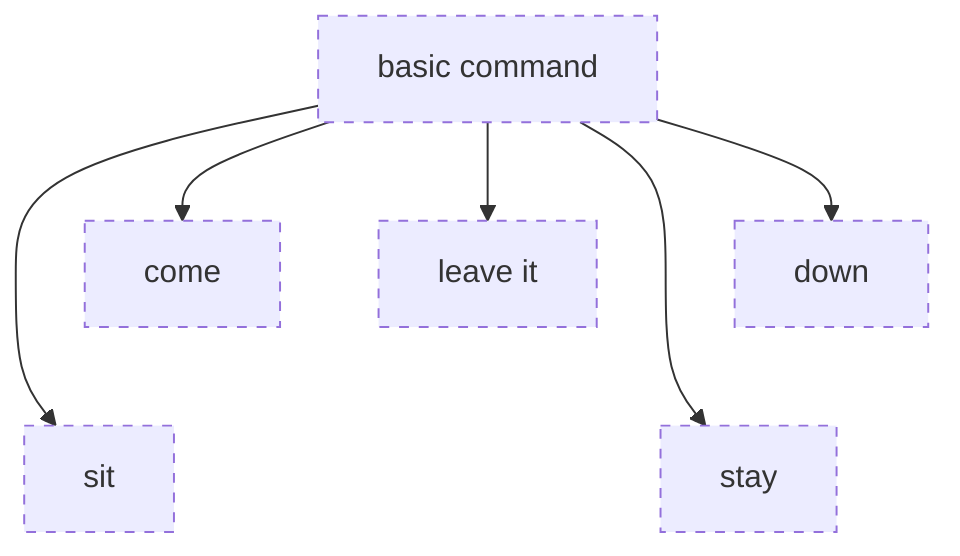

### Taxonomy of breed

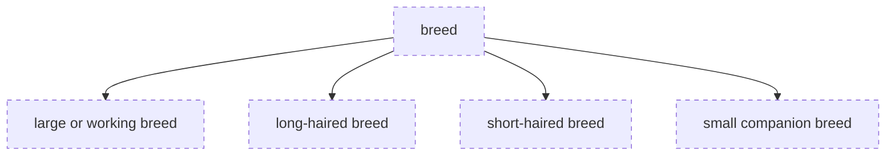

### Taxonomy of food poisonous to dogs

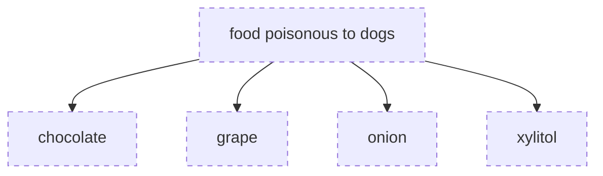

### Taxonomy of grooming

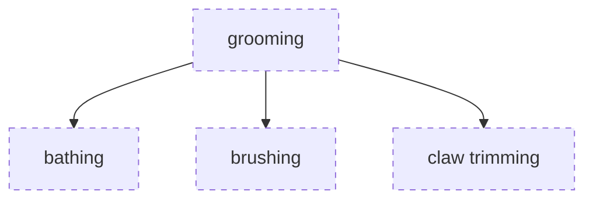

### Taxonomy of leash

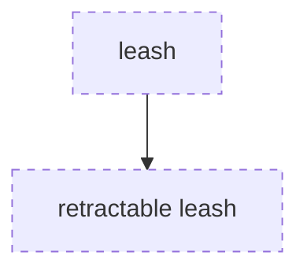

### Taxonomy of litter

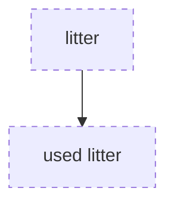

### Taxonomy of noise

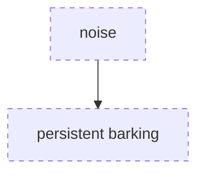

### Taxonomy of pet

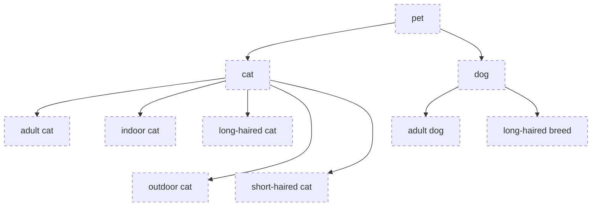

### Taxonomy of pet textile

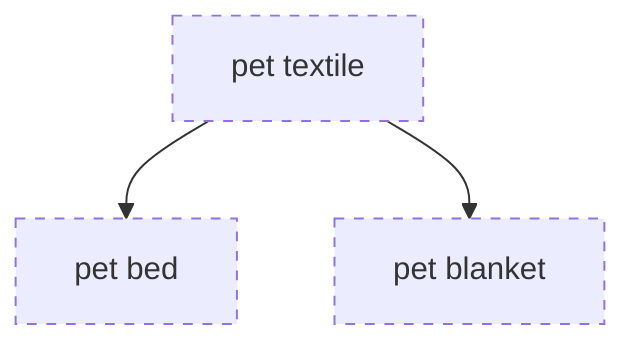

### Taxonomy of resident

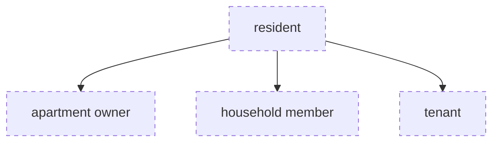

### Taxonomy of vaccination

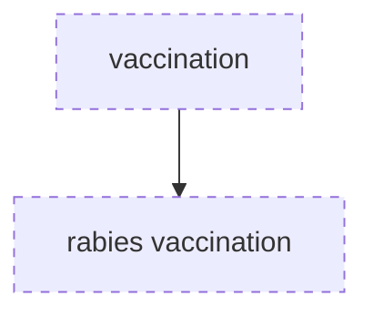

### Taxonomy of waste

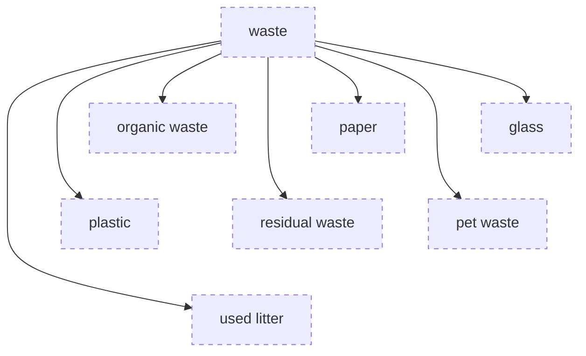

### Other concepts

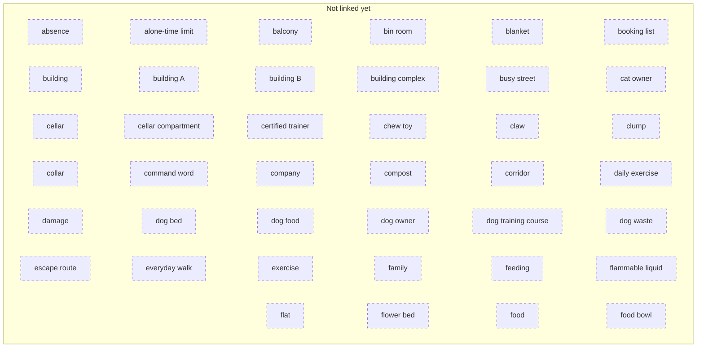

### Other concepts

```mermaid
flowchart TB
    classDef draft stroke-dasharray: 5 5
    subgraph unlinked["Not linked yet"]
    direction LR
        cn_01M82GV0DCSP2BSTQA19ENCPJ7["free-running sign"]
        cn_01M82GM2G3AM0SX444VHV3202J["fresh water"]
        cn_01M82GR8C6YNAW05QP8GX3MF7V["good behaviour"]
        cn_01M82GPB8ZK0N7S1VR303H5EPE["harness"]
        cn_01M82H7HBZP5REB8E6N9M29JTH["house management"]
        cn_01M82H7HBZP5REB8E6N9M29JTQ["house rules"]
        cn_01M82H7HBZP5REB8E6N9M29JTP["inner yard"]
        cn_01M82HCHQC6AK72JNVEQYR1KXR["key"]
        cn_01M82GQHZCWYDZ4FY134N19HRB["large breed"]
        cn_01M82HDB2F6BK5KDQ92WEFACHV["laundry slot"]
        cn_01M82GR8C6YNAW05QP8GX3MF7Q["lead (leader)"]
        cn_01M82GPTF0J0A1WWEWDR3G29FG["leash training"]
        cn_01M82GSR24145KC6KF8V0HWF9G["leaving the dog alone"]
        cn_01M82HA4JVD4MJZ6M8W4CVWNW0["lift"]
        cn_01M82H0CT7BJSF0Q3S0YPNSAE6["lily"]
        cn_01M82GZMM3VP80T7XD6GS67TSK["litter box"]
        cn_01M82GJP3CRKNX3DNJZDNANDWN["local authority"]
        cn_01M82HCHQC6AK72JNVEQYR1KXN["main door"]
        cn_01M82H394WWKSMY0HG5WFCNGAE["matting"]
        cn_01M82H0CT7BJSF0Q3S0YPNSAE4["meal"]
        cn_01M82H0CT7BJSF0Q3S0YPNSAE5["meat-based food"]
        cn_01M82GJP3CRKNX3DNJZDNANDWP["microchip"]
        cn_01M82GZMM3VP80T7XD6GS67TST["net"]
        cn_01M82H115ABPPRSFHS5N8011PE["neutering"]
        cn_01M82HBZKCWB6HP1MM7REEF3KK["pet equipment"]
        cn_01M82H94Y19DEFXTHPXP970KGF["pet owner"]
        cn_01M82H94Y19DEFXTHPXP970KGH["pet registration"]
        cn_01M82H2KZE881EPDPP32PV6RGF["play"]
        cn_01M82GYVMAZ9K3VZWRC41RP559["play and climbing place"]
        cn_01M82H83Q82K5CKBRM346N833D["public holiday"]
        cn_01M82GV0DCSP2BSTQA19ENCPJ6["public place"]
        cn_01M82H2KZE881EPDPP32PV6RGE["punishment"]
        cn_01M82H83Q82K5CKBRM346N8335["quiet hours"]
        cn_01M82HBAX7NMYFG8GE4P9Y56F8["residual waste bin"]
        cn_01M82GR8C6YNAW05QP8GX3MF7X["reward"]
        cn_01M82GR8C6YNAW05QP8GX3MF7T["rule for the dog"]
        cn_01M82GZMM3VP80T7XD6GS67TSM["scratching post"]
        cn_01M82HBZKCWB6HP1MM7REEF3KE["shared indoor space"]
        cn_01M82HDB2F6BK5KDQ92WEFACHJ["shared laundry room"]
        cn_01M82HDB2F6BK5KDQ92WEFACHQ["shared washing machine"]
        cn_01M82GV0DCSP2BSTQA19ENCPJ7 ~~~ cn_01M82GM2G3AM0SX444VHV3202J ~~~ cn_01M82GR8C6YNAW05QP8GX3MF7V ~~~ cn_01M82GPB8ZK0N7S1VR303H5EPE ~~~ cn_01M82H7HBZP5REB8E6N9M29JTH ~~~ cn_01M82H7HBZP5REB8E6N9M29JTQ
        cn_01M82H7HBZP5REB8E6N9M29JTP ~~~ cn_01M82HCHQC6AK72JNVEQYR1KXR ~~~ cn_01M82GQHZCWYDZ4FY134N19HRB ~~~ cn_01M82HDB2F6BK5KDQ92WEFACHV ~~~ cn_01M82GR8C6YNAW05QP8GX3MF7Q ~~~ cn_01M82GPTF0J0A1WWEWDR3G29FG
        cn_01M82GSR24145KC6KF8V0HWF9G ~~~ cn_01M82HA4JVD4MJZ6M8W4CVWNW0 ~~~ cn_01M82H0CT7BJSF0Q3S0YPNSAE6 ~~~ cn_01M82GZMM3VP80T7XD6GS67TSK ~~~ cn_01M82GJP3CRKNX3DNJZDNANDWN ~~~ cn_01M82HCHQC6AK72JNVEQYR1KXN
        cn_01M82H394WWKSMY0HG5WFCNGAE ~~~ cn_01M82H0CT7BJSF0Q3S0YPNSAE4 ~~~ cn_01M82H0CT7BJSF0Q3S0YPNSAE5 ~~~ cn_01M82GJP3CRKNX3DNJZDNANDWP ~~~ cn_01M82GZMM3VP80T7XD6GS67TST ~~~ cn_01M82H115ABPPRSFHS5N8011PE
        cn_01M82HBZKCWB6HP1MM7REEF3KK ~~~ cn_01M82H94Y19DEFXTHPXP970KGF ~~~ cn_01M82H94Y19DEFXTHPXP970KGH ~~~ cn_01M82H2KZE881EPDPP32PV6RGF ~~~ cn_01M82GYVMAZ9K3VZWRC41RP559 ~~~ cn_01M82H83Q82K5CKBRM346N833D
        cn_01M82GV0DCSP2BSTQA19ENCPJ6 ~~~ cn_01M82H2KZE881EPDPP32PV6RGE ~~~ cn_01M82H83Q82K5CKBRM346N8335 ~~~ cn_01M82HBAX7NMYFG8GE4P9Y56F8 ~~~ cn_01M82GR8C6YNAW05QP8GX3MF7X ~~~ cn_01M82GR8C6YNAW05QP8GX3MF7T
        cn_01M82GZMM3VP80T7XD6GS67TSM ~~~ cn_01M82HBZKCWB6HP1MM7REEF3KE ~~~ cn_01M82HDB2F6BK5KDQ92WEFACHJ ~~~ cn_01M82HDB2F6BK5KDQ92WEFACHQ
    end
    class cn_01M82GV0DCSP2BSTQA19ENCPJ7,cn_01M82GM2G3AM0SX444VHV3202J,cn_01M82GR8C6YNAW05QP8GX3MF7V,cn_01M82GPB8ZK0N7S1VR303H5EPE,cn_01M82H7HBZP5REB8E6N9M29JTH,cn_01M82H7HBZP5REB8E6N9M29JTQ,cn_01M82H7HBZP5REB8E6N9M29JTP,cn_01M82HCHQC6AK72JNVEQYR1KXR,cn_01M82GQHZCWYDZ4FY134N19HRB,cn_01M82HDB2F6BK5KDQ92WEFACHV,cn_01M82GR8C6YNAW05QP8GX3MF7Q,cn_01M82GPTF0J0A1WWEWDR3G29FG,cn_01M82GSR24145KC6KF8V0HWF9G,cn_01M82HA4JVD4MJZ6M8W4CVWNW0,cn_01M82H0CT7BJSF0Q3S0YPNSAE6,cn_01M82GZMM3VP80T7XD6GS67TSK,cn_01M82GJP3CRKNX3DNJZDNANDWN,cn_01M82HCHQC6AK72JNVEQYR1KXN,cn_01M82H394WWKSMY0HG5WFCNGAE,cn_01M82H0CT7BJSF0Q3S0YPNSAE4,cn_01M82H0CT7BJSF0Q3S0YPNSAE5,cn_01M82GJP3CRKNX3DNJZDNANDWP,cn_01M82GZMM3VP80T7XD6GS67TST,cn_01M82H115ABPPRSFHS5N8011PE,cn_01M82HBZKCWB6HP1MM7REEF3KK,cn_01M82H94Y19DEFXTHPXP970KGF,cn_01M82H94Y19DEFXTHPXP970KGH,cn_01M82H2KZE881EPDPP32PV6RGF,cn_01M82GYVMAZ9K3VZWRC41RP559,cn_01M82H83Q82K5CKBRM346N833D,cn_01M82GV0DCSP2BSTQA19ENCPJ6,cn_01M82H2KZE881EPDPP32PV6RGE,cn_01M82H83Q82K5CKBRM346N8335,cn_01M82HBAX7NMYFG8GE4P9Y56F8,cn_01M82GR8C6YNAW05QP8GX3MF7X,cn_01M82GR8C6YNAW05QP8GX3MF7T,cn_01M82GZMM3VP80T7XD6GS67TSM,cn_01M82HBZKCWB6HP1MM7REEF3KE,cn_01M82HDB2F6BK5KDQ92WEFACHJ,cn_01M82HDB2F6BK5KDQ92WEFACHQ draft
```

### Other concepts

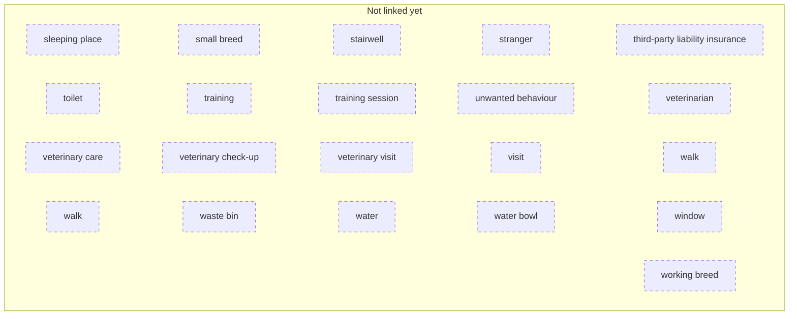

## Concepts and relations

### Relations under absence


### Relations under alone-time limit

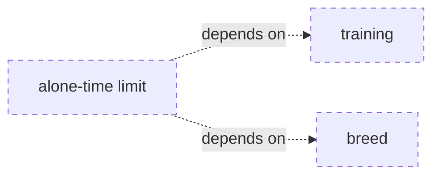

### Relations under balcony


### Relations under basic command

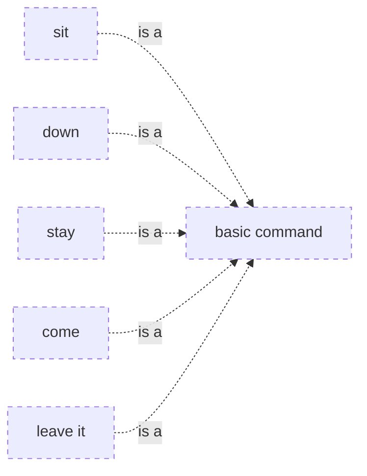

### Relations under bin room


### Relations under breed

```mermaid
flowchart LR
    classDef draft stroke-dasharray: 5 5
    cn_01M82GKFJ96730WAHGQQD3M958["breed"]
    cn_01M82GKFJ96730WAHGQQD3M95J["exercise"]
    cn_01M82GKFJ96730WAHGQQD3M95G["flat"]
    cn_01M82GKFJ96730WAHGQQD3M95A["large or working breed"]
    cn_01M82GKFJ96730WAHGQQD3M95C["short-haired breed"]
    cn_01M82GKFJ96730WAHGQQD3M959["small companion breed"]
    cn_01M82GKFJ96730WAHGQQD3M959 -. "is a" .-> cn_01M82GKFJ96730WAHGQQD3M958
    cn_01M82GKFJ96730WAHGQQD3M959 -. "adapts well to" .-> cn_01M82GKFJ96730WAHGQQD3M95G
    cn_01M82GKFJ96730WAHGQQD3M959 -. "needs less" .-> cn_01M82GKFJ96730WAHGQQD3M95J
    cn_01M82GKFJ96730WAHGQQD3M95A -. "is a" .-> cn_01M82GKFJ96730WAHGQQD3M958
    cn_01M82GKFJ96730WAHGQQD3M95A -. "needs more" .-> cn_01M82GKFJ96730WAHGQQD3M95J
    cn_01M82GKFJ96730WAHGQQD3M95C -. "is a" .-> cn_01M82GKFJ96730WAHGQQD3M958
    class cn_01M82GKFJ96730WAHGQQD3M958,cn_01M82GKFJ96730WAHGQQD3M95J,cn_01M82GKFJ96730WAHGQQD3M95G,cn_01M82GKFJ96730WAHGQQD3M95A,cn_01M82GKFJ96730WAHGQQD3M95C,cn_01M82GKFJ96730WAHGQQD3M959 draft
```

### Relations under building

```mermaid
flowchart LR
    classDef draft stroke-dasharray: 5 5
    cn_01M82H7HBZP5REB8E6N9M29JTN["building"]
    cn_01M82H7HBZP5REB8E6N9M29JTP["inner yard"]
    cn_01M82HCHQC6AK72JNVEQYR1KXN["main door"]
    cn_01M82H7HBZP5REB8E6N9M29JTN -. "is around" .-> cn_01M82H7HBZP5REB8E6N9M29JTP
    cn_01M82H7HBZP5REB8E6N9M29JTN -. "has" .-> cn_01M82HCHQC6AK72JNVEQYR1KXN
    class cn_01M82H7HBZP5REB8E6N9M29JTN,cn_01M82H7HBZP5REB8E6N9M29JTP,cn_01M82HCHQC6AK72JNVEQYR1KXN draft
```

### Relations under cat owner

```mermaid
flowchart LR
    classDef draft stroke-dasharray: 5 5
    cn_01M82GY6D4FG58KKX81F7CX0F1["cat"]
    cn_01M82GY6D4FG58KKX81F7CX0F2["cat owner"]
    cn_01M82GY6D4FG58KKX81F7CX0F2 -. "plays with" .-> cn_01M82GY6D4FG58KKX81F7CX0F1
    class cn_01M82GY6D4FG58KKX81F7CX0F1,cn_01M82GY6D4FG58KKX81F7CX0F2 draft
```

### Relations under cellar

```mermaid
flowchart LR
    classDef draft stroke-dasharray: 5 5
    cn_01M82HDB2F6BK5KDQ92WEFACHM["building A"]
    cn_01M82HAMBHA8TEWR617B2TSCX1["cellar"]
    cn_01M82HAMBHA8TEWR617B2TSCX1 -. "is part of" .-> cn_01M82HDB2F6BK5KDQ92WEFACHM
    class cn_01M82HDB2F6BK5KDQ92WEFACHM,cn_01M82HAMBHA8TEWR617B2TSCX1 draft
```

### Relations under dog food

```mermaid
flowchart LR
    classDef draft stroke-dasharray: 5 5
    cn_01M82GY6D4FG58KKX81F7CX0F1["cat"]
    cn_01M82H0CT7BJSF0Q3S0YPNSAE9["dog food"]
    cn_01M82H0CT7BJSF0Q3S0YPNSAE9 -. "is not suitable for" .-> cn_01M82GY6D4FG58KKX81F7CX0F1
    class cn_01M82GY6D4FG58KKX81F7CX0F1,cn_01M82H0CT7BJSF0Q3S0YPNSAE9 draft
```

### Relations under dog owner

```mermaid
flowchart LR
    classDef draft stroke-dasharray: 5 5
    cn_01M82GSR24145KC6KF8V0HWF9K["chew toy"]
    cn_01M82GV0DCSP2BSTQA19ENCPJ1["damage"]
    cn_01M82GJP3CRKNX3DNJZDNANDWM["dog"]
    cn_01M82GR8C6YNAW05QP8GX3MF7P["dog owner"]
    cn_01M82GQHZCWYDZ4FY134N19HRE["dog waste"]
    cn_01M82GR8C6YNAW05QP8GX3MF7T["rule for the dog"]
    cn_01M82GV0DCSP2BSTQA19ENCPJ2["third-party liability insurance"]
    cn_01M82GSR24145KC6KF8V0HWF9J["water"]
    cn_01M82GR8C6YNAW05QP8GX3MF7P -. "is the lead of" .-> cn_01M82GJP3CRKNX3DNJZDNANDWM
    cn_01M82GR8C6YNAW05QP8GX3MF7P -. "owns" .-> cn_01M82GJP3CRKNX3DNJZDNANDWM
    cn_01M82GR8C6YNAW05QP8GX3MF7P -. "walks" .-> cn_01M82GJP3CRKNX3DNJZDNANDWM
    cn_01M82GR8C6YNAW05QP8GX3MF7P -. "walks" .-> cn_01M82GJP3CRKNX3DNJZDNANDWM
    cn_01M82GR8C6YNAW05QP8GX3MF7P -. "picks up" .-> cn_01M82GQHZCWYDZ4FY134N19HRE
    cn_01M82GR8C6YNAW05QP8GX3MF7P -. "sets" .-> cn_01M82GR8C6YNAW05QP8GX3MF7T
    cn_01M82GR8C6YNAW05QP8GX3MF7P -. "leaves for the dog" .-> cn_01M82GSR24145KC6KF8V0HWF9J
    cn_01M82GR8C6YNAW05QP8GX3MF7P -. "leaves for the dog" .-> cn_01M82GSR24145KC6KF8V0HWF9K
    cn_01M82GR8C6YNAW05QP8GX3MF7P -. "is liable for" .-> cn_01M82GV0DCSP2BSTQA19ENCPJ1
    cn_01M82GR8C6YNAW05QP8GX3MF7P -. "has" .-> cn_01M82GV0DCSP2BSTQA19ENCPJ2
    class cn_01M82GSR24145KC6KF8V0HWF9K,cn_01M82GV0DCSP2BSTQA19ENCPJ1,cn_01M82GJP3CRKNX3DNJZDNANDWM,cn_01M82GR8C6YNAW05QP8GX3MF7P,cn_01M82GQHZCWYDZ4FY134N19HRE,cn_01M82GR8C6YNAW05QP8GX3MF7T,cn_01M82GV0DCSP2BSTQA19ENCPJ2,cn_01M82GSR24145KC6KF8V0HWF9J draft
```

### Relations under dog training course

```mermaid
flowchart LR
    classDef draft stroke-dasharray: 5 5
    cn_01M82GS0NSGHH6X6DCYVS251C3["certified trainer"]
    cn_01M82GS0NSGHH6X6DCYVS251C2["dog training course"]
    cn_01M82GS0NSGHH6X6DCYVS251C2 -. "is given by" .-> cn_01M82GS0NSGHH6X6DCYVS251C3
    class cn_01M82GS0NSGHH6X6DCYVS251C3,cn_01M82GS0NSGHH6X6DCYVS251C2 draft
```

### Relations under dog waste

```mermaid
flowchart LR
    classDef draft stroke-dasharray: 5 5
    cn_01M82GQHZCWYDZ4FY134N19HRE["dog waste"]
    cn_01M82GQHZCWYDZ4FY134N19HRF["waste bin"]
    cn_01M82GQHZCWYDZ4FY134N19HRE -. "is put in" .-> cn_01M82GQHZCWYDZ4FY134N19HRF
    class cn_01M82GQHZCWYDZ4FY134N19HRE,cn_01M82GQHZCWYDZ4FY134N19HRF draft
```

### Relations under family

```mermaid
flowchart LR
    classDef draft stroke-dasharray: 5 5
    cn_01M82GR8C6YNAW05QP8GX3MF7R["command word"]
    cn_01M82GR8C6YNAW05QP8GX3MF7S["family"]
    cn_01M82GR8C6YNAW05QP8GX3MF7S -. "uses" .-> cn_01M82GR8C6YNAW05QP8GX3MF7R
    class cn_01M82GR8C6YNAW05QP8GX3MF7R,cn_01M82GR8C6YNAW05QP8GX3MF7S draft
```

### Relations under flat

```mermaid
flowchart LR
    classDef draft stroke-dasharray: 5 5
    cn_01M82HDB2F6BK5KDQ92WEFACHN["cellar compartment"]
    cn_01M82GKFJ96730WAHGQQD3M95G["flat"]
    cn_01M82GKFJ96730WAHGQQD3M95G -. "has" .-> cn_01M82HDB2F6BK5KDQ92WEFACHN
    class cn_01M82HDB2F6BK5KDQ92WEFACHN,cn_01M82GKFJ96730WAHGQQD3M95G draft
```

### Relations under food bowl

```mermaid
flowchart LR
    classDef draft stroke-dasharray: 5 5
    cn_01M82GZMM3VP80T7XD6GS67TSN["food bowl"]
    cn_01M82GZMM3VP80T7XD6GS67TSK["litter box"]
    cn_01M82GZMM3VP80T7XD6GS67TSN -. "is placed away from" .-> cn_01M82GZMM3VP80T7XD6GS67TSK
    class cn_01M82GZMM3VP80T7XD6GS67TSN,cn_01M82GZMM3VP80T7XD6GS67TSK draft
```

### Relations under food poisonous to dogs

```mermaid
flowchart LR
    classDef draft stroke-dasharray: 5 5
    cn_01M82GY6D4FG58KKX81F7CX0F1["cat"]
    cn_01M82GM2G3AM0SX444VHV3202M["chocolate"]
    cn_01M82GJP3CRKNX3DNJZDNANDWM["dog"]
    cn_01M82GM2G3AM0SX444VHV3202K["food poisonous to dogs"]
    cn_01M82GM2G3AM0SX444VHV3202N["grape"]
    cn_01M82GM2G3AM0SX444VHV3202P["onion"]
    cn_01M82GM2G3AM0SX444VHV3202Q["xylitol"]
    cn_01M82GM2G3AM0SX444VHV3202K -. "is poisonous to" .-> cn_01M82GJP3CRKNX3DNJZDNANDWM
    cn_01M82GM2G3AM0SX444VHV3202M -. "is a" .-> cn_01M82GM2G3AM0SX444VHV3202K
    cn_01M82GM2G3AM0SX444VHV3202M -. "is not suitable for" .-> cn_01M82GY6D4FG58KKX81F7CX0F1
    cn_01M82GM2G3AM0SX444VHV3202N -. "is a" .-> cn_01M82GM2G3AM0SX444VHV3202K
    cn_01M82GM2G3AM0SX444VHV3202P -. "is a" .-> cn_01M82GM2G3AM0SX444VHV3202K
    cn_01M82GM2G3AM0SX444VHV3202P -. "is not suitable for" .-> cn_01M82GY6D4FG58KKX81F7CX0F1
    cn_01M82GM2G3AM0SX444VHV3202Q -. "is a" .-> cn_01M82GM2G3AM0SX444VHV3202K
    class cn_01M82GY6D4FG58KKX81F7CX0F1,cn_01M82GM2G3AM0SX444VHV3202M,cn_01M82GJP3CRKNX3DNJZDNANDWM,cn_01M82GM2G3AM0SX444VHV3202K,cn_01M82GM2G3AM0SX444VHV3202N,cn_01M82GM2G3AM0SX444VHV3202P,cn_01M82GM2G3AM0SX444VHV3202Q draft
```

### Relations under free-running sign

```mermaid
flowchart LR
    classDef draft stroke-dasharray: 5 5
    cn_01M82GV0DCSP2BSTQA19ENCPJ7["free-running sign"]
    cn_01M82GV0DCSP2BSTQA19ENCPJ6["public place"]
    cn_01M82GV0DCSP2BSTQA19ENCPJ7 -. "is located in" .-> cn_01M82GV0DCSP2BSTQA19ENCPJ6
    class cn_01M82GV0DCSP2BSTQA19ENCPJ7,cn_01M82GV0DCSP2BSTQA19ENCPJ6 draft
```

### Relations under grooming

```mermaid
flowchart LR
    classDef draft stroke-dasharray: 5 5
    cn_01M82H394WWKSMY0HG5WFCNGAC["bathing"]
    cn_01M82GN67QTV2KDH6NRHKR2RZZ["brushing"]
    cn_01M82GN67QTV2KDH6NRHKR2S01["claw"]
    cn_01M82GN67QTV2KDH6NRHKR2S00["claw trimming"]
    cn_01M82GJP3CRKNX3DNJZDNANDWM["dog"]
    cn_01M82GKFJ96730WAHGQQD3M95H["grooming"]
    cn_01M82H394WWKSMY0HG5WFCNGAE["matting"]
    cn_01M82GN67QTV2KDH6NRHKR2RZZ -. "is applied to" .-> cn_01M82GJP3CRKNX3DNJZDNANDWM
    cn_01M82GN67QTV2KDH6NRHKR2RZZ -. "is a" .-> cn_01M82GKFJ96730WAHGQQD3M95H
    cn_01M82GN67QTV2KDH6NRHKR2RZZ -. "prevents" .-> cn_01M82H394WWKSMY0HG5WFCNGAE
    cn_01M82GN67QTV2KDH6NRHKR2S00 -. "is a" .-> cn_01M82GKFJ96730WAHGQQD3M95H
    cn_01M82GN67QTV2KDH6NRHKR2S00 -. "is applied to" .-> cn_01M82GN67QTV2KDH6NRHKR2S01
    cn_01M82H394WWKSMY0HG5WFCNGAC -. "is a" .-> cn_01M82GKFJ96730WAHGQQD3M95H
    class cn_01M82H394WWKSMY0HG5WFCNGAC,cn_01M82GN67QTV2KDH6NRHKR2RZZ,cn_01M82GN67QTV2KDH6NRHKR2S01,cn_01M82GN67QTV2KDH6NRHKR2S00,cn_01M82GJP3CRKNX3DNJZDNANDWM,cn_01M82GKFJ96730WAHGQQD3M95H,cn_01M82H394WWKSMY0HG5WFCNGAE draft
```

### Relations under house management

```mermaid
flowchart LR
    classDef draft stroke-dasharray: 5 5
    cn_01M82H7HBZP5REB8E6N9M29JTN["building"]
    cn_01M82H7HBZP5REB8E6N9M29JTH["house management"]
    cn_01M82H7HBZP5REB8E6N9M29JTQ["house rules"]
    cn_01M82H7HBZP5REB8E6N9M29JTH -. "administers" .-> cn_01M82H7HBZP5REB8E6N9M29JTN
    cn_01M82H7HBZP5REB8E6N9M29JTH -. "enforces" .-> cn_01M82H7HBZP5REB8E6N9M29JTQ
    class cn_01M82H7HBZP5REB8E6N9M29JTN,cn_01M82H7HBZP5REB8E6N9M29JTH,cn_01M82H7HBZP5REB8E6N9M29JTQ draft
```

### Relations under house rules

```mermaid
flowchart LR
    classDef draft stroke-dasharray: 5 5
    cn_01M82H7HBZP5REB8E6N9M29JTN["building"]
    cn_01M82H7HBZP5REB8E6N9M29JTQ["house rules"]
    cn_01M82H7HBZP5REB8E6N9M29JTQ -. "apply to" .-> cn_01M82H7HBZP5REB8E6N9M29JTN
    class cn_01M82H7HBZP5REB8E6N9M29JTN,cn_01M82H7HBZP5REB8E6N9M29JTQ draft
```

### Relations under inner yard

```mermaid
flowchart LR
    classDef draft stroke-dasharray: 5 5
    cn_01M82HA4JVD4MJZ6M8W4CVWNW2["building complex"]
    cn_01M82H7HBZP5REB8E6N9M29JTP["inner yard"]
    cn_01M82H7HBZP5REB8E6N9M29JTG["resident"]
    cn_01M82H7HBZP5REB8E6N9M29JTP -. "is shared by" .-> cn_01M82H7HBZP5REB8E6N9M29JTG
    cn_01M82H7HBZP5REB8E6N9M29JTP -. "is part of" .-> cn_01M82HA4JVD4MJZ6M8W4CVWNW2
    class cn_01M82HA4JVD4MJZ6M8W4CVWNW2,cn_01M82H7HBZP5REB8E6N9M29JTP,cn_01M82H7HBZP5REB8E6N9M29JTG draft
```

### Relations under laundry slot

```mermaid
flowchart LR
    classDef draft stroke-dasharray: 5 5
    cn_01M82HDB2GRFNRYQMSRVHKV6BR["booking list"]
    cn_01M82HDB2F6BK5KDQ92WEFACHV["laundry slot"]
    cn_01M82HDB2F6BK5KDQ92WEFACHJ["shared laundry room"]
    cn_01M82HDB2F6BK5KDQ92WEFACHV -. "is a slot for" .-> cn_01M82HDB2F6BK5KDQ92WEFACHJ
    cn_01M82HDB2F6BK5KDQ92WEFACHV -. "is booked on" .-> cn_01M82HDB2GRFNRYQMSRVHKV6BR
    class cn_01M82HDB2GRFNRYQMSRVHKV6BR,cn_01M82HDB2F6BK5KDQ92WEFACHV,cn_01M82HDB2F6BK5KDQ92WEFACHJ draft
```

### Relations under leash

```mermaid
flowchart LR
    classDef draft stroke-dasharray: 5 5
    cn_01M82GPB8ZK0N7S1VR303H5EPG["busy street"]
    cn_01M82GPB8ZK0N7S1VR303H5EPD["collar"]
    cn_01M82GPB8ZK0N7S1VR303H5EPF["everyday walk"]
    cn_01M82GPB8ZK0N7S1VR303H5EPE["harness"]
    cn_01M82GPB8ZK0N7S1VR303H5EPB["leash"]
    cn_01M82GPB8ZK0N7S1VR303H5EPC["retractable leash"]
    cn_01M82GPB8ZK0N7S1VR303H5EPB -. "is attached to" .-> cn_01M82GPB8ZK0N7S1VR303H5EPD
    cn_01M82GPB8ZK0N7S1VR303H5EPB -. "is attached to" .-> cn_01M82GPB8ZK0N7S1VR303H5EPE
    cn_01M82GPB8ZK0N7S1VR303H5EPB -. "is used for" .-> cn_01M82GPB8ZK0N7S1VR303H5EPF
    cn_01M82GPB8ZK0N7S1VR303H5EPC -. "is a" .-> cn_01M82GPB8ZK0N7S1VR303H5EPB
    cn_01M82GPB8ZK0N7S1VR303H5EPC -. "is not suitable in" .-> cn_01M82GPB8ZK0N7S1VR303H5EPG
    class cn_01M82GPB8ZK0N7S1VR303H5EPG,cn_01M82GPB8ZK0N7S1VR303H5EPD,cn_01M82GPB8ZK0N7S1VR303H5EPF,cn_01M82GPB8ZK0N7S1VR303H5EPE,cn_01M82GPB8ZK0N7S1VR303H5EPB,cn_01M82GPB8ZK0N7S1VR303H5EPC draft
```

### Relations under leash training

```mermaid
flowchart LR
    classDef draft stroke-dasharray: 5 5
    cn_01M82GPB8ZK0N7S1VR303H5EPB["leash"]
    cn_01M82GPTF0J0A1WWEWDR3G29FG["leash training"]
    cn_01M82GPTF0J0A1WWEWDR3G29FG -. "uses" .-> cn_01M82GPB8ZK0N7S1VR303H5EPB
    class cn_01M82GPB8ZK0N7S1VR303H5EPB,cn_01M82GPTF0J0A1WWEWDR3G29FG draft
```

### Relations under lily

```mermaid
flowchart LR
    classDef draft stroke-dasharray: 5 5
    cn_01M82GY6D4FG58KKX81F7CX0F1["cat"]
    cn_01M82H0CT7BJSF0Q3S0YPNSAE6["lily"]
    cn_01M82H0CT7BJSF0Q3S0YPNSAE6 -. "is highly poisonous to" .-> cn_01M82GY6D4FG58KKX81F7CX0F1
    cn_01M82H0CT7BJSF0Q3S0YPNSAE6 -. "is not suitable for" .-> cn_01M82GY6D4FG58KKX81F7CX0F1
    class cn_01M82GY6D4FG58KKX81F7CX0F1,cn_01M82H0CT7BJSF0Q3S0YPNSAE6 draft
```

### Relations under litter

```mermaid
flowchart LR
    classDef draft stroke-dasharray: 5 5
    cn_01M82H1MQPVEX27Q0YHCNZ9WE5["compost"]
    cn_01M82GY6D4FG58KKX81F7CX0F4["litter"]
    cn_01M82H1MQPVEX27Q0YHCNZ9WE3["residual waste"]
    cn_01M82HBAX7NMYFG8GE4P9Y56F8["residual waste bin"]
    cn_01M82H1MQPVEX27Q0YHCNZ9WE4["toilet"]
    cn_01M82H1MQPVEX27Q0YHCNZ9WE1["used litter"]
    cn_01M82HBAX7NMYFG8GE4P9Y56F3["waste"]
    cn_01M82H1MQPVEX27Q0YHCNZ9WE1 -. "is a" .-> cn_01M82GY6D4FG58KKX81F7CX0F4
    cn_01M82H1MQPVEX27Q0YHCNZ9WE1 -. "goes into" .-> cn_01M82H1MQPVEX27Q0YHCNZ9WE3
    cn_01M82H1MQPVEX27Q0YHCNZ9WE1 -. "must not go into" .-> cn_01M82H1MQPVEX27Q0YHCNZ9WE4
    cn_01M82H1MQPVEX27Q0YHCNZ9WE1 -. "must not go into" .-> cn_01M82H1MQPVEX27Q0YHCNZ9WE5
    cn_01M82H1MQPVEX27Q0YHCNZ9WE1 -. "is a" .-> cn_01M82HBAX7NMYFG8GE4P9Y56F3
    cn_01M82H1MQPVEX27Q0YHCNZ9WE1 -. "goes into" .-> cn_01M82HBAX7NMYFG8GE4P9Y56F8
    class cn_01M82H1MQPVEX27Q0YHCNZ9WE5,cn_01M82GY6D4FG58KKX81F7CX0F4,cn_01M82H1MQPVEX27Q0YHCNZ9WE3,cn_01M82HBAX7NMYFG8GE4P9Y56F8,cn_01M82H1MQPVEX27Q0YHCNZ9WE4,cn_01M82H1MQPVEX27Q0YHCNZ9WE1,cn_01M82HBAX7NMYFG8GE4P9Y56F3 draft
```

### Relations under litter box

```mermaid
flowchart LR
    classDef draft stroke-dasharray: 5 5
    cn_01M82GKFJ96730WAHGQQD3M95G["flat"]
    cn_01M82GY6D4FG58KKX81F7CX0F4["litter"]
    cn_01M82GZMM3VP80T7XD6GS67TSK["litter box"]
    cn_01M82GZMM3VP80T7XD6GS67TSK -. "must be kept inside" .-> cn_01M82GKFJ96730WAHGQQD3M95G
    cn_01M82GZMM3VP80T7XD6GS67TSK -. "contains" .-> cn_01M82GY6D4FG58KKX81F7CX0F4
    class cn_01M82GKFJ96730WAHGQQD3M95G,cn_01M82GY6D4FG58KKX81F7CX0F4,cn_01M82GZMM3VP80T7XD6GS67TSK draft
```

### Relations under noise

```mermaid
flowchart LR
    classDef draft stroke-dasharray: 5 5
    cn_01M82GKFJ96730WAHGQQD3M95G["flat"]
    cn_01M82H7HBZP5REB8E6N9M29JTP["inner yard"]
    cn_01M82H83Q82K5CKBRM346N8337["noise"]
    cn_01M82H83Q82K5CKBRM346N8338["persistent barking"]
    cn_01M82H83Q82K5CKBRM346N8337 -. "can be heard in" .-> cn_01M82GKFJ96730WAHGQQD3M95G
    cn_01M82H83Q82K5CKBRM346N8337 -. "can be heard in" .-> cn_01M82H7HBZP5REB8E6N9M29JTP
    cn_01M82H83Q82K5CKBRM346N8338 -. "is a" .-> cn_01M82H83Q82K5CKBRM346N8337
    class cn_01M82GKFJ96730WAHGQQD3M95G,cn_01M82H7HBZP5REB8E6N9M29JTP,cn_01M82H83Q82K5CKBRM346N8337,cn_01M82H83Q82K5CKBRM346N8338 draft
```

### Relations under pet

```mermaid
flowchart LR
    classDef draft stroke-dasharray: 5 5
    cn_01M82H0CT7BJSF0Q3S0YPNSAE2["adult cat"]
    cn_01M82GM2G3AM0SX444VHV3202F["adult dog"]
    cn_01M82HA4JVD4MJZ6M8W4CVWNW6["alone-time limit"]
    cn_01M82GS0NSGHH6X6DCYVS251BV["basic command"]
    cn_01M82GN67QTV2KDH6NRHKR2S03["blanket"]
    cn_01M82GKFJ96730WAHGQQD3M958["breed"]
    cn_01M82GN67QTV2KDH6NRHKR2RZZ["brushing"]
    cn_01M82GY6D4FG58KKX81F7CX0F1["cat"]
    cn_01M82HAMBHA8TEWR617B2TSCX1["cellar"]
    cn_01M82GN67QTV2KDH6NRHKR2S01["claw"]
    cn_01M82GJP3CRKNX3DNJZDNANDWR["company"]
    cn_01M82GJP3CRKNX3DNJZDNANDWQ["daily exercise"]
    cn_01M82GV0DCSP2BSTQA19ENCPJ1["damage"]
    cn_01M82GJP3CRKNX3DNJZDNANDWM["dog"]
    cn_01M82GN67QTV2KDH6NRHKR2S02["dog bed"]
    cn_01M82GR8C6YNAW05QP8GX3MF7P["dog owner"]
    cn_01M82GS0NSGHH6X6DCYVS251C2["dog training course"]
    cn_01M82GM2G3AM0SX444VHV3202H["feeding"]
    cn_01M82GKFJ96730WAHGQQD3M95G["flat"]
    cn_01M82GY6D4FG58KKX81F7CX0F3["food"]
    cn_01M82GZMM3VP80T7XD6GS67TSN["food bowl"]
    cn_01M82GM2G3AM0SX444VHV3202J["fresh water"]
    cn_01M82GKFJ96730WAHGQQD3M95H["grooming"]
    cn_01M82H7HBZP5REB8E6N9M29JTH["house management"]
    cn_01M82GYVM9BBT0CS4ZCPR3ER6H["indoor cat"]
    cn_01M82H7HBZP5REB8E6N9M29JTP["inner yard"]
    cn_01M82GPB8ZK0N7S1VR303H5EPB["leash"]
    cn_01M82GY6D4FG58KKX81F7CX0F4["litter"]
    cn_01M82GZMM3VP80T7XD6GS67TSK["litter box"]
    cn_01M82GJP3CRKNX3DNJZDNANDWN["local authority"]
    cn_01M82GKFJ96730WAHGQQD3M95B["long-haired breed"]
    cn_01M82H394WWKSMY0HG5WFCNGA9["long-haired cat"]
    cn_01M82H0CT7BJSF0Q3S0YPNSAE4["meal"]
    cn_01M82H0CT7BJSF0Q3S0YPNSAE5["meat-based food"]
    cn_01M82GJP3CRKNX3DNJZDNANDWP["microchip"]
    cn_01M82H115ABPPRSFHS5N8011PE["neutering"]
    cn_01M82GYVM9BBT0CS4ZCPR3ER6J["outdoor cat"]
    cn_01M82H94Y19DEFXTHPXP970KGB["pet"]
    cn_01M82GYVMAZ9K3VZWRC41RP559["play and climbing place"]
    cn_01M82GMKV1KS5PBE1QB2P99CPB["rabies vaccination"]
    cn_01M82H7HBZP5REB8E6N9M29JTG["resident"]
    cn_01M82GZMM3VP80T7XD6GS67TSM["scratching post"]
    cn_01M82H394WWKSMY0HG5WFCNGA8["short-haired cat"]
    cn_01M82GZMM3VP80T7XD6GS67TSQ["sleeping place"]
    cn_01M82HA4JVD4MJZ6M8W4CVWNVZ["stairwell"]
    cn_01M82GJP3CRKNX3DNJZDNANDWS["training"]
    cn_01M82GMKV1KS5PBE1QB2P99CPA["vaccination"]
    cn_01M82GMKV1KS5PBE1QB2P99CPC["veterinarian"]
    cn_01M82GJP3CRKNX3DNJZDNANDWT["veterinary care"]
    cn_01M82GMKV1KS5PBE1QB2P99CPD["veterinary check-up"]
    cn_01M82GY6D4FG58KKX81F7CX0F5["veterinary visit"]
    cn_01M82GQHZCWYDZ4FY134N19HRD["walk"]
    cn_01M82GZMM3VP80T7XD6GS67TSP["water bowl"]
    cn_01M82GJP3CRKNX3DNJZDNANDWM -. "is registered with" .-> cn_01M82GJP3CRKNX3DNJZDNANDWN
    cn_01M82GJP3CRKNX3DNJZDNANDWM -. "carries" .-> cn_01M82GJP3CRKNX3DNJZDNANDWP
    cn_01M82GJP3CRKNX3DNJZDNANDWM -. "needs" .-> cn_01M82GJP3CRKNX3DNJZDNANDWQ
    cn_01M82GJP3CRKNX3DNJZDNANDWM -. "needs" .-> cn_01M82GJP3CRKNX3DNJZDNANDWR
    cn_01M82GJP3CRKNX3DNJZDNANDWM -. "needs" .-> cn_01M82GJP3CRKNX3DNJZDNANDWS
    cn_01M82GJP3CRKNX3DNJZDNANDWM -. "needs" .-> cn_01M82GJP3CRKNX3DNJZDNANDWT
    cn_01M82GJP3CRKNX3DNJZDNANDWM -. "has" .-> cn_01M82GKFJ96730WAHGQQD3M958
    cn_01M82GJP3CRKNX3DNJZDNANDWM -. "is taken for" .-> cn_01M82GMKV1KS5PBE1QB2P99CPD
    cn_01M82GJP3CRKNX3DNJZDNANDWM -. "has" .-> cn_01M82GN67QTV2KDH6NRHKR2S01
    cn_01M82GJP3CRKNX3DNJZDNANDWM -. "has" .-> cn_01M82GN67QTV2KDH6NRHKR2S02
    cn_01M82GJP3CRKNX3DNJZDNANDWM -. "has" .-> cn_01M82GN67QTV2KDH6NRHKR2S03
    cn_01M82GJP3CRKNX3DNJZDNANDWM -. "is kept on" .-> cn_01M82GPB8ZK0N7S1VR303H5EPB
    cn_01M82GJP3CRKNX3DNJZDNANDWM -. "is kept on" .-> cn_01M82GPB8ZK0N7S1VR303H5EPB
    cn_01M82GJP3CRKNX3DNJZDNANDWM -. "looks to for direction" .-> cn_01M82GR8C6YNAW05QP8GX3MF7P
    cn_01M82GJP3CRKNX3DNJZDNANDWM -. "should learn" .-> cn_01M82GS0NSGHH6X6DCYVS251BV
    cn_01M82GJP3CRKNX3DNJZDNANDWM -. "is recommended to attend" .-> cn_01M82GS0NSGHH6X6DCYVS251C2
    cn_01M82GJP3CRKNX3DNJZDNANDWM -. "causes" .-> cn_01M82GV0DCSP2BSTQA19ENCPJ1
    cn_01M82GJP3CRKNX3DNJZDNANDWM -. "is a" .-> cn_01M82H94Y19DEFXTHPXP970KGB
    cn_01M82GJP3CRKNX3DNJZDNANDWM -. "has" .-> cn_01M82HA4JVD4MJZ6M8W4CVWNW6
    cn_01M82GKFJ96730WAHGQQD3M95B -. "is a" .-> cn_01M82GJP3CRKNX3DNJZDNANDWM
    cn_01M82GKFJ96730WAHGQQD3M95B -. "is a" .-> cn_01M82GKFJ96730WAHGQQD3M958
    cn_01M82GKFJ96730WAHGQQD3M95B -. "needs more" .-> cn_01M82GKFJ96730WAHGQQD3M95H
    cn_01M82GM2G3AM0SX444VHV3202F -. "is a" .-> cn_01M82GJP3CRKNX3DNJZDNANDWM
    cn_01M82GM2G3AM0SX444VHV3202F -. "is fed twice a day" .-> cn_01M82GM2G3AM0SX444VHV3202H
    cn_01M82GM2G3AM0SX444VHV3202F -. "needs per day" .-> cn_01M82GQHZCWYDZ4FY134N19HRD
    cn_01M82GY6D4FG58KKX81F7CX0F1 -. "visits" .-> cn_01M82GMKV1KS5PBE1QB2P99CPC
    cn_01M82GY6D4FG58KKX81F7CX0F1 -. "needs" .-> cn_01M82GY6D4FG58KKX81F7CX0F3
    cn_01M82GY6D4FG58KKX81F7CX0F1 -. "needs" .-> cn_01M82GY6D4FG58KKX81F7CX0F4
    cn_01M82GY6D4FG58KKX81F7CX0F1 -. "has yearly" .-> cn_01M82GY6D4FG58KKX81F7CX0F5
    cn_01M82GY6D4FG58KKX81F7CX0F1 -. "has" .-> cn_01M82GZMM3VP80T7XD6GS67TSK
    cn_01M82GY6D4FG58KKX81F7CX0F1 -. "needs" .-> cn_01M82GZMM3VP80T7XD6GS67TSK
    cn_01M82GY6D4FG58KKX81F7CX0F1 -. "uses" .-> cn_01M82GZMM3VP80T7XD6GS67TSK
    cn_01M82GY6D4FG58KKX81F7CX0F1 -. "needs" .-> cn_01M82GZMM3VP80T7XD6GS67TSM
    cn_01M82GY6D4FG58KKX81F7CX0F1 -. "needs" .-> cn_01M82GZMM3VP80T7XD6GS67TSM
    cn_01M82GY6D4FG58KKX81F7CX0F1 -. "needs" .-> cn_01M82GZMM3VP80T7XD6GS67TSN
    cn_01M82GY6D4FG58KKX81F7CX0F1 -. "needs" .-> cn_01M82GZMM3VP80T7XD6GS67TSP
    cn_01M82GY6D4FG58KKX81F7CX0F1 -. "needs" .-> cn_01M82GZMM3VP80T7XD6GS67TSQ
    cn_01M82GY6D4FG58KKX81F7CX0F1 -. "needs" .-> cn_01M82H0CT7BJSF0Q3S0YPNSAE5
    cn_01M82GY6D4FG58KKX81F7CX0F1 -. "undergoes" .-> cn_01M82H115ABPPRSFHS5N8011PE
    cn_01M82GY6D4FG58KKX81F7CX0F1 -. "may move freely in" .-> cn_01M82H7HBZP5REB8E6N9M29JTP
    cn_01M82GY6D4FG58KKX81F7CX0F1 -. "is a" .-> cn_01M82H94Y19DEFXTHPXP970KGB
    cn_01M82GY6D4FG58KKX81F7CX0F1 -. "may not be kept in" .-> cn_01M82HA4JVD4MJZ6M8W4CVWNVZ
    cn_01M82GY6D4FG58KKX81F7CX0F1 -. "may not be kept in" .-> cn_01M82HAMBHA8TEWR617B2TSCX1
    cn_01M82GYVM9BBT0CS4ZCPR3ER6H -. "never leaves" .-> cn_01M82GKFJ96730WAHGQQD3M95G
    cn_01M82GYVM9BBT0CS4ZCPR3ER6H -. "is a" .-> cn_01M82GY6D4FG58KKX81F7CX0F1
    cn_01M82GYVM9BBT0CS4ZCPR3ER6H -. "needs more" .-> cn_01M82GYVMAZ9K3VZWRC41RP559
    cn_01M82GYVM9BBT0CS4ZCPR3ER6J -. "must have before first going outside" .-> cn_01M82GJP3CRKNX3DNJZDNANDWP
    cn_01M82GYVM9BBT0CS4ZCPR3ER6J -. "must have before first going outside" .-> cn_01M82GMKV1KS5PBE1QB2P99CPA
    cn_01M82GYVM9BBT0CS4ZCPR3ER6J -. "must be vaccinated with" .-> cn_01M82GMKV1KS5PBE1QB2P99CPB
    cn_01M82GYVM9BBT0CS4ZCPR3ER6J -. "is a" .-> cn_01M82GY6D4FG58KKX81F7CX0F1
    cn_01M82H0CT7BJSF0Q3S0YPNSAE2 -. "needs when alone" .-> cn_01M82GM2G3AM0SX444VHV3202J
    cn_01M82H0CT7BJSF0Q3S0YPNSAE2 -. "is a" .-> cn_01M82GY6D4FG58KKX81F7CX0F1
    cn_01M82H0CT7BJSF0Q3S0YPNSAE2 -. "needs when alone" .-> cn_01M82GY6D4FG58KKX81F7CX0F3
    cn_01M82H0CT7BJSF0Q3S0YPNSAE2 -. "needs when alone" .-> cn_01M82GZMM3VP80T7XD6GS67TSK
    cn_01M82H0CT7BJSF0Q3S0YPNSAE2 -. "is fed" .-> cn_01M82H0CT7BJSF0Q3S0YPNSAE4
    cn_01M82H394WWKSMY0HG5WFCNGA8 -. "grooms itself" .-> cn_01M82GKFJ96730WAHGQQD3M95H
    cn_01M82H394WWKSMY0HG5WFCNGA8 -. "needs weekly brushing" .-> cn_01M82GN67QTV2KDH6NRHKR2RZZ
    cn_01M82H394WWKSMY0HG5WFCNGA8 -. "is a" .-> cn_01M82GY6D4FG58KKX81F7CX0F1
    cn_01M82H394WWKSMY0HG5WFCNGA9 -. "needs daily brushing" .-> cn_01M82GN67QTV2KDH6NRHKR2RZZ
    cn_01M82H394WWKSMY0HG5WFCNGA9 -. "is a" .-> cn_01M82GY6D4FG58KKX81F7CX0F1
    cn_01M82H94Y19DEFXTHPXP970KGB -. "must not disturb" .-> cn_01M82H7HBZP5REB8E6N9M29JTG
    cn_01M82H94Y19DEFXTHPXP970KGB -. "is registered with" .-> cn_01M82H7HBZP5REB8E6N9M29JTH
    class cn_01M82H0CT7BJSF0Q3S0YPNSAE2,cn_01M82GM2G3AM0SX444VHV3202F,cn_01M82HA4JVD4MJZ6M8W4CVWNW6,cn_01M82GS0NSGHH6X6DCYVS251BV,cn_01M82GN67QTV2KDH6NRHKR2S03,cn_01M82GKFJ96730WAHGQQD3M958,cn_01M82GN67QTV2KDH6NRHKR2RZZ,cn_01M82GY6D4FG58KKX81F7CX0F1,cn_01M82HAMBHA8TEWR617B2TSCX1,cn_01M82GN67QTV2KDH6NRHKR2S01,cn_01M82GJP3CRKNX3DNJZDNANDWR,cn_01M82GJP3CRKNX3DNJZDNANDWQ,cn_01M82GV0DCSP2BSTQA19ENCPJ1,cn_01M82GJP3CRKNX3DNJZDNANDWM,cn_01M82GN67QTV2KDH6NRHKR2S02,cn_01M82GR8C6YNAW05QP8GX3MF7P,cn_01M82GS0NSGHH6X6DCYVS251C2,cn_01M82GM2G3AM0SX444VHV3202H,cn_01M82GKFJ96730WAHGQQD3M95G,cn_01M82GY6D4FG58KKX81F7CX0F3,cn_01M82GZMM3VP80T7XD6GS67TSN,cn_01M82GM2G3AM0SX444VHV3202J,cn_01M82GKFJ96730WAHGQQD3M95H,cn_01M82H7HBZP5REB8E6N9M29JTH,cn_01M82GYVM9BBT0CS4ZCPR3ER6H,cn_01M82H7HBZP5REB8E6N9M29JTP,cn_01M82GPB8ZK0N7S1VR303H5EPB,cn_01M82GY6D4FG58KKX81F7CX0F4,cn_01M82GZMM3VP80T7XD6GS67TSK,cn_01M82GJP3CRKNX3DNJZDNANDWN,cn_01M82GKFJ96730WAHGQQD3M95B,cn_01M82H394WWKSMY0HG5WFCNGA9,cn_01M82H0CT7BJSF0Q3S0YPNSAE4,cn_01M82H0CT7BJSF0Q3S0YPNSAE5,cn_01M82GJP3CRKNX3DNJZDNANDWP,cn_01M82H115ABPPRSFHS5N8011PE,cn_01M82GYVM9BBT0CS4ZCPR3ER6J,cn_01M82H94Y19DEFXTHPXP970KGB,cn_01M82GYVMAZ9K3VZWRC41RP559,cn_01M82GMKV1KS5PBE1QB2P99CPB,cn_01M82H7HBZP5REB8E6N9M29JTG,cn_01M82GZMM3VP80T7XD6GS67TSM,cn_01M82H394WWKSMY0HG5WFCNGA8,cn_01M82GZMM3VP80T7XD6GS67TSQ,cn_01M82HA4JVD4MJZ6M8W4CVWNVZ,cn_01M82GJP3CRKNX3DNJZDNANDWS,cn_01M82GMKV1KS5PBE1QB2P99CPA,cn_01M82GMKV1KS5PBE1QB2P99CPC,cn_01M82GJP3CRKNX3DNJZDNANDWT,cn_01M82GMKV1KS5PBE1QB2P99CPD,cn_01M82GY6D4FG58KKX81F7CX0F5,cn_01M82GQHZCWYDZ4FY134N19HRD,cn_01M82GZMM3VP80T7XD6GS67TSP draft
```

### Relations under pet owner

```mermaid
flowchart LR
    classDef draft stroke-dasharray: 5 5
    cn_01M82H94Y19DEFXTHPXP970KGB["pet"]
    cn_01M82H94Y19DEFXTHPXP970KGF["pet owner"]
    cn_01M82H94Y19DEFXTHPXP970KGF -. "owns" .-> cn_01M82H94Y19DEFXTHPXP970KGB
    class cn_01M82H94Y19DEFXTHPXP970KGB,cn_01M82H94Y19DEFXTHPXP970KGF draft
```

### Relations under pet textile

```mermaid
flowchart LR
    classDef draft stroke-dasharray: 5 5
    cn_01M82HDB2F6BK5KDQ92WEFACHT["pet bed"]
    cn_01M82HDB2F6BK5KDQ92WEFACHS["pet blanket"]
    cn_01M82HDB2F6BK5KDQ92WEFACHR["pet textile"]
    cn_01M82HDB2F6BK5KDQ92WEFACHS -. "is a" .-> cn_01M82HDB2F6BK5KDQ92WEFACHR
    cn_01M82HDB2F6BK5KDQ92WEFACHT -. "is a" .-> cn_01M82HDB2F6BK5KDQ92WEFACHR
    class cn_01M82HDB2F6BK5KDQ92WEFACHT,cn_01M82HDB2F6BK5KDQ92WEFACHS,cn_01M82HDB2F6BK5KDQ92WEFACHR draft
```

### Relations under resident

```mermaid
flowchart LR
    classDef draft stroke-dasharray: 5 5
    cn_01M82H7HBZP5REB8E6N9M29JTK["apartment owner"]
    cn_01M82H7HBZP5REB8E6N9M29JTN["building"]
    cn_01M82H7HBZP5REB8E6N9M29JTQ["house rules"]
    cn_01M82H7HBZP5REB8E6N9M29JTM["household member"]
    cn_01M82HCHQC6AK72JNVEQYR1KXR["key"]
    cn_01M82HCHQC6AK72JNVEQYR1KXN["main door"]
    cn_01M82H83Q82K5CKBRM346N8337["noise"]
    cn_01M82H7HBZP5REB8E6N9M29JTG["resident"]
    cn_01M82H7HBZP5REB8E6N9M29JTJ["tenant"]
    cn_01M82H7HBZP5REB8E6N9M29JTG -. "lives in" .-> cn_01M82H7HBZP5REB8E6N9M29JTN
    cn_01M82H7HBZP5REB8E6N9M29JTG -. "must follow" .-> cn_01M82H7HBZP5REB8E6N9M29JTQ
    cn_01M82H7HBZP5REB8E6N9M29JTG -. "must avoid during quiet hours" .-> cn_01M82H83Q82K5CKBRM346N8337
    cn_01M82H7HBZP5REB8E6N9M29JTG -. "opens" .-> cn_01M82HCHQC6AK72JNVEQYR1KXN
    cn_01M82H7HBZP5REB8E6N9M29JTG -. "has own" .-> cn_01M82HCHQC6AK72JNVEQYR1KXR
    cn_01M82H7HBZP5REB8E6N9M29JTJ -. "is a" .-> cn_01M82H7HBZP5REB8E6N9M29JTG
    cn_01M82H7HBZP5REB8E6N9M29JTK -. "is a" .-> cn_01M82H7HBZP5REB8E6N9M29JTG
    cn_01M82H7HBZP5REB8E6N9M29JTM -. "is a" .-> cn_01M82H7HBZP5REB8E6N9M29JTG
    class cn_01M82H7HBZP5REB8E6N9M29JTK,cn_01M82H7HBZP5REB8E6N9M29JTN,cn_01M82H7HBZP5REB8E6N9M29JTQ,cn_01M82H7HBZP5REB8E6N9M29JTM,cn_01M82HCHQC6AK72JNVEQYR1KXR,cn_01M82HCHQC6AK72JNVEQYR1KXN,cn_01M82H83Q82K5CKBRM346N8337,cn_01M82H7HBZP5REB8E6N9M29JTG,cn_01M82H7HBZP5REB8E6N9M29JTJ draft
```

### Relations under reward

```mermaid
flowchart LR
    classDef draft stroke-dasharray: 5 5
    cn_01M82GR8C6YNAW05QP8GX3MF7V["good behaviour"]
    cn_01M82GR8C6YNAW05QP8GX3MF7X["reward"]
    cn_01M82GR8C6YNAW05QP8GX3MF7X -. "is given for" .-> cn_01M82GR8C6YNAW05QP8GX3MF7V
    class cn_01M82GR8C6YNAW05QP8GX3MF7V,cn_01M82GR8C6YNAW05QP8GX3MF7X draft
```

### Relations under shared laundry room

```mermaid
flowchart LR
    classDef draft stroke-dasharray: 5 5
    cn_01M82HAMBHA8TEWR617B2TSCX1["cellar"]
    cn_01M82HDB2F6BK5KDQ92WEFACHJ["shared laundry room"]
    cn_01M82HDB2F6BK5KDQ92WEFACHJ -. "is located in" .-> cn_01M82HAMBHA8TEWR617B2TSCX1
    class cn_01M82HAMBHA8TEWR617B2TSCX1,cn_01M82HDB2F6BK5KDQ92WEFACHJ draft
```

### Relations under shared washing machine

```mermaid
flowchart LR
    classDef draft stroke-dasharray: 5 5
    cn_01M82HDB2F6BK5KDQ92WEFACHJ["shared laundry room"]
    cn_01M82HDB2F6BK5KDQ92WEFACHQ["shared washing machine"]
    cn_01M82HDB2F6BK5KDQ92WEFACHQ -. "is located in" .-> cn_01M82HDB2F6BK5KDQ92WEFACHJ
    class cn_01M82HDB2F6BK5KDQ92WEFACHJ,cn_01M82HDB2F6BK5KDQ92WEFACHQ draft
```

### Relations under vaccination

```mermaid
flowchart LR
    classDef draft stroke-dasharray: 5 5
    cn_01M82GMKV1KS5PBE1QB2P99CPB["rabies vaccination"]
    cn_01M82GMKV1KS5PBE1QB2P99CPA["vaccination"]
    cn_01M82GMKV1KS5PBE1QB2P99CPB -. "is a" .-> cn_01M82GMKV1KS5PBE1QB2P99CPA
    class cn_01M82GMKV1KS5PBE1QB2P99CPB,cn_01M82GMKV1KS5PBE1QB2P99CPA draft
```

### Relations under veterinarian

```mermaid
flowchart LR
    classDef draft stroke-dasharray: 5 5
    cn_01M82H394WWKSMY0HG5WFCNGAC["bathing"]
    cn_01M82GMKV1KS5PBE1QB2P99CPC["veterinarian"]
    cn_01M82GMKV1KS5PBE1QB2P99CPC -. "advises" .-> cn_01M82H394WWKSMY0HG5WFCNGAC
    class cn_01M82H394WWKSMY0HG5WFCNGAC,cn_01M82GMKV1KS5PBE1QB2P99CPC draft
```

### Relations under veterinary check-up

```mermaid
flowchart LR
    classDef draft stroke-dasharray: 5 5
    cn_01M82GMKV1KS5PBE1QB2P99CPC["veterinarian"]
    cn_01M82GMKV1KS5PBE1QB2P99CPD["veterinary check-up"]
    cn_01M82GMKV1KS5PBE1QB2P99CPD -. "is performed by" .-> cn_01M82GMKV1KS5PBE1QB2P99CPC
    class cn_01M82GMKV1KS5PBE1QB2P99CPC,cn_01M82GMKV1KS5PBE1QB2P99CPD draft
```

### Relations under waste

```mermaid
flowchart LR
    classDef draft stroke-dasharray: 5 5
    cn_01M82HBAX7NMYFG8GE4P9Y56F4["bin room"]
    cn_01M82HBAX7NMYFG8GE4P9Y56FC["glass"]
    cn_01M82HBAX7NMYFG8GE4P9Y56FD["organic waste"]
    cn_01M82HBAX7NMYFG8GE4P9Y56FA["paper"]
    cn_01M82HBAX7NMYFG8GE4P9Y56F6["pet waste"]
    cn_01M82HBAX7NMYFG8GE4P9Y56FB["plastic"]
    cn_01M82H1MQPVEX27Q0YHCNZ9WE3["residual waste"]
    cn_01M82HBAX7NMYFG8GE4P9Y56F8["residual waste bin"]
    cn_01M82HBAX7NMYFG8GE4P9Y56F3["waste"]
    cn_01M82H1MQPVEX27Q0YHCNZ9WE3 -. "is a" .-> cn_01M82HBAX7NMYFG8GE4P9Y56F3
    cn_01M82HBAX7NMYFG8GE4P9Y56F3 -. "is sorted in" .-> cn_01M82HBAX7NMYFG8GE4P9Y56F4
    cn_01M82HBAX7NMYFG8GE4P9Y56F6 -. "is a" .-> cn_01M82HBAX7NMYFG8GE4P9Y56F3
    cn_01M82HBAX7NMYFG8GE4P9Y56F6 -. "goes into" .-> cn_01M82HBAX7NMYFG8GE4P9Y56F8
    cn_01M82HBAX7NMYFG8GE4P9Y56FA -. "is a" .-> cn_01M82HBAX7NMYFG8GE4P9Y56F3
    cn_01M82HBAX7NMYFG8GE4P9Y56FB -. "is a" .-> cn_01M82HBAX7NMYFG8GE4P9Y56F3
    cn_01M82HBAX7NMYFG8GE4P9Y56FC -. "is a" .-> cn_01M82HBAX7NMYFG8GE4P9Y56F3
    cn_01M82HBAX7NMYFG8GE4P9Y56FD -. "is a" .-> cn_01M82HBAX7NMYFG8GE4P9Y56F3
    class cn_01M82HBAX7NMYFG8GE4P9Y56F4,cn_01M82HBAX7NMYFG8GE4P9Y56FC,cn_01M82HBAX7NMYFG8GE4P9Y56FD,cn_01M82HBAX7NMYFG8GE4P9Y56FA,cn_01M82HBAX7NMYFG8GE4P9Y56F6,cn_01M82HBAX7NMYFG8GE4P9Y56FB,cn_01M82H1MQPVEX27Q0YHCNZ9WE3,cn_01M82HBAX7NMYFG8GE4P9Y56F8,cn_01M82HBAX7NMYFG8GE4P9Y56F3 draft
```

### Relations under water bowl

```mermaid
flowchart LR
    classDef draft stroke-dasharray: 5 5
    cn_01M82GZMM3VP80T7XD6GS67TSK["litter box"]
    cn_01M82GZMM3VP80T7XD6GS67TSP["water bowl"]
    cn_01M82GZMM3VP80T7XD6GS67TSP -. "is placed away from" .-> cn_01M82GZMM3VP80T7XD6GS67TSK
    class cn_01M82GZMM3VP80T7XD6GS67TSK,cn_01M82GZMM3VP80T7XD6GS67TSP draft
```

### Relations under window

```mermaid
flowchart LR
    classDef draft stroke-dasharray: 5 5
    cn_01M82GZMM3VP80T7XD6GS67TST["net"]
    cn_01M82GZMM3VP80T7XD6GS67TSR["window"]
    cn_01M82GZMM3VP80T7XD6GS67TSR -. "is secured with" .-> cn_01M82GZMM3VP80T7XD6GS67TST
    class cn_01M82GZMM3VP80T7XD6GS67TST,cn_01M82GZMM3VP80T7XD6GS67TSR draft
```

## Concepts

<a id="cn_01M82H3S04Z53GFAPY01PTT047"></a>
### absence · ● proposed

- **Level:** 2
- **Evidence:** [§46](#su_01M82GXF5CK27HSSNSY54SX5FF)

<a id="cn_01M82H0CT7BJSF0Q3S0YPNSAE2"></a>
### adult cat · ● proposed

- **Is a:** [cat](#cn_01M82GY6D4FG58KKX81F7CX0F1)
- **Level:** 2
- **Evidence:** [§19](#su_01M82GXF5CK27HSSNSY54SX5F3), [§46](#su_01M82GXF5CK27HSSNSY54SX5FF)

<a id="cn_01M82GM2G3AM0SX444VHV3202F"></a>
### adult dog · ● proposed

- **Is a:** [dog](#cn_01M82GJP3CRKNX3DNJZDNANDWM)
- **Level:** 2
- **Evidence:** [§14](#su_01M82GHYMP28WWGVJCAF7BMQCQ), [§32](#su_01M82GHYMQYRXNHXCXTMK9HDP5), [§47](#su_01M82GHYMR2WSZZZXCEPR86V3Q)

<a id="cn_01M82HA4JVD4MJZ6M8W4CVWNW6"></a>
### alone-time limit · ● proposed

The maximum time a dog may be left alone in a flat.

- **Synonyms:** maximum time left alone
- **Level:** 2
- **Evidence:** [§25](#su_01M82H6T2T27Y7HH29TGSXAMMK)

<a id="cn_01M82H7HBZP5REB8E6N9M29JTK"></a>
### apartment owner · ● proposed

- **Synonyms:** owner
- **Sense:** A person who owns an apartment in the buildings; one kind of resident.
- **Is a:** [resident](#cn_01M82H7HBZP5REB8E6N9M29JTG)
- **Level:** 2
- **Evidence:** [§4](#su_01M82H6T2SJCWQ88GWH3NA9WX1)

<a id="cn_01M82GZMM3VP80T7XD6GS67TSS"></a>
### balcony · ● proposed

- **Level:** 2
- **Evidence:** [§17](#su_01M82GXF5BZJDB4QGXVFMJEB33)

<a id="cn_01M82GS0NSGHH6X6DCYVS251BV"></a>
### basic command · ● proposed

One of five commands every dog should learn: sit, down, stay, come and leave it.

- **Level:** 2
- **Evidence:** [§43](#su_01M82GHYMQYRXNHXCXTMK9HDPD)

<a id="cn_01M82H394WWKSMY0HG5WFCNGAC"></a>
### bathing · ● proposed

- **Synonyms:** bathe
- **Is a:** [grooming](#cn_01M82GKFJ96730WAHGQQD3M95H)
- **Level:** 2
- **Evidence:** [§41](#su_01M82GXF5CK27HSSNSY54SX5FD)

<a id="cn_01M82HBAX7NMYFG8GE4P9Y56F4"></a>
### bin room · ● proposed

- **Level:** 2
- **Evidence:** [§33](#su_01M82H6T2T27Y7HH29TGSXAMMR)

<a id="cn_01M82GN67QTV2KDH6NRHKR2S03"></a>
### blanket · ● proposed

- **Level:** 2
- **Evidence:** [§16](#su_01M82GHYMP28WWGVJCAF7BMQCV)

<a id="cn_01M82HDB2GRFNRYQMSRVHKV6BR"></a>
### booking list · ● proposed

- **Synonyms:** list at the door
- **Level:** 2
- **Evidence:** [§45](#su_01M82H6T2T27Y7HH29TGSXAMMY)

<a id="cn_01M82GKFJ96730WAHGQQD3M958"></a>
### breed · ● proposed

- **Level:** 2
- **Evidence:** [§5](#su_01M82GHYMP28WWGVJCAF7BMQCH), [§9](#su_01M82GHYMP28WWGVJCAF7BMQCN), [§25](#su_01M82H6T2T27Y7HH29TGSXAMMK)

<a id="cn_01M82GN67QTV2KDH6NRHKR2RZZ"></a>
### brushing · ● proposed

- **Is a:** [grooming](#cn_01M82GKFJ96730WAHGQQD3M95H)
- **Level:** 2
- **Evidence:** [§16](#su_01M82GHYMP28WWGVJCAF7BMQCV), [§41](#su_01M82GXF5CK27HSSNSY54SX5FD)

<a id="cn_01M82H7HBZP5REB8E6N9M29JTN"></a>
### building · ● proposed

- **Level:** 2
- **Evidence:** [§4](#su_01M82H6T2SJCWQ88GWH3NA9WX1), [§42](#su_01M82H6T2T27Y7HH29TGSXAMMW)

<a id="cn_01M82HDB2F6BK5KDQ92WEFACHM"></a>
### building A · ● proposed

- **Level:** 2
- **Evidence:** [§45](#su_01M82H6T2T27Y7HH29TGSXAMMY)

<a id="cn_01M82HBAX7NMYFG8GE4P9Y56F5"></a>
### building B · ● proposed

- **Level:** 2
- **Evidence:** [§33](#su_01M82H6T2T27Y7HH29TGSXAMMR)

<a id="cn_01M82HA4JVD4MJZ6M8W4CVWNW2"></a>
### building complex · ● proposed

- **Level:** 1
- **Evidence:** [§24](#su_01M82H6T2T27Y7HH29TGSXAMMJ)

<a id="cn_01M82GPB8ZK0N7S1VR303H5EPG"></a>
### busy street · ● proposed

- **Level:** 2
- **Evidence:** [§30](#su_01M82GHYMQYRXNHXCXTMK9HDP1)

<a id="cn_01M82GY6D4FG58KKX81F7CX0F1"></a>
### cat · ● proposed

- **Synonyms:** cats
- **Is a:** [pet](#cn_01M82H94Y19DEFXTHPXP970KGB)
- **Level:** 1
- **Evidence:** [§1](#su_01M82GXF5BZJDB4QGXVFMJEB2X), [§10](#su_01M82GXF5BZJDB4QGXVFMJEB2Z), [§17](#su_01M82GXF5BZJDB4QGXVFMJEB33), [§19](#su_01M82GXF5CK27HSSNSY54SX5F3), [§20](#su_01M82GXF5CK27HSSNSY54SX5F5), [§21](#su_01M82GXF5CK27HSSNSY54SX5F7), [§22](#su_01M82H6T2SJCWQ88GWH3NA9WX7), [§27](#su_01M82H6T2T27Y7HH29TGSXAMMP), [§29](#su_01M82GXF5CK27HSSNSY54SX5F9), [§39](#su_01M82GXF5CK27HSSNSY54SX5FB), [§41](#su_01M82GXF5CK27HSSNSY54SX5FD), [§46](#su_01M82GXF5CK27HSSNSY54SX5FF), [§49](#su_01M82GXF5CK27HSSNSY54SX5FH)

<a id="cn_01M82GY6D4FG58KKX81F7CX0F2"></a>
### cat owner · ● proposed

- **Level:** 1
- **Evidence:** [§1](#su_01M82GXF5BZJDB4QGXVFMJEB2X), [§39](#su_01M82GXF5CK27HSSNSY54SX5FB)

<a id="cn_01M82HAMBHA8TEWR617B2TSCX1"></a>
### cellar · ● proposed

- **Level:** 2
- **Evidence:** [§27](#su_01M82H6T2T27Y7HH29TGSXAMMP), [§45](#su_01M82H6T2T27Y7HH29TGSXAMMY)

<a id="cn_01M82HDB2F6BK5KDQ92WEFACHN"></a>
### cellar compartment · ● proposed

- **Level:** 2
- **Evidence:** [§45](#su_01M82H6T2T27Y7HH29TGSXAMMY)

<a id="cn_01M82GS0NSGHH6X6DCYVS251C3"></a>
### certified trainer · ● proposed

- **Level:** 2
- **Evidence:** [§44](#su_01M82GHYMQYRXNHXCXTMK9HDPE)

<a id="cn_01M82GSR24145KC6KF8V0HWF9K"></a>
### chew toy · ● proposed

- **Level:** 2
- **Evidence:** [§48](#su_01M82GHYMR2WSZZZXCEPR86V3R)

<a id="cn_01M82GM2G3AM0SX444VHV3202M"></a>
### chocolate · ● proposed

- **Is a:** [food poisonous to dogs](#cn_01M82GM2G3AM0SX444VHV3202K)
- **Level:** 2
- **Evidence:** [§14](#su_01M82GHYMP28WWGVJCAF7BMQCQ), [§19](#su_01M82GXF5CK27HSSNSY54SX5F3)

<a id="cn_01M82GN67QTV2KDH6NRHKR2S01"></a>
### claw · ● proposed

- **Level:** 2
- **Evidence:** [§16](#su_01M82GHYMP28WWGVJCAF7BMQCV)

<a id="cn_01M82GN67QTV2KDH6NRHKR2S00"></a>
### claw trimming · ● proposed

- **Is a:** [grooming](#cn_01M82GKFJ96730WAHGQQD3M95H)
- **Level:** 2
- **Evidence:** [§16](#su_01M82GHYMP28WWGVJCAF7BMQCV)

<a id="cn_01M82H1MQPVEX27Q0YHCNZ9WE2"></a>
### clump · ● proposed

- **Level:** 2
- **Evidence:** [§21](#su_01M82GXF5CK27HSSNSY54SX5F7)

<a id="cn_01M82GPB8ZK0N7S1VR303H5EPD"></a>
### collar · ● proposed

- **Level:** 2
- **Evidence:** [§30](#su_01M82GHYMQYRXNHXCXTMK9HDP1)

<a id="cn_01M82GS0NSGHH6X6DCYVS251BZ"></a>
### come · ● proposed

- **Is a:** [basic command](#cn_01M82GS0NSGHH6X6DCYVS251BV)
- **Level:** 2
- **Evidence:** [§43](#su_01M82GHYMQYRXNHXCXTMK9HDPD)

<a id="cn_01M82GR8C6YNAW05QP8GX3MF7R"></a>
### command word · ● proposed

- **Level:** 2
- **Evidence:** [§35](#su_01M82GHYMQYRXNHXCXTMK9HDP8)

<a id="cn_01M82GJP3CRKNX3DNJZDNANDWR"></a>
### company · ● proposed

- **Level:** 2
- **Evidence:** [§2](#su_01M82GHYMP28WWGVJCAF7BMQCE)

<a id="cn_01M82H1MQPVEX27Q0YHCNZ9WE5"></a>
### compost · ● proposed

- **Level:** 1
- **Evidence:** [§21](#su_01M82GXF5CK27HSSNSY54SX5F7)

<a id="cn_01M82HBZKCWB6HP1MM7REEF3KG"></a>
### corridor · ● proposed

- **Level:** 2
- **Evidence:** [§40](#su_01M82H6T2T27Y7HH29TGSXAMMT)

<a id="cn_01M82GJP3CRKNX3DNJZDNANDWQ"></a>
### daily exercise · ● proposed

- **Level:** 2
- **Evidence:** [§2](#su_01M82GHYMP28WWGVJCAF7BMQCE)

<a id="cn_01M82GV0DCSP2BSTQA19ENCPJ1"></a>
### damage · ● proposed

- **Level:** 2
- **Evidence:** [§52](#su_01M82GHYMR2WSZZZXCEPR86V3W), [§53](#su_01M82H6T2T27Y7HH29TGSXAMN2)

<a id="cn_01M82GJP3CRKNX3DNJZDNANDWM"></a>
### dog · ● proposed

- **Is a:** [pet](#cn_01M82H94Y19DEFXTHPXP970KGB)
- **Level:** 1
- **Evidence:** [§2](#su_01M82GHYMP28WWGVJCAF7BMQCE), [§3](#su_01M82GHYMP28WWGVJCAF7BMQCF), [§14](#su_01M82GHYMP28WWGVJCAF7BMQCQ), [§15](#su_01M82GHYMP28WWGVJCAF7BMQCS), [§16](#su_01M82GHYMP28WWGVJCAF7BMQCV), [§22](#su_01M82H6T2SJCWQ88GWH3NA9WX7), [§23](#su_01M82H6T2T27Y7HH29TGSXAMMH), [§24](#su_01M82H6T2T27Y7HH29TGSXAMMJ), [§25](#su_01M82H6T2T27Y7HH29TGSXAMMK), [§26](#su_01M82H6T2T27Y7HH29TGSXAMMM), [§28](#su_01M82GHYMQYRXNHXCXTMK9HDNY), [§31](#su_01M82GHYMQYRXNHXCXTMK9HDP3), [§32](#su_01M82GHYMQYRXNHXCXTMK9HDP5), [§34](#su_01M82GHYMQYRXNHXCXTMK9HDP7), [§36](#su_01M82GHYMQYRXNHXCXTMK9HDP9), [§38](#su_01M82GHYMQYRXNHXCXTMK9HDPB), [§43](#su_01M82GHYMQYRXNHXCXTMK9HDPD), [§44](#su_01M82GHYMQYRXNHXCXTMK9HDPE), [§47](#su_01M82GHYMR2WSZZZXCEPR86V3Q), [§48](#su_01M82GHYMR2WSZZZXCEPR86V3R), [§51](#su_01M82GHYMR2WSZZZXCEPR86V3T), [§52](#su_01M82GHYMR2WSZZZXCEPR86V3W)

<a id="cn_01M82GN67QTV2KDH6NRHKR2S02"></a>
### dog bed · ● proposed

- **Synonyms:** bed
- **Level:** 2
- **Evidence:** [§16](#su_01M82GHYMP28WWGVJCAF7BMQCV)

<a id="cn_01M82H0CT7BJSF0Q3S0YPNSAE9"></a>
### dog food · ● proposed

- **Level:** 2
- **Evidence:** [§19](#su_01M82GXF5CK27HSSNSY54SX5F3)

<a id="cn_01M82GR8C6YNAW05QP8GX3MF7P"></a>
### dog owner · ● proposed

- **Synonyms:** owner
- **Level:** 1
- **Evidence:** [§24](#su_01M82H6T2T27Y7HH29TGSXAMMJ), [§25](#su_01M82H6T2T27Y7HH29TGSXAMMK), [§26](#su_01M82H6T2T27Y7HH29TGSXAMMM), [§32](#su_01M82GHYMQYRXNHXCXTMK9HDP5), [§38](#su_01M82GHYMQYRXNHXCXTMK9HDPB), [§48](#su_01M82GHYMR2WSZZZXCEPR86V3R), [§52](#su_01M82GHYMR2WSZZZXCEPR86V3W)

<a id="cn_01M82GS0NSGHH6X6DCYVS251C2"></a>
### dog training course · ● proposed

- **Level:** 2
- **Evidence:** [§44](#su_01M82GHYMQYRXNHXCXTMK9HDPE)

<a id="cn_01M82GQHZCWYDZ4FY134N19HRE"></a>
### dog waste · ● proposed

- **Synonyms:** waste
- **Level:** 1
- **Evidence:** [§32](#su_01M82GHYMQYRXNHXCXTMK9HDP5)

<a id="cn_01M82GS0NSGHH6X6DCYVS251BX"></a>
### down · ● proposed

- **Is a:** [basic command](#cn_01M82GS0NSGHH6X6DCYVS251BV)
- **Level:** 2
- **Evidence:** [§43](#su_01M82GHYMQYRXNHXCXTMK9HDPD)

<a id="cn_01M82HBZKCWB6HP1MM7REEF3KH"></a>
### escape route · ● proposed

- **Level:** 2
- **Evidence:** [§40](#su_01M82H6T2T27Y7HH29TGSXAMMT)

<a id="cn_01M82GPB8ZK0N7S1VR303H5EPF"></a>
### everyday walk · ● proposed

- **Level:** 2
- **Evidence:** [§30](#su_01M82GHYMQYRXNHXCXTMK9HDP1)

<a id="cn_01M82GKFJ96730WAHGQQD3M95J"></a>
### exercise · ● proposed

- **Level:** 2
- **Evidence:** [§6](#su_01M82GHYMP28WWGVJCAF7BMQCJ), [§7](#su_01M82GHYMP28WWGVJCAF7BMQCK)

<a id="cn_01M82GR8C6YNAW05QP8GX3MF7S"></a>
### family · ● proposed

- **Level:** 2
- **Evidence:** [§35](#su_01M82GHYMQYRXNHXCXTMK9HDP8)

<a id="cn_01M82GM2G3AM0SX444VHV3202H"></a>
### feeding · ● proposed

- **Synonyms:** feed
- **Level:** 2
- **Evidence:** [§14](#su_01M82GHYMP28WWGVJCAF7BMQCQ)

<a id="cn_01M82HDB2GRFNRYQMSRVHKV6BS"></a>
### flammable liquid · ● proposed

- **Synonyms:** flammable liquids
- **Level:** 2
- **Evidence:** [§45](#su_01M82H6T2T27Y7HH29TGSXAMMY)

<a id="cn_01M82GKFJ96730WAHGQQD3M95G"></a>
### flat · ● proposed

- **Synonyms:** flats
- **Level:** 2
- **Evidence:** [§6](#su_01M82GHYMP28WWGVJCAF7BMQCJ), [§11](#su_01M82GXF5BZJDB4QGXVFMJEB30), [§13](#su_01M82H6T2SJCWQ88GWH3NA9WX3), [§25](#su_01M82H6T2T27Y7HH29TGSXAMMK), [§27](#su_01M82H6T2T27Y7HH29TGSXAMMP), [§29](#su_01M82GXF5CK27HSSNSY54SX5F9), [§41](#su_01M82GXF5CK27HSSNSY54SX5FD), [§45](#su_01M82H6T2T27Y7HH29TGSXAMMY)

<a id="cn_01M82HA4JVD4MJZ6M8W4CVWNW1"></a>
### flower bed · ● proposed

- **Level:** 2
- **Evidence:** [§24](#su_01M82H6T2T27Y7HH29TGSXAMMJ)

<a id="cn_01M82GY6D4FG58KKX81F7CX0F3"></a>
### food · ● proposed

- **Level:** 2
- **Evidence:** [§1](#su_01M82GXF5BZJDB4QGXVFMJEB2X), [§46](#su_01M82GXF5CK27HSSNSY54SX5FF)

<a id="cn_01M82GZMM3VP80T7XD6GS67TSN"></a>
### food bowl · ● proposed

- **Level:** 2
- **Evidence:** [§17](#su_01M82GXF5BZJDB4QGXVFMJEB33)

<a id="cn_01M82GM2G3AM0SX444VHV3202K"></a>
### food poisonous to dogs · ● proposed

- **Level:** 2
- **Evidence:** [§14](#su_01M82GHYMP28WWGVJCAF7BMQCQ)

<a id="cn_01M82GV0DCSP2BSTQA19ENCPJ7"></a>
### free-running sign · ● proposed

- **Synonyms:** sign
- **Level:** 2
- **Evidence:** [§52](#su_01M82GHYMR2WSZZZXCEPR86V3W)

<a id="cn_01M82GM2G3AM0SX444VHV3202J"></a>
### fresh water · ● proposed

- **Level:** 2
- **Evidence:** [§14](#su_01M82GHYMP28WWGVJCAF7BMQCQ), [§46](#su_01M82GXF5CK27HSSNSY54SX5FF)

<a id="cn_01M82HBAX7NMYFG8GE4P9Y56FC"></a>
### glass · ● proposed

- **Is a:** [waste](#cn_01M82HBAX7NMYFG8GE4P9Y56F3)
- **Level:** 2
- **Evidence:** [§33](#su_01M82H6T2T27Y7HH29TGSXAMMR)

<a id="cn_01M82GR8C6YNAW05QP8GX3MF7V"></a>
### good behaviour · ● proposed

- **Level:** 2
- **Evidence:** [§37](#su_01M82GHYMQYRXNHXCXTMK9HDPA)

<a id="cn_01M82GM2G3AM0SX444VHV3202N"></a>
### grape · ● proposed

- **Synonyms:** grapes
- **Is a:** [food poisonous to dogs](#cn_01M82GM2G3AM0SX444VHV3202K)
- **Level:** 2
- **Evidence:** [§14](#su_01M82GHYMP28WWGVJCAF7BMQCQ)

<a id="cn_01M82GKFJ96730WAHGQQD3M95H"></a>
### grooming · ● proposed

- **Level:** 2
- **Evidence:** [§8](#su_01M82GHYMP28WWGVJCAF7BMQCM), [§16](#su_01M82GHYMP28WWGVJCAF7BMQCV), [§41](#su_01M82GXF5CK27HSSNSY54SX5FD)

<a id="cn_01M82GPB8ZK0N7S1VR303H5EPE"></a>
### harness · ● proposed

- **Level:** 2
- **Evidence:** [§30](#su_01M82GHYMQYRXNHXCXTMK9HDP1)

<a id="cn_01M82H7HBZP5REB8E6N9M29JTH"></a>
### house management · ● proposed

Administers the buildings and enforces these rules.

- **Level:** 1
- **Evidence:** [§4](#su_01M82H6T2SJCWQ88GWH3NA9WX1), [§22](#su_01M82H6T2SJCWQ88GWH3NA9WX7), [§26](#su_01M82H6T2T27Y7HH29TGSXAMMM), [§33](#su_01M82H6T2T27Y7HH29TGSXAMMR), [§42](#su_01M82H6T2T27Y7HH29TGSXAMMW), [§50](#su_01M82H6T2T27Y7HH29TGSXAMN0), [§53](#su_01M82H6T2T27Y7HH29TGSXAMN2)

<a id="cn_01M82H7HBZP5REB8E6N9M29JTQ"></a>
### house rules · ● proposed

- **Synonyms:** rules
- **Level:** 1
- **Evidence:** [§4](#su_01M82H6T2SJCWQ88GWH3NA9WX1)

<a id="cn_01M82H7HBZP5REB8E6N9M29JTM"></a>
### household member · ● proposed

- **Is a:** [resident](#cn_01M82H7HBZP5REB8E6N9M29JTG)
- **Level:** 2
- **Evidence:** [§4](#su_01M82H6T2SJCWQ88GWH3NA9WX1)

<a id="cn_01M82GYVM9BBT0CS4ZCPR3ER6H"></a>
### indoor cat · ● proposed

A cat that never leaves the flat.

- **Is a:** [cat](#cn_01M82GY6D4FG58KKX81F7CX0F1)
- **Level:** 2
- **Evidence:** [§11](#su_01M82GXF5BZJDB4QGXVFMJEB30)

<a id="cn_01M82H7HBZP5REB8E6N9M29JTP"></a>
### inner yard · ● proposed

The yard shared by all residents.

- **Synonyms:** shared inner yard
- **Level:** 2
- **Evidence:** [§4](#su_01M82H6T2SJCWQ88GWH3NA9WX1), [§13](#su_01M82H6T2SJCWQ88GWH3NA9WX3), [§18](#su_01M82H6T2SJCWQ88GWH3NA9WX5), [§23](#su_01M82H6T2T27Y7HH29TGSXAMMH), [§24](#su_01M82H6T2T27Y7HH29TGSXAMMJ), [§27](#su_01M82H6T2T27Y7HH29TGSXAMMP)

<a id="cn_01M82HCHQC6AK72JNVEQYR1KXR"></a>
### key · ● proposed

- **Level:** 2
- **Evidence:** [§42](#su_01M82H6T2T27Y7HH29TGSXAMMW)

<a id="cn_01M82GQHZCWYDZ4FY134N19HRB"></a>
### large breed · ● proposed

- **Level:** 2
- **Evidence:** [§32](#su_01M82GHYMQYRXNHXCXTMK9HDP5)

<a id="cn_01M82GKFJ96730WAHGQQD3M95A"></a>
### large or working breed · ● proposed

- **Synonyms:** large and working breeds
- **Is a:** [breed](#cn_01M82GKFJ96730WAHGQQD3M958)
- **Level:** 2
- **Evidence:** [§7](#su_01M82GHYMP28WWGVJCAF7BMQCK)

<a id="cn_01M82HDB2F6BK5KDQ92WEFACHV"></a>
### laundry slot · ● proposed

- **Synonyms:** slot
- **Level:** 2
- **Evidence:** [§45](#su_01M82H6T2T27Y7HH29TGSXAMMY)

<a id="cn_01M82GR8C6YNAW05QP8GX3MF7Q"></a>
### lead (leader) · ● proposed

A calm, consistent and confident leader whose signals the dog can trust.

- **Synonyms:** lead
- **Level:** 2
- **Evidence:** [§34](#su_01M82GHYMQYRXNHXCXTMK9HDP7), [§38](#su_01M82GHYMQYRXNHXCXTMK9HDPB)

<a id="cn_01M82GPB8ZK0N7S1VR303H5EPB"></a>
### leash · ● proposed

- **Synonyms:** lead
- **Level:** 1
- **Evidence:** [§23](#su_01M82H6T2T27Y7HH29TGSXAMMH), [§30](#su_01M82GHYMQYRXNHXCXTMK9HDP1), [§31](#su_01M82GHYMQYRXNHXCXTMK9HDP3), [§52](#su_01M82GHYMR2WSZZZXCEPR86V3W)

<a id="cn_01M82GPTF0J0A1WWEWDR3G29FG"></a>
### leash training · ● proposed

- **Level:** 2
- **Evidence:** [§31](#su_01M82GHYMQYRXNHXCXTMK9HDP3)

<a id="cn_01M82GS0NSGHH6X6DCYVS251C0"></a>
### leave it · ● proposed

- **Is a:** [basic command](#cn_01M82GS0NSGHH6X6DCYVS251BV)
- **Level:** 2
- **Evidence:** [§43](#su_01M82GHYMQYRXNHXCXTMK9HDPD)

<a id="cn_01M82GSR24145KC6KF8V0HWF9G"></a>
### leaving the dog alone · ● proposed

- **Level:** 2
- **Evidence:** [§47](#su_01M82GHYMR2WSZZZXCEPR86V3Q), [§48](#su_01M82GHYMR2WSZZZXCEPR86V3R)

<a id="cn_01M82HA4JVD4MJZ6M8W4CVWNW0"></a>
### lift · ● proposed

- **Level:** 2
- **Evidence:** [§23](#su_01M82H6T2T27Y7HH29TGSXAMMH), [§50](#su_01M82H6T2T27Y7HH29TGSXAMN0)

<a id="cn_01M82H0CT7BJSF0Q3S0YPNSAE6"></a>
### lily · ● proposed

- **Synonyms:** lilies
- **Level:** 2
- **Evidence:** [§19](#su_01M82GXF5CK27HSSNSY54SX5F3)

<a id="cn_01M82GY6D4FG58KKX81F7CX0F4"></a>
### litter · ● proposed

- **Level:** 2
- **Evidence:** [§1](#su_01M82GXF5BZJDB4QGXVFMJEB2X), [§21](#su_01M82GXF5CK27HSSNSY54SX5F7)

<a id="cn_01M82GZMM3VP80T7XD6GS67TSK"></a>
### litter box · ● proposed

- **Synonyms:** litter boxes
- **Level:** 2
- **Evidence:** [§17](#su_01M82GXF5BZJDB4QGXVFMJEB33), [§21](#su_01M82GXF5CK27HSSNSY54SX5F7), [§27](#su_01M82H6T2T27Y7HH29TGSXAMMP), [§29](#su_01M82GXF5CK27HSSNSY54SX5F9), [§39](#su_01M82GXF5CK27HSSNSY54SX5FB), [§46](#su_01M82GXF5CK27HSSNSY54SX5FF), [§49](#su_01M82GXF5CK27HSSNSY54SX5FH)

<a id="cn_01M82GJP3CRKNX3DNJZDNANDWN"></a>
### local authority · ● proposed

- **Level:** 1
- **Evidence:** [§3](#su_01M82GHYMP28WWGVJCAF7BMQCF), [§9](#su_01M82GHYMP28WWGVJCAF7BMQCN), [§52](#su_01M82GHYMR2WSZZZXCEPR86V3W)

<a id="cn_01M82GKFJ96730WAHGQQD3M95B"></a>
### long-haired breed · ● proposed

- **Synonyms:** long-haired breeds
- **Is a:** [dog](#cn_01M82GJP3CRKNX3DNJZDNANDWM), [breed](#cn_01M82GKFJ96730WAHGQQD3M958)
- **Level:** 2
- **Evidence:** [§8](#su_01M82GHYMP28WWGVJCAF7BMQCM), [§16](#su_01M82GHYMP28WWGVJCAF7BMQCV)

<a id="cn_01M82H394WWKSMY0HG5WFCNGA9"></a>
### long-haired cat · ● proposed

- **Is a:** [cat](#cn_01M82GY6D4FG58KKX81F7CX0F1)
- **Level:** 2
- **Evidence:** [§41](#su_01M82GXF5CK27HSSNSY54SX5FD)

<a id="cn_01M82HCHQC6AK72JNVEQYR1KXN"></a>
### main door · ● proposed

- **Level:** 2
- **Evidence:** [§42](#su_01M82H6T2T27Y7HH29TGSXAMMW)

<a id="cn_01M82H394WWKSMY0HG5WFCNGAE"></a>
### matting · ● proposed

- **Level:** 2
- **Evidence:** [§41](#su_01M82GXF5CK27HSSNSY54SX5FD)

<a id="cn_01M82H0CT7BJSF0Q3S0YPNSAE4"></a>
### meal · ● proposed

- **Level:** 2
- **Evidence:** [§19](#su_01M82GXF5CK27HSSNSY54SX5F3)

<a id="cn_01M82H0CT7BJSF0Q3S0YPNSAE5"></a>
### meat-based food · ● proposed

- **Level:** 2
- **Evidence:** [§19](#su_01M82GXF5CK27HSSNSY54SX5F3)

<a id="cn_01M82GJP3CRKNX3DNJZDNANDWP"></a>
### microchip · ● proposed

- **Synonyms:** microchipped
- **Level:** 1
- **Evidence:** [§3](#su_01M82GHYMP28WWGVJCAF7BMQCF), [§12](#su_01M82GXF5BZJDB4QGXVFMJEB31), [§51](#su_01M82GHYMR2WSZZZXCEPR86V3T)

<a id="cn_01M82GZMM3VP80T7XD6GS67TST"></a>
### net · ● proposed

- **Level:** 2
- **Evidence:** [§17](#su_01M82GXF5BZJDB4QGXVFMJEB33)

<a id="cn_01M82H115ABPPRSFHS5N8011PE"></a>
### neutering · ● proposed

- **Synonyms:** neuter
- **Level:** 2
- **Evidence:** [§20](#su_01M82GXF5CK27HSSNSY54SX5F5)

<a id="cn_01M82H83Q82K5CKBRM346N8337"></a>
### noise · ● proposed

- **Level:** 2
- **Evidence:** [§13](#su_01M82H6T2SJCWQ88GWH3NA9WX3)

<a id="cn_01M82GM2G3AM0SX444VHV3202P"></a>
### onion · ● proposed

- **Synonyms:** onions
- **Is a:** [food poisonous to dogs](#cn_01M82GM2G3AM0SX444VHV3202K)
- **Level:** 2
- **Evidence:** [§14](#su_01M82GHYMP28WWGVJCAF7BMQCQ), [§19](#su_01M82GXF5CK27HSSNSY54SX5F3)

<a id="cn_01M82HBAX7NMYFG8GE4P9Y56FD"></a>
### organic waste · ● proposed

- **Is a:** [waste](#cn_01M82HBAX7NMYFG8GE4P9Y56F3)
- **Level:** 2
- **Evidence:** [§33](#su_01M82H6T2T27Y7HH29TGSXAMMR)

<a id="cn_01M82GYVM9BBT0CS4ZCPR3ER6J"></a>
### outdoor cat · ● proposed

A cat that goes outside on its own.

- **Synonyms:** cat that goes outdoors
- **Is a:** [cat](#cn_01M82GY6D4FG58KKX81F7CX0F1)
- **Level:** 2
- **Evidence:** [§12](#su_01M82GXF5BZJDB4QGXVFMJEB31), [§20](#su_01M82GXF5CK27HSSNSY54SX5F5), [§49](#su_01M82GXF5CK27HSSNSY54SX5FH)

<a id="cn_01M82HBAX7NMYFG8GE4P9Y56FA"></a>
### paper · ● proposed

- **Is a:** [waste](#cn_01M82HBAX7NMYFG8GE4P9Y56F3)
- **Level:** 2
- **Evidence:** [§33](#su_01M82H6T2T27Y7HH29TGSXAMMR)

<a id="cn_01M82H83Q82K5CKBRM346N8338"></a>
### persistent barking · ● proposed

- **Synonyms:** barks persistently
- **Is a:** [noise](#cn_01M82H83Q82K5CKBRM346N8337)
- **Level:** 2
- **Evidence:** [§13](#su_01M82H6T2SJCWQ88GWH3NA9WX3), [§26](#su_01M82H6T2T27Y7HH29TGSXAMMM)

<a id="cn_01M82H94Y19DEFXTHPXP970KGB"></a>
### pet · ● proposed

A dog or a cat.

- **Level:** 1
- **Evidence:** [§22](#su_01M82H6T2SJCWQ88GWH3NA9WX7)

<a id="cn_01M82HDB2F6BK5KDQ92WEFACHT"></a>
### pet bed · ● proposed

- **Synonyms:** pet beds
- **Is a:** [pet textile](#cn_01M82HDB2F6BK5KDQ92WEFACHR)
- **Level:** 2
- **Evidence:** [§45](#su_01M82H6T2T27Y7HH29TGSXAMMY)

<a id="cn_01M82HDB2F6BK5KDQ92WEFACHS"></a>
### pet blanket · ● proposed

- **Synonyms:** pet blankets
- **Is a:** [pet textile](#cn_01M82HDB2F6BK5KDQ92WEFACHR)
- **Level:** 2
- **Evidence:** [§45](#su_01M82H6T2T27Y7HH29TGSXAMMY)

<a id="cn_01M82HBZKCWB6HP1MM7REEF3KK"></a>
### pet equipment · ● proposed

- **Is a:** object
- **Level:** 2
- **Evidence:** [§40](#su_01M82H6T2T27Y7HH29TGSXAMMT)

<a id="cn_01M82H94Y19DEFXTHPXP970KGF"></a>
### pet owner · ● proposed

- **Level:** 1
- **Evidence:** [§22](#su_01M82H6T2SJCWQ88GWH3NA9WX7)

<a id="cn_01M82H94Y19DEFXTHPXP970KGH"></a>
### pet registration · ● proposed

- **Level:** 1
- **Evidence:** [§22](#su_01M82H6T2SJCWQ88GWH3NA9WX7)

<a id="cn_01M82HDB2F6BK5KDQ92WEFACHR"></a>
### pet textile · ● proposed

- **Synonyms:** pet textiles
- **Level:** 2
- **Evidence:** [§45](#su_01M82H6T2T27Y7HH29TGSXAMMY)

<a id="cn_01M82HBAX7NMYFG8GE4P9Y56F6"></a>
### pet waste · ● proposed

- **Is a:** [waste](#cn_01M82HBAX7NMYFG8GE4P9Y56F3)
- **Level:** 1
- **Evidence:** [§33](#su_01M82H6T2T27Y7HH29TGSXAMMR)

<a id="cn_01M82HBAX7NMYFG8GE4P9Y56FB"></a>
### plastic · ● proposed

- **Is a:** [waste](#cn_01M82HBAX7NMYFG8GE4P9Y56F3)
- **Level:** 2
- **Evidence:** [§33](#su_01M82H6T2T27Y7HH29TGSXAMMR)

<a id="cn_01M82H2KZE881EPDPP32PV6RGF"></a>
### play · ● proposed

- **Level:** 2
- **Evidence:** [§39](#su_01M82GXF5CK27HSSNSY54SX5FB)

<a id="cn_01M82GYVMAZ9K3VZWRC41RP559"></a>
### play and climbing place · ● proposed

- **Synonyms:** play and climbing places
- **Level:** 2
- **Evidence:** [§11](#su_01M82GXF5BZJDB4QGXVFMJEB30)

<a id="cn_01M82H83Q82K5CKBRM346N833D"></a>
### public holiday · ● proposed

- **Synonyms:** public holidays
- **Level:** 2
- **Evidence:** [§13](#su_01M82H6T2SJCWQ88GWH3NA9WX3)

<a id="cn_01M82GV0DCSP2BSTQA19ENCPJ6"></a>
### public place · ● proposed

- **Synonyms:** public places
- **Level:** 2
- **Evidence:** [§52](#su_01M82GHYMR2WSZZZXCEPR86V3W)

<a id="cn_01M82H2KZE881EPDPP32PV6RGE"></a>
### punishment · ● proposed

- **Level:** 2
- **Evidence:** [§39](#su_01M82GXF5CK27HSSNSY54SX5FB)

<a id="cn_01M82H83Q82K5CKBRM346N8335"></a>
### quiet hours · ● proposed

The period from 22:00 to 07:00 on weekdays and from 22:00 to 09:00 on weekends and public holidays.

- **Level:** 2
- **Evidence:** [§13](#su_01M82H6T2SJCWQ88GWH3NA9WX3), [§18](#su_01M82H6T2SJCWQ88GWH3NA9WX5)

<a id="cn_01M82GMKV1KS5PBE1QB2P99CPB"></a>
### rabies vaccination · ● proposed

- **Synonyms:** rabies
- **Is a:** [vaccination](#cn_01M82GMKV1KS5PBE1QB2P99CPA)
- **Level:** 2
- **Evidence:** [§15](#su_01M82GHYMP28WWGVJCAF7BMQCS), [§20](#su_01M82GXF5CK27HSSNSY54SX5F5), [§51](#su_01M82GHYMR2WSZZZXCEPR86V3T)

<a id="cn_01M82H7HBZP5REB8E6N9M29JTG"></a>
### resident · ● proposed

Anyone who lives in one of the buildings: tenants, owners and their household members.

- **Synonyms:** residents
- **Level:** 1
- **Evidence:** [§4](#su_01M82H6T2SJCWQ88GWH3NA9WX1), [§13](#su_01M82H6T2SJCWQ88GWH3NA9WX3), [§18](#su_01M82H6T2SJCWQ88GWH3NA9WX5), [§22](#su_01M82H6T2SJCWQ88GWH3NA9WX7), [§42](#su_01M82H6T2T27Y7HH29TGSXAMMW)

<a id="cn_01M82H1MQPVEX27Q0YHCNZ9WE3"></a>
### residual waste · ● proposed

- **Is a:** [waste](#cn_01M82HBAX7NMYFG8GE4P9Y56F3)
- **Level:** 1
- **Evidence:** [§21](#su_01M82GXF5CK27HSSNSY54SX5F7), [§33](#su_01M82H6T2T27Y7HH29TGSXAMMR)

<a id="cn_01M82HBAX7NMYFG8GE4P9Y56F8"></a>
### residual waste bin · ● proposed

- **Level:** 1
- **Evidence:** [§33](#su_01M82H6T2T27Y7HH29TGSXAMMR)

<a id="cn_01M82GPB8ZK0N7S1VR303H5EPC"></a>
### retractable leash · ● proposed

- **Is a:** [leash](#cn_01M82GPB8ZK0N7S1VR303H5EPB)
- **Level:** 2
- **Evidence:** [§30](#su_01M82GHYMQYRXNHXCXTMK9HDP1)

<a id="cn_01M82GR8C6YNAW05QP8GX3MF7X"></a>
### reward · ● proposed

- **Level:** 2
- **Evidence:** [§37](#su_01M82GHYMQYRXNHXCXTMK9HDPA)

<a id="cn_01M82GR8C6YNAW05QP8GX3MF7T"></a>
### rule for the dog · ● proposed

- **Level:** 2
- **Evidence:** [§36](#su_01M82GHYMQYRXNHXCXTMK9HDP9)

<a id="cn_01M82GZMM3VP80T7XD6GS67TSM"></a>
### scratching post · ● proposed

- **Level:** 2
- **Evidence:** [§17](#su_01M82GXF5BZJDB4QGXVFMJEB33), [§39](#su_01M82GXF5CK27HSSNSY54SX5FB)

<a id="cn_01M82HBZKCWB6HP1MM7REEF3KE"></a>
### shared indoor space · ● proposed

- **Level:** 2
- **Evidence:** [§40](#su_01M82H6T2T27Y7HH29TGSXAMMT)

<a id="cn_01M82HDB2F6BK5KDQ92WEFACHJ"></a>
### shared laundry room · ● proposed

- **Level:** 2
- **Evidence:** [§45](#su_01M82H6T2T27Y7HH29TGSXAMMY)

<a id="cn_01M82HDB2F6BK5KDQ92WEFACHQ"></a>
### shared washing machine · ● proposed

- **Synonyms:** shared washing machines
- **Level:** 2
- **Evidence:** [§45](#su_01M82H6T2T27Y7HH29TGSXAMMY)

<a id="cn_01M82GKFJ96730WAHGQQD3M95C"></a>
### short-haired breed · ● proposed

- **Synonyms:** short-haired breeds
- **Is a:** [breed](#cn_01M82GKFJ96730WAHGQQD3M958)
- **Level:** 2
- **Evidence:** [§8](#su_01M82GHYMP28WWGVJCAF7BMQCM)

<a id="cn_01M82H394WWKSMY0HG5WFCNGA8"></a>
### short-haired cat · ● proposed

- **Is a:** [cat](#cn_01M82GY6D4FG58KKX81F7CX0F1)
- **Level:** 2
- **Evidence:** [§41](#su_01M82GXF5CK27HSSNSY54SX5FD)

<a id="cn_01M82GS0NSGHH6X6DCYVS251BW"></a>
### sit · ● proposed

- **Is a:** [basic command](#cn_01M82GS0NSGHH6X6DCYVS251BV)
- **Level:** 2
- **Evidence:** [§43](#su_01M82GHYMQYRXNHXCXTMK9HDPD)

<a id="cn_01M82GZMM3VP80T7XD6GS67TSQ"></a>
### sleeping place · ● proposed

- **Synonyms:** quiet place to sleep
- **Level:** 2
- **Evidence:** [§17](#su_01M82GXF5BZJDB4QGXVFMJEB33)

<a id="cn_01M82GQHZCWYDZ4FY134N19HRA"></a>
### small breed · ● proposed

- **Level:** 2
- **Evidence:** [§32](#su_01M82GHYMQYRXNHXCXTMK9HDP5)

<a id="cn_01M82GKFJ96730WAHGQQD3M959"></a>
### small companion breed · ● proposed

- **Synonyms:** small companion breeds
- **Is a:** [breed](#cn_01M82GKFJ96730WAHGQQD3M958)
- **Level:** 2
- **Evidence:** [§6](#su_01M82GHYMP28WWGVJCAF7BMQCJ)

<a id="cn_01M82HA4JVD4MJZ6M8W4CVWNVZ"></a>
### stairwell · ● proposed

- **Synonyms:** stairwells
- **Level:** 2
- **Evidence:** [§23](#su_01M82H6T2T27Y7HH29TGSXAMMH), [§27](#su_01M82H6T2T27Y7HH29TGSXAMMP), [§40](#su_01M82H6T2T27Y7HH29TGSXAMMT)

<a id="cn_01M82GS0NSGHH6X6DCYVS251BY"></a>
### stay · ● proposed

- **Is a:** [basic command](#cn_01M82GS0NSGHH6X6DCYVS251BV)
- **Level:** 2
- **Evidence:** [§43](#su_01M82GHYMQYRXNHXCXTMK9HDPD)

<a id="cn_01M82HCHQC6AK72JNVEQYR1KXS"></a>
### stranger · ● proposed

- **Level:** 2
- **Evidence:** [§42](#su_01M82H6T2T27Y7HH29TGSXAMMW)

<a id="cn_01M82H7HBZP5REB8E6N9M29JTJ"></a>
### tenant · ● proposed

- **Is a:** [resident](#cn_01M82H7HBZP5REB8E6N9M29JTG)
- **Level:** 2
- **Evidence:** [§4](#su_01M82H6T2SJCWQ88GWH3NA9WX1)

<a id="cn_01M82GV0DCSP2BSTQA19ENCPJ2"></a>
### third-party liability insurance · ● proposed

- **Level:** 2
- **Evidence:** [§52](#su_01M82GHYMR2WSZZZXCEPR86V3W)

<a id="cn_01M82H1MQPVEX27Q0YHCNZ9WE4"></a>
### toilet · ● proposed

- **Level:** 1
- **Evidence:** [§21](#su_01M82GXF5CK27HSSNSY54SX5F7)

<a id="cn_01M82GJP3CRKNX3DNJZDNANDWS"></a>
### training · ● proposed

- **Synonyms:** education (training)
- **Level:** 2
- **Evidence:** [§2](#su_01M82GHYMP28WWGVJCAF7BMQCE), [§25](#su_01M82H6T2T27Y7HH29TGSXAMMK)

<a id="cn_01M82GS0NSGHH6X6DCYVS251C1"></a>
### training session · ● proposed

- **Synonyms:** session
- **Level:** 2
- **Evidence:** [§43](#su_01M82GHYMQYRXNHXCXTMK9HDPD)

<a id="cn_01M82GR8C6YNAW05QP8GX3MF7W"></a>
### unwanted behaviour · ● proposed

- **Level:** 2
- **Evidence:** [§37](#su_01M82GHYMQYRXNHXCXTMK9HDPA)

<a id="cn_01M82H1MQPVEX27Q0YHCNZ9WE1"></a>
### used litter · ● proposed

- **Synonyms:** used cat litter
- **Is a:** [litter](#cn_01M82GY6D4FG58KKX81F7CX0F4), [waste](#cn_01M82HBAX7NMYFG8GE4P9Y56F3)
- **Level:** 1
- **Evidence:** [§21](#su_01M82GXF5CK27HSSNSY54SX5F7), [§33](#su_01M82H6T2T27Y7HH29TGSXAMMR)

<a id="cn_01M82GMKV1KS5PBE1QB2P99CPA"></a>
### vaccination · ● proposed

- **Synonyms:** vaccinated
- **Level:** 2
- **Evidence:** [§12](#su_01M82GXF5BZJDB4QGXVFMJEB31), [§15](#su_01M82GHYMP28WWGVJCAF7BMQCS), [§20](#su_01M82GXF5CK27HSSNSY54SX5F5)

<a id="cn_01M82GMKV1KS5PBE1QB2P99CPC"></a>
### veterinarian · ● proposed

- **Level:** 2
- **Evidence:** [§15](#su_01M82GHYMP28WWGVJCAF7BMQCS), [§20](#su_01M82GXF5CK27HSSNSY54SX5F5), [§39](#su_01M82GXF5CK27HSSNSY54SX5FB), [§41](#su_01M82GXF5CK27HSSNSY54SX5FD)

<a id="cn_01M82GJP3CRKNX3DNJZDNANDWT"></a>
### veterinary care · ● proposed

- **Level:** 2
- **Evidence:** [§2](#su_01M82GHYMP28WWGVJCAF7BMQCE)

<a id="cn_01M82GMKV1KS5PBE1QB2P99CPD"></a>
### veterinary check-up · ● proposed

- **Synonyms:** check-up
- **Level:** 2
- **Evidence:** [§15](#su_01M82GHYMP28WWGVJCAF7BMQCS)

<a id="cn_01M82GY6D4FG58KKX81F7CX0F5"></a>
### veterinary visit · ● proposed

- **Level:** 2
- **Evidence:** [§1](#su_01M82GXF5BZJDB4QGXVFMJEB2X), [§20](#su_01M82GXF5CK27HSSNSY54SX5F5)

<a id="cn_01M82H3S04Z53GFAPY01PTT048"></a>
### visit · ● proposed

- **Level:** 2
- **Evidence:** [§46](#su_01M82GXF5CK27HSSNSY54SX5FF)

<a id="cn_01M82GPTF0J0A1WWEWDR3G29FM"></a>
### walk · ● proposed

- **Synonyms:** walking
- **Level:** 2
- **Evidence:** [§31](#su_01M82GHYMQYRXNHXCXTMK9HDP3)

<a id="cn_01M82GQHZCWYDZ4FY134N19HRD"></a>
### walk · ● proposed

- **Level:** 2
- **Evidence:** [§32](#su_01M82GHYMQYRXNHXCXTMK9HDP5), [§48](#su_01M82GHYMR2WSZZZXCEPR86V3R)

<a id="cn_01M82HBAX7NMYFG8GE4P9Y56F3"></a>
### waste · ● proposed

- **Level:** 2
- **Evidence:** [§33](#su_01M82H6T2T27Y7HH29TGSXAMMR)

<a id="cn_01M82GQHZCWYDZ4FY134N19HRF"></a>
### waste bin · ● proposed

- **Level:** 1
- **Evidence:** [§32](#su_01M82GHYMQYRXNHXCXTMK9HDP5)

<a id="cn_01M82GSR24145KC6KF8V0HWF9J"></a>
### water · ● proposed

- **Level:** 2
- **Evidence:** [§48](#su_01M82GHYMR2WSZZZXCEPR86V3R)

<a id="cn_01M82GZMM3VP80T7XD6GS67TSP"></a>
### water bowl · ● proposed

- **Level:** 2
- **Evidence:** [§17](#su_01M82GXF5BZJDB4QGXVFMJEB33)

<a id="cn_01M82GZMM3VP80T7XD6GS67TSR"></a>
### window · ● proposed

- **Level:** 2
- **Evidence:** [§17](#su_01M82GXF5BZJDB4QGXVFMJEB33)

<a id="cn_01M82GQHZCWYDZ4FY134N19HRC"></a>
### working breed · ● proposed

- **Level:** 2
- **Evidence:** [§32](#su_01M82GHYMQYRXNHXCXTMK9HDP5)

<a id="cn_01M82GM2G3AM0SX444VHV3202Q"></a>
### xylitol · ● proposed

- **Is a:** [food poisonous to dogs](#cn_01M82GM2G3AM0SX444VHV3202K)
- **Level:** 2
- **Evidence:** [§14](#su_01M82GHYMP28WWGVJCAF7BMQCQ)

## Relations

<a id="rl_01M82GKFJ96730WAHGQQD3M95N"></a>
### adapts well to · ● proposed

- [small companion breed](#cn_01M82GKFJ96730WAHGQQD3M959) — adapts well to → [flat](#cn_01M82GKFJ96730WAHGQQD3M95G)
- **Level:** 2
- **Evidence:** [§6](#su_01M82GHYMP28WWGVJCAF7BMQCJ)

<a id="rl_01M82H7HBZP5REB8E6N9M29JTS"></a>
### administers · ● proposed

- [house management](#cn_01M82H7HBZP5REB8E6N9M29JTH) — administers → [building](#cn_01M82H7HBZP5REB8E6N9M29JTN)
- **Level:** 1
- **Evidence:** [§4](#su_01M82H6T2SJCWQ88GWH3NA9WX1)

<a id="rl_01M82H394WWKSMY0HG5WFCNGAM"></a>
### advises · ● proposed

- [veterinarian](#cn_01M82GMKV1KS5PBE1QB2P99CPC) — advises → [bathing](#cn_01M82H394WWKSMY0HG5WFCNGAC)
- **Level:** 2
- **Evidence:** [§41](#su_01M82GXF5CK27HSSNSY54SX5FD)

<a id="rl_01M82H7HC0Y79J6K9SG7H0Z9K9"></a>
### apply to · ● proposed

- [house rules](#cn_01M82H7HBZP5REB8E6N9M29JTQ) — apply to → [building](#cn_01M82H7HBZP5REB8E6N9M29JTN)
- **Level:** 1
- **Evidence:** [§4](#su_01M82H6T2SJCWQ88GWH3NA9WX1)

<a id="rl_01M82H83Q82K5CKBRM346N833F"></a>
### can be heard in · ● proposed

- [noise](#cn_01M82H83Q82K5CKBRM346N8337) — can be heard in → [flat](#cn_01M82GKFJ96730WAHGQQD3M95G)
- **Level:** 2
- **Evidence:** [§13](#su_01M82H6T2SJCWQ88GWH3NA9WX3)

<a id="rl_01M82H83Q82K5CKBRM346N833G"></a>
### can be heard in · ● proposed

- [noise](#cn_01M82H83Q82K5CKBRM346N8337) — can be heard in → [inner yard](#cn_01M82H7HBZP5REB8E6N9M29JTP)
- **Level:** 2
- **Evidence:** [§13](#su_01M82H6T2SJCWQ88GWH3NA9WX3)

<a id="rl_01M82GJP3CRKNX3DNJZDNANDWW"></a>
### carries · ● proposed

- [dog](#cn_01M82GJP3CRKNX3DNJZDNANDWM) — carries → [microchip](#cn_01M82GJP3CRKNX3DNJZDNANDWP)
- **Level:** 1
- **Evidence:** [§3](#su_01M82GHYMP28WWGVJCAF7BMQCF)

<a id="rl_01M82GV0DCSP2BSTQA19ENCPJ9"></a>
### causes · ● proposed

- [dog](#cn_01M82GJP3CRKNX3DNJZDNANDWM) — causes → [damage](#cn_01M82GV0DCSP2BSTQA19ENCPJ1)
- **Level:** 2
- **Evidence:** [§52](#su_01M82GHYMR2WSZZZXCEPR86V3W)

<a id="rl_01M82H1MQPVEX27Q0YHCNZ9WE7"></a>
### contains · ● proposed

- [litter box](#cn_01M82GZMM3VP80T7XD6GS67TSK) — contains → [litter](#cn_01M82GY6D4FG58KKX81F7CX0F4)
- **Level:** 2
- **Evidence:** [§21](#su_01M82GXF5CK27HSSNSY54SX5F7)

<a id="rl_01M82HA4JVD4MJZ6M8W4CVWNWC"></a>
### depends on · ● proposed

- [alone-time limit](#cn_01M82HA4JVD4MJZ6M8W4CVWNW6) — depends on → [training](#cn_01M82GJP3CRKNX3DNJZDNANDWS)
- **Level:** 2
- **Evidence:** [§25](#su_01M82H6T2T27Y7HH29TGSXAMMK)

<a id="rl_01M82HA4JVD4MJZ6M8W4CVWNWD"></a>
### depends on · ● proposed

- [alone-time limit](#cn_01M82HA4JVD4MJZ6M8W4CVWNW6) — depends on → [breed](#cn_01M82GKFJ96730WAHGQQD3M958)
- **Level:** 2
- **Evidence:** [§25](#su_01M82H6T2T27Y7HH29TGSXAMMK)

<a id="rl_01M82H7HC0Y79J6K9SG7H0Z9K7"></a>
### enforces · ● proposed

- [house management](#cn_01M82H7HBZP5REB8E6N9M29JTH) — enforces → [house rules](#cn_01M82H7HBZP5REB8E6N9M29JTQ)
- **Level:** 1
- **Evidence:** [§4](#su_01M82H6T2SJCWQ88GWH3NA9WX1)

<a id="rl_01M82H1MQPVEX27Q0YHCNZ9WE8"></a>
### goes into · ● proposed

- [used litter](#cn_01M82H1MQPVEX27Q0YHCNZ9WE1) — goes into → [residual waste](#cn_01M82H1MQPVEX27Q0YHCNZ9WE3)
- **Level:** 1
- **Evidence:** [§21](#su_01M82GXF5CK27HSSNSY54SX5F7)

<a id="rl_01M82HBAX7NMYFG8GE4P9Y56FJ"></a>
### goes into · ● proposed

- [pet waste](#cn_01M82HBAX7NMYFG8GE4P9Y56F6) — goes into → [residual waste bin](#cn_01M82HBAX7NMYFG8GE4P9Y56F8)
- **Level:** 1
- **Evidence:** [§33](#su_01M82H6T2T27Y7HH29TGSXAMMR)

<a id="rl_01M82HBAX7NMYFG8GE4P9Y56FK"></a>
### goes into · ● proposed

- [used litter](#cn_01M82H1MQPVEX27Q0YHCNZ9WE1) — goes into → [residual waste bin](#cn_01M82HBAX7NMYFG8GE4P9Y56F8)
- **Level:** 1
- **Evidence:** [§33](#su_01M82H6T2T27Y7HH29TGSXAMMR)

<a id="rl_01M82H394WWKSMY0HG5WFCNGAG"></a>
### grooms itself · ● proposed

- [short-haired cat](#cn_01M82H394WWKSMY0HG5WFCNGA8) — grooms itself → [grooming](#cn_01M82GKFJ96730WAHGQQD3M95H)
- **Level:** 2
- **Evidence:** [§41](#su_01M82GXF5CK27HSSNSY54SX5FD)

<a id="rl_01M82GN67QTV2KDH6NRHKR2S04"></a>
### has · ● proposed

- [dog](#cn_01M82GJP3CRKNX3DNJZDNANDWM) — has → [claw](#cn_01M82GN67QTV2KDH6NRHKR2S01)
- **Level:** 2
- **Evidence:** [§16](#su_01M82GHYMP28WWGVJCAF7BMQCV)

<a id="rl_01M82GN67QTV2KDH6NRHKR2S07"></a>
### has · ● proposed

- [dog](#cn_01M82GJP3CRKNX3DNJZDNANDWM) — has → [dog bed](#cn_01M82GN67QTV2KDH6NRHKR2S02)
- **Level:** 2
- **Evidence:** [§16](#su_01M82GHYMP28WWGVJCAF7BMQCV)

<a id="rl_01M82GN67QTV2KDH6NRHKR2S08"></a>
### has · ● proposed

- [dog](#cn_01M82GJP3CRKNX3DNJZDNANDWM) — has → [blanket](#cn_01M82GN67QTV2KDH6NRHKR2S03)
- **Level:** 2
- **Evidence:** [§16](#su_01M82GHYMP28WWGVJCAF7BMQCV)

<a id="rl_01M82GV0DCSP2BSTQA19ENCPJA"></a>
### has · ● proposed

- [dog owner](#cn_01M82GR8C6YNAW05QP8GX3MF7P) — has → [third-party liability insurance](#cn_01M82GV0DCSP2BSTQA19ENCPJ2)
- **Level:** 2
- **Evidence:** [§52](#su_01M82GHYMR2WSZZZXCEPR86V3W)

<a id="rl_01M82H1MQPVEX27Q0YHCNZ9WE6"></a>
### has · ● proposed

- [cat](#cn_01M82GY6D4FG58KKX81F7CX0F1) — has → [litter box](#cn_01M82GZMM3VP80T7XD6GS67TSK)
- **Cardinality:** at least 1
- **Level:** 2
- **Evidence:** [§21](#su_01M82GXF5CK27HSSNSY54SX5F7)

<a id="rl_01M82HA4JVD4MJZ6M8W4CVWNWE"></a>
### has · ● proposed

- [dog](#cn_01M82GJP3CRKNX3DNJZDNANDWM) — has → [alone-time limit](#cn_01M82HA4JVD4MJZ6M8W4CVWNW6)
- **Level:** 2
- **Evidence:** [§25](#su_01M82H6T2T27Y7HH29TGSXAMMK)

<a id="rl_01M82HA4JVD4MJZ6M8W4CVWNWF"></a>
### has · ● proposed

- [dog](#cn_01M82GJP3CRKNX3DNJZDNANDWM) — has → [breed](#cn_01M82GKFJ96730WAHGQQD3M958)
- **Level:** 2
- **Evidence:** [§25](#su_01M82H6T2T27Y7HH29TGSXAMMK)

<a id="rl_01M82HCHQC6AK72JNVEQYR1KXW"></a>
### has · ● proposed

- [building](#cn_01M82H7HBZP5REB8E6N9M29JTN) — has → [main door](#cn_01M82HCHQC6AK72JNVEQYR1KXN)
- **Level:** 2
- **Evidence:** [§42](#su_01M82H6T2T27Y7HH29TGSXAMMW)

<a id="rl_01M82HDB2GRFNRYQMSRVHKV6BW"></a>
### has · ● proposed

- [flat](#cn_01M82GKFJ96730WAHGQQD3M95G) — has → [cellar compartment](#cn_01M82HDB2F6BK5KDQ92WEFACHN)
- **Cardinality:** at least 1, at most 1
- **Level:** 2
- **Evidence:** [§45](#su_01M82H6T2T27Y7HH29TGSXAMMY)

<a id="rl_01M82HCHQC6AK72JNVEQYR1KXY"></a>
### has own · ● proposed

- [resident](#cn_01M82H7HBZP5REB8E6N9M29JTG) — has own → [key](#cn_01M82HCHQC6AK72JNVEQYR1KXR)
- **Level:** 2
- **Evidence:** [§42](#su_01M82H6T2T27Y7HH29TGSXAMMW)

<a id="rl_01M82GY6D4FG58KKX81F7CX0FA"></a>
### has yearly · ● proposed

- [cat](#cn_01M82GY6D4FG58KKX81F7CX0F1) — has yearly → [veterinary visit](#cn_01M82GY6D4FG58KKX81F7CX0F5)
- **Level:** 2
- **Evidence:** [§1](#su_01M82GXF5BZJDB4QGXVFMJEB2X)

<a id="rl_01M82HDB2GRFNRYQMSRVHKV6BY"></a>
### is a slot for · ● proposed

- [laundry slot](#cn_01M82HDB2F6BK5KDQ92WEFACHV) — is a slot for → [shared laundry room](#cn_01M82HDB2F6BK5KDQ92WEFACHJ)
- **Level:** 2
- **Evidence:** [§45](#su_01M82H6T2T27Y7HH29TGSXAMMY)

<a id="rl_01M82GN67QTV2KDH6NRHKR2S05"></a>
### is applied to · ● proposed

- [claw trimming](#cn_01M82GN67QTV2KDH6NRHKR2S00) — is applied to → [claw](#cn_01M82GN67QTV2KDH6NRHKR2S01)
- **Level:** 2
- **Evidence:** [§16](#su_01M82GHYMP28WWGVJCAF7BMQCV)

<a id="rl_01M82GN67QTV2KDH6NRHKR2S06"></a>
### is applied to · ● proposed

- [brushing](#cn_01M82GN67QTV2KDH6NRHKR2RZZ) — is applied to → [dog](#cn_01M82GJP3CRKNX3DNJZDNANDWM)
- **Level:** 2
- **Evidence:** [§16](#su_01M82GHYMP28WWGVJCAF7BMQCV)

<a id="rl_01M82H7HC0Y79J6K9SG7H0Z9KA"></a>
### is around · ● proposed

- [building](#cn_01M82H7HBZP5REB8E6N9M29JTN) — is around → [inner yard](#cn_01M82H7HBZP5REB8E6N9M29JTP)
- **Level:** 2
- **Evidence:** [§4](#su_01M82H6T2SJCWQ88GWH3NA9WX1)

<a id="rl_01M82GPB8ZK0N7S1VR303H5EPJ"></a>
### is attached to · ● proposed

- [leash](#cn_01M82GPB8ZK0N7S1VR303H5EPB) — is attached to → [collar](#cn_01M82GPB8ZK0N7S1VR303H5EPD)
- **Level:** 2
- **Evidence:** [§30](#su_01M82GHYMQYRXNHXCXTMK9HDP1)

<a id="rl_01M82GPB8ZK0N7S1VR303H5EPK"></a>
### is attached to · ● proposed

- [leash](#cn_01M82GPB8ZK0N7S1VR303H5EPB) — is attached to → [harness](#cn_01M82GPB8ZK0N7S1VR303H5EPE)
- **Level:** 2
- **Evidence:** [§30](#su_01M82GHYMQYRXNHXCXTMK9HDP1)

<a id="rl_01M82HDB2GRFNRYQMSRVHKV6BX"></a>
### is booked on · ● proposed

- [laundry slot](#cn_01M82HDB2F6BK5KDQ92WEFACHV) — is booked on → [booking list](#cn_01M82HDB2GRFNRYQMSRVHKV6BR)
- **Level:** 2
- **Evidence:** [§45](#su_01M82H6T2T27Y7HH29TGSXAMMY)

<a id="rl_01M82H0CT7BJSF0Q3S0YPNSAEA"></a>
### is fed · ● proposed

- [adult cat](#cn_01M82H0CT7BJSF0Q3S0YPNSAE2) — is fed → [meal](#cn_01M82H0CT7BJSF0Q3S0YPNSAE4)
- **Cardinality:** at least 2, at most 3
- **Level:** 2
- **Evidence:** [§19](#su_01M82GXF5CK27HSSNSY54SX5F3)

<a id="rl_01M82GM2G3AM0SX444VHV3202S"></a>
### is fed twice a day · ● proposed

- [adult dog](#cn_01M82GM2G3AM0SX444VHV3202F) — is fed twice a day → [feeding](#cn_01M82GM2G3AM0SX444VHV3202H)
- **Cardinality:** at least 2, at most 2
- **Level:** 2
- **Evidence:** [§14](#su_01M82GHYMP28WWGVJCAF7BMQCQ)

<a id="rl_01M82GS0NSGHH6X6DCYVS251C8"></a>
### is given by · ● proposed

- [dog training course](#cn_01M82GS0NSGHH6X6DCYVS251C2) — is given by → [certified trainer](#cn_01M82GS0NSGHH6X6DCYVS251C3)
- **Level:** 2
- **Evidence:** [§44](#su_01M82GHYMQYRXNHXCXTMK9HDPE)

<a id="rl_01M82GR8C6YNAW05QP8GX3MF82"></a>
### is given for · ● proposed

- [reward](#cn_01M82GR8C6YNAW05QP8GX3MF7X) — is given for → [good behaviour](#cn_01M82GR8C6YNAW05QP8GX3MF7V)
- **Level:** 2
- **Evidence:** [§37](#su_01M82GHYMQYRXNHXCXTMK9HDPA)

<a id="rl_01M82H0CT7BJSF0Q3S0YPNSAEE"></a>
### is highly poisonous to · ● proposed

- [lily](#cn_01M82H0CT7BJSF0Q3S0YPNSAE6) — is highly poisonous to → [cat](#cn_01M82GY6D4FG58KKX81F7CX0F1)
- **Level:** 2
- **Evidence:** [§19](#su_01M82GXF5CK27HSSNSY54SX5F3)

<a id="rl_01M82GV0DCSP2BSTQA19ENCPJC"></a>
### is kept on · ● proposed

- [dog](#cn_01M82GJP3CRKNX3DNJZDNANDWM) — is kept on → [leash](#cn_01M82GPB8ZK0N7S1VR303H5EPB)
- **Level:** 1
- **Evidence:** [§52](#su_01M82GHYMR2WSZZZXCEPR86V3W)

<a id="rl_01M82HA4JVD4MJZ6M8W4CVWNWA"></a>
### is kept on · ● proposed

- [dog](#cn_01M82GJP3CRKNX3DNJZDNANDWM) — is kept on → [leash](#cn_01M82GPB8ZK0N7S1VR303H5EPB)
- **Level:** 1
- **Evidence:** [§23](#su_01M82H6T2T27Y7HH29TGSXAMMH)

<a id="rl_01M82GV0DCSP2BSTQA19ENCPJ8"></a>
### is liable for · ● proposed

- [dog owner](#cn_01M82GR8C6YNAW05QP8GX3MF7P) — is liable for → [damage](#cn_01M82GV0DCSP2BSTQA19ENCPJ1)
- **Level:** 1
- **Evidence:** [§52](#su_01M82GHYMR2WSZZZXCEPR86V3W)

<a id="rl_01M82GV0DCSP2BSTQA19ENCPJD"></a>
### is located in · ● proposed

- [free-running sign](#cn_01M82GV0DCSP2BSTQA19ENCPJ7) — is located in → [public place](#cn_01M82GV0DCSP2BSTQA19ENCPJ6)
- **Level:** 2
- **Evidence:** [§52](#su_01M82GHYMR2WSZZZXCEPR86V3W)

<a id="rl_01M82HBAX7NMYFG8GE4P9Y56FG"></a>
### is located in · ● proposed

- [bin room](#cn_01M82HBAX7NMYFG8GE4P9Y56F4) — is located in → [building B](#cn_01M82HBAX7NMYFG8GE4P9Y56F5)
- **Level:** 2
- **Evidence:** [§33](#su_01M82H6T2T27Y7HH29TGSXAMMR)

<a id="rl_01M82HDB2GRFNRYQMSRVHKV6BT"></a>
### is located in · ● proposed

- [shared laundry room](#cn_01M82HDB2F6BK5KDQ92WEFACHJ) — is located in → [cellar](#cn_01M82HAMBHA8TEWR617B2TSCX1)
- **Level:** 2
- **Evidence:** [§45](#su_01M82H6T2T27Y7HH29TGSXAMMY)

<a id="rl_01M82HDB2GRFNRYQMSRVHKV6BZ"></a>
### is located in · ● proposed

- [shared washing machine](#cn_01M82HDB2F6BK5KDQ92WEFACHQ) — is located in → [shared laundry room](#cn_01M82HDB2F6BK5KDQ92WEFACHJ)
- **Level:** 2
- **Evidence:** [§45](#su_01M82H6T2T27Y7HH29TGSXAMMY)

<a id="rl_01M82H0CT7BJSF0Q3S0YPNSAED"></a>
### is not suitable for · ● proposed

- [lily](#cn_01M82H0CT7BJSF0Q3S0YPNSAE6) — is not suitable for → [cat](#cn_01M82GY6D4FG58KKX81F7CX0F1)
- **Level:** 2
- **Evidence:** [§19](#su_01M82GXF5CK27HSSNSY54SX5F3)

<a id="rl_01M82H0CT7BJSF0Q3S0YPNSAEF"></a>
### is not suitable for · ● proposed

- [onion](#cn_01M82GM2G3AM0SX444VHV3202P) — is not suitable for → [cat](#cn_01M82GY6D4FG58KKX81F7CX0F1)
- **Level:** 2
- **Evidence:** [§19](#su_01M82GXF5CK27HSSNSY54SX5F3)

<a id="rl_01M82H0CT7BJSF0Q3S0YPNSAEG"></a>
### is not suitable for · ● proposed

- [chocolate](#cn_01M82GM2G3AM0SX444VHV3202M) — is not suitable for → [cat](#cn_01M82GY6D4FG58KKX81F7CX0F1)
- **Level:** 2
- **Evidence:** [§19](#su_01M82GXF5CK27HSSNSY54SX5F3)

<a id="rl_01M82H0CT7BJSF0Q3S0YPNSAEH"></a>
### is not suitable for · ● proposed

- [dog food](#cn_01M82H0CT7BJSF0Q3S0YPNSAE9) — is not suitable for → [cat](#cn_01M82GY6D4FG58KKX81F7CX0F1)
- **Level:** 2
- **Evidence:** [§19](#su_01M82GXF5CK27HSSNSY54SX5F3)

<a id="rl_01M82GPB8ZK0N7S1VR303H5EPM"></a>
### is not suitable in · ● proposed

- [retractable leash](#cn_01M82GPB8ZK0N7S1VR303H5EPC) — is not suitable in → [busy street](#cn_01M82GPB8ZK0N7S1VR303H5EPG)
- **Level:** 2
- **Evidence:** [§30](#su_01M82GHYMQYRXNHXCXTMK9HDP1)

<a id="rl_01M82HA4JVD4MJZ6M8W4CVWNWG"></a>
### is part of · ● proposed

- [inner yard](#cn_01M82H7HBZP5REB8E6N9M29JTP) — is part of → [building complex](#cn_01M82HA4JVD4MJZ6M8W4CVWNW2)
- **Level:** 2
- **Evidence:** [§24](#su_01M82H6T2T27Y7HH29TGSXAMMJ)

<a id="rl_01M82HDB2GRFNRYQMSRVHKV6BV"></a>
### is part of · ● proposed

- [cellar](#cn_01M82HAMBHA8TEWR617B2TSCX1) — is part of → [building A](#cn_01M82HDB2F6BK5KDQ92WEFACHM)
- **Level:** 2
- **Evidence:** [§45](#su_01M82H6T2T27Y7HH29TGSXAMMY)

<a id="rl_01M82GMKV1KS5PBE1QB2P99CPG"></a>
### is performed by · ● proposed

- [veterinary check-up](#cn_01M82GMKV1KS5PBE1QB2P99CPD) — is performed by → [veterinarian](#cn_01M82GMKV1KS5PBE1QB2P99CPC)
- **Level:** 2
- **Evidence:** [§15](#su_01M82GHYMP28WWGVJCAF7BMQCS)

<a id="rl_01M82GZMM3VP80T7XD6GS67TT0"></a>
### is placed away from · ● proposed

- [food bowl](#cn_01M82GZMM3VP80T7XD6GS67TSN) — is placed away from → [litter box](#cn_01M82GZMM3VP80T7XD6GS67TSK)
- **Level:** 2
- **Evidence:** [§17](#su_01M82GXF5BZJDB4QGXVFMJEB33)

<a id="rl_01M82GZMM3VP80T7XD6GS67TT1"></a>
### is placed away from · ● proposed

- [water bowl](#cn_01M82GZMM3VP80T7XD6GS67TSP) — is placed away from → [litter box](#cn_01M82GZMM3VP80T7XD6GS67TSK)
- **Level:** 2
- **Evidence:** [§17](#su_01M82GXF5BZJDB4QGXVFMJEB33)

<a id="rl_01M82GM2G3AM0SX444VHV3202R"></a>
### is poisonous to · ● proposed

- [food poisonous to dogs](#cn_01M82GM2G3AM0SX444VHV3202K) — is poisonous to → [dog](#cn_01M82GJP3CRKNX3DNJZDNANDWM)
- **Level:** 2
- **Evidence:** [§14](#su_01M82GHYMP28WWGVJCAF7BMQCQ)

<a id="rl_01M82GQHZCWYDZ4FY134N19HRJ"></a>
### is put in · ● proposed

- [dog waste](#cn_01M82GQHZCWYDZ4FY134N19HRE) — is put in → [waste bin](#cn_01M82GQHZCWYDZ4FY134N19HRF)
- **Level:** 1
- **Evidence:** [§32](#su_01M82GHYMQYRXNHXCXTMK9HDP5)

<a id="rl_01M82GS0NSGHH6X6DCYVS251C9"></a>
### is recommended to attend · ● proposed

- [dog](#cn_01M82GJP3CRKNX3DNJZDNANDWM) — is recommended to attend → [dog training course](#cn_01M82GS0NSGHH6X6DCYVS251C2)
- **Level:** 2
- **Evidence:** [§44](#su_01M82GHYMQYRXNHXCXTMK9HDPE)

<a id="rl_01M82GJP3CRKNX3DNJZDNANDWV"></a>
### is registered with · ● proposed

- [dog](#cn_01M82GJP3CRKNX3DNJZDNANDWM) — is registered with → [local authority](#cn_01M82GJP3CRKNX3DNJZDNANDWN)
- **Level:** 1
- **Evidence:** [§3](#su_01M82GHYMP28WWGVJCAF7BMQCF)

<a id="rl_01M82H94Y19DEFXTHPXP970KGJ"></a>
### is registered with · ● proposed

- [pet](#cn_01M82H94Y19DEFXTHPXP970KGB) — is registered with → [house management](#cn_01M82H7HBZP5REB8E6N9M29JTH)
- **Level:** 1
- **Evidence:** [§22](#su_01M82H6T2SJCWQ88GWH3NA9WX7)

<a id="rl_01M82GZMM3VP80T7XD6GS67TT2"></a>
### is secured with · ● proposed

- [window](#cn_01M82GZMM3VP80T7XD6GS67TSR) — is secured with → [net](#cn_01M82GZMM3VP80T7XD6GS67TST)
- **Level:** 2
- **Evidence:** [§17](#su_01M82GXF5BZJDB4QGXVFMJEB33)

<a id="rl_01M82GZMM3VP80T7XD6GS67TT3"></a>
### is secured with · ● proposed

- [balcony](#cn_01M82GZMM3VP80T7XD6GS67TSS) — is secured with → [net](#cn_01M82GZMM3VP80T7XD6GS67TST)
- **Level:** 2
- **Evidence:** [§17](#su_01M82GXF5BZJDB4QGXVFMJEB33)

<a id="rl_01M82H8PHWWT3YCZP3DMSNG80X"></a>
### is shared by · ● proposed

- [inner yard](#cn_01M82H7HBZP5REB8E6N9M29JTP) — is shared by → [resident](#cn_01M82H7HBZP5REB8E6N9M29JTG)
- **Level:** 2
- **Evidence:** [§18](#su_01M82H6T2SJCWQ88GWH3NA9WX5)

<a id="rl_01M82HBAX7NMYFG8GE4P9Y56FH"></a>
### is sorted in · ● proposed

- [waste](#cn_01M82HBAX7NMYFG8GE4P9Y56F3) — is sorted in → [bin room](#cn_01M82HBAX7NMYFG8GE4P9Y56F4)
- **Level:** 2
- **Evidence:** [§33](#su_01M82H6T2T27Y7HH29TGSXAMMR)

<a id="rl_01M82GMKV1KS5PBE1QB2P99CPF"></a>
### is taken for · ● proposed

- [dog](#cn_01M82GJP3CRKNX3DNJZDNANDWM) — is taken for → [veterinary check-up](#cn_01M82GMKV1KS5PBE1QB2P99CPD)
- **Level:** 2
- **Evidence:** [§15](#su_01M82GHYMP28WWGVJCAF7BMQCS)

<a id="rl_01M82GR8C6YNAW05QP8GX3MF7Y"></a>
### is the lead of · ● proposed

- [dog owner](#cn_01M82GR8C6YNAW05QP8GX3MF7P) — is the lead of → [dog](#cn_01M82GJP3CRKNX3DNJZDNANDWM)
- **Level:** 2
- **Evidence:** [§34](#su_01M82GHYMQYRXNHXCXTMK9HDP7), [§38](#su_01M82GHYMQYRXNHXCXTMK9HDPB)

<a id="rl_01M82GPB8ZK0N7S1VR303H5EPH"></a>
### is used for · ● proposed

- [leash](#cn_01M82GPB8ZK0N7S1VR303H5EPB) — is used for → [everyday walk](#cn_01M82GPB8ZK0N7S1VR303H5EPF)
- **Level:** 2
- **Evidence:** [§30](#su_01M82GHYMQYRXNHXCXTMK9HDP1)

<a id="rl_01M82GSR24145KC6KF8V0HWF9P"></a>
### leaves for the dog · ● proposed

- [dog owner](#cn_01M82GR8C6YNAW05QP8GX3MF7P) — leaves for the dog → [water](#cn_01M82GSR24145KC6KF8V0HWF9J)
- **Level:** 2
- **Evidence:** [§48](#su_01M82GHYMR2WSZZZXCEPR86V3R)

<a id="rl_01M82GSR24145KC6KF8V0HWF9Q"></a>
### leaves for the dog · ● proposed

- [dog owner](#cn_01M82GR8C6YNAW05QP8GX3MF7P) — leaves for the dog → [chew toy](#cn_01M82GSR24145KC6KF8V0HWF9K)
- **Level:** 2
- **Evidence:** [§48](#su_01M82GHYMR2WSZZZXCEPR86V3R)

<a id="rl_01M82H7HBZP5REB8E6N9M29JTR"></a>
### lives in · ● proposed

- [resident](#cn_01M82H7HBZP5REB8E6N9M29JTG) — lives in → [building](#cn_01M82H7HBZP5REB8E6N9M29JTN)
- **Level:** 1
- **Evidence:** [§4](#su_01M82H6T2SJCWQ88GWH3NA9WX1)

<a id="rl_01M82GR8C6YNAW05QP8GX3MF7Z"></a>
### looks to for direction · ● proposed

- [dog](#cn_01M82GJP3CRKNX3DNJZDNANDWM) — looks to for direction → [dog owner](#cn_01M82GR8C6YNAW05QP8GX3MF7P)
- **Level:** 2
- **Evidence:** [§34](#su_01M82GHYMQYRXNHXCXTMK9HDP7)

<a id="rl_01M82HAMBHA8TEWR617B2TSCX4"></a>
### may move freely in · ● proposed

- [cat](#cn_01M82GY6D4FG58KKX81F7CX0F1) — may move freely in → [inner yard](#cn_01M82H7HBZP5REB8E6N9M29JTP)
- **Level:** 2
- **Evidence:** [§27](#su_01M82H6T2T27Y7HH29TGSXAMMP)

<a id="rl_01M82HAMBHA8TEWR617B2TSCX5"></a>
### may not be kept in · ● proposed

- [cat](#cn_01M82GY6D4FG58KKX81F7CX0F1) — may not be kept in → [stairwell](#cn_01M82HA4JVD4MJZ6M8W4CVWNVZ)
- **Level:** 1
- **Evidence:** [§27](#su_01M82H6T2T27Y7HH29TGSXAMMP)

<a id="rl_01M82HAMBHA8TEWR617B2TSCX6"></a>
### may not be kept in · ● proposed

- [cat](#cn_01M82GY6D4FG58KKX81F7CX0F1) — may not be kept in → [cellar](#cn_01M82HAMBHA8TEWR617B2TSCX1)
- **Level:** 1
- **Evidence:** [§27](#su_01M82H6T2T27Y7HH29TGSXAMMP)

<a id="rl_01M82H83Q82K5CKBRM346N833E"></a>
### must avoid during quiet hours · ● proposed

- [resident](#cn_01M82H7HBZP5REB8E6N9M29JTG) — must avoid during quiet hours → [noise](#cn_01M82H83Q82K5CKBRM346N8337)
- **Level:** 2
- **Evidence:** [§13](#su_01M82H6T2SJCWQ88GWH3NA9WX3)

<a id="rl_01M82HAMBHA8TEWR617B2TSCX7"></a>
### must be kept inside · ● proposed

- [litter box](#cn_01M82GZMM3VP80T7XD6GS67TSK) — must be kept inside → [flat](#cn_01M82GKFJ96730WAHGQQD3M95G)
- **Level:** 1
- **Evidence:** [§27](#su_01M82H6T2T27Y7HH29TGSXAMMP)

<a id="rl_01M82H115ABPPRSFHS5N8011PJ"></a>
### must be vaccinated with · ● proposed

- [outdoor cat](#cn_01M82GYVM9BBT0CS4ZCPR3ER6J) — must be vaccinated with → [rabies vaccination](#cn_01M82GMKV1KS5PBE1QB2P99CPB)
- **Level:** 2
- **Evidence:** [§20](#su_01M82GXF5CK27HSSNSY54SX5F5)

<a id="rl_01M82H7HC0Y79J6K9SG7H0Z9K8"></a>
### must follow · ● proposed

- [resident](#cn_01M82H7HBZP5REB8E6N9M29JTG) — must follow → [house rules](#cn_01M82H7HBZP5REB8E6N9M29JTQ)
- **Level:** 1
- **Evidence:** [§4](#su_01M82H6T2SJCWQ88GWH3NA9WX1)

<a id="rl_01M82GYVMAZ9K3VZWRC41RP55C"></a>
### must have before first going outside · ● proposed

- [outdoor cat](#cn_01M82GYVM9BBT0CS4ZCPR3ER6J) — must have before first going outside → [vaccination](#cn_01M82GMKV1KS5PBE1QB2P99CPA)
- **Level:** 2
- **Evidence:** [§12](#su_01M82GXF5BZJDB4QGXVFMJEB31)

<a id="rl_01M82GYVMAZ9K3VZWRC41RP55D"></a>
### must have before first going outside · ● proposed

- [outdoor cat](#cn_01M82GYVM9BBT0CS4ZCPR3ER6J) — must have before first going outside → [microchip](#cn_01M82GJP3CRKNX3DNJZDNANDWP)
- **Level:** 2
- **Evidence:** [§12](#su_01M82GXF5BZJDB4QGXVFMJEB31)

<a id="rl_01M82HBZKCWB6HP1MM7REEF3KQ"></a>
### must not be kept in · ● proposed

- object — must not be kept in → [stairwell](#cn_01M82HA4JVD4MJZ6M8W4CVWNVZ)
- **Level:** 2
- **Evidence:** [§40](#su_01M82H6T2T27Y7HH29TGSXAMMT)

<a id="rl_01M82HBZKCWB6HP1MM7REEF3KR"></a>
### must not be kept in · ● proposed

- object — must not be kept in → [corridor](#cn_01M82HBZKCWB6HP1MM7REEF3KG)
- **Level:** 2
- **Evidence:** [§40](#su_01M82H6T2T27Y7HH29TGSXAMMT)

<a id="rl_01M82HBZKCWB6HP1MM7REEF3KS"></a>
### must not be kept in · ● proposed

- object — must not be kept in → [escape route](#cn_01M82HBZKCWB6HP1MM7REEF3KH)
- **Level:** 2
- **Evidence:** [§40](#su_01M82H6T2T27Y7HH29TGSXAMMT)

<a id="rl_01M82H94Y19DEFXTHPXP970KGM"></a>
### must not disturb · ● proposed

- [pet](#cn_01M82H94Y19DEFXTHPXP970KGB) — must not disturb → [resident](#cn_01M82H7HBZP5REB8E6N9M29JTG)
- **Level:** 1
- **Evidence:** [§22](#su_01M82H6T2SJCWQ88GWH3NA9WX7)

<a id="rl_01M82H1MQPVEX27Q0YHCNZ9WE9"></a>
### must not go into · ● proposed

- [used litter](#cn_01M82H1MQPVEX27Q0YHCNZ9WE1) — must not go into → [toilet](#cn_01M82H1MQPVEX27Q0YHCNZ9WE4)
- **Level:** 1
- **Evidence:** [§21](#su_01M82GXF5CK27HSSNSY54SX5F7)

<a id="rl_01M82H1MQPVEX27Q0YHCNZ9WEA"></a>
### must not go into · ● proposed

- [used litter](#cn_01M82H1MQPVEX27Q0YHCNZ9WE1) — must not go into → [compost](#cn_01M82H1MQPVEX27Q0YHCNZ9WE5)
- **Level:** 1
- **Evidence:** [§21](#su_01M82GXF5CK27HSSNSY54SX5F7)

<a id="rl_01M82GJP3CRKNX3DNJZDNANDWX"></a>
### needs · ● proposed

- [dog](#cn_01M82GJP3CRKNX3DNJZDNANDWM) — needs → [daily exercise](#cn_01M82GJP3CRKNX3DNJZDNANDWQ)
- **Level:** 2
- **Evidence:** [§2](#su_01M82GHYMP28WWGVJCAF7BMQCE)

<a id="rl_01M82GJP3CRKNX3DNJZDNANDWY"></a>
### needs · ● proposed

- [dog](#cn_01M82GJP3CRKNX3DNJZDNANDWM) — needs → [company](#cn_01M82GJP3CRKNX3DNJZDNANDWR)
- **Level:** 2
- **Evidence:** [§2](#su_01M82GHYMP28WWGVJCAF7BMQCE)

<a id="rl_01M82GJP3CRKNX3DNJZDNANDWZ"></a>
### needs · ● proposed

- [dog](#cn_01M82GJP3CRKNX3DNJZDNANDWM) — needs → [training](#cn_01M82GJP3CRKNX3DNJZDNANDWS)
- **Level:** 2
- **Evidence:** [§2](#su_01M82GHYMP28WWGVJCAF7BMQCE)

<a id="rl_01M82GJP3CRKNX3DNJZDNANDX0"></a>
### needs · ● proposed

- [dog](#cn_01M82GJP3CRKNX3DNJZDNANDWM) — needs → [veterinary care](#cn_01M82GJP3CRKNX3DNJZDNANDWT)
- **Level:** 2
- **Evidence:** [§2](#su_01M82GHYMP28WWGVJCAF7BMQCE)

<a id="rl_01M82GY6D4FG58KKX81F7CX0F8"></a>
### needs · ● proposed

- [cat](#cn_01M82GY6D4FG58KKX81F7CX0F1) — needs → [food](#cn_01M82GY6D4FG58KKX81F7CX0F3)
- **Level:** 2
- **Evidence:** [§1](#su_01M82GXF5BZJDB4QGXVFMJEB2X)

<a id="rl_01M82GY6D4FG58KKX81F7CX0F9"></a>
### needs · ● proposed

- [cat](#cn_01M82GY6D4FG58KKX81F7CX0F1) — needs → [litter](#cn_01M82GY6D4FG58KKX81F7CX0F4)
- **Level:** 2
- **Evidence:** [§1](#su_01M82GXF5BZJDB4QGXVFMJEB2X)

<a id="rl_01M82GZMM3VP80T7XD6GS67TSV"></a>
### needs · ● proposed

- [cat](#cn_01M82GY6D4FG58KKX81F7CX0F1) — needs → [litter box](#cn_01M82GZMM3VP80T7XD6GS67TSK)
- **Level:** 2
- **Evidence:** [§17](#su_01M82GXF5BZJDB4QGXVFMJEB33)

<a id="rl_01M82GZMM3VP80T7XD6GS67TSW"></a>
### needs · ● proposed

- [cat](#cn_01M82GY6D4FG58KKX81F7CX0F1) — needs → [scratching post](#cn_01M82GZMM3VP80T7XD6GS67TSM)
- **Level:** 2
- **Evidence:** [§17](#su_01M82GXF5BZJDB4QGXVFMJEB33)

<a id="rl_01M82GZMM3VP80T7XD6GS67TSX"></a>
### needs · ● proposed

- [cat](#cn_01M82GY6D4FG58KKX81F7CX0F1) — needs → [food bowl](#cn_01M82GZMM3VP80T7XD6GS67TSN)
- **Level:** 2
- **Evidence:** [§17](#su_01M82GXF5BZJDB4QGXVFMJEB33)

<a id="rl_01M82GZMM3VP80T7XD6GS67TSY"></a>
### needs · ● proposed

- [cat](#cn_01M82GY6D4FG58KKX81F7CX0F1) — needs → [water bowl](#cn_01M82GZMM3VP80T7XD6GS67TSP)
- **Level:** 2
- **Evidence:** [§17](#su_01M82GXF5BZJDB4QGXVFMJEB33)

<a id="rl_01M82GZMM3VP80T7XD6GS67TSZ"></a>
### needs · ● proposed

- [cat](#cn_01M82GY6D4FG58KKX81F7CX0F1) — needs → [sleeping place](#cn_01M82GZMM3VP80T7XD6GS67TSQ)
- **Level:** 2
- **Evidence:** [§17](#su_01M82GXF5BZJDB4QGXVFMJEB33)

<a id="rl_01M82H0CT7BJSF0Q3S0YPNSAEC"></a>
### needs · ● proposed

- [cat](#cn_01M82GY6D4FG58KKX81F7CX0F1) — needs → [meat-based food](#cn_01M82H0CT7BJSF0Q3S0YPNSAE5)
- **Level:** 2
- **Evidence:** [§19](#su_01M82GXF5CK27HSSNSY54SX5F3)

<a id="rl_01M82H2KZE881EPDPP32PV6RGJ"></a>
### needs · ● proposed

- [cat](#cn_01M82GY6D4FG58KKX81F7CX0F1) — needs → [scratching post](#cn_01M82GZMM3VP80T7XD6GS67TSM)
- **Level:** 2
- **Evidence:** [§39](#su_01M82GXF5CK27HSSNSY54SX5FB)

<a id="rl_01M82H394WWKSMY0HG5WFCNGAJ"></a>
### needs daily brushing · ● proposed

- [long-haired cat](#cn_01M82H394WWKSMY0HG5WFCNGA9) — needs daily brushing → [brushing](#cn_01M82GN67QTV2KDH6NRHKR2RZZ)
- **Level:** 2
- **Evidence:** [§41](#su_01M82GXF5CK27HSSNSY54SX5FD)

<a id="rl_01M82GKFJ96730WAHGQQD3M95R"></a>
### needs less · ● proposed

- [small companion breed](#cn_01M82GKFJ96730WAHGQQD3M959) — needs less → [exercise](#cn_01M82GKFJ96730WAHGQQD3M95J)
- **Level:** 2
- **Evidence:** [§6](#su_01M82GHYMP28WWGVJCAF7BMQCJ)

<a id="rl_01M82GKFJ96730WAHGQQD3M95P"></a>
### needs more · ● proposed

- [long-haired breed](#cn_01M82GKFJ96730WAHGQQD3M95B) — needs more → [grooming](#cn_01M82GKFJ96730WAHGQQD3M95H)
- **Level:** 2
- **Evidence:** [§8](#su_01M82GHYMP28WWGVJCAF7BMQCM)

<a id="rl_01M82GKFJ96730WAHGQQD3M95Q"></a>
### needs more · ● proposed

- [large or working breed](#cn_01M82GKFJ96730WAHGQQD3M95A) — needs more → [exercise](#cn_01M82GKFJ96730WAHGQQD3M95J)
- **Level:** 2
- **Evidence:** [§7](#su_01M82GHYMP28WWGVJCAF7BMQCK)

<a id="rl_01M82GYVMAZ9K3VZWRC41RP55B"></a>
### needs more · ● proposed

- [indoor cat](#cn_01M82GYVM9BBT0CS4ZCPR3ER6H) — needs more → [play and climbing place](#cn_01M82GYVMAZ9K3VZWRC41RP559)
- **Level:** 2
- **Evidence:** [§11](#su_01M82GXF5BZJDB4QGXVFMJEB30)

<a id="rl_01M82GQHZCWYDZ4FY134N19HRG"></a>
### needs per day · ● proposed

- [adult dog](#cn_01M82GM2G3AM0SX444VHV3202F) — needs per day → [walk](#cn_01M82GQHZCWYDZ4FY134N19HRD)
- **Cardinality:** at least 2
- **Level:** 2
- **Evidence:** [§32](#su_01M82GHYMQYRXNHXCXTMK9HDP5)

<a id="rl_01M82H394WWKSMY0HG5WFCNGAH"></a>
### needs weekly brushing · ● proposed

- [short-haired cat](#cn_01M82H394WWKSMY0HG5WFCNGA8) — needs weekly brushing → [brushing](#cn_01M82GN67QTV2KDH6NRHKR2RZZ)
- **Level:** 2
- **Evidence:** [§41](#su_01M82GXF5CK27HSSNSY54SX5FD)

<a id="rl_01M82H3S04Z53GFAPY01PTT049"></a>
### needs when alone · ● proposed

- [adult cat](#cn_01M82H0CT7BJSF0Q3S0YPNSAE2) — needs when alone → [food](#cn_01M82GY6D4FG58KKX81F7CX0F3)
- **Level:** 2
- **Evidence:** [§46](#su_01M82GXF5CK27HSSNSY54SX5FF)

<a id="rl_01M82H3S04Z53GFAPY01PTT04A"></a>
### needs when alone · ● proposed

- [adult cat](#cn_01M82H0CT7BJSF0Q3S0YPNSAE2) — needs when alone → [fresh water](#cn_01M82GM2G3AM0SX444VHV3202J)
- **Level:** 2
- **Evidence:** [§46](#su_01M82GXF5CK27HSSNSY54SX5FF)

<a id="rl_01M82H3S04Z53GFAPY01PTT04B"></a>
### needs when alone · ● proposed

- [adult cat](#cn_01M82H0CT7BJSF0Q3S0YPNSAE2) — needs when alone → [litter box](#cn_01M82GZMM3VP80T7XD6GS67TSK)
- **Level:** 2
- **Evidence:** [§46](#su_01M82GXF5CK27HSSNSY54SX5FF)

<a id="rl_01M82GYVMAZ9K3VZWRC41RP55A"></a>
### never leaves · ● proposed

- [indoor cat](#cn_01M82GYVM9BBT0CS4ZCPR3ER6H) — never leaves → [flat](#cn_01M82GKFJ96730WAHGQQD3M95G)
- **Level:** 2
- **Evidence:** [§11](#su_01M82GXF5BZJDB4QGXVFMJEB30)

<a id="rl_01M82HCHQC6AK72JNVEQYR1KXX"></a>
### opens · ● proposed

- [resident](#cn_01M82H7HBZP5REB8E6N9M29JTG) — opens → [main door](#cn_01M82HCHQC6AK72JNVEQYR1KXN)
- **Level:** 2
- **Evidence:** [§42](#su_01M82H6T2T27Y7HH29TGSXAMMW)

<a id="rl_01M82H94Y19DEFXTHPXP970KGK"></a>
### owns · ● proposed

- [pet owner](#cn_01M82H94Y19DEFXTHPXP970KGF) — owns → [pet](#cn_01M82H94Y19DEFXTHPXP970KGB)
- **Level:** 1
- **Evidence:** [§22](#su_01M82H6T2SJCWQ88GWH3NA9WX7)

<a id="rl_01M82HA4JVD4MJZ6M8W4CVWNWB"></a>
### owns · ● proposed

- [dog owner](#cn_01M82GR8C6YNAW05QP8GX3MF7P) — owns → [dog](#cn_01M82GJP3CRKNX3DNJZDNANDWM)
- **Level:** 1
- **Evidence:** [§24](#su_01M82H6T2T27Y7HH29TGSXAMMJ), [§25](#su_01M82H6T2T27Y7HH29TGSXAMMK)

<a id="rl_01M82GQHZCWYDZ4FY134N19HRH"></a>
### picks up · ● proposed

- [dog owner](#cn_01M82GR8C6YNAW05QP8GX3MF7P) — picks up → [dog waste](#cn_01M82GQHZCWYDZ4FY134N19HRE)
- **Level:** 1
- **Evidence:** [§32](#su_01M82GHYMQYRXNHXCXTMK9HDP5)

<a id="rl_01M82H2KZE881EPDPP32PV6RGG"></a>
### plays with · ● proposed

- [cat owner](#cn_01M82GY6D4FG58KKX81F7CX0F2) — plays with → [cat](#cn_01M82GY6D4FG58KKX81F7CX0F1)
- **Level:** 2
- **Evidence:** [§39](#su_01M82GXF5CK27HSSNSY54SX5FB)

<a id="rl_01M82H394WWKSMY0HG5WFCNGAK"></a>
### prevents · ● proposed

- [brushing](#cn_01M82GN67QTV2KDH6NRHKR2RZZ) — prevents → [matting](#cn_01M82H394WWKSMY0HG5WFCNGAE)
- **Level:** 2
- **Evidence:** [§41](#su_01M82GXF5CK27HSSNSY54SX5FD)

<a id="rl_01M82H3S04Z53GFAPY01PTT04C"></a>
### requires daily · ● proposed

- [absence](#cn_01M82H3S04Z53GFAPY01PTT047) — requires daily → [visit](#cn_01M82H3S04Z53GFAPY01PTT048)
- **Cardinality:** at least 1
- **Level:** 2
- **Evidence:** [§46](#su_01M82GXF5CK27HSSNSY54SX5FF)

<a id="rl_01M82GR8C6YNAW05QP8GX3MF81"></a>
### sets · ● proposed

- [dog owner](#cn_01M82GR8C6YNAW05QP8GX3MF7P) — sets → [rule for the dog](#cn_01M82GR8C6YNAW05QP8GX3MF7T)
- **Level:** 2
- **Evidence:** [§36](#su_01M82GHYMQYRXNHXCXTMK9HDP9)

<a id="rl_01M82GS0NSGHH6X6DCYVS251C7"></a>
### should learn · ● proposed

- [dog](#cn_01M82GJP3CRKNX3DNJZDNANDWM) — should learn → [basic command](#cn_01M82GS0NSGHH6X6DCYVS251BV)
- **Cardinality:** at least 5, at most 5
- **Level:** 2
- **Evidence:** [§43](#su_01M82GHYMQYRXNHXCXTMK9HDPD)

<a id="rl_01M82H115ABPPRSFHS5N8011PK"></a>
### undergoes · ● proposed

- [cat](#cn_01M82GY6D4FG58KKX81F7CX0F1) — undergoes → [neutering](#cn_01M82H115ABPPRSFHS5N8011PE)
- **Level:** 2
- **Evidence:** [§20](#su_01M82GXF5CK27HSSNSY54SX5F5)

<a id="rl_01M82GPTF0J0A1WWEWDR3G29FP"></a>
### uses · ● proposed

- [leash training](#cn_01M82GPTF0J0A1WWEWDR3G29FG) — uses → [leash](#cn_01M82GPB8ZK0N7S1VR303H5EPB)
- **Level:** 2
- **Evidence:** [§31](#su_01M82GHYMQYRXNHXCXTMK9HDP3)

<a id="rl_01M82GR8C6YNAW05QP8GX3MF80"></a>
### uses · ● proposed

- [family](#cn_01M82GR8C6YNAW05QP8GX3MF7S) — uses → [command word](#cn_01M82GR8C6YNAW05QP8GX3MF7R)
- **Level:** 2
- **Evidence:** [§35](#su_01M82GHYMQYRXNHXCXTMK9HDP8)

<a id="rl_01M82H2KZE881EPDPP32PV6RGK"></a>
### uses · ● proposed

- [cat](#cn_01M82GY6D4FG58KKX81F7CX0F1) — uses → [litter box](#cn_01M82GZMM3VP80T7XD6GS67TSK)
- **Level:** 2
- **Evidence:** [§39](#su_01M82GXF5CK27HSSNSY54SX5FB)

<a id="rl_01M82H115ABPPRSFHS5N8011PM"></a>
### visits · ● proposed

- [cat](#cn_01M82GY6D4FG58KKX81F7CX0F1) — visits → [veterinarian](#cn_01M82GMKV1KS5PBE1QB2P99CPC)
- **Level:** 2
- **Evidence:** [§20](#su_01M82GXF5CK27HSSNSY54SX5F5)

<a id="rl_01M82GQHZCWYDZ4FY134N19HRK"></a>
### walks · ● proposed

- [dog owner](#cn_01M82GR8C6YNAW05QP8GX3MF7P) — walks → [dog](#cn_01M82GJP3CRKNX3DNJZDNANDWM)
- **Level:** 2
- **Evidence:** [§32](#su_01M82GHYMQYRXNHXCXTMK9HDP5)

<a id="rl_01M82GSR24145KC6KF8V0HWF9N"></a>
### walks · ● proposed

- [dog owner](#cn_01M82GR8C6YNAW05QP8GX3MF7P) — walks → [dog](#cn_01M82GJP3CRKNX3DNJZDNANDWM)
- **Level:** 2
- **Evidence:** [§48](#su_01M82GHYMR2WSZZZXCEPR86V3R)

## Rules

<a id="ru_01M82H3S04Z53GFAPY01PTT04D"></a>
### Adult cat may stay alone up to 24 hours · ● proposed

adult cat **may** stay alone

- **When:** it has enough food, fresh water and a clean litter box
- **Limit:** ≤ 24 hours
- **Refers to:** [fresh water](#cn_01M82GM2G3AM0SX444VHV3202J), [food](#cn_01M82GY6D4FG58KKX81F7CX0F3), [litter box](#cn_01M82GZMM3VP80T7XD6GS67TSK), [adult cat](#cn_01M82H0CT7BJSF0Q3S0YPNSAE2), [needs when alone](#rl_01M82H3S04Z53GFAPY01PTT049), [needs when alone](#rl_01M82H3S04Z53GFAPY01PTT04A), [needs when alone](#rl_01M82H3S04Z53GFAPY01PTT04B)
- **Applies to:** co_01M82GXF5A3M9Z44ZD3X2YY7HZ
- **Level:** 2
- **Evidence:** [§46](#su_01M82GXF5CK27HSSNSY54SX5FF)

<a id="ru_01M82GQHZCWYDZ4FY134N19HRM"></a>
### Adult dog needs at least two walks a day · ● proposed

owner **must** walk an adult dog at least twice a day

- **Limit:** ≥ 2 walks per day
- **Cardinality:** at least 2 of [needs per day](#rl_01M82GQHZCWYDZ4FY134N19HRG)
- **Refers to:** [adult dog](#cn_01M82GM2G3AM0SX444VHV3202F), [walk](#cn_01M82GQHZCWYDZ4FY134N19HRD), [needs per day](#rl_01M82GQHZCWYDZ4FY134N19HRG), [walks](#rl_01M82GQHZCWYDZ4FY134N19HRK)
- **Applies to:** co_01M82GHYMN49VHXB6YMXXC893Z
- **Level:** 2
- **Evidence:** [§32](#su_01M82GHYMQYRXNHXCXTMK9HDP5)

<a id="ru_01M82GSR25X2Z0HPSPM2814WPN"></a>
### Adult dog not left alone more than 6 hours · ● proposed

owner **must not** leave an adult dog alone at home for more than 6 hours

- **Limit:** ≤ 6 hours
- **Refers to:** [adult dog](#cn_01M82GM2G3AM0SX444VHV3202F), [dog owner](#cn_01M82GR8C6YNAW05QP8GX3MF7P), [leaving the dog alone](#cn_01M82GSR24145KC6KF8V0HWF9G)
- **Applies to:** co_01M82GHYMN49VHXB6YMXXC893Z
- **Level:** 2
- **Evidence:** [§47](#su_01M82GHYMR2WSZZZXCEPR86V3Q)

<a id="ru_01M82GS0NSGHH6X6DCYVS251CF"></a>
### Always end a session with a success · ● proposed

owner **must** always end a training session with a success

- **Refers to:** [training session](#cn_01M82GS0NSGHH6X6DCYVS251C1)
- **Applies to:** co_01M82GHYMN49VHXB6YMXXC893Z
- **Level:** 2
- **Evidence:** [§43](#su_01M82GHYMQYRXNHXCXTMK9HDPD)

<a id="ru_01M82GQHZCWYDZ4FY134N19HRQ"></a>
### Always pick up dog waste and bin it · ● proposed

owner **must** always pick up the dog's waste and put it in a waste bin

- **Refers to:** [dog waste](#cn_01M82GQHZCWYDZ4FY134N19HRE), [waste bin](#cn_01M82GQHZCWYDZ4FY134N19HRF), [dog owner](#cn_01M82GR8C6YNAW05QP8GX3MF7P), [picks up](#rl_01M82GQHZCWYDZ4FY134N19HRH), [is put in](#rl_01M82GQHZCWYDZ4FY134N19HRJ)
- **Applies to:** co_01M82GHYMN49VHXB6YMXXC893Z
- **Level:** 1
- **Evidence:** [§32](#su_01M82GHYMQYRXNHXCXTMK9HDP5)

<a id="ru_01M82H3S04Z53GFAPY01PTT04E"></a>
### Arrange daily visits for longer absences · ● proposed

owner **must** arrange for someone to visit the cat at least once a day

- **When:** the absence is longer than 24 hours
- **Limit:** ≥ 1 visits per day
- **Refers to:** [cat](#cn_01M82GY6D4FG58KKX81F7CX0F1), [absence](#cn_01M82H3S04Z53GFAPY01PTT047), [visit](#cn_01M82H3S04Z53GFAPY01PTT048), [requires daily](#rl_01M82H3S04Z53GFAPY01PTT04C)
- **Applies to:** co_01M82GXF5A3M9Z44ZD3X2YY7HZ
- **Level:** 2
- **Evidence:** [§46](#su_01M82GXF5CK27HSSNSY54SX5FF)

<a id="ru_01M82GPB8ZK0N7S1VR303H5EPR"></a>
### Attach leash to well-fitting collar or harness · ● proposed

dog owner **must** attach the leash to a well-fitting collar or harness

- **Refers to:** [leash](#cn_01M82GPB8ZK0N7S1VR303H5EPB), [collar](#cn_01M82GPB8ZK0N7S1VR303H5EPD), [harness](#cn_01M82GPB8ZK0N7S1VR303H5EPE), [is attached to](#rl_01M82GPB8ZK0N7S1VR303H5EPJ), [is attached to](#rl_01M82GPB8ZK0N7S1VR303H5EPK)
- **Applies to:** co_01M82GHYMN49VHXB6YMXXC893Z
- **Level:** 2
- **Evidence:** [§30](#su_01M82GHYMQYRXNHXCXTMK9HDP1)

<a id="ru_01M82H83Q82K5CKBRM346N833H"></a>
### Avoid audible noise during quiet hours · ● proposed

resident **must not** make noise that can be heard in other flats or in the inner yard, including music, drilling and persistent barking

- **When:** during quiet hours
- **Refers to:** [flat](#cn_01M82GKFJ96730WAHGQQD3M95G), [resident](#cn_01M82H7HBZP5REB8E6N9M29JTG), [inner yard](#cn_01M82H7HBZP5REB8E6N9M29JTP), [quiet hours](#cn_01M82H83Q82K5CKBRM346N8335), [noise](#cn_01M82H83Q82K5CKBRM346N8337), [persistent barking](#cn_01M82H83Q82K5CKBRM346N8338), music, drilling, [must avoid during quiet hours](#rl_01M82H83Q82K5CKBRM346N833E), [can be heard in](#rl_01M82H83Q82K5CKBRM346N833F), [can be heard in](#rl_01M82H83Q82K5CKBRM346N833G)
- **Applies to:** co_01M82H6T2RFZXKEGGF51P3J7NK
- **Level:** 2
- **Evidence:** [§13](#su_01M82H6T2SJCWQ88GWH3NA9WX3)

<a id="ru_01M82H8PHWWT3YCZP3DMSNG811"></a>
### Barbecues only in the marked barbecue area · ● proposed

resident **may** have a barbecue

- **When:** only in the marked barbecue area
- **Refers to:** [resident](#cn_01M82H7HBZP5REB8E6N9M29JTG), cn_01M82H8PHWWT3YCZP3DMSNG80V, rl_01M82H8PHWWT3YCZP3DMSNG80Y
- **Applies to:** co_01M82H6T2RFZXKEGGF51P3J7NK
- **Level:** 2
- **Evidence:** [§18](#su_01M82H6T2SJCWQ88GWH3NA9WX5)

<a id="ru_01M82H8PHWWT3YCZP3DMSNG810"></a>
### Bicycles only in bicycle racks · ● proposed

bicycle owner **must** park bicycles in the bicycle racks only

- **Refers to:** [inner yard](#cn_01M82H7HBZP5REB8E6N9M29JTP), cn_01M82H8PHWWT3YCZP3DMSNG80W
- **Applies to:** co_01M82H6T2RFZXKEGGF51P3J7NK
- **Level:** 2
- **Evidence:** [§18](#su_01M82H6T2SJCWQ88GWH3NA9WX5)

<a id="ru_01M82HDB2GRFNRYQMSRVHKV6C1"></a>
### Book a laundry slot · ● proposed

resident **must** book a slot on the list at the door

- **When:** when using the shared laundry room
- **Refers to:** [laundry slot](#cn_01M82HDB2F6BK5KDQ92WEFACHV), [booking list](#cn_01M82HDB2GRFNRYQMSRVHKV6BR), [is booked on](#rl_01M82HDB2GRFNRYQMSRVHKV6BX)
- **Applies to:** co_01M82H6T2RFZXKEGGF51P3J7NK
- **Level:** 2
- **Evidence:** [§45](#su_01M82H6T2T27Y7HH29TGSXAMMY)

<a id="ru_01M82GN67QTV2KDH6NRHKR2S09"></a>
### Brush dog at least once a week · ● proposed

owner **must** brush the dog at least once a week

- **Limit:** ≥ 1 times per week
- **Refers to:** [dog](#cn_01M82GJP3CRKNX3DNJZDNANDWM), [brushing](#cn_01M82GN67QTV2KDH6NRHKR2RZZ), [is applied to](#rl_01M82GN67QTV2KDH6NRHKR2S06)
- **Applies to:** co_01M82GHYMN49VHXB6YMXXC893Z
- **Level:** 2
- **Evidence:** [§16](#su_01M82GHYMP28WWGVJCAF7BMQCV)

<a id="ru_01M82GN67QTV2KDH6NRHKR2S0A"></a>
### Brush long-haired breeds daily · ● proposed

owner **must** brush the dog every day

- **When:** the dog is of a long-haired breed
- **Limit:** ≥ 1 times per day
- **Refers to:** [long-haired breed](#cn_01M82GKFJ96730WAHGQQD3M95B), [brushing](#cn_01M82GN67QTV2KDH6NRHKR2RZZ)
- **Applies to:** co_01M82GHYMN49VHXB6YMXXC893Z
- **Level:** 2
- **Evidence:** [§16](#su_01M82GHYMP28WWGVJCAF7BMQCV)

<a id="ru_01M82H394WWKSMY0HG5WFCNGAP"></a>
### Brush long-haired cats every day · ● proposed

cat owner **must** brush a long-haired cat every day to prevent matting

- **When:** the cat is long-haired
- **Limit:** = 1 times per day
- **Refers to:** [brushing](#cn_01M82GN67QTV2KDH6NRHKR2RZZ), [long-haired cat](#cn_01M82H394WWKSMY0HG5WFCNGA9), [matting](#cn_01M82H394WWKSMY0HG5WFCNGAE), [needs daily brushing](#rl_01M82H394WWKSMY0HG5WFCNGAJ), [prevents](#rl_01M82H394WWKSMY0HG5WFCNGAK)
- **Applies to:** co_01M82GXF5A3M9Z44ZD3X2YY7HZ
- **Level:** 2
- **Evidence:** [§41](#su_01M82GXF5CK27HSSNSY54SX5FD)

<a id="ru_01M82H394WWKSMY0HG5WFCNGAN"></a>
### Brush short-haired cats once a week · ● proposed

cat owner **must** brush a short-haired cat once a week to reduce hair in the flat

- **When:** the cat is short-haired
- **Limit:** = 1 times per week
- **Refers to:** [flat](#cn_01M82GKFJ96730WAHGQQD3M95G), [brushing](#cn_01M82GN67QTV2KDH6NRHKR2RZZ), [short-haired cat](#cn_01M82H394WWKSMY0HG5WFCNGA8), [needs weekly brushing](#rl_01M82H394WWKSMY0HG5WFCNGAH)
- **Applies to:** co_01M82GXF5A3M9Z44ZD3X2YY7HZ
- **Level:** 2
- **Evidence:** [§41](#su_01M82GXF5CK27HSSNSY54SX5FD)

<a id="ru_01M82GY6D4FG58KKX81F7CX0FD"></a>
### Cat needs daily attention, play and clean environment · ● proposed

cat owner **must** give the cat daily attention, play and a clean environment

- **Refers to:** [cat](#cn_01M82GY6D4FG58KKX81F7CX0F1), [cat owner](#cn_01M82GY6D4FG58KKX81F7CX0F2)
- **Applies to:** co_01M82GXF5A3M9Z44ZD3X2YY7HZ
- **Level:** 2
- **Evidence:** [§1](#su_01M82GXF5BZJDB4QGXVFMJEB2X)

<a id="ru_01M82HAMBHA8TEWR617B2TSCX8"></a>
### Cats may move freely in the inner yard · ● proposed

cat **may** move freely in the inner yard

- **Refers to:** [cat](#cn_01M82GY6D4FG58KKX81F7CX0F1), [inner yard](#cn_01M82H7HBZP5REB8E6N9M29JTP), [may move freely in](#rl_01M82HAMBHA8TEWR617B2TSCX4)
- **Applies to:** co_01M82H6T2RFZXKEGGF51P3J7NK
- **Level:** 2
- **Evidence:** [§27](#su_01M82H6T2T27Y7HH29TGSXAMMP)

<a id="ru_01M82GJP3CRKNX3DNJZDNANDX3"></a>
### Check home, working hours and budget before getting a dog · ● proposed

person who considers getting a dog **must** check that their home, working hours and budget fit the dog they want

- **When:** before getting a dog
- **Refers to:** [dog](#cn_01M82GJP3CRKNX3DNJZDNANDWM)
- **Applies to:** co_01M82GHYMN49VHXB6YMXXC893Z
- **Level:** 2
- **Evidence:** [§2](#su_01M82GHYMP28WWGVJCAF7BMQCE)

<a id="ru_01M82H8PHWWT3YCZP3DMSNG80Z"></a>
### Children may play in the inner yard during set hours · ● proposed

children **may** play in the inner yard

- **When:** between 08:00 and 20:00
- **Refers to:** [inner yard](#cn_01M82H7HBZP5REB8E6N9M29JTP)
- **Applies to:** co_01M82H6T2RFZXKEGGF51P3J7NK
- **Level:** 2
- **Evidence:** [§18](#su_01M82H6T2SJCWQ88GWH3NA9WX5)

<a id="ru_01M82GYVMAZ9K3VZWRC41RP55E"></a>
### Decide early between indoor and outdoor cat · ● proposed

cat owner **must** decide early whether the cat will be an indoor cat or an outdoor cat

- **Refers to:** [cat](#cn_01M82GY6D4FG58KKX81F7CX0F1), [indoor cat](#cn_01M82GYVM9BBT0CS4ZCPR3ER6H), [outdoor cat](#cn_01M82GYVM9BBT0CS4ZCPR3ER6J)
- **Applies to:** co_01M82GXF5A3M9Z44ZD3X2YY7HZ
- **Level:** 2
- **Evidence:** [§10](#su_01M82GXF5BZJDB4QGXVFMJEB2Z)

<a id="ru_01M82H394WWKSMY0HG5WFCNGAQ"></a>
### Do not bathe a cat without vet advice · ● proposed

cat owner **must not** bathe a cat

- **When:** unless the veterinarian advises it
- **Refers to:** [veterinarian](#cn_01M82GMKV1KS5PBE1QB2P99CPC), [cat](#cn_01M82GY6D4FG58KKX81F7CX0F1), [bathing](#cn_01M82H394WWKSMY0HG5WFCNGAC), [advises](#rl_01M82H394WWKSMY0HG5WFCNGAM)
- **Applies to:** co_01M82GXF5A3M9Z44ZD3X2YY7HZ
- **Level:** 2
- **Evidence:** [§41](#su_01M82GXF5CK27HSSNSY54SX5FD)

<a id="ru_01M82H0CT7BJSF0Q3S0YPNSAEN"></a>
### Do not feed cats lilies, onions, chocolate or dog food · ● proposed

owner **must not** give the cat lilies, onions, chocolate or dog food

- **Refers to:** [chocolate](#cn_01M82GM2G3AM0SX444VHV3202M), [onion](#cn_01M82GM2G3AM0SX444VHV3202P), [cat](#cn_01M82GY6D4FG58KKX81F7CX0F1), [lily](#cn_01M82H0CT7BJSF0Q3S0YPNSAE6), [dog food](#cn_01M82H0CT7BJSF0Q3S0YPNSAE9), [is not suitable for](#rl_01M82H0CT7BJSF0Q3S0YPNSAED), [is not suitable for](#rl_01M82H0CT7BJSF0Q3S0YPNSAEF), [is not suitable for](#rl_01M82H0CT7BJSF0Q3S0YPNSAEG), [is not suitable for](#rl_01M82H0CT7BJSF0Q3S0YPNSAEH)
- **Applies to:** co_01M82GXF5A3M9Z44ZD3X2YY7HZ
- **Level:** 2
- **Evidence:** [§19](#su_01M82GXF5CK27HSSNSY54SX5F3)

<a id="ru_01M82HCHQC6AK72JNVEQYR1KY2"></a>
### Do not let strangers in · ● proposed

resident **must not** let strangers into the building

- **Refers to:** [resident](#cn_01M82H7HBZP5REB8E6N9M29JTG), [building](#cn_01M82H7HBZP5REB8E6N9M29JTN), [stranger](#cn_01M82HCHQC6AK72JNVEQYR1KXS)
- **Applies to:** co_01M82H6T2RFZXKEGGF51P3J7NK
- **Level:** 2
- **Evidence:** [§42](#su_01M82H6T2T27Y7HH29TGSXAMMW)

<a id="ru_01M82GS0NSGHH6X6DCYVS251CC"></a>
### Dog should learn five basic commands · ● proposed

dog **must** learn the five basic commands sit, down, stay, come and leave it

- **Cardinality:** at least 5, at most 5 of [should learn](#rl_01M82GS0NSGHH6X6DCYVS251C7)
- **Refers to:** [dog](#cn_01M82GJP3CRKNX3DNJZDNANDWM), [basic command](#cn_01M82GS0NSGHH6X6DCYVS251BV), [should learn](#rl_01M82GS0NSGHH6X6DCYVS251C7)
- **Applies to:** co_01M82GHYMN49VHXB6YMXXC893Z
- **Level:** 2
- **Evidence:** [§43](#su_01M82GHYMQYRXNHXCXTMK9HDPD)

<a id="ru_01M82GJP3CRKNX3DNJZDNANDX1"></a>
### Dogs older than 4 months must be registered · ● proposed

dog **must** be registered with the local authority

- **When:** the dog is older than 4 months
- **Limit:** &gt; 4 months
- **Refers to:** [dog](#cn_01M82GJP3CRKNX3DNJZDNANDWM), [local authority](#cn_01M82GJP3CRKNX3DNJZDNANDWN), [is registered with](#rl_01M82GJP3CRKNX3DNJZDNANDWV)
- **Applies to:** co_01M82GHYMN49VHXB6YMXXC893Z
- **Level:** 1
- **Evidence:** [§3](#su_01M82GHYMP28WWGVJCAF7BMQCF)

<a id="ru_01M82GJP3CRKNX3DNJZDNANDX2"></a>
### Dogs older than 4 months must carry a microchip · ● proposed

dog **must** carry a microchip

- **When:** the dog is older than 4 months
- **Limit:** &gt; 4 months
- **Refers to:** [dog](#cn_01M82GJP3CRKNX3DNJZDNANDWM), [microchip](#cn_01M82GJP3CRKNX3DNJZDNANDWP), [carries](#rl_01M82GJP3CRKNX3DNJZDNANDWW)
- **Applies to:** co_01M82GHYMN49VHXB6YMXXC893Z
- **Level:** 1
- **Evidence:** [§3](#su_01M82GHYMP28WWGVJCAF7BMQCF)

<a id="ru_01M82HA4JVD4MJZ6M8W4CVWNWK"></a>
### Dogs on lead in yard, stairwells and lifts · ● proposed

dog owner **must** keep the dog on a lead at all times in the inner yard, the stairwells and the lifts

- **Refers to:** [dog](#cn_01M82GJP3CRKNX3DNJZDNANDWM), [leash](#cn_01M82GPB8ZK0N7S1VR303H5EPB), [inner yard](#cn_01M82H7HBZP5REB8E6N9M29JTP), [stairwell](#cn_01M82HA4JVD4MJZ6M8W4CVWNVZ), [lift](#cn_01M82HA4JVD4MJZ6M8W4CVWNW0), [is kept on](#rl_01M82HA4JVD4MJZ6M8W4CVWNWA)
- **Applies to:** co_01M82H6T2RFZXKEGGF51P3J7NK
- **Level:** 1
- **Evidence:** [§23](#su_01M82H6T2T27Y7HH29TGSXAMMH)

<a id="ru_01M82H7HC0Y79J6K9SG7H0Z9KB"></a>
### Every resident must follow the house rules · ● proposed

resident **must** follow the house rules

- **Refers to:** [resident](#cn_01M82H7HBZP5REB8E6N9M29JTG), [house rules](#cn_01M82H7HBZP5REB8E6N9M29JTQ), [must follow](#rl_01M82H7HC0Y79J6K9SG7H0Z9K8)
- **Applies to:** co_01M82H6T2RFZXKEGGF51P3J7NK
- **Level:** 1
- **Evidence:** [§4](#su_01M82H6T2SJCWQ88GWH3NA9WX1)

<a id="ru_01M82GPB8ZK0N7S1VR303H5EPN"></a>
### Everyday leash at least 1.5 m · ● proposed

dog owner **must** use a leash of at least 1.5 metres

- **When:** for everyday walks
- **Limit:** ≥ 1.5 m
- **Refers to:** [leash](#cn_01M82GPB8ZK0N7S1VR303H5EPB), [everyday walk](#cn_01M82GPB8ZK0N7S1VR303H5EPF), [is used for](#rl_01M82GPB8ZK0N7S1VR303H5EPH)
- **Applies to:** co_01M82GHYMN49VHXB6YMXXC893Z
- **Level:** 2
- **Evidence:** [§30](#su_01M82GHYMQYRXNHXCXTMK9HDP1)

<a id="ru_01M82GPB8ZK0N7S1VR303H5EPP"></a>
### Everyday leash at most 2 m · ● proposed

dog owner **must** use a leash of at most 2 metres

- **When:** for everyday walks
- **Limit:** ≤ 2 m
- **Refers to:** [leash](#cn_01M82GPB8ZK0N7S1VR303H5EPB), [everyday walk](#cn_01M82GPB8ZK0N7S1VR303H5EPF), [is used for](#rl_01M82GPB8ZK0N7S1VR303H5EPH)
- **Applies to:** co_01M82GHYMN49VHXB6YMXXC893Z
- **Level:** 2
- **Evidence:** [§30](#su_01M82GHYMQYRXNHXCXTMK9HDP1)

<a id="ru_01M82H0CT7BJSF0Q3S0YPNSAEJ"></a>
### Feed an adult cat two to three small meals a day · ● proposed

owner **must** feed an adult cat two to three small meals a day

- **Cardinality:** at least 2, at most 3 of [is fed](#rl_01M82H0CT7BJSF0Q3S0YPNSAEA)
- **Refers to:** [adult cat](#cn_01M82H0CT7BJSF0Q3S0YPNSAE2), [meal](#cn_01M82H0CT7BJSF0Q3S0YPNSAE4), [is fed](#rl_01M82H0CT7BJSF0Q3S0YPNSAEA)
- **Applies to:** co_01M82GXF5A3M9Z44ZD3X2YY7HZ
- **Level:** 2
- **Evidence:** [§19](#su_01M82GXF5CK27HSSNSY54SX5F3)

<a id="ru_01M82GM2G3AM0SX444VHV3202V"></a>
### Feed an adult dog twice a day · ● proposed

owner **must** feed an adult dog twice a day

- **Limit:** = 2 times per day
- **Refers to:** [adult dog](#cn_01M82GM2G3AM0SX444VHV3202F), [feeding](#cn_01M82GM2G3AM0SX444VHV3202H), [is fed twice a day](#rl_01M82GM2G3AM0SX444VHV3202S)
- **Applies to:** co_01M82GHYMN49VHXB6YMXXC893Z
- **Level:** 2
- **Evidence:** [§14](#su_01M82GHYMP28WWGVJCAF7BMQCQ)

<a id="ru_01M82GM2G3AM0SX444VHV3202X"></a>
### Fresh water always available · ● proposed

owner **must** always keep fresh water available for the dog

- **Refers to:** [dog](#cn_01M82GJP3CRKNX3DNJZDNANDWM), [fresh water](#cn_01M82GM2G3AM0SX444VHV3202J)
- **Applies to:** co_01M82GHYMN49VHXB6YMXXC893Z
- **Level:** 2
- **Evidence:** [§14](#su_01M82GHYMP28WWGVJCAF7BMQCQ)

<a id="ru_01M82H0CT7BJSF0Q3S0YPNSAEM"></a>
### Give cats meat-based food · ● proposed

owner **must** give the cat meat-based food

- **Refers to:** [cat](#cn_01M82GY6D4FG58KKX81F7CX0F1), [meat-based food](#cn_01M82H0CT7BJSF0Q3S0YPNSAE5), [needs](#rl_01M82H0CT7BJSF0Q3S0YPNSAEC)
- **Applies to:** co_01M82GXF5A3M9Z44ZD3X2YY7HZ
- **Level:** 2
- **Evidence:** [§19](#su_01M82GXF5CK27HSSNSY54SX5F3)

<a id="ru_01M82H7HC0Y79J6K9SG7H0Z9KC"></a>
### House management enforces the house rules · ● proposed

house management **must** enforce the house rules

- **Refers to:** [house management](#cn_01M82H7HBZP5REB8E6N9M29JTH), [house rules](#cn_01M82H7HBZP5REB8E6N9M29JTQ), [enforces](#rl_01M82H7HC0Y79J6K9SG7H0Z9K7)
- **Applies to:** co_01M82H6T2RFZXKEGGF51P3J7NK
- **Level:** 1
- **Evidence:** [§4](#su_01M82H6T2SJCWQ88GWH3NA9WX1)

<a id="ru_01M82GR8C6YNAW05QP8GX3MF87"></a>
### Ignore unwanted behaviour instead of shouting · ● proposed

owner **must not** shout at unwanted behaviour; ignore it instead

- **Refers to:** [dog owner](#cn_01M82GR8C6YNAW05QP8GX3MF7P), [unwanted behaviour](#cn_01M82GR8C6YNAW05QP8GX3MF7W)
- **Applies to:** co_01M82GHYMN49VHXB6YMXXC893Z
- **Level:** 2
- **Evidence:** [§37](#su_01M82GHYMQYRXNHXCXTMK9HDPA)

<a id="ru_01M82GYVMAZ9K3VZWRC41RP55F"></a>
### Indoor cat never leaves the flat · ● proposed

indoor cat **must not** leave the flat

- **Refers to:** [flat](#cn_01M82GKFJ96730WAHGQQD3M95G), [indoor cat](#cn_01M82GYVM9BBT0CS4ZCPR3ER6H), [never leaves](#rl_01M82GYVMAZ9K3VZWRC41RP55A)
- **Applies to:** co_01M82GXF5A3M9Z44ZD3X2YY7HZ
- **Level:** 2
- **Evidence:** [§11](#su_01M82GXF5BZJDB4QGXVFMJEB30)

<a id="ru_01M82GSR25X2Z0HPSPM2814WPT"></a>
### Keep departure low-key · ● proposed

owner **must** keep the departure low-key

- **When:** when leaving the dog alone
- **Refers to:** [dog owner](#cn_01M82GR8C6YNAW05QP8GX3MF7P), [leaving the dog alone](#cn_01M82GSR24145KC6KF8V0HWF9G)
- **Applies to:** co_01M82GHYMN49VHXB6YMXXC893Z
- **Level:** 2
- **Evidence:** [§48](#su_01M82GHYMR2WSZZZXCEPR86V3R)

<a id="ru_01M82HDB2GRFNRYQMSRVHKV6C0"></a>
### Laundry room usage hours · ● proposed

resident **may** use the shared laundry room from 07:00 to 21:00

- **Refers to:** [shared laundry room](#cn_01M82HDB2F6BK5KDQ92WEFACHJ)
- **Applies to:** co_01M82H6T2RFZXKEGGF51P3J7NK
- **Level:** 2
- **Evidence:** [§45](#su_01M82H6T2T27Y7HH29TGSXAMMY)

<a id="ru_01M82HA4JVD4MJZ6M8W4CVWNWM"></a>
### Lead at most 2 metres · ● proposed

dog owner **must not** use a lead longer than 2 metres

- **Limit:** ≤ 2 m
- **Refers to:** [leash](#cn_01M82GPB8ZK0N7S1VR303H5EPB), [is kept on](#rl_01M82HA4JVD4MJZ6M8W4CVWNWA)
- **Applies to:** co_01M82H6T2RFZXKEGGF51P3J7NK
- **Level:** 1
- **Evidence:** [§23](#su_01M82H6T2T27Y7HH29TGSXAMMH)

<a id="ru_01M82GV0DCSP2BSTQA19ENCPJH"></a>
### Leash in public places · ● proposed

dog owner **must** keep the dog on a leash in public places

- **When:** unless a sign allows free running
- **Refers to:** [dog](#cn_01M82GJP3CRKNX3DNJZDNANDWM), [leash](#cn_01M82GPB8ZK0N7S1VR303H5EPB), [public place](#cn_01M82GV0DCSP2BSTQA19ENCPJ6), [free-running sign](#cn_01M82GV0DCSP2BSTQA19ENCPJ7), [is kept on](#rl_01M82GV0DCSP2BSTQA19ENCPJC), [is located in](#rl_01M82GV0DCSP2BSTQA19ENCPJD)
- **Applies to:** co_01M82GHYMN49VHXB6YMXXC893Z
- **Level:** 1
- **Evidence:** [§52](#su_01M82GHYMR2WSZZZXCEPR86V3W)

<a id="ru_01M82GSR25X2Z0HPSPM2814WPS"></a>
### Leave a safe chew toy before leaving · ● proposed

owner **must** leave a safe chew toy for the dog

- **When:** before leaving the dog alone
- **Refers to:** [dog owner](#cn_01M82GR8C6YNAW05QP8GX3MF7P), [leaving the dog alone](#cn_01M82GSR24145KC6KF8V0HWF9G), [chew toy](#cn_01M82GSR24145KC6KF8V0HWF9K), [leaves for the dog](#rl_01M82GSR24145KC6KF8V0HWF9Q)
- **Applies to:** co_01M82GHYMN49VHXB6YMXXC893Z
- **Level:** 2
- **Evidence:** [§48](#su_01M82GHYMR2WSZZZXCEPR86V3R)

<a id="ru_01M82GSR25X2Z0HPSPM2814WPR"></a>
### Leave water before leaving · ● proposed

owner **must** leave water for the dog

- **When:** before leaving the dog alone
- **Refers to:** [dog owner](#cn_01M82GR8C6YNAW05QP8GX3MF7P), [leaving the dog alone](#cn_01M82GSR24145KC6KF8V0HWF9G), [water](#cn_01M82GSR24145KC6KF8V0HWF9J), [leaves for the dog](#rl_01M82GSR24145KC6KF8V0HWF9P)
- **Applies to:** co_01M82GHYMN49VHXB6YMXXC893Z
- **Level:** 2
- **Evidence:** [§48](#su_01M82GHYMR2WSZZZXCEPR86V3R)

<a id="ru_01M82GV0DCSP2BSTQA19ENCPJF"></a>
### Liability insurance strongly recommended · ● proposed

dog owner **may** take out third-party liability insurance (strongly recommended)

- **Refers to:** [dog owner](#cn_01M82GR8C6YNAW05QP8GX3MF7P), [third-party liability insurance](#cn_01M82GV0DCSP2BSTQA19ENCPJ2), [has](#rl_01M82GV0DCSP2BSTQA19ENCPJA)
- **Applies to:** co_01M82GHYMN49VHXB6YMXXC893Z
- **Level:** 2
- **Evidence:** [§52](#su_01M82GHYMR2WSZZZXCEPR86V3W)

<a id="ru_01M82HAMBHA8TEWR617B2TSCXB"></a>
### Litter boxes kept inside the flat · ● proposed

cat owner **must** keep litter boxes inside the flat

- **Refers to:** [flat](#cn_01M82GKFJ96730WAHGQQD3M95G), [litter box](#cn_01M82GZMM3VP80T7XD6GS67TSK), [must be kept inside](#rl_01M82HAMBHA8TEWR617B2TSCX7)
- **Applies to:** co_01M82H6T2RFZXKEGGF51P3J7NK
- **Level:** 1
- **Evidence:** [§27](#su_01M82H6T2T27Y7HH29TGSXAMMP)

<a id="ru_01M82HCHQC6AK72JNVEQYR1KY0"></a>
### Main doors locked 22:00-06:00 · ● proposed

main door of each building **must** stay closed and locked from 22:00 to 06:00

- **Refers to:** [building](#cn_01M82H7HBZP5REB8E6N9M29JTN), [main door](#cn_01M82HCHQC6AK72JNVEQYR1KXN), [has](#rl_01M82HCHQC6AK72JNVEQYR1KXW)
- **Applies to:** co_01M82H6T2RFZXKEGGF51P3J7NK
- **Level:** 2
- **Evidence:** [§42](#su_01M82H6T2T27Y7HH29TGSXAMMW)

<a id="ru_01M82H115ABPPRSFHS5N8011PQ"></a>
### Neuter the cat · ● proposed

cat owner **must** neuter the cat at about 5 to 6 months of age

- **Refers to:** [cat](#cn_01M82GY6D4FG58KKX81F7CX0F1), [neutering](#cn_01M82H115ABPPRSFHS5N8011PE), [undergoes](#rl_01M82H115ABPPRSFHS5N8011PK)
- **Applies to:** co_01M82GXF5A3M9Z44ZD3X2YY7HZ
- **Level:** 2
- **Evidence:** [§20](#su_01M82GXF5CK27HSSNSY54SX5F5)

<a id="ru_01M82GPTF0J0A1WWEWDR3G29FT"></a>
### Never jerk the leash · ● proposed

owner **must not** jerk the leash

- **Refers to:** [leash](#cn_01M82GPB8ZK0N7S1VR303H5EPB), [leash training](#cn_01M82GPTF0J0A1WWEWDR3G29FG)
- **Applies to:** co_01M82GHYMN49VHXB6YMXXC893Z
- **Level:** 2
- **Evidence:** [§31](#su_01M82GHYMQYRXNHXCXTMK9HDP3)

<a id="ru_01M82H2KZE881EPDPP32PV6RGP"></a>
### Never punish a cat physically · ● proposed

owner **must not** punish a cat physically

- **Refers to:** [cat](#cn_01M82GY6D4FG58KKX81F7CX0F1), [cat owner](#cn_01M82GY6D4FG58KKX81F7CX0F2), [punishment](#cn_01M82H2KZE881EPDPP32PV6RGE)
- **Applies to:** co_01M82GXF5A3M9Z44ZD3X2YY7HZ
- **Level:** 2
- **Evidence:** [§39](#su_01M82GXF5CK27HSSNSY54SX5FB)

<a id="ru_01M82H8PHWWT3YCZP3DMSNG812"></a>
### No barbecues during quiet hours · ● proposed

resident **must not** have a barbecue

- **When:** during quiet hours
- **Refers to:** [resident](#cn_01M82H7HBZP5REB8E6N9M29JTG), [quiet hours](#cn_01M82H83Q82K5CKBRM346N8335), cn_01M82H8PHWWT3YCZP3DMSNG80V
- **Applies to:** co_01M82H6T2RFZXKEGGF51P3J7NK
- **Level:** 2
- **Evidence:** [§18](#su_01M82H6T2SJCWQ88GWH3NA9WX5)

<a id="ru_01M82HAMBHA8TEWR617B2TSCX9"></a>
### No cats kept in stairwells · ● proposed

cat **must not** be kept in the stairwells

- **Refers to:** [cat](#cn_01M82GY6D4FG58KKX81F7CX0F1), [stairwell](#cn_01M82HA4JVD4MJZ6M8W4CVWNVZ), [may not be kept in](#rl_01M82HAMBHA8TEWR617B2TSCX5)
- **Applies to:** co_01M82H6T2RFZXKEGGF51P3J7NK
- **Level:** 2
- **Evidence:** [§27](#su_01M82H6T2T27Y7HH29TGSXAMMP)

<a id="ru_01M82HAMBHA8TEWR617B2TSCXA"></a>
### No cats kept in the cellar · ● proposed

cat **must not** be kept in the cellar

- **Refers to:** [cat](#cn_01M82GY6D4FG58KKX81F7CX0F1), [cellar](#cn_01M82HAMBHA8TEWR617B2TSCX1), [may not be kept in](#rl_01M82HAMBHA8TEWR617B2TSCX6)
- **Applies to:** co_01M82H6T2RFZXKEGGF51P3J7NK
- **Level:** 2
- **Evidence:** [§27](#su_01M82H6T2T27Y7HH29TGSXAMMP)

<a id="ru_01M82HDB2GRFNRYQMSRVHKV6C3"></a>
### No flammable liquids in cellar compartment · ● proposed

resident **must not** store flammable liquids in the cellar compartment

- **Refers to:** [cellar compartment](#cn_01M82HDB2F6BK5KDQ92WEFACHN), [flammable liquid](#cn_01M82HDB2GRFNRYQMSRVHKV6BS)
- **Applies to:** co_01M82H6T2RFZXKEGGF51P3J7NK
- **Level:** 2
- **Evidence:** [§45](#su_01M82H6T2T27Y7HH29TGSXAMMY)

<a id="ru_01M82HBZKCWB6HP1MM7REEF3KW"></a>
### No pet equipment in stairwells, corridors and escape routes · ● proposed

resident **must not** leave pet equipment in stairwells, corridors or escape routes

- **Refers to:** [stairwell](#cn_01M82HA4JVD4MJZ6M8W4CVWNVZ), [corridor](#cn_01M82HBZKCWB6HP1MM7REEF3KG), [escape route](#cn_01M82HBZKCWB6HP1MM7REEF3KH), [pet equipment](#cn_01M82HBZKCWB6HP1MM7REEF3KK)
- **Applies to:** co_01M82H6T2RFZXKEGGF51P3J7NK
- **Level:** 2
- **Evidence:** [§40](#su_01M82H6T2T27Y7HH29TGSXAMMT)

<a id="ru_01M82HDB2GRFNRYQMSRVHKV6C2"></a>
### No pet textiles in shared washing machines · ● proposed

pet owner **must not** wash pet blankets, pet beds or other pet textiles in the shared washing machines

- **Refers to:** [shared washing machine](#cn_01M82HDB2F6BK5KDQ92WEFACHQ), [pet textile](#cn_01M82HDB2F6BK5KDQ92WEFACHR), [pet blanket](#cn_01M82HDB2F6BK5KDQ92WEFACHS), [pet bed](#cn_01M82HDB2F6BK5KDQ92WEFACHT)
- **Applies to:** co_01M82H6T2RFZXKEGGF51P3J7NK
- **Level:** 2
- **Evidence:** [§45](#su_01M82H6T2T27Y7HH29TGSXAMMY)

<a id="ru_01M82HBZKCWB6HP1MM7REEF3KX"></a>
### No prams or shoes in stairwells, corridors and escape routes · ● proposed

resident **must not** leave prams or shoes in stairwells, corridors or escape routes

- **Refers to:** [stairwell](#cn_01M82HA4JVD4MJZ6M8W4CVWNVZ), [corridor](#cn_01M82HBZKCWB6HP1MM7REEF3KG), [escape route](#cn_01M82HBZKCWB6HP1MM7REEF3KH), pram, shoes
- **Applies to:** co_01M82H6T2RFZXKEGGF51P3J7NK
- **Level:** 2
- **Evidence:** [§40](#su_01M82H6T2T27Y7HH29TGSXAMMT)

<a id="ru_01M82HA4JVD4MJZ6M8W4CVWNWN"></a>
### No relieving in inner yard or flower beds · ● proposed

dog owner **must not** let the dog relieve itself in the inner yard or the flower beds

- **Refers to:** [dog](#cn_01M82GJP3CRKNX3DNJZDNANDWM), [inner yard](#cn_01M82H7HBZP5REB8E6N9M29JTP), [flower bed](#cn_01M82HA4JVD4MJZ6M8W4CVWNW1)
- **Applies to:** co_01M82H6T2RFZXKEGGF51P3J7NK
- **Level:** 1
- **Evidence:** [§24](#su_01M82H6T2T27Y7HH29TGSXAMMJ)

<a id="ru_01M82GPB8ZK0N7S1VR303H5EPQ"></a>
### No retractable leash in busy streets · ● proposed

dog owner **must not** use a retractable leash

- **When:** in busy streets
- **Refers to:** [retractable leash](#cn_01M82GPB8ZK0N7S1VR303H5EPC), [busy street](#cn_01M82GPB8ZK0N7S1VR303H5EPG), [is not suitable in](#rl_01M82GPB8ZK0N7S1VR303H5EPM)
- **Applies to:** co_01M82GHYMN49VHXB6YMXXC893Z
- **Level:** 2
- **Evidence:** [§30](#su_01M82GHYMQYRXNHXCXTMK9HDP1)

<a id="ru_01M82HBZKCWB6HP1MM7REEF3KY"></a>
### No smoking in shared indoor spaces · ● proposed

resident **must not** smoke in any shared indoor space

- **Refers to:** [shared indoor space](#cn_01M82HBZKCWB6HP1MM7REEF3KE), smoking, is not allowed in
- **Applies to:** co_01M82H6T2RFZXKEGGF51P3J7NK
- **Level:** 2
- **Evidence:** [§40](#su_01M82H6T2T27Y7HH29TGSXAMMT)

<a id="ru_01M82H1MQPVEX27Q0YHCNZ9WEG"></a>
### No used litter in compost · ● proposed

cat owner **must not** put used litter into the compost

- **Refers to:** [used litter](#cn_01M82H1MQPVEX27Q0YHCNZ9WE1), [compost](#cn_01M82H1MQPVEX27Q0YHCNZ9WE5), [must not go into](#rl_01M82H1MQPVEX27Q0YHCNZ9WEA)
- **Applies to:** co_01M82GXF5A3M9Z44ZD3X2YY7HZ
- **Level:** 1
- **Evidence:** [§21](#su_01M82GXF5CK27HSSNSY54SX5F7)

<a id="ru_01M82H1MQPVEX27Q0YHCNZ9WEF"></a>
### No used litter in toilet · ● proposed

cat owner **must not** put used litter into the toilet

- **Refers to:** [used litter](#cn_01M82H1MQPVEX27Q0YHCNZ9WE1), [toilet](#cn_01M82H1MQPVEX27Q0YHCNZ9WE4), [must not go into](#rl_01M82H1MQPVEX27Q0YHCNZ9WE9)
- **Applies to:** co_01M82GXF5A3M9Z44ZD3X2YY7HZ
- **Level:** 1
- **Evidence:** [§21](#su_01M82GXF5CK27HSSNSY54SX5F7)

<a id="ru_01M82H1MQPVEX27Q0YHCNZ9WEB"></a>
### One litter box per cat plus one extra · ● proposed

cat owner **must** provide one litter box per cat plus one extra

- **Refers to:** [cat](#cn_01M82GY6D4FG58KKX81F7CX0F1), [litter box](#cn_01M82GZMM3VP80T7XD6GS67TSK), [has](#rl_01M82H1MQPVEX27Q0YHCNZ9WE6)
- **Applies to:** co_01M82GXF5A3M9Z44ZD3X2YY7HZ
- **Level:** 2
- **Evidence:** [§21](#su_01M82GXF5CK27HSSNSY54SX5F7)

<a id="ru_01M82GYVMAZ9K3VZWRC41RP55H"></a>
### Outdoor cat microchipped before first going outside · ● proposed

outdoor cat **must** be microchipped

- **When:** before it goes outside for the first time
- **Refers to:** [microchip](#cn_01M82GJP3CRKNX3DNJZDNANDWP), [outdoor cat](#cn_01M82GYVM9BBT0CS4ZCPR3ER6J), [must have before first going outside](#rl_01M82GYVMAZ9K3VZWRC41RP55D)
- **Applies to:** co_01M82GXF5A3M9Z44ZD3X2YY7HZ
- **Level:** 2
- **Evidence:** [§12](#su_01M82GXF5BZJDB4QGXVFMJEB31)

<a id="ru_01M82H115ABPPRSFHS5N8011PN"></a>
### Outdoor cat rabies vaccination · ● proposed

cat that goes outdoors **must** be vaccinated against rabies

- **When:** the cat goes outdoors
- **Refers to:** [rabies vaccination](#cn_01M82GMKV1KS5PBE1QB2P99CPB), [outdoor cat](#cn_01M82GYVM9BBT0CS4ZCPR3ER6J), [must be vaccinated with](#rl_01M82H115ABPPRSFHS5N8011PJ)
- **Applies to:** co_01M82GXF5A3M9Z44ZD3X2YY7HZ
- **Level:** 2
- **Evidence:** [§20](#su_01M82GXF5CK27HSSNSY54SX5F5)

<a id="ru_01M82GYVMAZ9K3VZWRC41RP55G"></a>
### Outdoor cat vaccinated before first going outside · ● proposed

outdoor cat **must** be vaccinated

- **When:** before it goes outside for the first time
- **Refers to:** [vaccination](#cn_01M82GMKV1KS5PBE1QB2P99CPA), [outdoor cat](#cn_01M82GYVM9BBT0CS4ZCPR3ER6J), [must have before first going outside](#rl_01M82GYVMAZ9K3VZWRC41RP55C)
- **Applies to:** co_01M82GXF5A3M9Z44ZD3X2YY7HZ
- **Level:** 2
- **Evidence:** [§12](#su_01M82GXF5BZJDB4QGXVFMJEB31)

<a id="ru_01M82GV0DCSP2BSTQA19ENCPJE"></a>
### Owner is liable for damage caused by the dog · ● proposed

dog owner **must** be liable for any damage the dog causes

- **Refers to:** [dog owner](#cn_01M82GR8C6YNAW05QP8GX3MF7P), [damage](#cn_01M82GV0DCSP2BSTQA19ENCPJ1), [is liable for](#rl_01M82GV0DCSP2BSTQA19ENCPJ8), [causes](#rl_01M82GV0DCSP2BSTQA19ENCPJ9)
- **Applies to:** co_01M82GHYMN49VHXB6YMXXC893Z
- **Level:** 2
- **Evidence:** [§52](#su_01M82GHYMR2WSZZZXCEPR86V3W)

<a id="ru_01M82HA4JVD4MJZ6M8W4CVWNWQ"></a>
### Owner must know alone-time limit · ● proposed

dog owner **must** know the maximum time their dog may be left alone in the flat

- **Refers to:** [flat](#cn_01M82GKFJ96730WAHGQQD3M95G), [alone-time limit](#cn_01M82HA4JVD4MJZ6M8W4CVWNW6), [depends on](#rl_01M82HA4JVD4MJZ6M8W4CVWNWC), [depends on](#rl_01M82HA4JVD4MJZ6M8W4CVWNWD), [has](#rl_01M82HA4JVD4MJZ6M8W4CVWNWE)
- **Applies to:** co_01M82H6T2RFZXKEGGF51P3J7NK
- **Level:** 2
- **Evidence:** [§25](#su_01M82H6T2T27Y7HH29TGSXAMMK)

<a id="ru_01M82GR8C6YNAW05QP8GX3MF83"></a>
### Owner should be the dog's lead · ● proposed

owner **must** be the dog's lead: a calm, consistent and confident leader whose signals it can trust

- **Refers to:** [dog](#cn_01M82GJP3CRKNX3DNJZDNANDWM), [dog owner](#cn_01M82GR8C6YNAW05QP8GX3MF7P), [lead (leader)](#cn_01M82GR8C6YNAW05QP8GX3MF7Q), [is the lead of](#rl_01M82GR8C6YNAW05QP8GX3MF7Y)
- **Applies to:** co_01M82GHYMN49VHXB6YMXXC893Z
- **Level:** 2
- **Evidence:** [§34](#su_01M82GHYMQYRXNHXCXTMK9HDP7)

<a id="ru_01M82H94Y19DEFXTHPXP970KGP"></a>
### Pet must not disturb residents · ● proposed

pet owner **must** make sure that their pet does not disturb other residents

- **Refers to:** [resident](#cn_01M82H7HBZP5REB8E6N9M29JTG), [pet](#cn_01M82H94Y19DEFXTHPXP970KGB), [pet owner](#cn_01M82H94Y19DEFXTHPXP970KGF), [must not disturb](#rl_01M82H94Y19DEFXTHPXP970KGM)
- **Applies to:** co_01M82H6T2RFZXKEGGF51P3J7NK
- **Level:** 1
- **Evidence:** [§22](#su_01M82H6T2SJCWQ88GWH3NA9WX7)

<a id="ru_01M82HBAX7NMYFG8GE4P9Y56FN"></a>
### Pet waste goes into residual waste bin only · ● proposed

pet owner **must** put pet waste into the residual waste bin only

- **Refers to:** [pet waste](#cn_01M82HBAX7NMYFG8GE4P9Y56F6), [residual waste bin](#cn_01M82HBAX7NMYFG8GE4P9Y56F8), [goes into](#rl_01M82HBAX7NMYFG8GE4P9Y56FJ)
- **Applies to:** co_01M82H6T2RFZXKEGGF51P3J7NK
- **Level:** 1
- **Evidence:** [§33](#su_01M82H6T2T27Y7HH29TGSXAMMR)

<a id="ru_01M82GZMM3VP80T7XD6GS67TT7"></a>
### Place bowls away from the litter box · ● proposed

cat owner **must** place the food and water bowls away from the litter box

- **Refers to:** [litter box](#cn_01M82GZMM3VP80T7XD6GS67TSK), [food bowl](#cn_01M82GZMM3VP80T7XD6GS67TSN), [water bowl](#cn_01M82GZMM3VP80T7XD6GS67TSP), [is placed away from](#rl_01M82GZMM3VP80T7XD6GS67TT0), [is placed away from](#rl_01M82GZMM3VP80T7XD6GS67TT1)
- **Applies to:** co_01M82GXF5A3M9Z44ZD3X2YY7HZ
- **Level:** 2
- **Evidence:** [§17](#su_01M82GXF5BZJDB4QGXVFMJEB33)

<a id="ru_01M82GY6D4FG58KKX81F7CX0FE"></a>
### Plan for food and litter · ● proposed

cat owner **must** plan for food and litter for the cat

- **Refers to:** [cat owner](#cn_01M82GY6D4FG58KKX81F7CX0F2), [food](#cn_01M82GY6D4FG58KKX81F7CX0F3), [litter](#cn_01M82GY6D4FG58KKX81F7CX0F4), [needs](#rl_01M82GY6D4FG58KKX81F7CX0F8), [needs](#rl_01M82GY6D4FG58KKX81F7CX0F9)
- **Applies to:** co_01M82GXF5A3M9Z44ZD3X2YY7HZ
- **Level:** 2
- **Evidence:** [§1](#su_01M82GXF5BZJDB4QGXVFMJEB2X)

<a id="ru_01M82GY6D4FG58KKX81F7CX0FF"></a>
### Plan for yearly vet visits · ● proposed

cat owner **must** plan for yearly veterinary visits

- **Refers to:** [cat owner](#cn_01M82GY6D4FG58KKX81F7CX0F2), [veterinary visit](#cn_01M82GY6D4FG58KKX81F7CX0F5), [has yearly](#rl_01M82GY6D4FG58KKX81F7CX0FA)
- **Applies to:** co_01M82GXF5A3M9Z44ZD3X2YY7HZ
- **Level:** 2
- **Evidence:** [§1](#su_01M82GXF5BZJDB4QGXVFMJEB2X)

<a id="ru_01M82H2KZE881EPDPP32PV6RGN"></a>
### Play with cat at least 15 minutes twice a day · ● proposed

owner **must** play with the cat for at least 15 minutes, twice a day

- **Limit:** ≥ 15 minutes
- **Refers to:** [cat](#cn_01M82GY6D4FG58KKX81F7CX0F1), [cat owner](#cn_01M82GY6D4FG58KKX81F7CX0F2), [play](#cn_01M82H2KZE881EPDPP32PV6RGF), [plays with](#rl_01M82H2KZE881EPDPP32PV6RGG)
- **Applies to:** co_01M82GXF5A3M9Z44ZD3X2YY7HZ
- **Level:** 2
- **Evidence:** [§39](#su_01M82GXF5CK27HSSNSY54SX5FB)

<a id="ru_01M82GZMM3VP80T7XD6GS67TT4"></a>
### Provide a litter box for a cat · ● proposed

cat owner **must** provide a litter box for the cat

- **Refers to:** [cat](#cn_01M82GY6D4FG58KKX81F7CX0F1), [litter box](#cn_01M82GZMM3VP80T7XD6GS67TSK), [needs](#rl_01M82GZMM3VP80T7XD6GS67TSV)
- **Applies to:** co_01M82GXF5A3M9Z44ZD3X2YY7HZ
- **Level:** 2
- **Evidence:** [§17](#su_01M82GXF5BZJDB4QGXVFMJEB33)

<a id="ru_01M82GZMM3VP80T7XD6GS67TT8"></a>
### Provide a quiet sleeping place for a cat · ● proposed

cat owner **must** provide a quiet place to sleep for the cat

- **Refers to:** [cat](#cn_01M82GY6D4FG58KKX81F7CX0F1), [sleeping place](#cn_01M82GZMM3VP80T7XD6GS67TSQ), [needs](#rl_01M82GZMM3VP80T7XD6GS67TSZ)
- **Applies to:** co_01M82GXF5A3M9Z44ZD3X2YY7HZ
- **Level:** 2
- **Evidence:** [§17](#su_01M82GXF5BZJDB4QGXVFMJEB33)

<a id="ru_01M82GZMM3VP80T7XD6GS67TT5"></a>
### Provide a scratching post for a cat · ● proposed

cat owner **must** provide a scratching post for the cat

- **Refers to:** [cat](#cn_01M82GY6D4FG58KKX81F7CX0F1), [scratching post](#cn_01M82GZMM3VP80T7XD6GS67TSM), [needs](#rl_01M82GZMM3VP80T7XD6GS67TSW)
- **Applies to:** co_01M82GXF5A3M9Z44ZD3X2YY7HZ
- **Level:** 2
- **Evidence:** [§17](#su_01M82GXF5BZJDB4QGXVFMJEB33)

<a id="ru_01M82GZMM3VP80T7XD6GS67TT6"></a>
### Provide food and water bowls for a cat · ● proposed

cat owner **must** provide food and water bowls for the cat

- **Refers to:** [cat](#cn_01M82GY6D4FG58KKX81F7CX0F1), [food bowl](#cn_01M82GZMM3VP80T7XD6GS67TSN), [water bowl](#cn_01M82GZMM3VP80T7XD6GS67TSP), [needs](#rl_01M82GZMM3VP80T7XD6GS67TSX), [needs](#rl_01M82GZMM3VP80T7XD6GS67TSY)
- **Applies to:** co_01M82GXF5A3M9Z44ZD3X2YY7HZ
- **Level:** 2
- **Evidence:** [§17](#su_01M82GXF5BZJDB4QGXVFMJEB33)

<a id="ru_01M82GMKV1KS5PBE1QB2P99CPH"></a>
### Rabies vaccination is mandatory · ● proposed

dog owner **must** have the dog vaccinated against rabies

- **Refers to:** [dog](#cn_01M82GJP3CRKNX3DNJZDNANDWM), [rabies vaccination](#cn_01M82GMKV1KS5PBE1QB2P99CPB)
- **Applies to:** co_01M82GHYMN49VHXB6YMXXC893Z
- **Level:** 2
- **Evidence:** [§15](#su_01M82GHYMP28WWGVJCAF7BMQCS)

<a id="ru_01M82GMKV1KS5PBE1QB2P99CPJ"></a>
### Rabies vaccination renewed every year · ● proposed

dog owner **must** renew the rabies vaccination every year

- **Limit:** = 1 year
- **Refers to:** [rabies vaccination](#cn_01M82GMKV1KS5PBE1QB2P99CPB)
- **Applies to:** co_01M82GHYMN49VHXB6YMXXC893Z
- **Level:** 2
- **Evidence:** [§15](#su_01M82GHYMP28WWGVJCAF7BMQCS)

<a id="ru_01M82H115ABPPRSFHS5N8011PP"></a>
### Rabies vaccination renewed every year · ● proposed

owner of a cat that goes outdoors **must** renew the rabies vaccination every year

- **When:** the cat goes outdoors
- **Refers to:** [rabies vaccination](#cn_01M82GMKV1KS5PBE1QB2P99CPB), [outdoor cat](#cn_01M82GYVM9BBT0CS4ZCPR3ER6J)
- **Applies to:** co_01M82GXF5A3M9Z44ZD3X2YY7HZ
- **Level:** 2
- **Evidence:** [§20](#su_01M82GXF5CK27HSSNSY54SX5F5)

<a id="ru_01M82H94Y19DEFXTHPXP970KGN"></a>
### Register pet within 14 days · ● proposed

pet owner **must** register the pet (dog or cat) with the house management

- **When:** within 14 days of moving in or acquiring the pet
- **Limit:** ≤ 14 days
- **Refers to:** [house management](#cn_01M82H7HBZP5REB8E6N9M29JTH), [pet](#cn_01M82H94Y19DEFXTHPXP970KGB), [pet registration](#cn_01M82H94Y19DEFXTHPXP970KGH), [is registered with](#rl_01M82H94Y19DEFXTHPXP970KGJ)
- **Applies to:** co_01M82H6T2RFZXKEGGF51P3J7NK
- **Level:** 1
- **Evidence:** [§22](#su_01M82H6T2SJCWQ88GWH3NA9WX7)

<a id="ru_01M82H1MQPVEX27Q0YHCNZ9WEC"></a>
### Remove clumps daily · ● proposed

cat owner **must** remove clumps from the litter box every day

- **Limit:** = 1 day
- **Refers to:** [litter box](#cn_01M82GZMM3VP80T7XD6GS67TSK), [clump](#cn_01M82H1MQPVEX27Q0YHCNZ9WE2)
- **Applies to:** co_01M82GXF5A3M9Z44ZD3X2YY7HZ
- **Level:** 2
- **Evidence:** [§21](#su_01M82GXF5CK27HSSNSY54SX5F7)

<a id="ru_01M82H1MQPVEX27Q0YHCNZ9WED"></a>
### Replace all litter weekly · ● proposed

cat owner **must** replace all litter once a week

- **Limit:** = 1 week
- **Refers to:** [litter](#cn_01M82GY6D4FG58KKX81F7CX0F4), [litter box](#cn_01M82GZMM3VP80T7XD6GS67TSK)
- **Applies to:** co_01M82GXF5A3M9Z44ZD3X2YY7HZ
- **Level:** 2
- **Evidence:** [§21](#su_01M82GXF5CK27HSSNSY54SX5F7)

<a id="ru_01M82HCHQC6AK72JNVEQYR1KY1"></a>
### Residents open doors with own key · ● proposed

resident **must** open the main door with their own key

- **When:** from 22:00 to 06:00 when the main doors are locked
- **Refers to:** [resident](#cn_01M82H7HBZP5REB8E6N9M29JTG), [main door](#cn_01M82HCHQC6AK72JNVEQYR1KXN), [key](#cn_01M82HCHQC6AK72JNVEQYR1KXR), [opens](#rl_01M82HCHQC6AK72JNVEQYR1KXX), [has own](#rl_01M82HCHQC6AK72JNVEQYR1KXY)
- **Applies to:** co_01M82H6T2RFZXKEGGF51P3J7NK
- **Level:** 2
- **Evidence:** [§42](#su_01M82H6T2T27Y7HH29TGSXAMMW)

<a id="ru_01M82GR8C6YNAW05QP8GX3MF86"></a>
### Reward good behaviour immediately · ● proposed

owner **must** reward good behaviour immediately

- **Refers to:** [dog owner](#cn_01M82GR8C6YNAW05QP8GX3MF7P), [good behaviour](#cn_01M82GR8C6YNAW05QP8GX3MF7V), [reward](#cn_01M82GR8C6YNAW05QP8GX3MF7X), [is given for](#rl_01M82GR8C6YNAW05QP8GX3MF82)
- **Applies to:** co_01M82GHYMN49VHXB6YMXXC893Z
- **Level:** 2
- **Evidence:** [§37](#su_01M82GHYMQYRXNHXCXTMK9HDPA)

<a id="ru_01M82GPTF0J0A1WWEWDR3G29FR"></a>
### Reward the dog when the leash is loose · ● proposed

owner **must** reward the dog

- **When:** when the leash is loose
- **Refers to:** [dog](#cn_01M82GJP3CRKNX3DNJZDNANDWM), [leash](#cn_01M82GPB8ZK0N7S1VR303H5EPB), [leash training](#cn_01M82GPTF0J0A1WWEWDR3G29FG)
- **Applies to:** co_01M82GHYMN49VHXB6YMXXC893Z
- **Level:** 2
- **Evidence:** [§31](#su_01M82GHYMQYRXNHXCXTMK9HDP3)

<a id="ru_01M82GZMM3VP80T7XD6GS67TT9"></a>
### Secure windows and balconies with a net · ● proposed

cat owner **must** secure windows and balconies with a net, because cats can fall from height

- **Refers to:** [window](#cn_01M82GZMM3VP80T7XD6GS67TSR), [balcony](#cn_01M82GZMM3VP80T7XD6GS67TSS), [net](#cn_01M82GZMM3VP80T7XD6GS67TST), [is secured with](#rl_01M82GZMM3VP80T7XD6GS67TT2), [is secured with](#rl_01M82GZMM3VP80T7XD6GS67TT3)
- **Applies to:** co_01M82GXF5A3M9Z44ZD3X2YY7HZ
- **Level:** 2
- **Evidence:** [§17](#su_01M82GXF5BZJDB4QGXVFMJEB33)

<a id="ru_01M82GR8C6YNAW05QP8GX3MF85"></a>
### Set and keep clear rules · ● proposed

owner **must** set clear rules for the dog (for example, whether it may lie on the sofa) and keep them

- **Refers to:** [dog owner](#cn_01M82GR8C6YNAW05QP8GX3MF7P), [rule for the dog](#cn_01M82GR8C6YNAW05QP8GX3MF7T), [sets](#rl_01M82GR8C6YNAW05QP8GX3MF81)
- **Applies to:** co_01M82GHYMN49VHXB6YMXXC893Z
- **Level:** 2
- **Evidence:** [§36](#su_01M82GHYMQYRXNHXCXTMK9HDP9)

<a id="ru_01M82HBZKCWB6HP1MM7REEF3KV"></a>
### Stairwells, corridors and escape routes kept free of objects · ● proposed

resident **must** keep stairwells, corridors and escape routes free of objects

- **Refers to:** [stairwell](#cn_01M82HA4JVD4MJZ6M8W4CVWNVZ), [corridor](#cn_01M82HBZKCWB6HP1MM7REEF3KG), [escape route](#cn_01M82HBZKCWB6HP1MM7REEF3KH), object, [must not be kept in](#rl_01M82HBZKCWB6HP1MM7REEF3KQ), [must not be kept in](#rl_01M82HBZKCWB6HP1MM7REEF3KR), [must not be kept in](#rl_01M82HBZKCWB6HP1MM7REEF3KS)
- **Applies to:** co_01M82H6T2RFZXKEGGF51P3J7NK
- **Level:** 2
- **Evidence:** [§40](#su_01M82H6T2T27Y7HH29TGSXAMMT)

<a id="ru_01M82GPTF0J0A1WWEWDR3G29FS"></a>
### Stop walking when the dog pulls · ● proposed

owner **must** stop walking

- **When:** when the dog pulls
- **Refers to:** [dog](#cn_01M82GJP3CRKNX3DNJZDNANDWM), [leash training](#cn_01M82GPTF0J0A1WWEWDR3G29FG), [walk](#cn_01M82GPTF0J0A1WWEWDR3G29FM)
- **Applies to:** co_01M82GHYMN49VHXB6YMXXC893Z
- **Level:** 2
- **Evidence:** [§31](#su_01M82GHYMQYRXNHXCXTMK9HDP3)

<a id="ru_01M82HA4JVD4MJZ6M8W4CVWNWP"></a>
### Take dogs outside the complex to relieve · ● proposed

dog owner **must** take the dog outside the building complex to relieve itself

- **Refers to:** [dog](#cn_01M82GJP3CRKNX3DNJZDNANDWM), [dog owner](#cn_01M82GR8C6YNAW05QP8GX3MF7P), [building complex](#cn_01M82HA4JVD4MJZ6M8W4CVWNW2)
- **Applies to:** co_01M82H6T2RFZXKEGGF51P3J7NK
- **Level:** 1
- **Evidence:** [§24](#su_01M82H6T2T27Y7HH29TGSXAMMJ)

<a id="ru_01M82GS0NSGHH6X6DCYVS251CG"></a>
### Training course recommended in first year · ● proposed

dog owner **may** attend a dog training course with a certified trainer

- **When:** in the first year
- **Refers to:** [dog training course](#cn_01M82GS0NSGHH6X6DCYVS251C2), [certified trainer](#cn_01M82GS0NSGHH6X6DCYVS251C3), [is given by](#rl_01M82GS0NSGHH6X6DCYVS251C8), [is recommended to attend](#rl_01M82GS0NSGHH6X6DCYVS251C9)
- **Applies to:** co_01M82GHYMN49VHXB6YMXXC893Z
- **Level:** 2
- **Evidence:** [§44](#su_01M82GHYMQYRXNHXCXTMK9HDPE)

<a id="ru_01M82GS0NSGHH6X6DCYVS251CD"></a>
### Training session at least 5 minutes · ● proposed

owner **must** train in sessions of at least 5 minutes

- **Limit:** ≥ 5 min
- **Refers to:** [training session](#cn_01M82GS0NSGHH6X6DCYVS251C1)
- **Applies to:** co_01M82GHYMN49VHXB6YMXXC893Z
- **Level:** 2
- **Evidence:** [§43](#su_01M82GHYMQYRXNHXCXTMK9HDPD)

<a id="ru_01M82GS0NSGHH6X6DCYVS251CE"></a>
### Training session at most 10 minutes · ● proposed

owner **must** train in short sessions of at most 10 minutes, several times a day

- **Limit:** ≤ 10 min
- **Refers to:** [training session](#cn_01M82GS0NSGHH6X6DCYVS251C1)
- **Applies to:** co_01M82GHYMN49VHXB6YMXXC893Z
- **Level:** 2
- **Evidence:** [§43](#su_01M82GHYMQYRXNHXCXTMK9HDPD)

<a id="ru_01M82GN67QTV2KDH6NRHKR2S0B"></a>
### Trim claws when clicking · ● proposed

owner **must** trim the dog's claws

- **When:** the claws can be heard clicking on the floor
- **Refers to:** [claw trimming](#cn_01M82GN67QTV2KDH6NRHKR2S00), [claw](#cn_01M82GN67QTV2KDH6NRHKR2S01), [is applied to](#rl_01M82GN67QTV2KDH6NRHKR2S05)
- **Applies to:** co_01M82GHYMN49VHXB6YMXXC893Z
- **Level:** 2
- **Evidence:** [§16](#su_01M82GHYMP28WWGVJCAF7BMQCV)

<a id="ru_01M82GPB8ZK0N7S1VR303H5EPS"></a>
### Two fingers under the collar · ● proposed

dog owner **must** be able to slide two fingers under the collar

- **Refers to:** [collar](#cn_01M82GPB8ZK0N7S1VR303H5EPD)
- **Applies to:** co_01M82GHYMN49VHXB6YMXXC893Z
- **Level:** 2
- **Evidence:** [§30](#su_01M82GHYMQYRXNHXCXTMK9HDP1)

<a id="ru_01M82GR8C6YNAW05QP8GX3MF84"></a>
### Use the same command words · ● proposed

owner **must** use the same command words every time and make sure everyone in the family uses them too

- **Refers to:** [dog owner](#cn_01M82GR8C6YNAW05QP8GX3MF7P), [command word](#cn_01M82GR8C6YNAW05QP8GX3MF7R), [family](#cn_01M82GR8C6YNAW05QP8GX3MF7S), [uses](#rl_01M82GR8C6YNAW05QP8GX3MF80)
- **Applies to:** co_01M82GHYMN49VHXB6YMXXC893Z
- **Level:** 2
- **Evidence:** [§35](#su_01M82GHYMQYRXNHXCXTMK9HDP8)

<a id="ru_01M82HBAX7NMYFG8GE4P9Y56FP"></a>
### Used cat litter goes into residual waste bin only · ● proposed

cat owner **must** put used cat litter into the residual waste bin only

- **Refers to:** [used litter](#cn_01M82H1MQPVEX27Q0YHCNZ9WE1), [residual waste bin](#cn_01M82HBAX7NMYFG8GE4P9Y56F8), [goes into](#rl_01M82HBAX7NMYFG8GE4P9Y56FK)
- **Applies to:** co_01M82H6T2RFZXKEGGF51P3J7NK
- **Level:** 1
- **Evidence:** [§33](#su_01M82H6T2T27Y7HH29TGSXAMMR)

<a id="ru_01M82H1MQPVEX27Q0YHCNZ9WEE"></a>
### Used litter into residual waste · ● proposed

cat owner **must** put used litter into the residual waste

- **Refers to:** [used litter](#cn_01M82H1MQPVEX27Q0YHCNZ9WE1), [residual waste](#cn_01M82H1MQPVEX27Q0YHCNZ9WE3), [goes into](#rl_01M82H1MQPVEX27Q0YHCNZ9WE8)
- **Applies to:** co_01M82GXF5A3M9Z44ZD3X2YY7HZ
- **Level:** 1
- **Evidence:** [§21](#su_01M82GXF5CK27HSSNSY54SX5F7)

<a id="ru_01M82H115ABPPRSFHS5N8011PR"></a>
### Visit the veterinarian at least once a year · ● proposed

cat owner **must** visit the veterinarian

- **Limit:** ≥ 1 visit per year
- **Refers to:** [veterinarian](#cn_01M82GMKV1KS5PBE1QB2P99CPC), [veterinary visit](#cn_01M82GY6D4FG58KKX81F7CX0F5), [visits](#rl_01M82H115ABPPRSFHS5N8011PM)
- **Applies to:** co_01M82GXF5A3M9Z44ZD3X2YY7HZ
- **Level:** 2
- **Evidence:** [§20](#su_01M82GXF5CK27HSSNSY54SX5F5)

<a id="ru_01M82GSR25X2Z0HPSPM2814WPQ"></a>
### Walk the dog before leaving · ● proposed

owner **must** walk the dog

- **When:** before leaving the dog alone
- **Refers to:** [dog](#cn_01M82GJP3CRKNX3DNJZDNANDWM), [walk](#cn_01M82GQHZCWYDZ4FY134N19HRD), [dog owner](#cn_01M82GR8C6YNAW05QP8GX3MF7P), [leaving the dog alone](#cn_01M82GSR24145KC6KF8V0HWF9G), [walks](#rl_01M82GSR24145KC6KF8V0HWF9N)
- **Applies to:** co_01M82GHYMN49VHXB6YMXXC893Z
- **Level:** 2
- **Evidence:** [§48](#su_01M82GHYMR2WSZZZXCEPR86V3R)

<a id="ru_01M82GQHZCWYDZ4FY134N19HRN"></a>
### Walk time for large and working breeds · ● proposed

owner **must** walk a large or working breed dog up to 2 hours a day in total

- **Limit:** ≤ 2 hours per day
- **Refers to:** [large breed](#cn_01M82GQHZCWYDZ4FY134N19HRB), [working breed](#cn_01M82GQHZCWYDZ4FY134N19HRC), [walk](#cn_01M82GQHZCWYDZ4FY134N19HRD)
- **Applies to:** co_01M82GHYMN49VHXB6YMXXC893Z
- **Level:** 2
- **Evidence:** [§32](#su_01M82GHYMQYRXNHXCXTMK9HDP5)

<a id="ru_01M82GN67QTV2KDH6NRHKR2S0C"></a>
### Wash bed and blankets weekly at 60 °C · ● proposed

owner **must** wash the dog's bed and blankets once a week at 60 °C

- **Limit:** = 1 times per week
- **Refers to:** [dog bed](#cn_01M82GN67QTV2KDH6NRHKR2S02), [blanket](#cn_01M82GN67QTV2KDH6NRHKR2S03), [has](#rl_01M82GN67QTV2KDH6NRHKR2S07), [has](#rl_01M82GN67QTV2KDH6NRHKR2S08)
- **Applies to:** co_01M82GHYMN49VHXB6YMXXC893Z
- **Level:** 2
- **Evidence:** [§16](#su_01M82GHYMP28WWGVJCAF7BMQCV)

<a id="ru_01M82HBAX7NMYFG8GE4P9Y56FQ"></a>
### Waste is sorted in the bin room · ● proposed

resident **must** sort waste into paper, plastic, glass, organic waste and residual waste in the bin room of building B

- **Refers to:** [residual waste](#cn_01M82H1MQPVEX27Q0YHCNZ9WE3), [waste](#cn_01M82HBAX7NMYFG8GE4P9Y56F3), [bin room](#cn_01M82HBAX7NMYFG8GE4P9Y56F4), [paper](#cn_01M82HBAX7NMYFG8GE4P9Y56FA), [plastic](#cn_01M82HBAX7NMYFG8GE4P9Y56FB), [glass](#cn_01M82HBAX7NMYFG8GE4P9Y56FC), [organic waste](#cn_01M82HBAX7NMYFG8GE4P9Y56FD), [is sorted in](#rl_01M82HBAX7NMYFG8GE4P9Y56FH)
- **Applies to:** co_01M82H6T2RFZXKEGGF51P3J7NK
- **Level:** 2
- **Evidence:** [§33](#su_01M82H6T2T27Y7HH29TGSXAMMR)

<a id="ru_01M82GMKV1KS5PBE1QB2P99CPK"></a>
### Yearly veterinary check-up · ● proposed

dog owner **must** take the dog to the veterinarian for a check-up at least once a year

- **Limit:** ≥ 1 times per year
- **Refers to:** [veterinarian](#cn_01M82GMKV1KS5PBE1QB2P99CPC), [veterinary check-up](#cn_01M82GMKV1KS5PBE1QB2P99CPD), [is taken for](#rl_01M82GMKV1KS5PBE1QB2P99CPF), [is performed by](#rl_01M82GMKV1KS5PBE1QB2P99CPG)
- **Applies to:** co_01M82GHYMN49VHXB6YMXXC893Z
- **Level:** 2
- **Evidence:** [§15](#su_01M82GHYMP28WWGVJCAF7BMQCS)

## Properties

<a id="pr_01M82H0CT7BJSF0Q3S0YPNSAER"></a>
### Adult cat meal size · ● proposed

- **Of:** [adult cat](#cn_01M82H0CT7BJSF0Q3S0YPNSAE2)
- **meal size:** small
- **Level:** 2
- **Evidence:** [§19](#su_01M82GXF5CK27HSSNSY54SX5F3)

<a id="pr_01M82H0CT7BJSF0Q3S0YPNSAEP"></a>
### Adult cat meals per day · ● proposed

- **Of:** [adult cat](#cn_01M82H0CT7BJSF0Q3S0YPNSAE2)
- **meals per day:** 2-3 meals per day
- **Level:** 2
- **Evidence:** [§19](#su_01M82GXF5CK27HSSNSY54SX5F3)

<a id="pr_01M82GM2G3AM0SX444VHV3202Z"></a>
### Adult dog feeding frequency · ● proposed

- **Of:** [adult dog](#cn_01M82GM2G3AM0SX444VHV3202F)
- **feeding frequency:** 2 times per day
- **Level:** 2
- **Evidence:** [§14](#su_01M82GHYMP28WWGVJCAF7BMQCQ)

<a id="pr_01M82HBAX7NMYFG8GE4P9Y56FS"></a>
### Bin room location · ● proposed

- **Of:** [bin room](#cn_01M82HBAX7NMYFG8GE4P9Y56F4)
- **location:** building B
- **Level:** 2
- **Evidence:** [§33](#su_01M82H6T2T27Y7HH29TGSXAMMR)

<a id="pr_01M82H394WWKSMY0HG5WFCNGAS"></a>
### Brushing frequency of long-haired cats · ● proposed

- **Of:** [long-haired cat](#cn_01M82H394WWKSMY0HG5WFCNGA9)
- **brushing frequency:** every day
- **Level:** 2
- **Evidence:** [§41](#su_01M82GXF5CK27HSSNSY54SX5FD)

<a id="pr_01M82H394WWKSMY0HG5WFCNGAR"></a>
### Brushing frequency of short-haired cats · ● proposed

- **Of:** [short-haired cat](#cn_01M82H394WWKSMY0HG5WFCNGA8)
- **brushing frequency:** once a week
- **Level:** 2
- **Evidence:** [§41](#su_01M82GXF5CK27HSSNSY54SX5FD)

<a id="pr_01M82GY6D4FG58KKX81F7CX0FH"></a>
### Cat lifespan · ● proposed

- **Of:** [cat](#cn_01M82GY6D4FG58KKX81F7CX0F1)
- **lifespan:** 12 to 18 years
- **Level:** 1
- **Evidence:** [§1](#su_01M82GXF5BZJDB4QGXVFMJEB2X)

<a id="pr_01M82HDB2GRFNRYQMSRVHKV6C5"></a>
### Cellar compartments per flat · ● proposed

- **Of:** [has](#rl_01M82HDB2GRFNRYQMSRVHKV6BW)
- **number of cellar compartments per flat:** 1
- **Level:** 2
- **Evidence:** [§45](#su_01M82H6T2T27Y7HH29TGSXAMMY)

<a id="pr_01M82H8PHWWT3YCZP3DMSNG813"></a>
### Children's play hours in the inner yard · ● proposed

- **Of:** [inner yard](#cn_01M82H7HBZP5REB8E6N9M29JTP)
- **children's play hours:** 08:00-20:00
- **Level:** 2
- **Evidence:** [§18](#su_01M82H6T2SJCWQ88GWH3NA9WX5)

<a id="pr_01M82GPB8ZK0N7S1VR303H5EPV"></a>
### Collar fit · ● proposed

- **Of:** [collar](#cn_01M82GPB8ZK0N7S1VR303H5EPD)
- **fit:** two fingers can slide under the collar
- **Level:** 2
- **Evidence:** [§30](#su_01M82GHYMQYRXNHXCXTMK9HDP1)

<a id="pr_01M82GQHZCWYDZ4FY134N19HRS"></a>
### Daily walk time for large breeds · ● proposed

- **Of:** [large breed](#cn_01M82GQHZCWYDZ4FY134N19HRB)
- **total daily walk time:** up to 2 hours
- **Level:** 2
- **Evidence:** [§32](#su_01M82GHYMQYRXNHXCXTMK9HDP5)

<a id="pr_01M82GQHZCWYDZ4FY134N19HRR"></a>
### Daily walk time for small breeds · ● proposed

- **Of:** [small breed](#cn_01M82GQHZCWYDZ4FY134N19HRA)
- **total daily walk time:** 30 to 60 minutes
- **Level:** 2
- **Evidence:** [§32](#su_01M82GHYMQYRXNHXCXTMK9HDP5)

<a id="pr_01M82GQHZCWYDZ4FY134N19HRT"></a>
### Daily walk time for working breeds · ● proposed

- **Of:** [working breed](#cn_01M82GQHZCWYDZ4FY134N19HRC)
- **total daily walk time:** up to 2 hours
- **Level:** 2
- **Evidence:** [§32](#su_01M82GHYMQYRXNHXCXTMK9HDP5)

<a id="pr_01M82GSR25X2Z0HPSPM2814WPW"></a>
### Dog is a social animal · ● proposed

- **Of:** [dog](#cn_01M82GJP3CRKNX3DNJZDNANDWM)
- **nature:** social animal
- **Level:** 2
- **Evidence:** [§47](#su_01M82GHYMR2WSZZZXCEPR86V3Q)

<a id="pr_01M82GJP3CRKNX3DNJZDNANDX4"></a>
### Dog lifespan · ● proposed

- **Of:** [dog](#cn_01M82GJP3CRKNX3DNJZDNANDWM)
- **lifespan:** 10 to 15 years
- **Level:** 2
- **Evidence:** [§2](#su_01M82GHYMP28WWGVJCAF7BMQCE)

<a id="pr_01M82GPB8ZK0N7S1VR303H5EPT"></a>
### Everyday leash length · ● proposed

- **Of:** [leash](#cn_01M82GPB8ZK0N7S1VR303H5EPB)
- **length for everyday walks:** 1.5 to 2 m
- **Level:** 2
- **Evidence:** [§30](#su_01M82GHYMQYRXNHXCXTMK9HDP1)

<a id="pr_01M82GKFJ96730WAHGQQD3M95X"></a>
### Exercise need of large and working breeds · ● proposed

- **Of:** [large or working breed](#cn_01M82GKFJ96730WAHGQQD3M95A)
- **exercise need:** more
- **Level:** 2
- **Evidence:** [§7](#su_01M82GHYMP28WWGVJCAF7BMQCK)

<a id="pr_01M82GKFJ96730WAHGQQD3M95V"></a>
### Exercise need of small companion breeds · ● proposed

- **Of:** [small companion breed](#cn_01M82GKFJ96730WAHGQQD3M959)
- **exercise need:** less
- **Level:** 2
- **Evidence:** [§6](#su_01M82GHYMP28WWGVJCAF7BMQCJ)

<a id="pr_01M82GKFJ96730WAHGQQD3M95Z"></a>
### Grooming need of long-haired breeds · ● proposed

- **Of:** [long-haired breed](#cn_01M82GKFJ96730WAHGQQD3M95B)
- **grooming need:** more than short-haired breeds
- **Level:** 2
- **Evidence:** [§8](#su_01M82GHYMP28WWGVJCAF7BMQCM)

<a id="pr_01M82GYVMAZ9K3VZWRC41RP55J"></a>
### Indoor cat lifespan compared to outdoor · ● proposed

- **Of:** [indoor cat](#cn_01M82GYVM9BBT0CS4ZCPR3ER6H)
- **average lifespan:** longer on average
- **Level:** 2
- **Evidence:** [§11](#su_01M82GXF5BZJDB4QGXVFMJEB30)

<a id="pr_01M82HDB2GRFNRYQMSRVHKV6C4"></a>
### Laundry room opening hours · ● proposed

- **Of:** [shared laundry room](#cn_01M82HDB2F6BK5KDQ92WEFACHJ)
- **usage hours:** 07:00 to 21:00
- **Level:** 2
- **Evidence:** [§45](#su_01M82H6T2T27Y7HH29TGSXAMMY)

<a id="pr_01M82H0CT7BJSF0Q3S0YPNSAES"></a>
### Lily toxicity · ● proposed

- **Of:** [lily](#cn_01M82H0CT7BJSF0Q3S0YPNSAE6)
- **toxicity to cats:** highly poisonous
- **Level:** 2
- **Evidence:** [§19](#su_01M82GXF5CK27HSSNSY54SX5F3)

<a id="pr_01M82HCHQC6AK72JNVEQYR1KY4"></a>
### Main door locking hours · ● proposed

- **Of:** [main door](#cn_01M82HCHQC6AK72JNVEQYR1KXN)
- **locked hours:** 22:00 to 06:00
- **Level:** 2
- **Evidence:** [§42](#su_01M82H6T2T27Y7HH29TGSXAMMW)

<a id="pr_01M82HA4JVD4MJZ6M8W4CVWNWS"></a>
### Maximum lead length · ● proposed

- **Of:** [leash](#cn_01M82GPB8ZK0N7S1VR303H5EPB)
- **maximum length:** 2 m
- **Level:** 1
- **Evidence:** [§23](#su_01M82H6T2T27Y7HH29TGSXAMMH)

<a id="pr_01M82H3S04Z53GFAPY01PTT04F"></a>
### Maximum time an adult cat can stay alone · ● proposed

- **Of:** [adult cat](#cn_01M82H0CT7BJSF0Q3S0YPNSAE2)
- **maximum time alone:** 24 hours
- **Level:** 2
- **Evidence:** [§46](#su_01M82GXF5CK27HSSNSY54SX5FF)

<a id="pr_01M82GKFJ96730WAHGQQD3M95Y"></a>
### Mental work need of large and working breeds · ● proposed

- **Of:** [large or working breed](#cn_01M82GKFJ96730WAHGQQD3M95A)
- **mental work need:** more
- **Level:** 2
- **Evidence:** [§7](#su_01M82GHYMP28WWGVJCAF7BMQCK)

<a id="pr_01M82H115ABPPRSFHS5N8011PV"></a>
### Neutering age · ● proposed

- **Of:** [neutering](#cn_01M82H115ABPPRSFHS5N8011PE)
- **recommended age:** about 5 to 6 months
- **Level:** 2
- **Evidence:** [§20](#su_01M82GXF5CK27HSSNSY54SX5F5)

<a id="pr_01M82GS0NSGHH6X6DCYVS251CK"></a>
### Number of basic commands · ● proposed

- **Of:** [basic command](#cn_01M82GS0NSGHH6X6DCYVS251BV)
- **number of basic commands:** 5
- **Level:** 2
- **Evidence:** [§43](#su_01M82GHYMQYRXNHXCXTMK9HDPD)

<a id="pr_01M82H2KZE881EPDPP32PV6RGR"></a>
### Play sessions per day · ● proposed

- **Of:** [Play with cat at least 15 minutes twice a day](#ru_01M82H2KZE881EPDPP32PV6RGN)
- **sessions per day:** 2 times per day
- **Level:** 2
- **Evidence:** [§39](#su_01M82GXF5CK27HSSNSY54SX5FB)

<a id="pr_01M82H83Q82K5CKBRM346N833J"></a>
### Quiet hours on weekdays · ● proposed

- **Of:** [quiet hours](#cn_01M82H83Q82K5CKBRM346N8335)
- **weekday time span:** 22:00 to 07:00
- **Level:** 2
- **Evidence:** [§13](#su_01M82H6T2SJCWQ88GWH3NA9WX3)

<a id="pr_01M82H83Q82K5CKBRM346N833K"></a>
### Quiet hours on weekends and public holidays · ● proposed

- **Of:** [quiet hours](#cn_01M82H83Q82K5CKBRM346N8335)
- **weekend and public holiday time span:** 22:00 to 09:00
- **Level:** 2
- **Evidence:** [§13](#su_01M82H6T2SJCWQ88GWH3NA9WX3)

<a id="pr_01M82GMKV1KS5PBE1QB2P99CPN"></a>
### Rabies renewal interval · ● proposed

- **Of:** [rabies vaccination](#cn_01M82GMKV1KS5PBE1QB2P99CPB)
- **renewal interval:** 1 year
- **Level:** 2
- **Evidence:** [§15](#su_01M82GHYMP28WWGVJCAF7BMQCS)

<a id="pr_01M82H115ABPPRSFHS5N8011PT"></a>
### Rabies vaccination renewal interval · ● proposed

- **Of:** [rabies vaccination](#cn_01M82GMKV1KS5PBE1QB2P99CPB)
- **renewal interval:** 1 year
- **Level:** 2
- **Evidence:** [§20](#su_01M82GXF5CK27HSSNSY54SX5F5)

<a id="pr_01M82H94Y19DEFXTHPXP970KGQ"></a>
### Registration deadline · ● proposed

- **Of:** [pet registration](#cn_01M82H94Y19DEFXTHPXP970KGH)
- **deadline:** 14 days after moving in or acquiring the pet
- **Level:** 1
- **Evidence:** [§22](#su_01M82H6T2SJCWQ88GWH3NA9WX7)

<a id="pr_01M82H7HC0Y79J6K9SG7H0Z9KD"></a>
### Scope of the house rules · ● proposed

- **Of:** [house rules](#cn_01M82H7HBZP5REB8E6N9M29JTQ)
- **applies to:** buildings A, B and C around the shared inner yard
- **Level:** 1
- **Evidence:** [§4](#su_01M82H6T2SJCWQ88GWH3NA9WX1)

<a id="pr_01M82GKFJ96730WAHGQQD3M95W"></a>
### Space need of large and working breeds · ● proposed

- **Of:** [large or working breed](#cn_01M82GKFJ96730WAHGQQD3M95A)
- **space need:** more
- **Level:** 2
- **Evidence:** [§7](#su_01M82GHYMP28WWGVJCAF7BMQCK)

<a id="pr_01M82GKFJ96730WAHGQQD3M95T"></a>
### Space need of small companion breeds · ● proposed

- **Of:** [small companion breed](#cn_01M82GKFJ96730WAHGQQD3M959)
- **space need:** less
- **Level:** 2
- **Evidence:** [§6](#su_01M82GHYMP28WWGVJCAF7BMQCJ)

<a id="pr_01M82GS0NSGHH6X6DCYVS251CJ"></a>
### Training session length · ● proposed

- **Of:** [training session](#cn_01M82GS0NSGHH6X6DCYVS251C1)
- **length:** 5 to 10 min
- **Level:** 2
- **Evidence:** [§43](#su_01M82GHYMQYRXNHXCXTMK9HDPD)

<a id="pr_01M82GY6D4FG58KKX81F7CX0FJ"></a>
### Vet visit frequency · ● proposed

- **Of:** [veterinary visit](#cn_01M82GY6D4FG58KKX81F7CX0F5)
- **frequency:** yearly
- **Level:** 2
- **Evidence:** [§1](#su_01M82GXF5BZJDB4QGXVFMJEB2X)

<a id="pr_01M82GQHZD01DATR6MT207C5NT"></a>
### Walks per day for adult dog · ● proposed

- **Of:** [adult dog](#cn_01M82GM2G3AM0SX444VHV3202F)
- **minimum walks per day:** 2 walks
- **Level:** 2
- **Evidence:** [§32](#su_01M82GHYMQYRXNHXCXTMK9HDP5)

<a id="pr_01M82GN67QTV2KDH6NRHKR2S0D"></a>
### Washing temperature for bed and blankets · ● proposed

- **Of:** [Wash bed and blankets weekly at 60 °C](#ru_01M82GN67QTV2KDH6NRHKR2S0C)
- **washing temperature:** 60 °C
- **Level:** 2
- **Evidence:** [§16](#su_01M82GHYMP28WWGVJCAF7BMQCV)

<a id="pr_01M82HBAX7NMYFG8GE4P9Y56FT"></a>
### Waste fractions · ● proposed

- **Of:** [waste](#cn_01M82HBAX7NMYFG8GE4P9Y56F3)
- **sorted fractions:** paper, plastic, glass, organic waste, residual waste
- **Level:** 2
- **Evidence:** [§33](#su_01M82H6T2T27Y7HH29TGSXAMMR)

## Statements

<a id="st_01M82H3S04Z53GFAPY01PTT03T"></a>
### Adult cat alone up to 24 hours · ● proposed

An adult cat can stay alone for up to 24 hours if it has enough food, fresh water and a clean litter box.

- **Level:** 2
- **Evidence:** [§46](#su_01M82GXF5CK27HSSNSY54SX5FF)

<a id="st_01M82H0CT6HYQ75KPNQXY0PMEX"></a>
### Adult cat meals per day · ● proposed

An adult cat should be fed two to three small meals a day.

- **Level:** 2
- **Evidence:** [§19](#su_01M82GXF5CK27HSSNSY54SX5F3)

<a id="st_01M82GSR24145KC6KF8V0HWF92"></a>
### Adult dog alone at most 6 hours · ● proposed

An adult dog must never be left alone at home for more than 6 hours.

- **Level:** 2
- **Evidence:** [§47](#su_01M82GHYMR2WSZZZXCEPR86V3Q)

<a id="st_01M82GM2G2RQN4BGFYPS36BGYC"></a>
### Adult dog feeding frequency · ● proposed

An adult dog is fed twice a day.

- **Level:** 2
- **Evidence:** [§14](#su_01M82GHYMP28WWGVJCAF7BMQCQ)

<a id="st_01M82GQHZCWYDZ4FY134N19HQR"></a>
### Adult dog walks per day · ● proposed

An adult dog needs at least two walks a day.

- **Level:** 2
- **Evidence:** [§32](#su_01M82GHYMQYRXNHXCXTMK9HDP5)

<a id="st_01M82HA4JVD4MJZ6M8W4CVWNV8"></a>
### Alone time depends on training and breed · ● proposed

The maximum time a dog may be left alone in a flat depends on the dog's training and its specific breed.

- **Level:** 2
- **Evidence:** [§25](#su_01M82H6T2T27Y7HH29TGSXAMMK)

<a id="st_01M82H83Q82K5CKBRM346N832W"></a>
### Avoid audible noise during quiet hours · ● proposed

During quiet hours, residents must avoid noise that can be heard in other flats or in the inner yard.

- **Level:** 2
- **Evidence:** [§13](#su_01M82H6T2SJCWQ88GWH3NA9WX3)

<a id="st_01M82GZMM3VP80T7XD6GS67TS5"></a>
### Bowls away from litter box · ● proposed

Food and water bowls are placed away from the litter box.

- **Level:** 2
- **Evidence:** [§17](#su_01M82GXF5BZJDB4QGXVFMJEB33)

<a id="st_01M82GKFJ8XS99C5698GHNMET0"></a>
### Breeds differ · ● proposed

Breeds differ in size, energy and the care they need.

- **Level:** 2
- **Evidence:** [§5](#su_01M82GHYMP28WWGVJCAF7BMQCH)

<a id="st_01M82H394WWKSMY0HG5WFCNG9W"></a>
### Brush long-haired cats daily · ● proposed

Long-haired cats need brushing every day to prevent matting.

- **Level:** 2
- **Evidence:** [§41](#su_01M82GXF5CK27HSSNSY54SX5FD)

<a id="st_01M82H394WWKSMY0HG5WFCNG9V"></a>
### Brush short-haired cats weekly · ● proposed

Short-haired cats should be brushed once a week to reduce hair in the flat.

- **Level:** 2
- **Evidence:** [§41](#su_01M82GXF5CK27HSSNSY54SX5FD)

<a id="st_01M82GY6D4FG58KKX81F7CX0EQ"></a>
### Cat daily needs · ● proposed

Cats still need daily attention, play and a clean environment.

- **Level:** 2
- **Evidence:** [§1](#su_01M82GXF5BZJDB4QGXVFMJEB2X)

<a id="st_01M82GY6D3EBA09WTHVE729V27"></a>
### Cat lifespan · ● proposed

A cat lives 12 to 18 years.

- **Level:** 1
- **Evidence:** [§1](#su_01M82GXF5BZJDB4QGXVFMJEB2X)

<a id="st_01M82GZMM3VP80T7XD6GS67TS4"></a>
### Cat needs food and water bowls · ● proposed

Every cat needs food and water bowls.

- **Level:** 2
- **Evidence:** [§17](#su_01M82GXF5BZJDB4QGXVFMJEB33)

<a id="st_01M82GZMM3VP80T7XD6GS67TS2"></a>
### Cat needs litter box · ● proposed

Every cat needs a litter box.

- **Level:** 2
- **Evidence:** [§17](#su_01M82GXF5BZJDB4QGXVFMJEB33)

<a id="st_01M82GZMM3VP80T7XD6GS67TS6"></a>
### Cat needs quiet sleeping place · ● proposed

Every cat needs a quiet place to sleep.

- **Level:** 2
- **Evidence:** [§17](#su_01M82GXF5BZJDB4QGXVFMJEB33)

<a id="st_01M82GZMM3VP80T7XD6GS67TS3"></a>
### Cat needs scratching post · ● proposed

Every cat needs a scratching post.

- **Level:** 2
- **Evidence:** [§17](#su_01M82GXF5BZJDB4QGXVFMJEB33)

<a id="st_01M82H115ABPPRSFHS5N8011P0"></a>
### Cat neutering age · ● proposed

A cat should be neutered at about 5 to 6 months of age.

- **Level:** 2
- **Evidence:** [§20](#su_01M82GXF5CK27HSSNSY54SX5F5)

<a id="st_01M82GY6D4FG58KKX81F7CX0EP"></a>
### Cats are independent · ● proposed

Cats are independent.

- **Level:** 2
- **Evidence:** [§1](#su_01M82GXF5BZJDB4QGXVFMJEB2X)

<a id="st_01M82GZMM3VP80T7XD6GS67TS8"></a>
### Cats can fall from height · ● proposed

Cats can fall from height.

- **Level:** 2
- **Evidence:** [§17](#su_01M82GXF5BZJDB4QGXVFMJEB33)

<a id="st_01M82H0CT6HYQ75KPNQXY0PMEZ"></a>
### Cats need meat-based food · ● proposed

Cats need meat-based food.

- **Level:** 2
- **Evidence:** [§19](#su_01M82GXF5CK27HSSNSY54SX5F3)

<a id="st_01M82HAMBHA8TEWR617B2TSCWN"></a>
### Cats roam inner yard · ● proposed

Cats may move freely in the inner yard.

- **Level:** 2
- **Evidence:** [§27](#su_01M82H6T2T27Y7HH29TGSXAMMP)

<a id="st_01M82GJP3CRKNX3DNJZDNANDWA"></a>
### Check before getting a dog · ● proposed

Before you get a dog, check that your home, your working hours and your budget fit the dog you want.

- **Level:** 2
- **Evidence:** [§2](#su_01M82GHYMP28WWGVJCAF7BMQCE)

<a id="st_01M82GN67PPA4W9M9C62QPP3NE"></a>
### Claw trimming · ● proposed

Trim the dog's claws when you can hear them clicking on the floor.

- **Level:** 2
- **Evidence:** [§16](#su_01M82GHYMP28WWGVJCAF7BMQCV)

<a id="st_01M82GPB8ZK0N7S1VR303H5EP4"></a>
### Collar fit check · ● proposed

A well-fitting collar allows two fingers to slide under it.

- **Level:** 2
- **Evidence:** [§30](#su_01M82GHYMQYRXNHXCXTMK9HDP1)

<a id="st_01M82GN67PPA4W9M9C62QPP3ND"></a>
### Daily brushing for long-haired breeds · ● proposed

Long-haired breeds need brushing every day.

- **Level:** 2
- **Evidence:** [§16](#su_01M82GHYMP28WWGVJCAF7BMQCV)

<a id="st_01M82H1MQPVEX27Q0YHCNZ9WDK"></a>
### Daily clump removal · ● proposed

Clumps are removed from the litter box every day.

- **Level:** 2
- **Evidence:** [§21](#su_01M82GXF5CK27HSSNSY54SX5F7)

<a id="st_01M82H2KZE881EPDPP32PV6RFY"></a>
### Daily play with a cat · ● proposed

An owner should play with their cat for at least 15 minutes twice a day.

- **Level:** 2
- **Evidence:** [§39](#su_01M82GXF5CK27HSSNSY54SX5FB)

<a id="st_01M82H3S04Z53GFAPY01PTT03V"></a>
### Daily visit for longer absences · ● proposed

For absences longer than 24 hours, someone should visit the cat at least once a day.

- **Level:** 2
- **Evidence:** [§46](#su_01M82GXF5CK27HSSNSY54SX5FF)

<a id="st_01M82GYVM9BBT0CS4ZCPR3ER63"></a>
### Decide indoor or outdoor early · ● proposed

The owner should decide early whether the cat will be an indoor cat or an outdoor cat.

- **Level:** 2
- **Evidence:** [§10](#su_01M82GXF5BZJDB4QGXVFMJEB2Z)

<a id="st_01M82H394WWKSMY0HG5WFCNG9X"></a>
### Do not bathe cats without vet advice · ● proposed

A cat should not be bathed unless the veterinarian advises it.

- **Level:** 2
- **Evidence:** [§41](#su_01M82GXF5CK27HSSNSY54SX5FD)

<a id="st_01M82GJP3CRKNX3DNJZDNANDW8"></a>
### Dog lifespan · ● proposed

A dog lives 10 to 15 years.

- **Level:** 2
- **Evidence:** [§2](#su_01M82GHYMP28WWGVJCAF7BMQCE)

<a id="st_01M82GR8C6YNAW05QP8GX3MF77"></a>
### Dog looks to owner for direction · ● proposed

A dog looks to its owner for direction.

- **Level:** 2
- **Evidence:** [§34](#su_01M82GHYMQYRXNHXCXTMK9HDP7)

<a id="st_01M82GJP3CRKNX3DNJZDNANDWC"></a>
### Dog microchip · ● proposed

A dog older than 4 months must carry a microchip.

- **Level:** 1
- **Evidence:** [§3](#su_01M82GHYMP28WWGVJCAF7BMQCF)

<a id="st_01M82GJP3CRKNX3DNJZDNANDWB"></a>
### Dog registration · ● proposed

A dog older than 4 months must be registered with the local authority.

- **Level:** 1
- **Evidence:** [§3](#su_01M82GHYMP28WWGVJCAF7BMQCF)

<a id="st_01M82GSR24145KC6KF8V0HWF91"></a>
### Dogs are social animals · ● proposed

Dogs are social animals.

- **Level:** 2
- **Evidence:** [§47](#su_01M82GHYMR2WSZZZXCEPR86V3Q)

<a id="st_01M82HA4JTFTWA7AZK127XE1DW"></a>
### Dogs on lead in shared areas · ● proposed

Dogs must be kept on a lead at all times in the inner yard, the stairwells and the lifts.

- **Level:** 1
- **Evidence:** [§23](#su_01M82H6T2T27Y7HH29TGSXAMMH)

<a id="st_01M82GS0NSGHH6X6DCYVS251BG"></a>
### End with success · ● proposed

A training session should always end with a success.

- **Level:** 2
- **Evidence:** [§43](#su_01M82GHYMQYRXNHXCXTMK9HDPD)

<a id="st_01M82GPB8YAGPD1GP8XNKV421W"></a>
### Everyday leash length · ● proposed

A leash of 1.5 to 2 metres should be used for everyday walks.

- **Level:** 2
- **Evidence:** [§30](#su_01M82GHYMQYRXNHXCXTMK9HDP1)

<a id="st_01M82GS0NSGHH6X6DCYVS251BE"></a>
### Five basic commands · ● proposed

Every dog should learn five basic commands: sit, down, stay, come and leave it.

- **Level:** 2
- **Evidence:** [§43](#su_01M82GHYMQYRXNHXCXTMK9HDPD)

<a id="st_01M82GM2G2RQN4BGFYPS36BGYF"></a>
### Foods poisonous to dogs · ● proposed

Chocolate, grapes, onions and xylitol are poisonous to dogs.

- **Level:** 2
- **Evidence:** [§14](#su_01M82GHYMP28WWGVJCAF7BMQCQ)

<a id="st_01M82H0CT6HYQ75KPNQXY0PMF0"></a>
### Foods unsuitable for cats · ● proposed

Lilies, onions, chocolate and dog food are not suitable for cats.

- **Level:** 2
- **Evidence:** [§19](#su_01M82GXF5CK27HSSNSY54SX5F3)

<a id="st_01M82GM2G2RQN4BGFYPS36BGYE"></a>
### Fresh water always available · ● proposed

Fresh water must always be available.

- **Level:** 2
- **Evidence:** [§14](#su_01M82GHYMP28WWGVJCAF7BMQCQ)

<a id="st_01M82H2KZE881EPDPP32PV6RFZ"></a>
### Furniture scratching needs a better scratching post · ● proposed

A cat that scratches furniture usually needs a better scratching post, not punishment.

- **Level:** 2
- **Evidence:** [§39](#su_01M82GXF5CK27HSSNSY54SX5FB)

<a id="st_01M82H7HBZP5REB8E6N9M29JT5"></a>
### House management administers buildings · ● proposed

The house management administers the buildings.

- **Level:** 1
- **Evidence:** [§4](#su_01M82H6T2SJCWQ88GWH3NA9WX1)

<a id="st_01M82H7HBZP5REB8E6N9M29JT6"></a>
### House management enforces rules · ● proposed

The house management enforces these rules.

- **Level:** 1
- **Evidence:** [§4](#su_01M82H6T2SJCWQ88GWH3NA9WX1)

<a id="st_01M82GR8C6YNAW05QP8GX3MF7C"></a>
### Ignore unwanted behaviour · ● proposed

Unwanted behaviour should be ignored instead of shouting.

- **Level:** 2
- **Evidence:** [§37](#su_01M82GHYMQYRXNHXCXTMK9HDPA)

<a id="st_01M82GYVM9BBT0CS4ZCPR3ER65"></a>
### Indoor cat lives longer on average · ● proposed

On average an indoor cat lives longer.

- **Level:** 2
- **Evidence:** [§11](#su_01M82GXF5BZJDB4QGXVFMJEB30)

<a id="st_01M82GYVM9BBT0CS4ZCPR3ER66"></a>
### Indoor cat needs more play and climbing places · ● proposed

An indoor cat needs more play and climbing places.

- **Level:** 2
- **Evidence:** [§11](#su_01M82GXF5BZJDB4QGXVFMJEB30)

<a id="st_01M82GYVM9BBT0CS4ZCPR3ER64"></a>
### Indoor cat never leaves the flat · ● proposed

An indoor cat never leaves the flat.

- **Level:** 2
- **Evidence:** [§11](#su_01M82GXF5BZJDB4QGXVFMJEB30)

<a id="st_01M82H8PHVK3AFBB4S3RR45YAR"></a>
### Inner yard is shared · ● proposed

The inner yard is shared by all residents.

- **Level:** 2
- **Evidence:** [§18](#su_01M82H6T2SJCWQ88GWH3NA9WX5)

<a id="st_01M82GKFJ8XS99C5698GHNMET2"></a>
### Large and working breeds need more · ● proposed

Large and working breeds need more space, more exercise and more mental work.

- **Level:** 2
- **Evidence:** [§7](#su_01M82GHYMP28WWGVJCAF7BMQCK)

<a id="st_01M82HDB2F6BK5KDQ92WEFACH1"></a>
### Laundry room hours · ● proposed

The shared laundry room may be used from 07:00 to 21:00.

- **Level:** 2
- **Evidence:** [§45](#su_01M82H6T2T27Y7HH29TGSXAMMY)

<a id="st_01M82HDB2F6BK5KDQ92WEFACH0"></a>
### Laundry room location · ● proposed

The shared laundry room is in the cellar of building A.

- **Level:** 2
- **Evidence:** [§45](#su_01M82H6T2T27Y7HH29TGSXAMMY)

<a id="st_01M82HDB2F6BK5KDQ92WEFACH2"></a>
### Laundry slot booking · ● proposed

A slot for the laundry room is booked on the list at the door.

- **Level:** 2
- **Evidence:** [§45](#su_01M82H6T2T27Y7HH29TGSXAMMY)

<a id="st_01M82GPB8ZK0N7S1VR303H5EP3"></a>
### Leash attachment · ● proposed

The leash is attached to a well-fitting collar or harness.

- **Level:** 2
- **Evidence:** [§30](#su_01M82GHYMQYRXNHXCXTMK9HDP1)

<a id="st_01M82GV0DCSP2BSTQA19ENCPHN"></a>
### Leash in public places · ● proposed

In public places, a dog must be kept on a leash unless a sign allows free running.

- **Level:** 1
- **Evidence:** [§52](#su_01M82GHYMR2WSZZZXCEPR86V3W)

<a id="st_01M82GV0DCSP2BSTQA19ENCPHK"></a>
### Liability insurance recommended · ● proposed

Third-party liability insurance for dog owners is strongly recommended.

- **Level:** 2
- **Evidence:** [§52](#su_01M82GHYMR2WSZZZXCEPR86V3W)

<a id="st_01M82GJP3CRKNX3DNJZDNANDW9"></a>
### Lifelong needs of a dog · ● proposed

A dog needs daily exercise, company, training and veterinary care for its whole life.

- **Level:** 2
- **Evidence:** [§2](#su_01M82GHYMP28WWGVJCAF7BMQCE)

<a id="st_01M82H0CT6HYQ75KPNQXY0PMF1"></a>
### Lilies are highly poisonous · ● proposed

Lilies are highly poisonous to cats.

- **Level:** 2
- **Evidence:** [§19](#su_01M82GXF5CK27HSSNSY54SX5F3)

<a id="st_01M82HAMBHA8TEWR617B2TSCWQ"></a>
### Litter boxes inside the flat · ● proposed

Litter boxes must be kept inside the flat.

- **Level:** 1
- **Evidence:** [§27](#su_01M82H6T2T27Y7HH29TGSXAMMP)

<a id="st_01M82H1MQPVEX27Q0YHCNZ9WDJ"></a>
### Litter boxes per cat · ● proposed

Provide one litter box per cat plus one extra.

- **Level:** 2
- **Evidence:** [§21](#su_01M82GXF5CK27HSSNSY54SX5F7)

<a id="st_01M82GKFJ8XS99C5698GHNMET3"></a>
### Long-haired breeds need more grooming · ● proposed

Long-haired breeds need more grooming than short-haired breeds.

- **Level:** 2
- **Evidence:** [§8](#su_01M82GHYMP28WWGVJCAF7BMQCM)

<a id="st_01M82HCHQC6AK72JNVEQYR1KXA"></a>
### Main doors locked at night · ● proposed

The main doors of each building stay closed and locked from 22:00 to 06:00.

- **Level:** 2
- **Evidence:** [§42](#su_01M82H6T2T27Y7HH29TGSXAMMW)

<a id="st_01M82HA4JVD4MJZ6M8W4CVWNV5"></a>
### Maximum lead length · ● proposed

The lead may not be longer than 2 metres.

- **Level:** 1
- **Evidence:** [§23](#su_01M82H6T2T27Y7HH29TGSXAMMH)

<a id="st_01M82GPTF0J0A1WWEWDR3G29FA"></a>
### Never jerk the leash · ● proposed

The leash is never jerked.

- **Level:** 2
- **Evidence:** [§31](#su_01M82GHYMQYRXNHXCXTMK9HDP3)

<a id="st_01M82HAMBHA8TEWR617B2TSCWP"></a>
### No cats in stairwells or cellar · ● proposed

Cats may not be kept in the stairwells or the cellar.

- **Level:** 1
- **Evidence:** [§27](#su_01M82H6T2T27Y7HH29TGSXAMMP)

<a id="st_01M82HDB2F6BK5KDQ92WEFACH5"></a>
### No flammable liquids in cellar · ● proposed

Flammable liquids may not be stored in the cellar compartment.

- **Level:** 2
- **Evidence:** [§45](#su_01M82H6T2T27Y7HH29TGSXAMMY)

<a id="st_01M82HDB2F6BK5KDQ92WEFACH3"></a>
### No pet textiles in shared machines · ● proposed

Pet blankets, pet beds and other pet textiles may not be washed in the shared washing machines.

- **Level:** 2
- **Evidence:** [§45](#su_01M82H6T2T27Y7HH29TGSXAMMY)

<a id="st_01M82H2KZE881EPDPP32PV6RG0"></a>
### No physical punishment of cats · ● proposed

A cat must never be punished physically.

- **Level:** 2
- **Evidence:** [§39](#su_01M82GXF5CK27HSSNSY54SX5FB)

<a id="st_01M82HA4JVD4MJZ6M8W4CVWNV6"></a>
### No relieving in yard or flower beds · ● proposed

Dogs may not relieve themselves in the inner yard or the flower beds.

- **Level:** 1
- **Evidence:** [§24](#su_01M82H6T2T27Y7HH29TGSXAMMJ)

<a id="st_01M82HBZKCWB6HP1MM7REEF3K4"></a>
### No smoking in shared indoor spaces · ● proposed

Smoking is not allowed in any shared indoor space.

- **Level:** 2
- **Evidence:** [§40](#su_01M82H6T2T27Y7HH29TGSXAMMT)

<a id="st_01M82HCHQC6AK72JNVEQYR1KXC"></a>
### No strangers let in · ● proposed

Strangers must not be let into the building.

- **Level:** 2
- **Evidence:** [§42](#su_01M82H6T2T27Y7HH29TGSXAMMW)

<a id="st_01M82H83Q82K5CKBRM346N832X"></a>
### Noise includes music, drilling and persistent barking · ● proposed

Noise to be avoided during quiet hours includes music, drilling and persistent barking.

- **Level:** 2
- **Evidence:** [§13](#su_01M82H6T2SJCWQ88GWH3NA9WX3)

<a id="st_01M82HDB2F6BK5KDQ92WEFACH4"></a>
### One cellar compartment per flat · ● proposed

Each flat has one cellar compartment.

- **Level:** 2
- **Evidence:** [§45](#su_01M82H6T2T27Y7HH29TGSXAMMY)

<a id="st_01M82GYVM9BBT0CS4ZCPR3ER67"></a>
### Outdoor cat goes outside on its own · ● proposed

An outdoor cat goes outside on its own.

- **Level:** 2
- **Evidence:** [§12](#su_01M82GXF5BZJDB4QGXVFMJEB31)

<a id="st_01M82H115ABPPRSFHS5N8011NY"></a>
### Outdoor cat rabies vaccination · ● proposed

A cat that goes outdoors must also be vaccinated against rabies.

- **Level:** 2
- **Evidence:** [§20](#su_01M82GXF5CK27HSSNSY54SX5F5)

<a id="st_01M82GYVM9BBT0CS4ZCPR3ER68"></a>
### Outdoor cat vaccinated and microchipped first · ● proposed

An outdoor cat must be vaccinated and microchipped before it goes outside for the first time.

- **Level:** 2
- **Evidence:** [§12](#su_01M82GXF5BZJDB4QGXVFMJEB31)

<a id="st_01M82GV0DCSP2BSTQA19ENCPHJ"></a>
### Owner liable for damage · ● proposed

The dog owner is liable for any damage the dog causes.

- **Level:** 1
- **Evidence:** [§52](#su_01M82GHYMR2WSZZZXCEPR86V3W)

<a id="st_01M82HA4JVD4MJZ6M8W4CVWNV9"></a>
### Owner responsible for knowing alone-time limit · ● proposed

Owners are responsible for knowing the alone-time limit that applies to their dog.

- **Level:** 2
- **Evidence:** [§25](#su_01M82H6T2T27Y7HH29TGSXAMMK)

<a id="st_01M82GR8C6YNAW05QP8GX3MF78"></a>
### Owner should be the dog's lead · ● proposed

The owner should be the dog's lead: a calm, consistent and confident leader whose signals the dog can trust.

- **Level:** 2
- **Evidence:** [§34](#su_01M82GHYMQYRXNHXCXTMK9HDP7)

<a id="st_01M82HA4JVD4MJZ6M8W4CVWNV7"></a>
### Owners take dogs outside to relieve · ● proposed

Dog owners take their dogs outside the building complex to relieve themselves.

- **Level:** 1
- **Evidence:** [§24](#su_01M82H6T2T27Y7HH29TGSXAMMJ)

<a id="st_01M82HBZKCWB6HP1MM7REEF3K2"></a>
### Pet equipment not left in shared routes · ● proposed

Pet equipment must not be left in stairwells, corridors or escape routes.

- **Level:** 2
- **Evidence:** [§40](#su_01M82H6T2T27Y7HH29TGSXAMMT)

<a id="st_01M82H94Y19DEFXTHPXP970KG4"></a>
### Pet must not disturb residents · ● proposed

A pet owner must make sure that their pet does not disturb other residents.

- **Level:** 1
- **Evidence:** [§22](#su_01M82H6T2SJCWQ88GWH3NA9WX7)

<a id="st_01M82H94Y19DEFXTHPXP970KG3"></a>
### Pet registration deadline · ● proposed

Every pet (dog or cat) must be registered with the house management within 14 days of moving in or acquiring the pet.

- **Level:** 1
- **Evidence:** [§22](#su_01M82H6T2SJCWQ88GWH3NA9WX7)

<a id="st_01M82HBAX7NMYFG8GE4P9Y56ET"></a>
### Pet waste into residual waste only · ● proposed

Pet waste and used cat litter go into the residual waste bin only.

- **Level:** 1
- **Evidence:** [§33](#su_01M82H6T2T27Y7HH29TGSXAMMR)

<a id="st_01M82GQHZCWYDZ4FY134N19HQW"></a>
### Pick up dog waste · ● proposed

The owner must always pick up the dog's waste and put it in a waste bin.

- **Level:** 1
- **Evidence:** [§32](#su_01M82GHYMQYRXNHXCXTMK9HDP5)

<a id="st_01M82GY6D4FG58KKX81F7CX0ER"></a>
### Plan for food and litter · ● proposed

A future cat owner should plan for food and litter.

- **Level:** 2
- **Evidence:** [§1](#su_01M82GXF5BZJDB4QGXVFMJEB2X)

<a id="st_01M82GY6D4FG58KKX81F7CX0ES"></a>
### Plan for yearly vet visits · ● proposed

A future cat owner should plan for yearly veterinary visits.

- **Level:** 2
- **Evidence:** [§1](#su_01M82GXF5BZJDB4QGXVFMJEB2X)

<a id="st_01M82HBZKCWB6HP1MM7REEF3K3"></a>
### Prams and shoes not left in shared routes · ● proposed

Prams and shoes must not be left in stairwells, corridors or escape routes.

- **Level:** 2
- **Evidence:** [§40](#su_01M82H6T2T27Y7HH29TGSXAMMT)

<a id="st_01M82GSR24145KC6KF8V0HWF94"></a>
### Preparing before leaving · ● proposed

Before leaving, the owner should walk the dog, leave water and a safe chew toy, and keep the departure low-key.

- **Level:** 2
- **Evidence:** [§48](#su_01M82GHYMR2WSZZZXCEPR86V3R)

<a id="st_01M82H83Q71ZV34MSQ9AQZ0HE2"></a>
### Quiet hours on weekdays · ● proposed

Quiet hours are from 22:00 to 07:00 on weekdays.

- **Level:** 2
- **Evidence:** [§13](#su_01M82H6T2SJCWQ88GWH3NA9WX3)

<a id="st_01M82H83Q82K5CKBRM346N832V"></a>
### Quiet hours on weekends and public holidays · ● proposed

Quiet hours are from 22:00 to 09:00 on weekends and public holidays.

- **Level:** 2
- **Evidence:** [§13](#su_01M82H6T2SJCWQ88GWH3NA9WX3)

<a id="st_01M82GMKV1KS5PBE1QB2P99CNZ"></a>
### Rabies vaccination mandatory · ● proposed

The rabies vaccination is mandatory.

- **Level:** 2
- **Evidence:** [§15](#su_01M82GHYMP28WWGVJCAF7BMQCS)

<a id="st_01M82GMKV1KS5PBE1QB2P99CP0"></a>
### Rabies vaccination renewed yearly · ● proposed

The rabies vaccination must be renewed every year.

- **Level:** 2
- **Evidence:** [§15](#su_01M82GHYMP28WWGVJCAF7BMQCS)

<a id="st_01M82H115ABPPRSFHS5N8011NZ"></a>
### Rabies vaccination renewed yearly · ● proposed

The rabies vaccination of an outdoor cat is renewed every year.

- **Level:** 2
- **Evidence:** [§20](#su_01M82GXF5CK27HSSNSY54SX5F5)

<a id="st_01M82H7HBZP5REB8E6N9M29JT4"></a>
### Resident definition · ● proposed

A resident is anyone who lives in one of the buildings: tenants, owners and their household members.

- **Level:** 1
- **Evidence:** [§4](#su_01M82H6T2SJCWQ88GWH3NA9WX1)

<a id="st_01M82H7HBZP5REB8E6N9M29JT7"></a>
### Residents must follow rules · ● proposed

Every resident must follow these rules.

- **Level:** 1
- **Evidence:** [§4](#su_01M82H6T2SJCWQ88GWH3NA9WX1)

<a id="st_01M82HCHQC6AK72JNVEQYR1KXB"></a>
### Residents open doors with own key · ● proposed

Residents open the main doors with their own key.

- **Level:** 2
- **Evidence:** [§42](#su_01M82H6T2T27Y7HH29TGSXAMMW)

<a id="st_01M82GPB8ZK0N7S1VR303H5EP2"></a>
### Retractable leash in busy streets · ● proposed

A retractable leash is not suitable in busy streets.

- **Level:** 2
- **Evidence:** [§30](#su_01M82GHYMQYRXNHXCXTMK9HDP1)

<a id="st_01M82GR8C6YNAW05QP8GX3MF7B"></a>
### Reward good behaviour immediately · ● proposed

Good behaviour should be rewarded immediately.

- **Level:** 2
- **Evidence:** [§37](#su_01M82GHYMQYRXNHXCXTMK9HDPA)

<a id="st_01M82GPTF0J0A1WWEWDR3G29F8"></a>
### Reward loose leash · ● proposed

The dog is rewarded when the leash is loose.

- **Level:** 2
- **Evidence:** [§31](#su_01M82GHYMQYRXNHXCXTMK9HDP3)

<a id="st_01M82H7HBZP5REB8E6N9M29JT3"></a>
### Scope of the rules · ● proposed

These rules apply to buildings A, B and C around the shared inner yard.

- **Level:** 1
- **Evidence:** [§4](#su_01M82H6T2SJCWQ88GWH3NA9WX1)

<a id="st_01M82GZMM3VP80T7XD6GS67TS7"></a>
### Secure windows and balconies with a net · ● proposed

Windows and balconies are to be secured with a net.

- **Level:** 2
- **Evidence:** [§17](#su_01M82GXF5BZJDB4QGXVFMJEB33)

<a id="st_01M82GR8C6YNAW05QP8GX3MF7A"></a>
### Set and keep clear rules for the dog · ● proposed

The owner should set clear rules for the dog, such as whether it may lie on the sofa, and keep them.

- **Level:** 2
- **Evidence:** [§36](#su_01M82GHYMQYRXNHXCXTMK9HDP9)

<a id="st_01M82HBZKCWB6HP1MM7REEF3K1"></a>
### Shared routes kept free of objects · ● proposed

Stairwells, corridors and escape routes must be kept free of objects.

- **Level:** 2
- **Evidence:** [§40](#su_01M82H6T2T27Y7HH29TGSXAMMT)

<a id="st_01M82H394WWKSMY0HG5WFCNG9T"></a>
### Short-haired cats groom themselves · ● proposed

Short-haired cats groom themselves.

- **Level:** 2
- **Evidence:** [§41](#su_01M82GXF5CK27HSSNSY54SX5FD)

<a id="st_01M82GKFJ8XS99C5698GHNMET1"></a>
### Small companion breeds suit flats · ● proposed

Small companion breeds need less space and less exercise and adapt well to flats.

- **Level:** 2
- **Evidence:** [§6](#su_01M82GHYMP28WWGVJCAF7BMQCJ)

<a id="st_01M82GPTF0J0A1WWEWDR3G29F9"></a>
### Stop when dog pulls · ● proposed

Walking stops when the dog pulls on the leash.

- **Level:** 2
- **Evidence:** [§31](#su_01M82GHYMQYRXNHXCXTMK9HDP3)

<a id="st_01M82GS0NSGHH6X6DCYVS251BH"></a>
### Training course recommended · ● proposed

A dog training course with a certified trainer is recommended in the first year.

- **Level:** 2
- **Evidence:** [§44](#su_01M82GHYMQYRXNHXCXTMK9HDPE)

<a id="st_01M82GS0NSGHH6X6DCYVS251BF"></a>
### Training session length · ● proposed

Training is done in short sessions of 5 to 10 minutes, several times a day.

- **Level:** 2
- **Evidence:** [§43](#su_01M82GHYMQYRXNHXCXTMK9HDPD)

<a id="st_01M82GR8C6YNAW05QP8GX3MF79"></a>
### Use the same command words · ● proposed

The same command words should be used every time, and everyone in the family should use them.

- **Level:** 2
- **Evidence:** [§35](#su_01M82GHYMQYRXNHXCXTMK9HDP8)

<a id="st_01M82H1MQPVEX27Q0YHCNZ9WDN"></a>
### Used litter disposal · ● proposed

Used litter goes into the residual waste, never into the toilet or the compost.

- **Level:** 1
- **Evidence:** [§21](#su_01M82GXF5CK27HSSNSY54SX5F7)

<a id="st_01M82GQHZCWYDZ4FY134N19HQT"></a>
### Walk time for large and working breeds · ● proposed

Large and working breeds need up to 2 hours of walks a day.

- **Level:** 2
- **Evidence:** [§32](#su_01M82GHYMQYRXNHXCXTMK9HDP5)

<a id="st_01M82GQHZCWYDZ4FY134N19HQS"></a>
### Walk time for small breeds · ● proposed

Small breeds need 30 to 60 minutes of walks a day in total.

- **Level:** 2
- **Evidence:** [§32](#su_01M82GHYMQYRXNHXCXTMK9HDP5)

<a id="st_01M82GN67QTV2KDH6NRHKR2RZN"></a>
### Washing bed and blankets · ● proposed

Wash the dog's bed and blankets once a week at 60 °C.

- **Level:** 2
- **Evidence:** [§16](#su_01M82GHYMP28WWGVJCAF7BMQCV)

<a id="st_01M82HBAX6EM7Y80JHXJSGY7MP"></a>
### Waste sorted in bin room of building B · ● proposed

Waste is sorted in the bin room of building B into paper, plastic, glass, organic waste and residual waste.

- **Level:** 2
- **Evidence:** [§33](#su_01M82H6T2T27Y7HH29TGSXAMMR)

<a id="st_01M82GN67PPA4W9M9C62QPP3NC"></a>
### Weekly brushing · ● proposed

A dog must be brushed at least once a week.

- **Level:** 2
- **Evidence:** [§16](#su_01M82GHYMP28WWGVJCAF7BMQCV)

<a id="st_01M82H1MQPVEX27Q0YHCNZ9WDM"></a>
### Weekly litter replacement · ● proposed

All litter is replaced once a week.

- **Level:** 2
- **Evidence:** [§21](#su_01M82GXF5CK27HSSNSY54SX5F7)

<a id="st_01M82H115ABPPRSFHS5N8011P1"></a>
### Yearly veterinarian visit · ● proposed

The cat should visit the veterinarian at least once a year.

- **Level:** 2
- **Evidence:** [§20](#su_01M82GXF5CK27HSSNSY54SX5F5)

<a id="st_01M82GMKV1KS5PBE1QB2P99CP1"></a>
### Yearly veterinary check-up · ● proposed

A dog is taken to the veterinarian for a check-up at least once a year.

- **Level:** 2
- **Evidence:** [§15](#su_01M82GHYMP28WWGVJCAF7BMQCS)

## Evidence

<a id="su_01M82GXF5BZJDB4QGXVFMJEB2X"></a>
**§1** · 01-before-you-get-a-cat.md › 1. Before You Get a Cat

> A cat lives 12 to 18 years. Cats are independent, but they still need daily attention, play and a clean environment. Plan for food, litter, yearly veterinary visits and someone to look after the cat when you travel.

<a id="su_01M82GHYMP28WWGVJCAF7BMQCE"></a>
**§2** · 01-before-you-get-a-dog.md › 1. Before You Get a Dog

> A dog lives 10 to 15 years. It needs daily exercise, company, training and veterinary care for its whole life. Before you get a dog, check that your home, your working hours and your budget fit the dog you want.

<a id="su_01M82GHYMP28WWGVJCAF7BMQCF"></a>
**§3** · 01-before-you-get-a-dog.md › 1. Before You Get a Dog

> A dog older than 4 months must be registered with the local authority and must carry a microchip.

<a id="su_01M82H6T2SJCWQ88GWH3NA9WX1"></a>
**§4** · 01-scope-and-definitions.md › 1. Scope and Definitions

> These rules apply to buildings A, B and C around the shared inner yard. A **resident** is anyone who lives in one of the buildings: tenants, owners and their household members. The **house management** administers the buildings and enforces these rules. Every resident must follow them.

<a id="su_01M82GHYMP28WWGVJCAF7BMQCH"></a>
**§5** · 02-choosing-a-breed.md › 2. Choosing a Breed

> Breeds differ in size, energy and the care they need.

<a id="su_01M82GHYMP28WWGVJCAF7BMQCJ"></a>
**§6** · 02-choosing-a-breed.md › 2. Choosing a Breed

> **Small companion breeds** (for example, Maltese or Pug) need less space and less exercise and adapt well to flats.

<a id="su_01M82GHYMP28WWGVJCAF7BMQCK"></a>
**§7** · 02-choosing-a-breed.md › 2. Choosing a Breed

> **Large and working breeds** (for example, Border Collie or German Shepherd) need more space, more exercise and more mental work.

<a id="su_01M82GHYMP28WWGVJCAF7BMQCM"></a>
**§8** · 02-choosing-a-breed.md › 2. Choosing a Breed

> **Long-haired breeds** need more grooming than short-haired breeds.

<a id="su_01M82GHYMP28WWGVJCAF7BMQCN"></a>
**§9** · 02-choosing-a-breed.md › 2. Choosing a Breed

> Some breeds are classified as dangerous by the local authority. Check the local list before you choose a breed.

<a id="su_01M82GXF5BZJDB4QGXVFMJEB2Z"></a>
**§10** · 02-indoor-or-outdoor-cat.md › 2. Indoor or Outdoor Cat

> Decide early whether your cat will be an indoor cat or an outdoor cat.

<a id="su_01M82GXF5BZJDB4QGXVFMJEB30"></a>
**§11** · 02-indoor-or-outdoor-cat.md › 2. Indoor or Outdoor Cat

> An **indoor cat** never leaves the flat. On average it lives longer, but it needs more play and climbing places.

<a id="su_01M82GXF5BZJDB4QGXVFMJEB31"></a>
**§12** · 02-indoor-or-outdoor-cat.md › 2. Indoor or Outdoor Cat

> An **outdoor cat** goes outside on its own. It must be vaccinated and microchipped before it goes outside for the first time.

<a id="su_01M82H6T2SJCWQ88GWH3NA9WX3"></a>
**§13** · 02-quiet-hours.md › 2. Quiet Hours

> Quiet hours are from 22:00 to 07:00 on weekdays and from 22:00 to 09:00 on weekends and public holidays. During quiet hours, residents must avoid noise that can be heard in other flats or in the inner yard, including music, drilling and persistent barking.

<a id="su_01M82GHYMP28WWGVJCAF7BMQCQ"></a>
**§14** · 03-health-and-care/01-feeding.md › 3. Health and Care — 3.1 Feeding

> Feed an adult dog twice a day and a puppy three to four times a day. Fresh water must always be available. Chocolate, grapes, onions and xylitol are poisonous to dogs.

<a id="su_01M82GHYMP28WWGVJCAF7BMQCS"></a>
**§15** · 03-health-and-care/02-vaccination-and-the-veterinarian.md › 3. Health and Care — 3.2 Vaccination and the Veterinarian

> A puppy receives its first vaccinations at 8 weeks of age. The rabies vaccination is mandatory and must be renewed every year. Take your dog to the veterinarian for a check-up at least once a year.

<a id="su_01M82GHYMP28WWGVJCAF7BMQCV"></a>
**§16** · 03-health-and-care/03-grooming-and-hygiene.md › 3. Health and Care — 3.3 Grooming and Hygiene

> Brush your dog at least once a week; long-haired breeds need brushing every day. Trim the claws when you can hear them clicking on the floor. Wash your dog's bed and blankets once a week at 60 °C.

<a id="su_01M82GXF5BZJDB4QGXVFMJEB33"></a>
**§17** · 03-home-and-equipment.md › 3. Home and Equipment

> Every cat needs a litter box, a scratching post, food and water bowls placed away from the litter box, and a quiet place to sleep. Secure windows and balconies with a net, because cats can fall from height.

<a id="su_01M82H6T2SJCWQ88GWH3NA9WX5"></a>
**§18** · 03-the-shared-inner-yard.md › 3. The Shared Inner Yard

> The inner yard is shared by all residents. Children may play there between 08:00 and 20:00. Bicycles must be parked in the bicycle racks only. Barbecues are allowed only in the marked barbecue area and never during quiet hours.

<a id="su_01M82GXF5CK27HSSNSY54SX5F3"></a>
**§19** · 04-health-and-care/01-feeding.md › 4. Health and Care — 4.1 Feeding

> Feed an adult cat two to three small meals a day; kittens need four meals a day. Cats need meat-based food. Lilies, onions, chocolate and dog food are not suitable for cats; lilies are highly poisonous.

<a id="su_01M82GXF5CK27HSSNSY54SX5F5"></a>
**§20** · 04-health-and-care/02-vaccination-and-the-veterinarian.md › 4. Health and Care — 4.2 Vaccination and the Veterinarian

> A kitten receives its first vaccinations at 8 weeks of age. A cat that goes outdoors must also be vaccinated against rabies, renewed every year. Neuter your cat at about 5 to 6 months of age. Visit the veterinarian at least once a year.

<a id="su_01M82GXF5CK27HSSNSY54SX5F7"></a>
**§21** · 04-health-and-care/03-litter-box-hygiene.md › 4. Health and Care — 4.3 Litter Box Hygiene

> Provide one litter box per cat plus one extra. Remove clumps every day and replace all litter once a week. Used litter goes into the residual waste, never into the toilet or the compost.

<a id="su_01M82H6T2SJCWQ88GWH3NA9WX7"></a>
**§22** · 04-pets/01-registering-pets.md › 4. Pets — 4.1 Registering Pets

> Every pet (dog or cat) must be registered with the house management within 14 days of moving in or acquiring the pet. A pet owner must make sure that their pet does not disturb other residents.

<a id="su_01M82H6T2T27Y7HH29TGSXAMMH"></a>
**§23** · 04-pets/02-dogs.md › 4. Pets — 4.2 Dogs

> Dogs must be kept on a lead at all times in the inner yard, the stairwells and the lifts. The lead may not be longer than 2 metres.

<a id="su_01M82H6T2T27Y7HH29TGSXAMMJ"></a>
**§24** · 04-pets/02-dogs.md › 4. Pets — 4.2 Dogs

> Dogs may not relieve themselves in the inner yard or the flower beds. Dog owners take their dogs outside the building complex for this.

<a id="su_01M82H6T2T27Y7HH29TGSXAMMK"></a>
**§25** · 04-pets/02-dogs.md › 4. Pets — 4.2 Dogs

> The maximum time a dog may be left alone in a flat depends on the dog's education (training) and its specific breed. Owners are responsible for knowing the limit that applies to their dog.

<a id="su_01M82H6T2T27Y7HH29TGSXAMMM"></a>
**§26** · 04-pets/02-dogs.md › 4. Pets — 4.2 Dogs

> If a dog barks persistently while left alone, the house management may require the owner to arrange care.

<a id="su_01M82H6T2T27Y7HH29TGSXAMMP"></a>
**§27** · 04-pets/03-cats.md › 4. Pets — 4.3 Cats

> Cats may move freely in the inner yard. Cats may not be kept in the stairwells or the cellar. Litter boxes must be kept inside the flat.

<a id="su_01M82GHYMQYRXNHXCXTMK9HDNY"></a>
**§28** · 04-puppy-basics.md › 4. Puppy Basics

> A puppy is a dog younger than 6 months. Puppies should not leave their mother before 8 weeks of age.

<a id="su_01M82GXF5CK27HSSNSY54SX5F9"></a>
**§29** · 05-kittens.md › 5. Kittens

> A kitten is a cat younger than 6 months. Kittens should not leave their mother before 12 weeks of age. Let a new kitten explore one room first, then the rest of the flat. Kittens learn to use the litter box quickly if it is easy to reach.

<a id="su_01M82GHYMQYRXNHXCXTMK9HDP1"></a>
**§30** · 05-walking-and-the-leash/01-choosing-a-leash.md › 5. Walking and the Leash — 5.1 Choosing a Leash

> Use a leash of 1.5 to 2 metres for everyday walks. A retractable leash is not suitable in busy streets. Attach the leash to a well-fitting collar or harness: you should be able to slide two fingers under the collar.

<a id="su_01M82GHYMQYRXNHXCXTMK9HDP3"></a>
**§31** · 05-walking-and-the-leash/02-leash-training.md › 5. Walking and the Leash — 5.2 Leash Training

> Start leash training when the puppy is 8 to 10 weeks old. Reward the dog when the leash is loose, and stop walking when the dog pulls. Never jerk the leash.

<a id="su_01M82GHYMQYRXNHXCXTMK9HDP5"></a>
**§32** · 05-walking-and-the-leash/03-daily-walks.md › 5. Walking and the Leash — 5.3 Daily Walks

> An adult dog needs at least two walks a day: 30 to 60 minutes in total for small breeds and up to 2 hours for large and working breeds. A puppy must be taken outside to relieve itself every 2 to 3 hours. Always pick up your dog's waste and put it in a waste bin.

<a id="su_01M82H6T2T27Y7HH29TGSXAMMR"></a>
**§33** · 05-waste-and-recycling.md › 5. Waste and Recycling

> Waste is sorted in the bin room of building B: paper, plastic, glass, organic waste and residual waste. Pet waste and used cat litter go into the residual waste bin only. Bulky items must be booked for collection with the house management.

<a id="su_01M82GHYMQYRXNHXCXTMK9HDP7"></a>
**§34** · 06-being-a-good-lead-for-your-dog.md › 6. Being a Good Lead for Your Dog

> Your dog looks to you for direction. Be its lead: a calm, consistent and confident leader whose signals it can trust.

<a id="su_01M82GHYMQYRXNHXCXTMK9HDP8"></a>
**§35** · 06-being-a-good-lead-for-your-dog.md › 6. Being a Good Lead for Your Dog

> Use the same command words every time, and make sure everyone in the family uses them too.

<a id="su_01M82GHYMQYRXNHXCXTMK9HDP9"></a>
**§36** · 06-being-a-good-lead-for-your-dog.md › 6. Being a Good Lead for Your Dog

> Set clear rules (for example, whether the dog may lie on the sofa) and keep them.

<a id="su_01M82GHYMQYRXNHXCXTMK9HDPA"></a>
**§37** · 06-being-a-good-lead-for-your-dog.md › 6. Being a Good Lead for Your Dog

> Reward good behaviour immediately; ignore unwanted behaviour instead of shouting.

<a id="su_01M82GHYMQYRXNHXCXTMK9HDPB"></a>
**§38** · 06-being-a-good-lead-for-your-dog.md › 6. Being a Good Lead for Your Dog

> A dog that does not see its owner as a reliable lead may become anxious or try to take control.

<a id="su_01M82GXF5CK27HSSNSY54SX5FB"></a>
**§39** · 06-play-and-behaviour.md › 6. Play and Behaviour

> Play with your cat for at least 15 minutes twice a day. A cat that scratches furniture usually needs a better scratching post, not punishment. Never punish a cat physically. A cat that suddenly stops using its litter box may be ill and should see a veterinarian.

<a id="su_01M82H6T2T27Y7HH29TGSXAMMT"></a>
**§40** · 06-shared-spaces-and-escape-routes.md › 6. Shared Spaces and Escape Routes

> Stairwells, corridors and escape routes must be kept free of objects, including prams, shoes and pet equipment. Smoking is not allowed in any shared indoor space.

<a id="su_01M82GXF5CK27HSSNSY54SX5FD"></a>
**§41** · 07-grooming.md › 7. Grooming

> Short-haired cats groom themselves; brush them once a week to reduce hair in the flat. Long-haired cats need brushing every day to prevent matting. Do not bathe a cat unless the veterinarian advises it.

<a id="su_01M82H6T2T27Y7HH29TGSXAMMW"></a>
**§42** · 07-security-and-access.md › 7. Security and Access

> The main doors of each building stay closed and locked from 22:00 to 06:00; residents open them with their own key. Do not let strangers into the building. Lost keys must be reported to the house management at once.

<a id="su_01M82GHYMQYRXNHXCXTMK9HDPD"></a>
**§43** · 07-training-and-commands.md › 7. Training and Commands

> Every dog should learn five basic commands: *sit*, *down*, *stay*, *come* and *leave it*. Train in short sessions of 5 to 10 minutes, several times a day, and always end with a success.

<a id="su_01M82GHYMQYRXNHXCXTMK9HDPE"></a>
**§44** · 07-training-and-commands.md › 7. Training and Commands

> A dog training course with a certified trainer is recommended in the first year. Dogs of breeds classified as dangerous must pass an obedience test.

<a id="su_01M82H6T2T27Y7HH29TGSXAMMY"></a>
**§45** · 08-laundry-and-cellar.md › 8. Laundry and Cellar

> The shared laundry room is in the cellar of building A and may be used from 07:00 to 21:00. Book a slot on the list at the door. Pet blankets, pet beds and other pet textiles may not be washed in the shared washing machines. Each flat has one cellar compartment; flammable liquids may not be stored there.

<a id="su_01M82GXF5CK27HSSNSY54SX5FF"></a>
**§46** · 08-leaving-your-cat-alone.md › 8. Leaving Your Cat Alone

> An adult cat can stay alone for up to 24 hours if it has enough food, fresh water and a clean litter box. For longer absences, arrange for someone to visit the cat at least once a day.

<a id="su_01M82GHYMR2WSZZZXCEPR86V3Q"></a>
**§47** · 08-leaving-your-dog-alone.md › 8. Leaving Your Dog Alone

> Dogs are social animals. **Never leave an adult dog alone at home for more than 6 hours.** Puppies should not be left alone for more than 2 hours.

<a id="su_01M82GHYMR2WSZZZXCEPR86V3R"></a>
**§48** · 08-leaving-your-dog-alone.md › 8. Leaving Your Dog Alone

> Before you leave, walk the dog, leave water and a safe chew toy, and keep your departure low-key. If your dog barks or howls while you are away, train it to be alone step by step, starting with a few minutes.

<a id="su_01M82GXF5CK27HSSNSY54SX5FH"></a>
**§49** · 09-moving-house-with-a-cat.md › 9. Moving House with a Cat

> Cats are attached to their territory. On moving day, keep the cat in a closed room with its litter box. After the move, keep an outdoor cat indoors for at least 2 weeks before you let it outside, so that it learns its new home.

<a id="su_01M82H6T2T27Y7HH29TGSXAMN0"></a>
**§50** · 09-renovation-and-moving.md › 9. Renovation and Moving

> Noisy work such as drilling is allowed on weekdays from 08:00 to 12:00 and from 14:00 to 18:00, and on Saturdays from 09:00 to 12:00. Announce a move to the house management at least 7 days in advance, and protect the lift with the covers provided.

<a id="su_01M82GHYMR2WSZZZXCEPR86V3T"></a>
**§51** · 09-travelling-with-your-dog.md › 9. Travelling with Your Dog

> In a car, a dog must travel in a crate or wear a safety harness attached to the seat belt. Never leave a dog in a parked car in warm weather. For travel abroad, your dog needs a pet passport, a microchip and a valid rabies vaccination.

<a id="su_01M82GHYMR2WSZZZXCEPR86V3W"></a>
**§52** · 10-legal-obligations-and-responsibility.md › 10. Legal Obligations and Responsibility

> You are liable for any damage your dog causes. Third-party liability insurance for dog owners is strongly recommended, and it is mandatory for breeds classified as dangerous by the local authority. In public places, your dog must be kept on a leash unless a sign allows free running.

<a id="su_01M82H6T2T27Y7HH29TGSXAMN2"></a>
**§53** · 10-reporting-and-enforcement.md › 10. Reporting and Enforcement

> Report damage, noise complaints and rule violations to the house management in writing. Repeated violations after a written warning may lead to termination of the tenancy.
