# pets-and-house-rules · level 2

**Version:** raw+e90c876 · **Release:** raw · This file holds levels 1 to 2; levels are cumulative.

Explain what it takes to own a dog or a cat in a residential complex, and which house rules apply to pets and their owners.

This is the raw release: it also holds elements that are not approved yet. They are marked
`● proposed` or `◐ waiting for approval`, and drawn dashed in the diagrams.

## Taxonomy

### Taxonomy of basic command

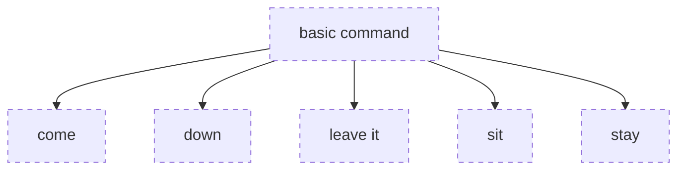

### Taxonomy of breed

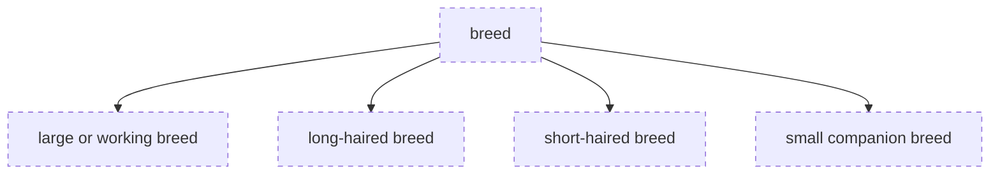

### Taxonomy of dog

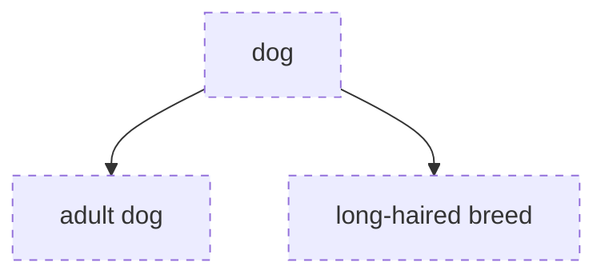

### Taxonomy of food poisonous to dogs

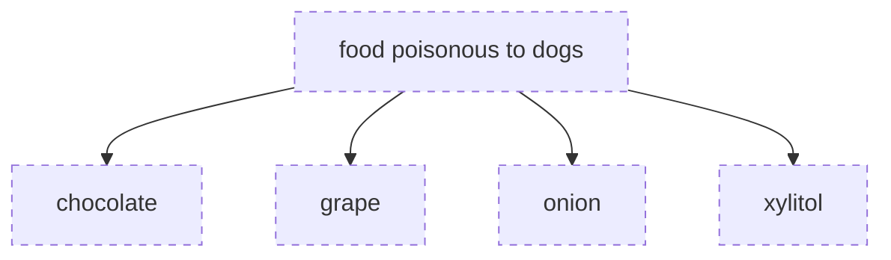

### Taxonomy of grooming

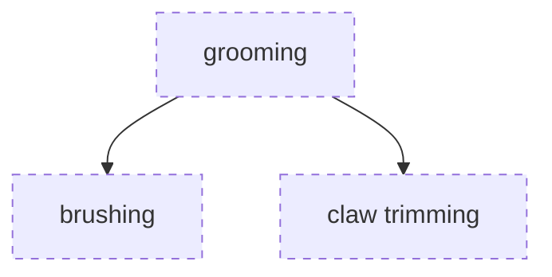

### Taxonomy of leash

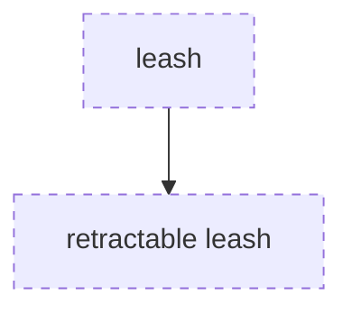

### Taxonomy of vaccination

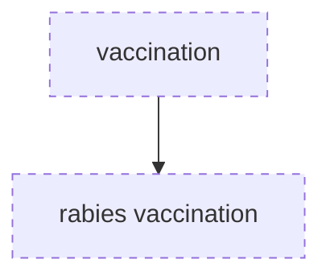

### Other concepts


### Other concepts


## Concepts and relations

### Relations under breed

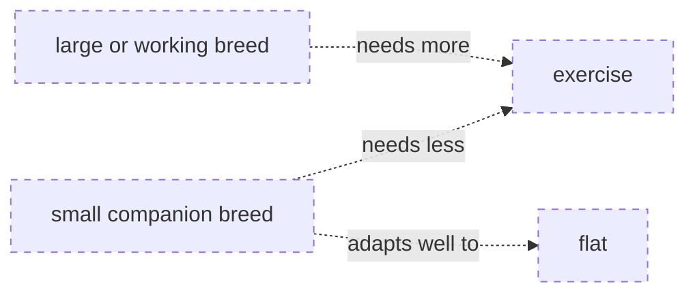

### Relations under dog

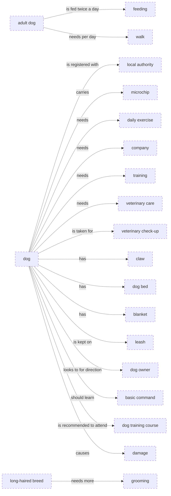

### Relations under dog owner

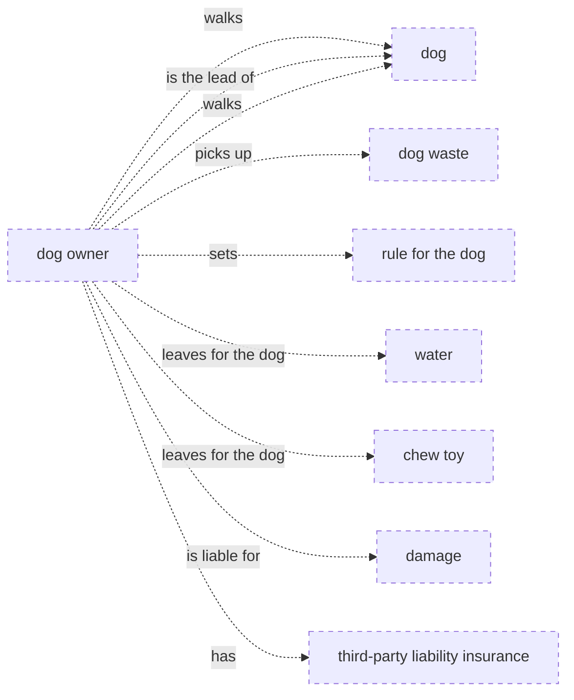

### Relations under dog training course

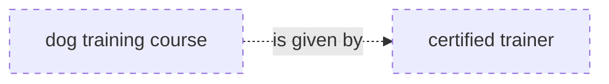

### Relations under dog waste

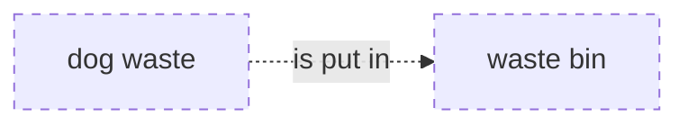

### Relations under family


### Relations under food poisonous to dogs


### Relations under free-running sign


### Relations under grooming

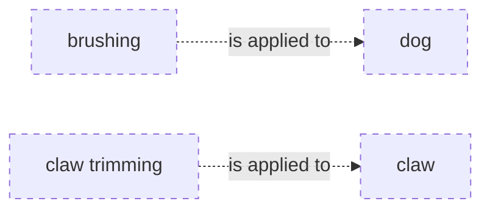

### Relations under leash

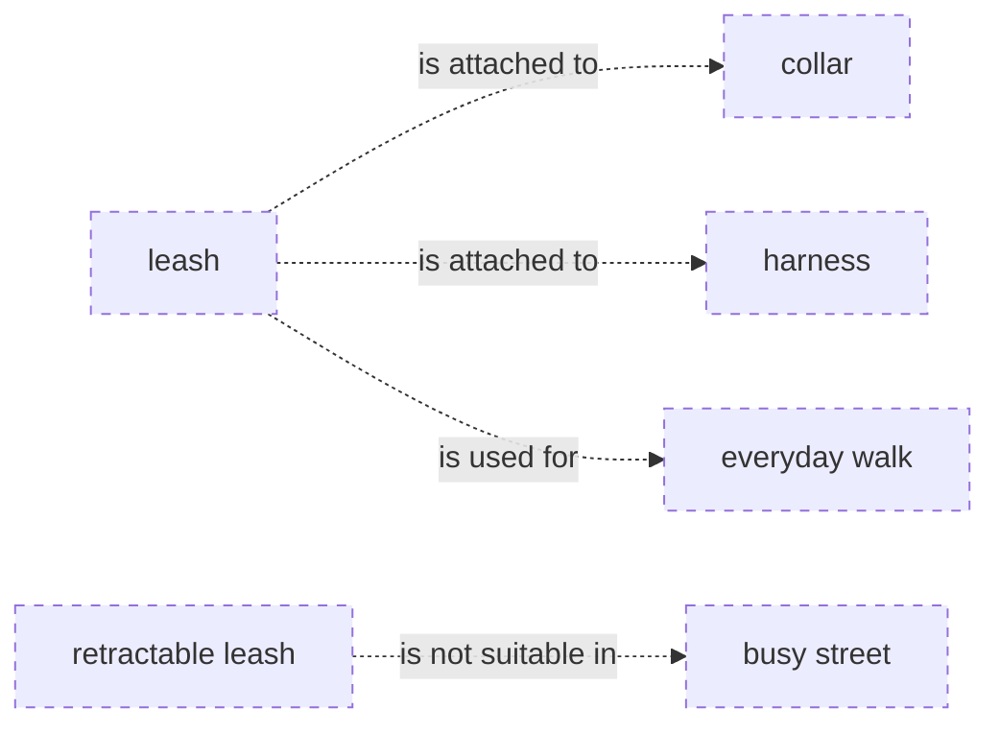

### Relations under leash training


### Relations under reward

```mermaid
flowchart LR
    classDef draft stroke-dasharray: 5 5
    cn_01M82GR8C6YNAW05QP8GX3MF7V["good behaviour"]
    cn_01M82GR8C6YNAW05QP8GX3MF7X["reward"]
    cn_01M82GR8C6YNAW05QP8GX3MF7X -. "is given for" .-> cn_01M82GR8C6YNAW05QP8GX3MF7V
    class cn_01M82GR8C6YNAW05QP8GX3MF7V,cn_01M82GR8C6YNAW05QP8GX3MF7X draft
```

### Relations under veterinary check-up

```mermaid
flowchart LR
    classDef draft stroke-dasharray: 5 5
    cn_01M82GMKV1KS5PBE1QB2P99CPC["veterinarian"]
    cn_01M82GMKV1KS5PBE1QB2P99CPD["veterinary check-up"]
    cn_01M82GMKV1KS5PBE1QB2P99CPD -. "is performed by" .-> cn_01M82GMKV1KS5PBE1QB2P99CPC
    class cn_01M82GMKV1KS5PBE1QB2P99CPC,cn_01M82GMKV1KS5PBE1QB2P99CPD draft
```

## Concepts

<a id="cn_01M82GM2G3AM0SX444VHV3202F"></a>
### adult dog · ● proposed

- **Is a:** [dog](#cn_01M82GJP3CRKNX3DNJZDNANDWM)
- **Level:** 2
- **Evidence:** [§8](#su_01M82GHYMP28WWGVJCAF7BMQCQ), [§14](#su_01M82GHYMQYRXNHXCXTMK9HDP5), [§22](#su_01M82GHYMR2WSZZZXCEPR86V3Q)

<a id="cn_01M82GS0NSGHH6X6DCYVS251BV"></a>
### basic command · ● proposed

One of five commands every dog should learn: sit, down, stay, come and leave it.

- **Level:** 2
- **Evidence:** [§20](#su_01M82GHYMQYRXNHXCXTMK9HDPD)

<a id="cn_01M82GN67QTV2KDH6NRHKR2S03"></a>
### blanket · ● proposed

- **Level:** 2
- **Evidence:** [§10](#su_01M82GHYMP28WWGVJCAF7BMQCV)

<a id="cn_01M82GKFJ96730WAHGQQD3M958"></a>
### breed · ● proposed

- **Level:** 2
- **Evidence:** [§3](#su_01M82GHYMP28WWGVJCAF7BMQCH), [§7](#su_01M82GHYMP28WWGVJCAF7BMQCN)

<a id="cn_01M82GN67QTV2KDH6NRHKR2RZZ"></a>
### brushing · ● proposed

- **Is a:** [grooming](#cn_01M82GKFJ96730WAHGQQD3M95H)
- **Level:** 2
- **Evidence:** [§10](#su_01M82GHYMP28WWGVJCAF7BMQCV)

<a id="cn_01M82GPB8ZK0N7S1VR303H5EPG"></a>
### busy street · ● proposed

- **Level:** 2
- **Evidence:** [§12](#su_01M82GHYMQYRXNHXCXTMK9HDP1)

<a id="cn_01M82GS0NSGHH6X6DCYVS251C3"></a>
### certified trainer · ● proposed

- **Level:** 2
- **Evidence:** [§21](#su_01M82GHYMQYRXNHXCXTMK9HDPE)

<a id="cn_01M82GSR24145KC6KF8V0HWF9K"></a>
### chew toy · ● proposed

- **Level:** 2
- **Evidence:** [§23](#su_01M82GHYMR2WSZZZXCEPR86V3R)

<a id="cn_01M82GM2G3AM0SX444VHV3202M"></a>
### chocolate · ● proposed

- **Is a:** [food poisonous to dogs](#cn_01M82GM2G3AM0SX444VHV3202K)
- **Level:** 2
- **Evidence:** [§8](#su_01M82GHYMP28WWGVJCAF7BMQCQ)

<a id="cn_01M82GN67QTV2KDH6NRHKR2S01"></a>
### claw · ● proposed

- **Level:** 2
- **Evidence:** [§10](#su_01M82GHYMP28WWGVJCAF7BMQCV)

<a id="cn_01M82GN67QTV2KDH6NRHKR2S00"></a>
### claw trimming · ● proposed

- **Is a:** [grooming](#cn_01M82GKFJ96730WAHGQQD3M95H)
- **Level:** 2
- **Evidence:** [§10](#su_01M82GHYMP28WWGVJCAF7BMQCV)

<a id="cn_01M82GPB8ZK0N7S1VR303H5EPD"></a>
### collar · ● proposed

- **Level:** 2
- **Evidence:** [§12](#su_01M82GHYMQYRXNHXCXTMK9HDP1)

<a id="cn_01M82GS0NSGHH6X6DCYVS251BZ"></a>
### come · ● proposed

- **Is a:** [basic command](#cn_01M82GS0NSGHH6X6DCYVS251BV)
- **Level:** 2
- **Evidence:** [§20](#su_01M82GHYMQYRXNHXCXTMK9HDPD)

<a id="cn_01M82GR8C6YNAW05QP8GX3MF7R"></a>
### command word · ● proposed

- **Level:** 2
- **Evidence:** [§16](#su_01M82GHYMQYRXNHXCXTMK9HDP8)

<a id="cn_01M82GJP3CRKNX3DNJZDNANDWR"></a>
### company · ● proposed

- **Level:** 2
- **Evidence:** [§1](#su_01M82GHYMP28WWGVJCAF7BMQCE)

<a id="cn_01M82GJP3CRKNX3DNJZDNANDWQ"></a>
### daily exercise · ● proposed

- **Level:** 2
- **Evidence:** [§1](#su_01M82GHYMP28WWGVJCAF7BMQCE)

<a id="cn_01M82GV0DCSP2BSTQA19ENCPJ1"></a>
### damage · ● proposed

- **Level:** 2
- **Evidence:** [§25](#su_01M82GHYMR2WSZZZXCEPR86V3W)

<a id="cn_01M82GJP3CRKNX3DNJZDNANDWM"></a>
### dog · ● proposed

- **Level:** 1
- **Evidence:** [§1](#su_01M82GHYMP28WWGVJCAF7BMQCE), [§2](#su_01M82GHYMP28WWGVJCAF7BMQCF), [§8](#su_01M82GHYMP28WWGVJCAF7BMQCQ), [§9](#su_01M82GHYMP28WWGVJCAF7BMQCS), [§10](#su_01M82GHYMP28WWGVJCAF7BMQCV), [§11](#su_01M82GHYMQYRXNHXCXTMK9HDNY), [§13](#su_01M82GHYMQYRXNHXCXTMK9HDP3), [§14](#su_01M82GHYMQYRXNHXCXTMK9HDP5), [§15](#su_01M82GHYMQYRXNHXCXTMK9HDP7), [§17](#su_01M82GHYMQYRXNHXCXTMK9HDP9), [§19](#su_01M82GHYMQYRXNHXCXTMK9HDPB), [§20](#su_01M82GHYMQYRXNHXCXTMK9HDPD), [§21](#su_01M82GHYMQYRXNHXCXTMK9HDPE), [§22](#su_01M82GHYMR2WSZZZXCEPR86V3Q), [§23](#su_01M82GHYMR2WSZZZXCEPR86V3R), [§24](#su_01M82GHYMR2WSZZZXCEPR86V3T), [§25](#su_01M82GHYMR2WSZZZXCEPR86V3W)

<a id="cn_01M82GN67QTV2KDH6NRHKR2S02"></a>
### dog bed · ● proposed

- **Synonyms:** bed
- **Level:** 2
- **Evidence:** [§10](#su_01M82GHYMP28WWGVJCAF7BMQCV)

<a id="cn_01M82GR8C6YNAW05QP8GX3MF7P"></a>
### dog owner · ● proposed

- **Synonyms:** owner
- **Level:** 1
- **Evidence:** [§14](#su_01M82GHYMQYRXNHXCXTMK9HDP5), [§19](#su_01M82GHYMQYRXNHXCXTMK9HDPB), [§23](#su_01M82GHYMR2WSZZZXCEPR86V3R), [§25](#su_01M82GHYMR2WSZZZXCEPR86V3W)

<a id="cn_01M82GS0NSGHH6X6DCYVS251C2"></a>
### dog training course · ● proposed

- **Level:** 2
- **Evidence:** [§21](#su_01M82GHYMQYRXNHXCXTMK9HDPE)

<a id="cn_01M82GQHZCWYDZ4FY134N19HRE"></a>
### dog waste · ● proposed

- **Synonyms:** waste
- **Level:** 1
- **Evidence:** [§14](#su_01M82GHYMQYRXNHXCXTMK9HDP5)

<a id="cn_01M82GS0NSGHH6X6DCYVS251BX"></a>
### down · ● proposed

- **Is a:** [basic command](#cn_01M82GS0NSGHH6X6DCYVS251BV)
- **Level:** 2
- **Evidence:** [§20](#su_01M82GHYMQYRXNHXCXTMK9HDPD)

<a id="cn_01M82GPB8ZK0N7S1VR303H5EPF"></a>
### everyday walk · ● proposed

- **Level:** 2
- **Evidence:** [§12](#su_01M82GHYMQYRXNHXCXTMK9HDP1)

<a id="cn_01M82GKFJ96730WAHGQQD3M95J"></a>
### exercise · ● proposed

- **Level:** 2
- **Evidence:** [§4](#su_01M82GHYMP28WWGVJCAF7BMQCJ), [§5](#su_01M82GHYMP28WWGVJCAF7BMQCK)

<a id="cn_01M82GR8C6YNAW05QP8GX3MF7S"></a>
### family · ● proposed

- **Level:** 2
- **Evidence:** [§16](#su_01M82GHYMQYRXNHXCXTMK9HDP8)

<a id="cn_01M82GM2G3AM0SX444VHV3202H"></a>
### feeding · ● proposed

- **Synonyms:** feed
- **Level:** 2
- **Evidence:** [§8](#su_01M82GHYMP28WWGVJCAF7BMQCQ)

<a id="cn_01M82GKFJ96730WAHGQQD3M95G"></a>
### flat · ● proposed

- **Synonyms:** flats
- **Level:** 2
- **Evidence:** [§4](#su_01M82GHYMP28WWGVJCAF7BMQCJ)

<a id="cn_01M82GM2G3AM0SX444VHV3202K"></a>
### food poisonous to dogs · ● proposed

- **Level:** 2
- **Evidence:** [§8](#su_01M82GHYMP28WWGVJCAF7BMQCQ)

<a id="cn_01M82GV0DCSP2BSTQA19ENCPJ7"></a>
### free-running sign · ● proposed

- **Synonyms:** sign
- **Level:** 2
- **Evidence:** [§25](#su_01M82GHYMR2WSZZZXCEPR86V3W)

<a id="cn_01M82GM2G3AM0SX444VHV3202J"></a>
### fresh water · ● proposed

- **Level:** 2
- **Evidence:** [§8](#su_01M82GHYMP28WWGVJCAF7BMQCQ)

<a id="cn_01M82GR8C6YNAW05QP8GX3MF7V"></a>
### good behaviour · ● proposed

- **Level:** 2
- **Evidence:** [§18](#su_01M82GHYMQYRXNHXCXTMK9HDPA)

<a id="cn_01M82GM2G3AM0SX444VHV3202N"></a>
### grape · ● proposed

- **Synonyms:** grapes
- **Is a:** [food poisonous to dogs](#cn_01M82GM2G3AM0SX444VHV3202K)
- **Level:** 2
- **Evidence:** [§8](#su_01M82GHYMP28WWGVJCAF7BMQCQ)

<a id="cn_01M82GKFJ96730WAHGQQD3M95H"></a>
### grooming · ● proposed

- **Level:** 2
- **Evidence:** [§6](#su_01M82GHYMP28WWGVJCAF7BMQCM), [§10](#su_01M82GHYMP28WWGVJCAF7BMQCV)

<a id="cn_01M82GPB8ZK0N7S1VR303H5EPE"></a>
### harness · ● proposed

- **Level:** 2
- **Evidence:** [§12](#su_01M82GHYMQYRXNHXCXTMK9HDP1)

<a id="cn_01M82GQHZCWYDZ4FY134N19HRB"></a>
### large breed · ● proposed

- **Level:** 2
- **Evidence:** [§14](#su_01M82GHYMQYRXNHXCXTMK9HDP5)

<a id="cn_01M82GKFJ96730WAHGQQD3M95A"></a>
### large or working breed · ● proposed

- **Synonyms:** large and working breeds
- **Is a:** [breed](#cn_01M82GKFJ96730WAHGQQD3M958)
- **Level:** 2
- **Evidence:** [§5](#su_01M82GHYMP28WWGVJCAF7BMQCK)

<a id="cn_01M82GR8C6YNAW05QP8GX3MF7Q"></a>
### lead (leader) · ● proposed

A calm, consistent and confident leader whose signals the dog can trust.

- **Synonyms:** lead
- **Level:** 2
- **Evidence:** [§15](#su_01M82GHYMQYRXNHXCXTMK9HDP7), [§19](#su_01M82GHYMQYRXNHXCXTMK9HDPB)

<a id="cn_01M82GPB8ZK0N7S1VR303H5EPB"></a>
### leash · ● proposed

- **Level:** 1
- **Evidence:** [§12](#su_01M82GHYMQYRXNHXCXTMK9HDP1), [§13](#su_01M82GHYMQYRXNHXCXTMK9HDP3), [§25](#su_01M82GHYMR2WSZZZXCEPR86V3W)

<a id="cn_01M82GPTF0J0A1WWEWDR3G29FG"></a>
### leash training · ● proposed

- **Level:** 2
- **Evidence:** [§13](#su_01M82GHYMQYRXNHXCXTMK9HDP3)

<a id="cn_01M82GS0NSGHH6X6DCYVS251C0"></a>
### leave it · ● proposed

- **Is a:** [basic command](#cn_01M82GS0NSGHH6X6DCYVS251BV)
- **Level:** 2
- **Evidence:** [§20](#su_01M82GHYMQYRXNHXCXTMK9HDPD)

<a id="cn_01M82GSR24145KC6KF8V0HWF9G"></a>
### leaving the dog alone · ● proposed

- **Level:** 2
- **Evidence:** [§22](#su_01M82GHYMR2WSZZZXCEPR86V3Q), [§23](#su_01M82GHYMR2WSZZZXCEPR86V3R)

<a id="cn_01M82GJP3CRKNX3DNJZDNANDWN"></a>
### local authority · ● proposed

- **Level:** 1
- **Evidence:** [§2](#su_01M82GHYMP28WWGVJCAF7BMQCF), [§7](#su_01M82GHYMP28WWGVJCAF7BMQCN), [§25](#su_01M82GHYMR2WSZZZXCEPR86V3W)

<a id="cn_01M82GKFJ96730WAHGQQD3M95B"></a>
### long-haired breed · ● proposed

- **Synonyms:** long-haired breeds
- **Is a:** [dog](#cn_01M82GJP3CRKNX3DNJZDNANDWM), [breed](#cn_01M82GKFJ96730WAHGQQD3M958)
- **Level:** 2
- **Evidence:** [§6](#su_01M82GHYMP28WWGVJCAF7BMQCM), [§10](#su_01M82GHYMP28WWGVJCAF7BMQCV)

<a id="cn_01M82GJP3CRKNX3DNJZDNANDWP"></a>
### microchip · ● proposed

- **Level:** 1
- **Evidence:** [§2](#su_01M82GHYMP28WWGVJCAF7BMQCF), [§24](#su_01M82GHYMR2WSZZZXCEPR86V3T)

<a id="cn_01M82GM2G3AM0SX444VHV3202P"></a>
### onion · ● proposed

- **Synonyms:** onions
- **Is a:** [food poisonous to dogs](#cn_01M82GM2G3AM0SX444VHV3202K)
- **Level:** 2
- **Evidence:** [§8](#su_01M82GHYMP28WWGVJCAF7BMQCQ)

<a id="cn_01M82GV0DCSP2BSTQA19ENCPJ6"></a>
### public place · ● proposed

- **Synonyms:** public places
- **Level:** 2
- **Evidence:** [§25](#su_01M82GHYMR2WSZZZXCEPR86V3W)

<a id="cn_01M82GMKV1KS5PBE1QB2P99CPB"></a>
### rabies vaccination · ● proposed

- **Is a:** [vaccination](#cn_01M82GMKV1KS5PBE1QB2P99CPA)
- **Level:** 2
- **Evidence:** [§9](#su_01M82GHYMP28WWGVJCAF7BMQCS), [§24](#su_01M82GHYMR2WSZZZXCEPR86V3T)

<a id="cn_01M82GPB8ZK0N7S1VR303H5EPC"></a>
### retractable leash · ● proposed

- **Is a:** [leash](#cn_01M82GPB8ZK0N7S1VR303H5EPB)
- **Level:** 2
- **Evidence:** [§12](#su_01M82GHYMQYRXNHXCXTMK9HDP1)

<a id="cn_01M82GR8C6YNAW05QP8GX3MF7X"></a>
### reward · ● proposed

- **Level:** 2
- **Evidence:** [§18](#su_01M82GHYMQYRXNHXCXTMK9HDPA)

<a id="cn_01M82GR8C6YNAW05QP8GX3MF7T"></a>
### rule for the dog · ● proposed

- **Level:** 2
- **Evidence:** [§17](#su_01M82GHYMQYRXNHXCXTMK9HDP9)

<a id="cn_01M82GKFJ96730WAHGQQD3M95C"></a>
### short-haired breed · ● proposed

- **Synonyms:** short-haired breeds
- **Is a:** [breed](#cn_01M82GKFJ96730WAHGQQD3M958)
- **Level:** 2
- **Evidence:** [§6](#su_01M82GHYMP28WWGVJCAF7BMQCM)

<a id="cn_01M82GS0NSGHH6X6DCYVS251BW"></a>
### sit · ● proposed

- **Is a:** [basic command](#cn_01M82GS0NSGHH6X6DCYVS251BV)
- **Level:** 2
- **Evidence:** [§20](#su_01M82GHYMQYRXNHXCXTMK9HDPD)

<a id="cn_01M82GQHZCWYDZ4FY134N19HRA"></a>
### small breed · ● proposed

- **Level:** 2
- **Evidence:** [§14](#su_01M82GHYMQYRXNHXCXTMK9HDP5)

<a id="cn_01M82GKFJ96730WAHGQQD3M959"></a>
### small companion breed · ● proposed

- **Synonyms:** small companion breeds
- **Is a:** [breed](#cn_01M82GKFJ96730WAHGQQD3M958)
- **Level:** 2
- **Evidence:** [§4](#su_01M82GHYMP28WWGVJCAF7BMQCJ)

<a id="cn_01M82GS0NSGHH6X6DCYVS251BY"></a>
### stay · ● proposed

- **Is a:** [basic command](#cn_01M82GS0NSGHH6X6DCYVS251BV)
- **Level:** 2
- **Evidence:** [§20](#su_01M82GHYMQYRXNHXCXTMK9HDPD)

<a id="cn_01M82GV0DCSP2BSTQA19ENCPJ2"></a>
### third-party liability insurance · ● proposed

- **Level:** 2
- **Evidence:** [§25](#su_01M82GHYMR2WSZZZXCEPR86V3W)

<a id="cn_01M82GJP3CRKNX3DNJZDNANDWS"></a>
### training · ● proposed

- **Level:** 2
- **Evidence:** [§1](#su_01M82GHYMP28WWGVJCAF7BMQCE)

<a id="cn_01M82GS0NSGHH6X6DCYVS251C1"></a>
### training session · ● proposed

- **Synonyms:** session
- **Level:** 2
- **Evidence:** [§20](#su_01M82GHYMQYRXNHXCXTMK9HDPD)

<a id="cn_01M82GR8C6YNAW05QP8GX3MF7W"></a>
### unwanted behaviour · ● proposed

- **Level:** 2
- **Evidence:** [§18](#su_01M82GHYMQYRXNHXCXTMK9HDPA)

<a id="cn_01M82GMKV1KS5PBE1QB2P99CPA"></a>
### vaccination · ● proposed

- **Level:** 2
- **Evidence:** [§9](#su_01M82GHYMP28WWGVJCAF7BMQCS)

<a id="cn_01M82GMKV1KS5PBE1QB2P99CPC"></a>
### veterinarian · ● proposed

- **Level:** 2
- **Evidence:** [§9](#su_01M82GHYMP28WWGVJCAF7BMQCS)

<a id="cn_01M82GJP3CRKNX3DNJZDNANDWT"></a>
### veterinary care · ● proposed

- **Level:** 2
- **Evidence:** [§1](#su_01M82GHYMP28WWGVJCAF7BMQCE)

<a id="cn_01M82GMKV1KS5PBE1QB2P99CPD"></a>
### veterinary check-up · ● proposed

- **Synonyms:** check-up
- **Level:** 2
- **Evidence:** [§9](#su_01M82GHYMP28WWGVJCAF7BMQCS)

<a id="cn_01M82GPTF0J0A1WWEWDR3G29FM"></a>
### walk · ● proposed

- **Synonyms:** walking
- **Level:** 2
- **Evidence:** [§13](#su_01M82GHYMQYRXNHXCXTMK9HDP3)

<a id="cn_01M82GQHZCWYDZ4FY134N19HRD"></a>
### walk · ● proposed

- **Level:** 2
- **Evidence:** [§14](#su_01M82GHYMQYRXNHXCXTMK9HDP5), [§23](#su_01M82GHYMR2WSZZZXCEPR86V3R)

<a id="cn_01M82GQHZCWYDZ4FY134N19HRF"></a>
### waste bin · ● proposed

- **Level:** 1
- **Evidence:** [§14](#su_01M82GHYMQYRXNHXCXTMK9HDP5)

<a id="cn_01M82GSR24145KC6KF8V0HWF9J"></a>
### water · ● proposed

- **Level:** 2
- **Evidence:** [§23](#su_01M82GHYMR2WSZZZXCEPR86V3R)

<a id="cn_01M82GQHZCWYDZ4FY134N19HRC"></a>
### working breed · ● proposed

- **Level:** 2
- **Evidence:** [§14](#su_01M82GHYMQYRXNHXCXTMK9HDP5)

<a id="cn_01M82GM2G3AM0SX444VHV3202Q"></a>
### xylitol · ● proposed

- **Is a:** [food poisonous to dogs](#cn_01M82GM2G3AM0SX444VHV3202K)
- **Level:** 2
- **Evidence:** [§8](#su_01M82GHYMP28WWGVJCAF7BMQCQ)

## Relations

<a id="rl_01M82GKFJ96730WAHGQQD3M95N"></a>
### adapts well to · ● proposed

- [small companion breed](#cn_01M82GKFJ96730WAHGQQD3M959) — adapts well to → [flat](#cn_01M82GKFJ96730WAHGQQD3M95G)
- **Level:** 2
- **Evidence:** [§4](#su_01M82GHYMP28WWGVJCAF7BMQCJ)

<a id="rl_01M82GJP3CRKNX3DNJZDNANDWW"></a>
### carries · ● proposed

- [dog](#cn_01M82GJP3CRKNX3DNJZDNANDWM) — carries → [microchip](#cn_01M82GJP3CRKNX3DNJZDNANDWP)
- **Level:** 1
- **Evidence:** [§2](#su_01M82GHYMP28WWGVJCAF7BMQCF)

<a id="rl_01M82GV0DCSP2BSTQA19ENCPJ9"></a>
### causes · ● proposed

- [dog](#cn_01M82GJP3CRKNX3DNJZDNANDWM) — causes → [damage](#cn_01M82GV0DCSP2BSTQA19ENCPJ1)
- **Level:** 2
- **Evidence:** [§25](#su_01M82GHYMR2WSZZZXCEPR86V3W)

<a id="rl_01M82GN67QTV2KDH6NRHKR2S04"></a>
### has · ● proposed

- [dog](#cn_01M82GJP3CRKNX3DNJZDNANDWM) — has → [claw](#cn_01M82GN67QTV2KDH6NRHKR2S01)
- **Level:** 2
- **Evidence:** [§10](#su_01M82GHYMP28WWGVJCAF7BMQCV)

<a id="rl_01M82GN67QTV2KDH6NRHKR2S07"></a>
### has · ● proposed

- [dog](#cn_01M82GJP3CRKNX3DNJZDNANDWM) — has → [dog bed](#cn_01M82GN67QTV2KDH6NRHKR2S02)
- **Level:** 2
- **Evidence:** [§10](#su_01M82GHYMP28WWGVJCAF7BMQCV)

<a id="rl_01M82GN67QTV2KDH6NRHKR2S08"></a>
### has · ● proposed

- [dog](#cn_01M82GJP3CRKNX3DNJZDNANDWM) — has → [blanket](#cn_01M82GN67QTV2KDH6NRHKR2S03)
- **Level:** 2
- **Evidence:** [§10](#su_01M82GHYMP28WWGVJCAF7BMQCV)

<a id="rl_01M82GV0DCSP2BSTQA19ENCPJA"></a>
### has · ● proposed

- [dog owner](#cn_01M82GR8C6YNAW05QP8GX3MF7P) — has → [third-party liability insurance](#cn_01M82GV0DCSP2BSTQA19ENCPJ2)
- **Level:** 2
- **Evidence:** [§25](#su_01M82GHYMR2WSZZZXCEPR86V3W)

<a id="rl_01M82GN67QTV2KDH6NRHKR2S05"></a>
### is applied to · ● proposed

- [claw trimming](#cn_01M82GN67QTV2KDH6NRHKR2S00) — is applied to → [claw](#cn_01M82GN67QTV2KDH6NRHKR2S01)
- **Level:** 2
- **Evidence:** [§10](#su_01M82GHYMP28WWGVJCAF7BMQCV)

<a id="rl_01M82GN67QTV2KDH6NRHKR2S06"></a>
### is applied to · ● proposed

- [brushing](#cn_01M82GN67QTV2KDH6NRHKR2RZZ) — is applied to → [dog](#cn_01M82GJP3CRKNX3DNJZDNANDWM)
- **Level:** 2
- **Evidence:** [§10](#su_01M82GHYMP28WWGVJCAF7BMQCV)

<a id="rl_01M82GPB8ZK0N7S1VR303H5EPJ"></a>
### is attached to · ● proposed

- [leash](#cn_01M82GPB8ZK0N7S1VR303H5EPB) — is attached to → [collar](#cn_01M82GPB8ZK0N7S1VR303H5EPD)
- **Level:** 2
- **Evidence:** [§12](#su_01M82GHYMQYRXNHXCXTMK9HDP1)

<a id="rl_01M82GPB8ZK0N7S1VR303H5EPK"></a>
### is attached to · ● proposed

- [leash](#cn_01M82GPB8ZK0N7S1VR303H5EPB) — is attached to → [harness](#cn_01M82GPB8ZK0N7S1VR303H5EPE)
- **Level:** 2
- **Evidence:** [§12](#su_01M82GHYMQYRXNHXCXTMK9HDP1)

<a id="rl_01M82GM2G3AM0SX444VHV3202S"></a>
### is fed twice a day · ● proposed

- [adult dog](#cn_01M82GM2G3AM0SX444VHV3202F) — is fed twice a day → [feeding](#cn_01M82GM2G3AM0SX444VHV3202H)
- **Cardinality:** at least 2, at most 2
- **Level:** 2
- **Evidence:** [§8](#su_01M82GHYMP28WWGVJCAF7BMQCQ)

<a id="rl_01M82GS0NSGHH6X6DCYVS251C8"></a>
### is given by · ● proposed

- [dog training course](#cn_01M82GS0NSGHH6X6DCYVS251C2) — is given by → [certified trainer](#cn_01M82GS0NSGHH6X6DCYVS251C3)
- **Level:** 2
- **Evidence:** [§21](#su_01M82GHYMQYRXNHXCXTMK9HDPE)

<a id="rl_01M82GR8C6YNAW05QP8GX3MF82"></a>
### is given for · ● proposed

- [reward](#cn_01M82GR8C6YNAW05QP8GX3MF7X) — is given for → [good behaviour](#cn_01M82GR8C6YNAW05QP8GX3MF7V)
- **Level:** 2
- **Evidence:** [§18](#su_01M82GHYMQYRXNHXCXTMK9HDPA)

<a id="rl_01M82GV0DCSP2BSTQA19ENCPJC"></a>
### is kept on · ● proposed

- [dog](#cn_01M82GJP3CRKNX3DNJZDNANDWM) — is kept on → [leash](#cn_01M82GPB8ZK0N7S1VR303H5EPB)
- **Level:** 1
- **Evidence:** [§25](#su_01M82GHYMR2WSZZZXCEPR86V3W)

<a id="rl_01M82GV0DCSP2BSTQA19ENCPJ8"></a>
### is liable for · ● proposed

- [dog owner](#cn_01M82GR8C6YNAW05QP8GX3MF7P) — is liable for → [damage](#cn_01M82GV0DCSP2BSTQA19ENCPJ1)
- **Level:** 1
- **Evidence:** [§25](#su_01M82GHYMR2WSZZZXCEPR86V3W)

<a id="rl_01M82GV0DCSP2BSTQA19ENCPJD"></a>
### is located in · ● proposed

- [free-running sign](#cn_01M82GV0DCSP2BSTQA19ENCPJ7) — is located in → [public place](#cn_01M82GV0DCSP2BSTQA19ENCPJ6)
- **Level:** 2
- **Evidence:** [§25](#su_01M82GHYMR2WSZZZXCEPR86V3W)

<a id="rl_01M82GPB8ZK0N7S1VR303H5EPM"></a>
### is not suitable in · ● proposed

- [retractable leash](#cn_01M82GPB8ZK0N7S1VR303H5EPC) — is not suitable in → [busy street](#cn_01M82GPB8ZK0N7S1VR303H5EPG)
- **Level:** 2
- **Evidence:** [§12](#su_01M82GHYMQYRXNHXCXTMK9HDP1)

<a id="rl_01M82GMKV1KS5PBE1QB2P99CPG"></a>
### is performed by · ● proposed

- [veterinary check-up](#cn_01M82GMKV1KS5PBE1QB2P99CPD) — is performed by → [veterinarian](#cn_01M82GMKV1KS5PBE1QB2P99CPC)
- **Level:** 2
- **Evidence:** [§9](#su_01M82GHYMP28WWGVJCAF7BMQCS)

<a id="rl_01M82GM2G3AM0SX444VHV3202R"></a>
### is poisonous to · ● proposed

- [food poisonous to dogs](#cn_01M82GM2G3AM0SX444VHV3202K) — is poisonous to → [dog](#cn_01M82GJP3CRKNX3DNJZDNANDWM)
- **Level:** 2
- **Evidence:** [§8](#su_01M82GHYMP28WWGVJCAF7BMQCQ)

<a id="rl_01M82GQHZCWYDZ4FY134N19HRJ"></a>
### is put in · ● proposed

- [dog waste](#cn_01M82GQHZCWYDZ4FY134N19HRE) — is put in → [waste bin](#cn_01M82GQHZCWYDZ4FY134N19HRF)
- **Level:** 1
- **Evidence:** [§14](#su_01M82GHYMQYRXNHXCXTMK9HDP5)

<a id="rl_01M82GS0NSGHH6X6DCYVS251C9"></a>
### is recommended to attend · ● proposed

- [dog](#cn_01M82GJP3CRKNX3DNJZDNANDWM) — is recommended to attend → [dog training course](#cn_01M82GS0NSGHH6X6DCYVS251C2)
- **Level:** 2
- **Evidence:** [§21](#su_01M82GHYMQYRXNHXCXTMK9HDPE)

<a id="rl_01M82GJP3CRKNX3DNJZDNANDWV"></a>
### is registered with · ● proposed

- [dog](#cn_01M82GJP3CRKNX3DNJZDNANDWM) — is registered with → [local authority](#cn_01M82GJP3CRKNX3DNJZDNANDWN)
- **Level:** 1
- **Evidence:** [§2](#su_01M82GHYMP28WWGVJCAF7BMQCF)

<a id="rl_01M82GMKV1KS5PBE1QB2P99CPF"></a>
### is taken for · ● proposed

- [dog](#cn_01M82GJP3CRKNX3DNJZDNANDWM) — is taken for → [veterinary check-up](#cn_01M82GMKV1KS5PBE1QB2P99CPD)
- **Level:** 2
- **Evidence:** [§9](#su_01M82GHYMP28WWGVJCAF7BMQCS)

<a id="rl_01M82GR8C6YNAW05QP8GX3MF7Y"></a>
### is the lead of · ● proposed

- [dog owner](#cn_01M82GR8C6YNAW05QP8GX3MF7P) — is the lead of → [dog](#cn_01M82GJP3CRKNX3DNJZDNANDWM)
- **Level:** 2
- **Evidence:** [§15](#su_01M82GHYMQYRXNHXCXTMK9HDP7), [§19](#su_01M82GHYMQYRXNHXCXTMK9HDPB)

<a id="rl_01M82GPB8ZK0N7S1VR303H5EPH"></a>
### is used for · ● proposed

- [leash](#cn_01M82GPB8ZK0N7S1VR303H5EPB) — is used for → [everyday walk](#cn_01M82GPB8ZK0N7S1VR303H5EPF)
- **Level:** 2
- **Evidence:** [§12](#su_01M82GHYMQYRXNHXCXTMK9HDP1)

<a id="rl_01M82GSR24145KC6KF8V0HWF9P"></a>
### leaves for the dog · ● proposed

- [dog owner](#cn_01M82GR8C6YNAW05QP8GX3MF7P) — leaves for the dog → [water](#cn_01M82GSR24145KC6KF8V0HWF9J)
- **Level:** 2
- **Evidence:** [§23](#su_01M82GHYMR2WSZZZXCEPR86V3R)

<a id="rl_01M82GSR24145KC6KF8V0HWF9Q"></a>
### leaves for the dog · ● proposed

- [dog owner](#cn_01M82GR8C6YNAW05QP8GX3MF7P) — leaves for the dog → [chew toy](#cn_01M82GSR24145KC6KF8V0HWF9K)
- **Level:** 2
- **Evidence:** [§23](#su_01M82GHYMR2WSZZZXCEPR86V3R)

<a id="rl_01M82GR8C6YNAW05QP8GX3MF7Z"></a>
### looks to for direction · ● proposed

- [dog](#cn_01M82GJP3CRKNX3DNJZDNANDWM) — looks to for direction → [dog owner](#cn_01M82GR8C6YNAW05QP8GX3MF7P)
- **Level:** 2
- **Evidence:** [§15](#su_01M82GHYMQYRXNHXCXTMK9HDP7)

<a id="rl_01M82GJP3CRKNX3DNJZDNANDWX"></a>
### needs · ● proposed

- [dog](#cn_01M82GJP3CRKNX3DNJZDNANDWM) — needs → [daily exercise](#cn_01M82GJP3CRKNX3DNJZDNANDWQ)
- **Level:** 2
- **Evidence:** [§1](#su_01M82GHYMP28WWGVJCAF7BMQCE)

<a id="rl_01M82GJP3CRKNX3DNJZDNANDWY"></a>
### needs · ● proposed

- [dog](#cn_01M82GJP3CRKNX3DNJZDNANDWM) — needs → [company](#cn_01M82GJP3CRKNX3DNJZDNANDWR)
- **Level:** 2
- **Evidence:** [§1](#su_01M82GHYMP28WWGVJCAF7BMQCE)

<a id="rl_01M82GJP3CRKNX3DNJZDNANDWZ"></a>
### needs · ● proposed

- [dog](#cn_01M82GJP3CRKNX3DNJZDNANDWM) — needs → [training](#cn_01M82GJP3CRKNX3DNJZDNANDWS)
- **Level:** 2
- **Evidence:** [§1](#su_01M82GHYMP28WWGVJCAF7BMQCE)

<a id="rl_01M82GJP3CRKNX3DNJZDNANDX0"></a>
### needs · ● proposed

- [dog](#cn_01M82GJP3CRKNX3DNJZDNANDWM) — needs → [veterinary care](#cn_01M82GJP3CRKNX3DNJZDNANDWT)
- **Level:** 2
- **Evidence:** [§1](#su_01M82GHYMP28WWGVJCAF7BMQCE)

<a id="rl_01M82GKFJ96730WAHGQQD3M95R"></a>
### needs less · ● proposed

- [small companion breed](#cn_01M82GKFJ96730WAHGQQD3M959) — needs less → [exercise](#cn_01M82GKFJ96730WAHGQQD3M95J)
- **Level:** 2
- **Evidence:** [§4](#su_01M82GHYMP28WWGVJCAF7BMQCJ)

<a id="rl_01M82GKFJ96730WAHGQQD3M95P"></a>
### needs more · ● proposed

- [long-haired breed](#cn_01M82GKFJ96730WAHGQQD3M95B) — needs more → [grooming](#cn_01M82GKFJ96730WAHGQQD3M95H)
- **Level:** 2
- **Evidence:** [§6](#su_01M82GHYMP28WWGVJCAF7BMQCM)

<a id="rl_01M82GKFJ96730WAHGQQD3M95Q"></a>
### needs more · ● proposed

- [large or working breed](#cn_01M82GKFJ96730WAHGQQD3M95A) — needs more → [exercise](#cn_01M82GKFJ96730WAHGQQD3M95J)
- **Level:** 2
- **Evidence:** [§5](#su_01M82GHYMP28WWGVJCAF7BMQCK)

<a id="rl_01M82GQHZCWYDZ4FY134N19HRG"></a>
### needs per day · ● proposed

- [adult dog](#cn_01M82GM2G3AM0SX444VHV3202F) — needs per day → [walk](#cn_01M82GQHZCWYDZ4FY134N19HRD)
- **Cardinality:** at least 2
- **Level:** 2
- **Evidence:** [§14](#su_01M82GHYMQYRXNHXCXTMK9HDP5)

<a id="rl_01M82GQHZCWYDZ4FY134N19HRH"></a>
### picks up · ● proposed

- [dog owner](#cn_01M82GR8C6YNAW05QP8GX3MF7P) — picks up → [dog waste](#cn_01M82GQHZCWYDZ4FY134N19HRE)
- **Level:** 1
- **Evidence:** [§14](#su_01M82GHYMQYRXNHXCXTMK9HDP5)

<a id="rl_01M82GR8C6YNAW05QP8GX3MF81"></a>
### sets · ● proposed

- [dog owner](#cn_01M82GR8C6YNAW05QP8GX3MF7P) — sets → [rule for the dog](#cn_01M82GR8C6YNAW05QP8GX3MF7T)
- **Level:** 2
- **Evidence:** [§17](#su_01M82GHYMQYRXNHXCXTMK9HDP9)

<a id="rl_01M82GS0NSGHH6X6DCYVS251C7"></a>
### should learn · ● proposed

- [dog](#cn_01M82GJP3CRKNX3DNJZDNANDWM) — should learn → [basic command](#cn_01M82GS0NSGHH6X6DCYVS251BV)
- **Cardinality:** at least 5, at most 5
- **Level:** 2
- **Evidence:** [§20](#su_01M82GHYMQYRXNHXCXTMK9HDPD)

<a id="rl_01M82GPTF0J0A1WWEWDR3G29FP"></a>
### uses · ● proposed

- [leash training](#cn_01M82GPTF0J0A1WWEWDR3G29FG) — uses → [leash](#cn_01M82GPB8ZK0N7S1VR303H5EPB)
- **Level:** 2
- **Evidence:** [§13](#su_01M82GHYMQYRXNHXCXTMK9HDP3)

<a id="rl_01M82GR8C6YNAW05QP8GX3MF80"></a>
### uses · ● proposed

- [family](#cn_01M82GR8C6YNAW05QP8GX3MF7S) — uses → [command word](#cn_01M82GR8C6YNAW05QP8GX3MF7R)
- **Level:** 2
- **Evidence:** [§16](#su_01M82GHYMQYRXNHXCXTMK9HDP8)

<a id="rl_01M82GQHZCWYDZ4FY134N19HRK"></a>
### walks · ● proposed

- [dog owner](#cn_01M82GR8C6YNAW05QP8GX3MF7P) — walks → [dog](#cn_01M82GJP3CRKNX3DNJZDNANDWM)
- **Level:** 2
- **Evidence:** [§14](#su_01M82GHYMQYRXNHXCXTMK9HDP5)

<a id="rl_01M82GSR24145KC6KF8V0HWF9N"></a>
### walks · ● proposed

- [dog owner](#cn_01M82GR8C6YNAW05QP8GX3MF7P) — walks → [dog](#cn_01M82GJP3CRKNX3DNJZDNANDWM)
- **Level:** 2
- **Evidence:** [§23](#su_01M82GHYMR2WSZZZXCEPR86V3R)

## Rules

<a id="ru_01M82GQHZCWYDZ4FY134N19HRM"></a>
### Adult dog needs at least two walks a day · ● proposed

owner **must** walk an adult dog at least twice a day

- **Limit:** ≥ 2 walks per day
- **Cardinality:** at least 2 of [needs per day](#rl_01M82GQHZCWYDZ4FY134N19HRG)
- **Refers to:** [adult dog](#cn_01M82GM2G3AM0SX444VHV3202F), [walk](#cn_01M82GQHZCWYDZ4FY134N19HRD), [needs per day](#rl_01M82GQHZCWYDZ4FY134N19HRG), [walks](#rl_01M82GQHZCWYDZ4FY134N19HRK)
- **Applies to:** co_01M82GHYMN49VHXB6YMXXC893Z
- **Level:** 2
- **Evidence:** [§14](#su_01M82GHYMQYRXNHXCXTMK9HDP5)

<a id="ru_01M82GSR25X2Z0HPSPM2814WPN"></a>
### Adult dog not left alone more than 6 hours · ● proposed

owner **must not** leave an adult dog alone at home for more than 6 hours

- **Limit:** ≤ 6 hours
- **Refers to:** [adult dog](#cn_01M82GM2G3AM0SX444VHV3202F), [dog owner](#cn_01M82GR8C6YNAW05QP8GX3MF7P), [leaving the dog alone](#cn_01M82GSR24145KC6KF8V0HWF9G)
- **Applies to:** co_01M82GHYMN49VHXB6YMXXC893Z
- **Level:** 2
- **Evidence:** [§22](#su_01M82GHYMR2WSZZZXCEPR86V3Q)

<a id="ru_01M82GS0NSGHH6X6DCYVS251CF"></a>
### Always end a session with a success · ● proposed

owner **must** always end a training session with a success

- **Refers to:** [training session](#cn_01M82GS0NSGHH6X6DCYVS251C1)
- **Applies to:** co_01M82GHYMN49VHXB6YMXXC893Z
- **Level:** 2
- **Evidence:** [§20](#su_01M82GHYMQYRXNHXCXTMK9HDPD)

<a id="ru_01M82GQHZCWYDZ4FY134N19HRQ"></a>
### Always pick up dog waste and bin it · ● proposed

owner **must** always pick up the dog's waste and put it in a waste bin

- **Refers to:** [dog waste](#cn_01M82GQHZCWYDZ4FY134N19HRE), [waste bin](#cn_01M82GQHZCWYDZ4FY134N19HRF), [dog owner](#cn_01M82GR8C6YNAW05QP8GX3MF7P), [picks up](#rl_01M82GQHZCWYDZ4FY134N19HRH), [is put in](#rl_01M82GQHZCWYDZ4FY134N19HRJ)
- **Applies to:** co_01M82GHYMN49VHXB6YMXXC893Z
- **Level:** 1
- **Evidence:** [§14](#su_01M82GHYMQYRXNHXCXTMK9HDP5)

<a id="ru_01M82GPB8ZK0N7S1VR303H5EPR"></a>
### Attach leash to well-fitting collar or harness · ● proposed

dog owner **must** attach the leash to a well-fitting collar or harness

- **Refers to:** [leash](#cn_01M82GPB8ZK0N7S1VR303H5EPB), [collar](#cn_01M82GPB8ZK0N7S1VR303H5EPD), [harness](#cn_01M82GPB8ZK0N7S1VR303H5EPE), [is attached to](#rl_01M82GPB8ZK0N7S1VR303H5EPJ), [is attached to](#rl_01M82GPB8ZK0N7S1VR303H5EPK)
- **Applies to:** co_01M82GHYMN49VHXB6YMXXC893Z
- **Level:** 2
- **Evidence:** [§12](#su_01M82GHYMQYRXNHXCXTMK9HDP1)

<a id="ru_01M82GN67QTV2KDH6NRHKR2S09"></a>
### Brush dog at least once a week · ● proposed

owner **must** brush the dog at least once a week

- **Limit:** ≥ 1 times per week
- **Refers to:** [dog](#cn_01M82GJP3CRKNX3DNJZDNANDWM), [brushing](#cn_01M82GN67QTV2KDH6NRHKR2RZZ), [is applied to](#rl_01M82GN67QTV2KDH6NRHKR2S06)
- **Applies to:** co_01M82GHYMN49VHXB6YMXXC893Z
- **Level:** 2
- **Evidence:** [§10](#su_01M82GHYMP28WWGVJCAF7BMQCV)

<a id="ru_01M82GN67QTV2KDH6NRHKR2S0A"></a>
### Brush long-haired breeds daily · ● proposed

owner **must** brush the dog every day

- **When:** the dog is of a long-haired breed
- **Limit:** ≥ 1 times per day
- **Refers to:** [long-haired breed](#cn_01M82GKFJ96730WAHGQQD3M95B), [brushing](#cn_01M82GN67QTV2KDH6NRHKR2RZZ)
- **Applies to:** co_01M82GHYMN49VHXB6YMXXC893Z
- **Level:** 2
- **Evidence:** [§10](#su_01M82GHYMP28WWGVJCAF7BMQCV)

<a id="ru_01M82GJP3CRKNX3DNJZDNANDX3"></a>
### Check home, working hours and budget before getting a dog · ● proposed

person who considers getting a dog **must** check that their home, working hours and budget fit the dog they want

- **When:** before getting a dog
- **Refers to:** [dog](#cn_01M82GJP3CRKNX3DNJZDNANDWM)
- **Applies to:** co_01M82GHYMN49VHXB6YMXXC893Z
- **Level:** 2
- **Evidence:** [§1](#su_01M82GHYMP28WWGVJCAF7BMQCE)

<a id="ru_01M82GS0NSGHH6X6DCYVS251CC"></a>
### Dog should learn five basic commands · ● proposed

dog **must** learn the five basic commands sit, down, stay, come and leave it

- **Cardinality:** at least 5, at most 5 of [should learn](#rl_01M82GS0NSGHH6X6DCYVS251C7)
- **Refers to:** [dog](#cn_01M82GJP3CRKNX3DNJZDNANDWM), [basic command](#cn_01M82GS0NSGHH6X6DCYVS251BV), [should learn](#rl_01M82GS0NSGHH6X6DCYVS251C7)
- **Applies to:** co_01M82GHYMN49VHXB6YMXXC893Z
- **Level:** 2
- **Evidence:** [§20](#su_01M82GHYMQYRXNHXCXTMK9HDPD)

<a id="ru_01M82GJP3CRKNX3DNJZDNANDX1"></a>
### Dogs older than 4 months must be registered · ● proposed

dog **must** be registered with the local authority

- **When:** the dog is older than 4 months
- **Limit:** &gt; 4 months
- **Refers to:** [dog](#cn_01M82GJP3CRKNX3DNJZDNANDWM), [local authority](#cn_01M82GJP3CRKNX3DNJZDNANDWN), [is registered with](#rl_01M82GJP3CRKNX3DNJZDNANDWV)
- **Applies to:** co_01M82GHYMN49VHXB6YMXXC893Z
- **Level:** 1
- **Evidence:** [§2](#su_01M82GHYMP28WWGVJCAF7BMQCF)

<a id="ru_01M82GJP3CRKNX3DNJZDNANDX2"></a>
### Dogs older than 4 months must carry a microchip · ● proposed

dog **must** carry a microchip

- **When:** the dog is older than 4 months
- **Limit:** &gt; 4 months
- **Refers to:** [dog](#cn_01M82GJP3CRKNX3DNJZDNANDWM), [microchip](#cn_01M82GJP3CRKNX3DNJZDNANDWP), [carries](#rl_01M82GJP3CRKNX3DNJZDNANDWW)
- **Applies to:** co_01M82GHYMN49VHXB6YMXXC893Z
- **Level:** 1
- **Evidence:** [§2](#su_01M82GHYMP28WWGVJCAF7BMQCF)

<a id="ru_01M82GPB8ZK0N7S1VR303H5EPN"></a>
### Everyday leash at least 1.5 m · ● proposed

dog owner **must** use a leash of at least 1.5 metres

- **When:** for everyday walks
- **Limit:** ≥ 1.5 m
- **Refers to:** [leash](#cn_01M82GPB8ZK0N7S1VR303H5EPB), [everyday walk](#cn_01M82GPB8ZK0N7S1VR303H5EPF), [is used for](#rl_01M82GPB8ZK0N7S1VR303H5EPH)
- **Applies to:** co_01M82GHYMN49VHXB6YMXXC893Z
- **Level:** 2
- **Evidence:** [§12](#su_01M82GHYMQYRXNHXCXTMK9HDP1)

<a id="ru_01M82GPB8ZK0N7S1VR303H5EPP"></a>
### Everyday leash at most 2 m · ● proposed

dog owner **must** use a leash of at most 2 metres

- **When:** for everyday walks
- **Limit:** ≤ 2 m
- **Refers to:** [leash](#cn_01M82GPB8ZK0N7S1VR303H5EPB), [everyday walk](#cn_01M82GPB8ZK0N7S1VR303H5EPF), [is used for](#rl_01M82GPB8ZK0N7S1VR303H5EPH)
- **Applies to:** co_01M82GHYMN49VHXB6YMXXC893Z
- **Level:** 2
- **Evidence:** [§12](#su_01M82GHYMQYRXNHXCXTMK9HDP1)

<a id="ru_01M82GM2G3AM0SX444VHV3202V"></a>
### Feed an adult dog twice a day · ● proposed

owner **must** feed an adult dog twice a day

- **Limit:** = 2 times per day
- **Refers to:** [adult dog](#cn_01M82GM2G3AM0SX444VHV3202F), [feeding](#cn_01M82GM2G3AM0SX444VHV3202H), [is fed twice a day](#rl_01M82GM2G3AM0SX444VHV3202S)
- **Applies to:** co_01M82GHYMN49VHXB6YMXXC893Z
- **Level:** 2
- **Evidence:** [§8](#su_01M82GHYMP28WWGVJCAF7BMQCQ)

<a id="ru_01M82GM2G3AM0SX444VHV3202X"></a>
### Fresh water always available · ● proposed

owner **must** always keep fresh water available for the dog

- **Refers to:** [dog](#cn_01M82GJP3CRKNX3DNJZDNANDWM), [fresh water](#cn_01M82GM2G3AM0SX444VHV3202J)
- **Applies to:** co_01M82GHYMN49VHXB6YMXXC893Z
- **Level:** 2
- **Evidence:** [§8](#su_01M82GHYMP28WWGVJCAF7BMQCQ)

<a id="ru_01M82GR8C6YNAW05QP8GX3MF87"></a>
### Ignore unwanted behaviour instead of shouting · ● proposed

owner **must not** shout at unwanted behaviour; ignore it instead

- **Refers to:** [dog owner](#cn_01M82GR8C6YNAW05QP8GX3MF7P), [unwanted behaviour](#cn_01M82GR8C6YNAW05QP8GX3MF7W)
- **Applies to:** co_01M82GHYMN49VHXB6YMXXC893Z
- **Level:** 2
- **Evidence:** [§18](#su_01M82GHYMQYRXNHXCXTMK9HDPA)

<a id="ru_01M82GSR25X2Z0HPSPM2814WPT"></a>
### Keep departure low-key · ● proposed

owner **must** keep the departure low-key

- **When:** when leaving the dog alone
- **Refers to:** [dog owner](#cn_01M82GR8C6YNAW05QP8GX3MF7P), [leaving the dog alone](#cn_01M82GSR24145KC6KF8V0HWF9G)
- **Applies to:** co_01M82GHYMN49VHXB6YMXXC893Z
- **Level:** 2
- **Evidence:** [§23](#su_01M82GHYMR2WSZZZXCEPR86V3R)

<a id="ru_01M82GV0DCSP2BSTQA19ENCPJH"></a>
### Leash in public places · ● proposed

dog owner **must** keep the dog on a leash in public places

- **When:** unless a sign allows free running
- **Refers to:** [dog](#cn_01M82GJP3CRKNX3DNJZDNANDWM), [leash](#cn_01M82GPB8ZK0N7S1VR303H5EPB), [public place](#cn_01M82GV0DCSP2BSTQA19ENCPJ6), [free-running sign](#cn_01M82GV0DCSP2BSTQA19ENCPJ7), [is kept on](#rl_01M82GV0DCSP2BSTQA19ENCPJC), [is located in](#rl_01M82GV0DCSP2BSTQA19ENCPJD)
- **Applies to:** co_01M82GHYMN49VHXB6YMXXC893Z
- **Level:** 1
- **Evidence:** [§25](#su_01M82GHYMR2WSZZZXCEPR86V3W)

<a id="ru_01M82GSR25X2Z0HPSPM2814WPS"></a>
### Leave a safe chew toy before leaving · ● proposed

owner **must** leave a safe chew toy for the dog

- **When:** before leaving the dog alone
- **Refers to:** [dog owner](#cn_01M82GR8C6YNAW05QP8GX3MF7P), [leaving the dog alone](#cn_01M82GSR24145KC6KF8V0HWF9G), [chew toy](#cn_01M82GSR24145KC6KF8V0HWF9K), [leaves for the dog](#rl_01M82GSR24145KC6KF8V0HWF9Q)
- **Applies to:** co_01M82GHYMN49VHXB6YMXXC893Z
- **Level:** 2
- **Evidence:** [§23](#su_01M82GHYMR2WSZZZXCEPR86V3R)

<a id="ru_01M82GSR25X2Z0HPSPM2814WPR"></a>
### Leave water before leaving · ● proposed

owner **must** leave water for the dog

- **When:** before leaving the dog alone
- **Refers to:** [dog owner](#cn_01M82GR8C6YNAW05QP8GX3MF7P), [leaving the dog alone](#cn_01M82GSR24145KC6KF8V0HWF9G), [water](#cn_01M82GSR24145KC6KF8V0HWF9J), [leaves for the dog](#rl_01M82GSR24145KC6KF8V0HWF9P)
- **Applies to:** co_01M82GHYMN49VHXB6YMXXC893Z
- **Level:** 2
- **Evidence:** [§23](#su_01M82GHYMR2WSZZZXCEPR86V3R)

<a id="ru_01M82GV0DCSP2BSTQA19ENCPJF"></a>
### Liability insurance strongly recommended · ● proposed

dog owner **may** take out third-party liability insurance (strongly recommended)

- **Refers to:** [dog owner](#cn_01M82GR8C6YNAW05QP8GX3MF7P), [third-party liability insurance](#cn_01M82GV0DCSP2BSTQA19ENCPJ2), [has](#rl_01M82GV0DCSP2BSTQA19ENCPJA)
- **Applies to:** co_01M82GHYMN49VHXB6YMXXC893Z
- **Level:** 2
- **Evidence:** [§25](#su_01M82GHYMR2WSZZZXCEPR86V3W)

<a id="ru_01M82GPTF0J0A1WWEWDR3G29FT"></a>
### Never jerk the leash · ● proposed

owner **must not** jerk the leash

- **Refers to:** [leash](#cn_01M82GPB8ZK0N7S1VR303H5EPB), [leash training](#cn_01M82GPTF0J0A1WWEWDR3G29FG)
- **Applies to:** co_01M82GHYMN49VHXB6YMXXC893Z
- **Level:** 2
- **Evidence:** [§13](#su_01M82GHYMQYRXNHXCXTMK9HDP3)

<a id="ru_01M82GPB8ZK0N7S1VR303H5EPQ"></a>
### No retractable leash in busy streets · ● proposed

dog owner **must not** use a retractable leash

- **When:** in busy streets
- **Refers to:** [retractable leash](#cn_01M82GPB8ZK0N7S1VR303H5EPC), [busy street](#cn_01M82GPB8ZK0N7S1VR303H5EPG), [is not suitable in](#rl_01M82GPB8ZK0N7S1VR303H5EPM)
- **Applies to:** co_01M82GHYMN49VHXB6YMXXC893Z
- **Level:** 2
- **Evidence:** [§12](#su_01M82GHYMQYRXNHXCXTMK9HDP1)

<a id="ru_01M82GV0DCSP2BSTQA19ENCPJE"></a>
### Owner is liable for damage caused by the dog · ● proposed

dog owner **must** be liable for any damage the dog causes

- **Refers to:** [dog owner](#cn_01M82GR8C6YNAW05QP8GX3MF7P), [damage](#cn_01M82GV0DCSP2BSTQA19ENCPJ1), [is liable for](#rl_01M82GV0DCSP2BSTQA19ENCPJ8), [causes](#rl_01M82GV0DCSP2BSTQA19ENCPJ9)
- **Applies to:** co_01M82GHYMN49VHXB6YMXXC893Z
- **Level:** 2
- **Evidence:** [§25](#su_01M82GHYMR2WSZZZXCEPR86V3W)

<a id="ru_01M82GR8C6YNAW05QP8GX3MF83"></a>
### Owner should be the dog's lead · ● proposed

owner **must** be the dog's lead: a calm, consistent and confident leader whose signals it can trust

- **Refers to:** [dog](#cn_01M82GJP3CRKNX3DNJZDNANDWM), [dog owner](#cn_01M82GR8C6YNAW05QP8GX3MF7P), [lead (leader)](#cn_01M82GR8C6YNAW05QP8GX3MF7Q), [is the lead of](#rl_01M82GR8C6YNAW05QP8GX3MF7Y)
- **Applies to:** co_01M82GHYMN49VHXB6YMXXC893Z
- **Level:** 2
- **Evidence:** [§15](#su_01M82GHYMQYRXNHXCXTMK9HDP7)

<a id="ru_01M82GMKV1KS5PBE1QB2P99CPH"></a>
### Rabies vaccination is mandatory · ● proposed

dog owner **must** have the dog vaccinated against rabies

- **Refers to:** [dog](#cn_01M82GJP3CRKNX3DNJZDNANDWM), [rabies vaccination](#cn_01M82GMKV1KS5PBE1QB2P99CPB)
- **Applies to:** co_01M82GHYMN49VHXB6YMXXC893Z
- **Level:** 2
- **Evidence:** [§9](#su_01M82GHYMP28WWGVJCAF7BMQCS)

<a id="ru_01M82GMKV1KS5PBE1QB2P99CPJ"></a>
### Rabies vaccination renewed every year · ● proposed

dog owner **must** renew the rabies vaccination every year

- **Limit:** = 1 year
- **Refers to:** [rabies vaccination](#cn_01M82GMKV1KS5PBE1QB2P99CPB)
- **Applies to:** co_01M82GHYMN49VHXB6YMXXC893Z
- **Level:** 2
- **Evidence:** [§9](#su_01M82GHYMP28WWGVJCAF7BMQCS)

<a id="ru_01M82GR8C6YNAW05QP8GX3MF86"></a>
### Reward good behaviour immediately · ● proposed

owner **must** reward good behaviour immediately

- **Refers to:** [dog owner](#cn_01M82GR8C6YNAW05QP8GX3MF7P), [good behaviour](#cn_01M82GR8C6YNAW05QP8GX3MF7V), [reward](#cn_01M82GR8C6YNAW05QP8GX3MF7X), [is given for](#rl_01M82GR8C6YNAW05QP8GX3MF82)
- **Applies to:** co_01M82GHYMN49VHXB6YMXXC893Z
- **Level:** 2
- **Evidence:** [§18](#su_01M82GHYMQYRXNHXCXTMK9HDPA)

<a id="ru_01M82GPTF0J0A1WWEWDR3G29FR"></a>
### Reward the dog when the leash is loose · ● proposed

owner **must** reward the dog

- **When:** when the leash is loose
- **Refers to:** [dog](#cn_01M82GJP3CRKNX3DNJZDNANDWM), [leash](#cn_01M82GPB8ZK0N7S1VR303H5EPB), [leash training](#cn_01M82GPTF0J0A1WWEWDR3G29FG)
- **Applies to:** co_01M82GHYMN49VHXB6YMXXC893Z
- **Level:** 2
- **Evidence:** [§13](#su_01M82GHYMQYRXNHXCXTMK9HDP3)

<a id="ru_01M82GR8C6YNAW05QP8GX3MF85"></a>
### Set and keep clear rules · ● proposed

owner **must** set clear rules for the dog (for example, whether it may lie on the sofa) and keep them

- **Refers to:** [dog owner](#cn_01M82GR8C6YNAW05QP8GX3MF7P), [rule for the dog](#cn_01M82GR8C6YNAW05QP8GX3MF7T), [sets](#rl_01M82GR8C6YNAW05QP8GX3MF81)
- **Applies to:** co_01M82GHYMN49VHXB6YMXXC893Z
- **Level:** 2
- **Evidence:** [§17](#su_01M82GHYMQYRXNHXCXTMK9HDP9)

<a id="ru_01M82GPTF0J0A1WWEWDR3G29FS"></a>
### Stop walking when the dog pulls · ● proposed

owner **must** stop walking

- **When:** when the dog pulls
- **Refers to:** [dog](#cn_01M82GJP3CRKNX3DNJZDNANDWM), [leash training](#cn_01M82GPTF0J0A1WWEWDR3G29FG), [walk](#cn_01M82GPTF0J0A1WWEWDR3G29FM)
- **Applies to:** co_01M82GHYMN49VHXB6YMXXC893Z
- **Level:** 2
- **Evidence:** [§13](#su_01M82GHYMQYRXNHXCXTMK9HDP3)

<a id="ru_01M82GS0NSGHH6X6DCYVS251CG"></a>
### Training course recommended in first year · ● proposed

dog owner **may** attend a dog training course with a certified trainer

- **When:** in the first year
- **Refers to:** [dog training course](#cn_01M82GS0NSGHH6X6DCYVS251C2), [certified trainer](#cn_01M82GS0NSGHH6X6DCYVS251C3), [is given by](#rl_01M82GS0NSGHH6X6DCYVS251C8), [is recommended to attend](#rl_01M82GS0NSGHH6X6DCYVS251C9)
- **Applies to:** co_01M82GHYMN49VHXB6YMXXC893Z
- **Level:** 2
- **Evidence:** [§21](#su_01M82GHYMQYRXNHXCXTMK9HDPE)

<a id="ru_01M82GS0NSGHH6X6DCYVS251CD"></a>
### Training session at least 5 minutes · ● proposed

owner **must** train in sessions of at least 5 minutes

- **Limit:** ≥ 5 min
- **Refers to:** [training session](#cn_01M82GS0NSGHH6X6DCYVS251C1)
- **Applies to:** co_01M82GHYMN49VHXB6YMXXC893Z
- **Level:** 2
- **Evidence:** [§20](#su_01M82GHYMQYRXNHXCXTMK9HDPD)

<a id="ru_01M82GS0NSGHH6X6DCYVS251CE"></a>
### Training session at most 10 minutes · ● proposed

owner **must** train in short sessions of at most 10 minutes, several times a day

- **Limit:** ≤ 10 min
- **Refers to:** [training session](#cn_01M82GS0NSGHH6X6DCYVS251C1)
- **Applies to:** co_01M82GHYMN49VHXB6YMXXC893Z
- **Level:** 2
- **Evidence:** [§20](#su_01M82GHYMQYRXNHXCXTMK9HDPD)

<a id="ru_01M82GN67QTV2KDH6NRHKR2S0B"></a>
### Trim claws when clicking · ● proposed

owner **must** trim the dog's claws

- **When:** the claws can be heard clicking on the floor
- **Refers to:** [claw trimming](#cn_01M82GN67QTV2KDH6NRHKR2S00), [claw](#cn_01M82GN67QTV2KDH6NRHKR2S01), [is applied to](#rl_01M82GN67QTV2KDH6NRHKR2S05)
- **Applies to:** co_01M82GHYMN49VHXB6YMXXC893Z
- **Level:** 2
- **Evidence:** [§10](#su_01M82GHYMP28WWGVJCAF7BMQCV)

<a id="ru_01M82GPB8ZK0N7S1VR303H5EPS"></a>
### Two fingers under the collar · ● proposed

dog owner **must** be able to slide two fingers under the collar

- **Refers to:** [collar](#cn_01M82GPB8ZK0N7S1VR303H5EPD)
- **Applies to:** co_01M82GHYMN49VHXB6YMXXC893Z
- **Level:** 2
- **Evidence:** [§12](#su_01M82GHYMQYRXNHXCXTMK9HDP1)

<a id="ru_01M82GR8C6YNAW05QP8GX3MF84"></a>
### Use the same command words · ● proposed

owner **must** use the same command words every time and make sure everyone in the family uses them too

- **Refers to:** [dog owner](#cn_01M82GR8C6YNAW05QP8GX3MF7P), [command word](#cn_01M82GR8C6YNAW05QP8GX3MF7R), [family](#cn_01M82GR8C6YNAW05QP8GX3MF7S), [uses](#rl_01M82GR8C6YNAW05QP8GX3MF80)
- **Applies to:** co_01M82GHYMN49VHXB6YMXXC893Z
- **Level:** 2
- **Evidence:** [§16](#su_01M82GHYMQYRXNHXCXTMK9HDP8)

<a id="ru_01M82GSR25X2Z0HPSPM2814WPQ"></a>
### Walk the dog before leaving · ● proposed

owner **must** walk the dog

- **When:** before leaving the dog alone
- **Refers to:** [dog](#cn_01M82GJP3CRKNX3DNJZDNANDWM), [walk](#cn_01M82GQHZCWYDZ4FY134N19HRD), [dog owner](#cn_01M82GR8C6YNAW05QP8GX3MF7P), [leaving the dog alone](#cn_01M82GSR24145KC6KF8V0HWF9G), [walks](#rl_01M82GSR24145KC6KF8V0HWF9N)
- **Applies to:** co_01M82GHYMN49VHXB6YMXXC893Z
- **Level:** 2
- **Evidence:** [§23](#su_01M82GHYMR2WSZZZXCEPR86V3R)

<a id="ru_01M82GQHZCWYDZ4FY134N19HRN"></a>
### Walk time for large and working breeds · ● proposed

owner **must** walk a large or working breed dog up to 2 hours a day in total

- **Limit:** ≤ 2 hours per day
- **Refers to:** [large breed](#cn_01M82GQHZCWYDZ4FY134N19HRB), [working breed](#cn_01M82GQHZCWYDZ4FY134N19HRC), [walk](#cn_01M82GQHZCWYDZ4FY134N19HRD)
- **Applies to:** co_01M82GHYMN49VHXB6YMXXC893Z
- **Level:** 2
- **Evidence:** [§14](#su_01M82GHYMQYRXNHXCXTMK9HDP5)

<a id="ru_01M82GN67QTV2KDH6NRHKR2S0C"></a>
### Wash bed and blankets weekly at 60 °C · ● proposed

owner **must** wash the dog's bed and blankets once a week at 60 °C

- **Limit:** = 1 times per week
- **Refers to:** [dog bed](#cn_01M82GN67QTV2KDH6NRHKR2S02), [blanket](#cn_01M82GN67QTV2KDH6NRHKR2S03), [has](#rl_01M82GN67QTV2KDH6NRHKR2S07), [has](#rl_01M82GN67QTV2KDH6NRHKR2S08)
- **Applies to:** co_01M82GHYMN49VHXB6YMXXC893Z
- **Level:** 2
- **Evidence:** [§10](#su_01M82GHYMP28WWGVJCAF7BMQCV)

<a id="ru_01M82GMKV1KS5PBE1QB2P99CPK"></a>
### Yearly veterinary check-up · ● proposed

dog owner **must** take the dog to the veterinarian for a check-up at least once a year

- **Limit:** ≥ 1 times per year
- **Refers to:** [veterinarian](#cn_01M82GMKV1KS5PBE1QB2P99CPC), [veterinary check-up](#cn_01M82GMKV1KS5PBE1QB2P99CPD), [is taken for](#rl_01M82GMKV1KS5PBE1QB2P99CPF), [is performed by](#rl_01M82GMKV1KS5PBE1QB2P99CPG)
- **Applies to:** co_01M82GHYMN49VHXB6YMXXC893Z
- **Level:** 2
- **Evidence:** [§9](#su_01M82GHYMP28WWGVJCAF7BMQCS)

## Properties

<a id="pr_01M82GM2G3AM0SX444VHV3202Z"></a>
### Adult dog feeding frequency · ● proposed

- **Of:** [adult dog](#cn_01M82GM2G3AM0SX444VHV3202F)
- **feeding frequency:** 2 times per day
- **Level:** 2
- **Evidence:** [§8](#su_01M82GHYMP28WWGVJCAF7BMQCQ)

<a id="pr_01M82GPB8ZK0N7S1VR303H5EPV"></a>
### Collar fit · ● proposed

- **Of:** [collar](#cn_01M82GPB8ZK0N7S1VR303H5EPD)
- **fit:** two fingers can slide under the collar
- **Level:** 2
- **Evidence:** [§12](#su_01M82GHYMQYRXNHXCXTMK9HDP1)

<a id="pr_01M82GQHZCWYDZ4FY134N19HRS"></a>
### Daily walk time for large breeds · ● proposed

- **Of:** [large breed](#cn_01M82GQHZCWYDZ4FY134N19HRB)
- **total daily walk time:** up to 2 hours
- **Level:** 2
- **Evidence:** [§14](#su_01M82GHYMQYRXNHXCXTMK9HDP5)

<a id="pr_01M82GQHZCWYDZ4FY134N19HRR"></a>
### Daily walk time for small breeds · ● proposed

- **Of:** [small breed](#cn_01M82GQHZCWYDZ4FY134N19HRA)
- **total daily walk time:** 30 to 60 minutes
- **Level:** 2
- **Evidence:** [§14](#su_01M82GHYMQYRXNHXCXTMK9HDP5)

<a id="pr_01M82GQHZCWYDZ4FY134N19HRT"></a>
### Daily walk time for working breeds · ● proposed

- **Of:** [working breed](#cn_01M82GQHZCWYDZ4FY134N19HRC)
- **total daily walk time:** up to 2 hours
- **Level:** 2
- **Evidence:** [§14](#su_01M82GHYMQYRXNHXCXTMK9HDP5)

<a id="pr_01M82GSR25X2Z0HPSPM2814WPW"></a>
### Dog is a social animal · ● proposed

- **Of:** [dog](#cn_01M82GJP3CRKNX3DNJZDNANDWM)
- **nature:** social animal
- **Level:** 2
- **Evidence:** [§22](#su_01M82GHYMR2WSZZZXCEPR86V3Q)

<a id="pr_01M82GJP3CRKNX3DNJZDNANDX4"></a>
### Dog lifespan · ● proposed

- **Of:** [dog](#cn_01M82GJP3CRKNX3DNJZDNANDWM)
- **lifespan:** 10 to 15 years
- **Level:** 2
- **Evidence:** [§1](#su_01M82GHYMP28WWGVJCAF7BMQCE)

<a id="pr_01M82GPB8ZK0N7S1VR303H5EPT"></a>
### Everyday leash length · ● proposed

- **Of:** [leash](#cn_01M82GPB8ZK0N7S1VR303H5EPB)
- **length for everyday walks:** 1.5 to 2 m
- **Level:** 2
- **Evidence:** [§12](#su_01M82GHYMQYRXNHXCXTMK9HDP1)

<a id="pr_01M82GKFJ96730WAHGQQD3M95X"></a>
### Exercise need of large and working breeds · ● proposed

- **Of:** [large or working breed](#cn_01M82GKFJ96730WAHGQQD3M95A)
- **exercise need:** more
- **Level:** 2
- **Evidence:** [§5](#su_01M82GHYMP28WWGVJCAF7BMQCK)

<a id="pr_01M82GKFJ96730WAHGQQD3M95V"></a>
### Exercise need of small companion breeds · ● proposed

- **Of:** [small companion breed](#cn_01M82GKFJ96730WAHGQQD3M959)
- **exercise need:** less
- **Level:** 2
- **Evidence:** [§4](#su_01M82GHYMP28WWGVJCAF7BMQCJ)

<a id="pr_01M82GKFJ96730WAHGQQD3M95Z"></a>
### Grooming need of long-haired breeds · ● proposed

- **Of:** [long-haired breed](#cn_01M82GKFJ96730WAHGQQD3M95B)
- **grooming need:** more than short-haired breeds
- **Level:** 2
- **Evidence:** [§6](#su_01M82GHYMP28WWGVJCAF7BMQCM)

<a id="pr_01M82GKFJ96730WAHGQQD3M95Y"></a>
### Mental work need of large and working breeds · ● proposed

- **Of:** [large or working breed](#cn_01M82GKFJ96730WAHGQQD3M95A)
- **mental work need:** more
- **Level:** 2
- **Evidence:** [§5](#su_01M82GHYMP28WWGVJCAF7BMQCK)

<a id="pr_01M82GS0NSGHH6X6DCYVS251CK"></a>
### Number of basic commands · ● proposed

- **Of:** [basic command](#cn_01M82GS0NSGHH6X6DCYVS251BV)
- **number of basic commands:** 5
- **Level:** 2
- **Evidence:** [§20](#su_01M82GHYMQYRXNHXCXTMK9HDPD)

<a id="pr_01M82GMKV1KS5PBE1QB2P99CPN"></a>
### Rabies renewal interval · ● proposed

- **Of:** [rabies vaccination](#cn_01M82GMKV1KS5PBE1QB2P99CPB)
- **renewal interval:** 1 year
- **Level:** 2
- **Evidence:** [§9](#su_01M82GHYMP28WWGVJCAF7BMQCS)

<a id="pr_01M82GKFJ96730WAHGQQD3M95W"></a>
### Space need of large and working breeds · ● proposed

- **Of:** [large or working breed](#cn_01M82GKFJ96730WAHGQQD3M95A)
- **space need:** more
- **Level:** 2
- **Evidence:** [§5](#su_01M82GHYMP28WWGVJCAF7BMQCK)

<a id="pr_01M82GKFJ96730WAHGQQD3M95T"></a>
### Space need of small companion breeds · ● proposed

- **Of:** [small companion breed](#cn_01M82GKFJ96730WAHGQQD3M959)
- **space need:** less
- **Level:** 2
- **Evidence:** [§4](#su_01M82GHYMP28WWGVJCAF7BMQCJ)

<a id="pr_01M82GS0NSGHH6X6DCYVS251CJ"></a>
### Training session length · ● proposed

- **Of:** [training session](#cn_01M82GS0NSGHH6X6DCYVS251C1)
- **length:** 5 to 10 min
- **Level:** 2
- **Evidence:** [§20](#su_01M82GHYMQYRXNHXCXTMK9HDPD)

<a id="pr_01M82GQHZD01DATR6MT207C5NT"></a>
### Walks per day for adult dog · ● proposed

- **Of:** [adult dog](#cn_01M82GM2G3AM0SX444VHV3202F)
- **minimum walks per day:** 2 walks
- **Level:** 2
- **Evidence:** [§14](#su_01M82GHYMQYRXNHXCXTMK9HDP5)

<a id="pr_01M82GN67QTV2KDH6NRHKR2S0D"></a>
### Washing temperature for bed and blankets · ● proposed

- **Of:** [Wash bed and blankets weekly at 60 °C](#ru_01M82GN67QTV2KDH6NRHKR2S0C)
- **washing temperature:** 60 °C
- **Level:** 2
- **Evidence:** [§10](#su_01M82GHYMP28WWGVJCAF7BMQCV)

## Statements

<a id="st_01M82GSR24145KC6KF8V0HWF92"></a>
### Adult dog alone at most 6 hours · ● proposed

An adult dog must never be left alone at home for more than 6 hours.

- **Level:** 2
- **Evidence:** [§22](#su_01M82GHYMR2WSZZZXCEPR86V3Q)

<a id="st_01M82GM2G2RQN4BGFYPS36BGYC"></a>
### Adult dog feeding frequency · ● proposed

An adult dog is fed twice a day.

- **Level:** 2
- **Evidence:** [§8](#su_01M82GHYMP28WWGVJCAF7BMQCQ)

<a id="st_01M82GQHZCWYDZ4FY134N19HQR"></a>
### Adult dog walks per day · ● proposed

An adult dog needs at least two walks a day.

- **Level:** 2
- **Evidence:** [§14](#su_01M82GHYMQYRXNHXCXTMK9HDP5)

<a id="st_01M82GKFJ8XS99C5698GHNMET0"></a>
### Breeds differ · ● proposed

Breeds differ in size, energy and the care they need.

- **Level:** 2
- **Evidence:** [§3](#su_01M82GHYMP28WWGVJCAF7BMQCH)

<a id="st_01M82GJP3CRKNX3DNJZDNANDWA"></a>
### Check before getting a dog · ● proposed

Before you get a dog, check that your home, your working hours and your budget fit the dog you want.

- **Level:** 2
- **Evidence:** [§1](#su_01M82GHYMP28WWGVJCAF7BMQCE)

<a id="st_01M82GN67PPA4W9M9C62QPP3NE"></a>
### Claw trimming · ● proposed

Trim the dog's claws when you can hear them clicking on the floor.

- **Level:** 2
- **Evidence:** [§10](#su_01M82GHYMP28WWGVJCAF7BMQCV)

<a id="st_01M82GPB8ZK0N7S1VR303H5EP4"></a>
### Collar fit check · ● proposed

A well-fitting collar allows two fingers to slide under it.

- **Level:** 2
- **Evidence:** [§12](#su_01M82GHYMQYRXNHXCXTMK9HDP1)

<a id="st_01M82GN67PPA4W9M9C62QPP3ND"></a>
### Daily brushing for long-haired breeds · ● proposed

Long-haired breeds need brushing every day.

- **Level:** 2
- **Evidence:** [§10](#su_01M82GHYMP28WWGVJCAF7BMQCV)

<a id="st_01M82GJP3CRKNX3DNJZDNANDW8"></a>
### Dog lifespan · ● proposed

A dog lives 10 to 15 years.

- **Level:** 2
- **Evidence:** [§1](#su_01M82GHYMP28WWGVJCAF7BMQCE)

<a id="st_01M82GR8C6YNAW05QP8GX3MF77"></a>
### Dog looks to owner for direction · ● proposed

A dog looks to its owner for direction.

- **Level:** 2
- **Evidence:** [§15](#su_01M82GHYMQYRXNHXCXTMK9HDP7)

<a id="st_01M82GJP3CRKNX3DNJZDNANDWC"></a>
### Dog microchip · ● proposed

A dog older than 4 months must carry a microchip.

- **Level:** 1
- **Evidence:** [§2](#su_01M82GHYMP28WWGVJCAF7BMQCF)

<a id="st_01M82GJP3CRKNX3DNJZDNANDWB"></a>
### Dog registration · ● proposed

A dog older than 4 months must be registered with the local authority.

- **Level:** 1
- **Evidence:** [§2](#su_01M82GHYMP28WWGVJCAF7BMQCF)

<a id="st_01M82GSR24145KC6KF8V0HWF91"></a>
### Dogs are social animals · ● proposed

Dogs are social animals.

- **Level:** 2
- **Evidence:** [§22](#su_01M82GHYMR2WSZZZXCEPR86V3Q)

<a id="st_01M82GS0NSGHH6X6DCYVS251BG"></a>
### End with success · ● proposed

A training session should always end with a success.

- **Level:** 2
- **Evidence:** [§20](#su_01M82GHYMQYRXNHXCXTMK9HDPD)

<a id="st_01M82GPB8YAGPD1GP8XNKV421W"></a>
### Everyday leash length · ● proposed

A leash of 1.5 to 2 metres should be used for everyday walks.

- **Level:** 2
- **Evidence:** [§12](#su_01M82GHYMQYRXNHXCXTMK9HDP1)

<a id="st_01M82GS0NSGHH6X6DCYVS251BE"></a>
### Five basic commands · ● proposed

Every dog should learn five basic commands: sit, down, stay, come and leave it.

- **Level:** 2
- **Evidence:** [§20](#su_01M82GHYMQYRXNHXCXTMK9HDPD)

<a id="st_01M82GM2G2RQN4BGFYPS36BGYF"></a>
### Foods poisonous to dogs · ● proposed

Chocolate, grapes, onions and xylitol are poisonous to dogs.

- **Level:** 2
- **Evidence:** [§8](#su_01M82GHYMP28WWGVJCAF7BMQCQ)

<a id="st_01M82GM2G2RQN4BGFYPS36BGYE"></a>
### Fresh water always available · ● proposed

Fresh water must always be available.

- **Level:** 2
- **Evidence:** [§8](#su_01M82GHYMP28WWGVJCAF7BMQCQ)

<a id="st_01M82GR8C6YNAW05QP8GX3MF7C"></a>
### Ignore unwanted behaviour · ● proposed

Unwanted behaviour should be ignored instead of shouting.

- **Level:** 2
- **Evidence:** [§18](#su_01M82GHYMQYRXNHXCXTMK9HDPA)

<a id="st_01M82GKFJ8XS99C5698GHNMET2"></a>
### Large and working breeds need more · ● proposed

Large and working breeds need more space, more exercise and more mental work.

- **Level:** 2
- **Evidence:** [§5](#su_01M82GHYMP28WWGVJCAF7BMQCK)

<a id="st_01M82GPB8ZK0N7S1VR303H5EP3"></a>
### Leash attachment · ● proposed

The leash is attached to a well-fitting collar or harness.

- **Level:** 2
- **Evidence:** [§12](#su_01M82GHYMQYRXNHXCXTMK9HDP1)

<a id="st_01M82GV0DCSP2BSTQA19ENCPHN"></a>
### Leash in public places · ● proposed

In public places, a dog must be kept on a leash unless a sign allows free running.

- **Level:** 1
- **Evidence:** [§25](#su_01M82GHYMR2WSZZZXCEPR86V3W)

<a id="st_01M82GV0DCSP2BSTQA19ENCPHK"></a>
### Liability insurance recommended · ● proposed

Third-party liability insurance for dog owners is strongly recommended.

- **Level:** 2
- **Evidence:** [§25](#su_01M82GHYMR2WSZZZXCEPR86V3W)

<a id="st_01M82GJP3CRKNX3DNJZDNANDW9"></a>
### Lifelong needs of a dog · ● proposed

A dog needs daily exercise, company, training and veterinary care for its whole life.

- **Level:** 2
- **Evidence:** [§1](#su_01M82GHYMP28WWGVJCAF7BMQCE)

<a id="st_01M82GKFJ8XS99C5698GHNMET3"></a>
### Long-haired breeds need more grooming · ● proposed

Long-haired breeds need more grooming than short-haired breeds.

- **Level:** 2
- **Evidence:** [§6](#su_01M82GHYMP28WWGVJCAF7BMQCM)

<a id="st_01M82GPTF0J0A1WWEWDR3G29FA"></a>
### Never jerk the leash · ● proposed

The leash is never jerked.

- **Level:** 2
- **Evidence:** [§13](#su_01M82GHYMQYRXNHXCXTMK9HDP3)

<a id="st_01M82GV0DCSP2BSTQA19ENCPHJ"></a>
### Owner liable for damage · ● proposed

The dog owner is liable for any damage the dog causes.

- **Level:** 1
- **Evidence:** [§25](#su_01M82GHYMR2WSZZZXCEPR86V3W)

<a id="st_01M82GR8C6YNAW05QP8GX3MF78"></a>
### Owner should be the dog's lead · ● proposed

The owner should be the dog's lead: a calm, consistent and confident leader whose signals the dog can trust.

- **Level:** 2
- **Evidence:** [§15](#su_01M82GHYMQYRXNHXCXTMK9HDP7)

<a id="st_01M82GQHZCWYDZ4FY134N19HQW"></a>
### Pick up dog waste · ● proposed

The owner must always pick up the dog's waste and put it in a waste bin.

- **Level:** 1
- **Evidence:** [§14](#su_01M82GHYMQYRXNHXCXTMK9HDP5)

<a id="st_01M82GSR24145KC6KF8V0HWF94"></a>
### Preparing before leaving · ● proposed

Before leaving, the owner should walk the dog, leave water and a safe chew toy, and keep the departure low-key.

- **Level:** 2
- **Evidence:** [§23](#su_01M82GHYMR2WSZZZXCEPR86V3R)

<a id="st_01M82GMKV1KS5PBE1QB2P99CNZ"></a>
### Rabies vaccination mandatory · ● proposed

The rabies vaccination is mandatory.

- **Level:** 2
- **Evidence:** [§9](#su_01M82GHYMP28WWGVJCAF7BMQCS)

<a id="st_01M82GMKV1KS5PBE1QB2P99CP0"></a>
### Rabies vaccination renewed yearly · ● proposed

The rabies vaccination must be renewed every year.

- **Level:** 2
- **Evidence:** [§9](#su_01M82GHYMP28WWGVJCAF7BMQCS)

<a id="st_01M82GPB8ZK0N7S1VR303H5EP2"></a>
### Retractable leash in busy streets · ● proposed

A retractable leash is not suitable in busy streets.

- **Level:** 2
- **Evidence:** [§12](#su_01M82GHYMQYRXNHXCXTMK9HDP1)

<a id="st_01M82GR8C6YNAW05QP8GX3MF7B"></a>
### Reward good behaviour immediately · ● proposed

Good behaviour should be rewarded immediately.

- **Level:** 2
- **Evidence:** [§18](#su_01M82GHYMQYRXNHXCXTMK9HDPA)

<a id="st_01M82GPTF0J0A1WWEWDR3G29F8"></a>
### Reward loose leash · ● proposed

The dog is rewarded when the leash is loose.

- **Level:** 2
- **Evidence:** [§13](#su_01M82GHYMQYRXNHXCXTMK9HDP3)

<a id="st_01M82GR8C6YNAW05QP8GX3MF7A"></a>
### Set and keep clear rules for the dog · ● proposed

The owner should set clear rules for the dog, such as whether it may lie on the sofa, and keep them.

- **Level:** 2
- **Evidence:** [§17](#su_01M82GHYMQYRXNHXCXTMK9HDP9)

<a id="st_01M82GKFJ8XS99C5698GHNMET1"></a>
### Small companion breeds suit flats · ● proposed

Small companion breeds need less space and less exercise and adapt well to flats.

- **Level:** 2
- **Evidence:** [§4](#su_01M82GHYMP28WWGVJCAF7BMQCJ)

<a id="st_01M82GPTF0J0A1WWEWDR3G29F9"></a>
### Stop when dog pulls · ● proposed

Walking stops when the dog pulls on the leash.

- **Level:** 2
- **Evidence:** [§13](#su_01M82GHYMQYRXNHXCXTMK9HDP3)

<a id="st_01M82GS0NSGHH6X6DCYVS251BH"></a>
### Training course recommended · ● proposed

A dog training course with a certified trainer is recommended in the first year.

- **Level:** 2
- **Evidence:** [§21](#su_01M82GHYMQYRXNHXCXTMK9HDPE)

<a id="st_01M82GS0NSGHH6X6DCYVS251BF"></a>
### Training session length · ● proposed

Training is done in short sessions of 5 to 10 minutes, several times a day.

- **Level:** 2
- **Evidence:** [§20](#su_01M82GHYMQYRXNHXCXTMK9HDPD)

<a id="st_01M82GR8C6YNAW05QP8GX3MF79"></a>
### Use the same command words · ● proposed

The same command words should be used every time, and everyone in the family should use them.

- **Level:** 2
- **Evidence:** [§16](#su_01M82GHYMQYRXNHXCXTMK9HDP8)

<a id="st_01M82GQHZCWYDZ4FY134N19HQT"></a>
### Walk time for large and working breeds · ● proposed

Large and working breeds need up to 2 hours of walks a day.

- **Level:** 2
- **Evidence:** [§14](#su_01M82GHYMQYRXNHXCXTMK9HDP5)

<a id="st_01M82GQHZCWYDZ4FY134N19HQS"></a>
### Walk time for small breeds · ● proposed

Small breeds need 30 to 60 minutes of walks a day in total.

- **Level:** 2
- **Evidence:** [§14](#su_01M82GHYMQYRXNHXCXTMK9HDP5)

<a id="st_01M82GN67QTV2KDH6NRHKR2RZN"></a>
### Washing bed and blankets · ● proposed

Wash the dog's bed and blankets once a week at 60 °C.

- **Level:** 2
- **Evidence:** [§10](#su_01M82GHYMP28WWGVJCAF7BMQCV)

<a id="st_01M82GN67PPA4W9M9C62QPP3NC"></a>
### Weekly brushing · ● proposed

A dog must be brushed at least once a week.

- **Level:** 2
- **Evidence:** [§10](#su_01M82GHYMP28WWGVJCAF7BMQCV)

<a id="st_01M82GMKV1KS5PBE1QB2P99CP1"></a>
### Yearly veterinary check-up · ● proposed

A dog is taken to the veterinarian for a check-up at least once a year.

- **Level:** 2
- **Evidence:** [§9](#su_01M82GHYMP28WWGVJCAF7BMQCS)

## Evidence

<a id="su_01M82GHYMP28WWGVJCAF7BMQCE"></a>
**§1** · 01-before-you-get-a-dog.md › 1. Before You Get a Dog

> A dog lives 10 to 15 years. It needs daily exercise, company, training and veterinary care for its whole life. Before you get a dog, check that your home, your working hours and your budget fit the dog you want.

<a id="su_01M82GHYMP28WWGVJCAF7BMQCF"></a>
**§2** · 01-before-you-get-a-dog.md › 1. Before You Get a Dog

> A dog older than 4 months must be registered with the local authority and must carry a microchip.

<a id="su_01M82GHYMP28WWGVJCAF7BMQCH"></a>
**§3** · 02-choosing-a-breed.md › 2. Choosing a Breed

> Breeds differ in size, energy and the care they need.

<a id="su_01M82GHYMP28WWGVJCAF7BMQCJ"></a>
**§4** · 02-choosing-a-breed.md › 2. Choosing a Breed

> **Small companion breeds** (for example, Maltese or Pug) need less space and less exercise and adapt well to flats.

<a id="su_01M82GHYMP28WWGVJCAF7BMQCK"></a>
**§5** · 02-choosing-a-breed.md › 2. Choosing a Breed

> **Large and working breeds** (for example, Border Collie or German Shepherd) need more space, more exercise and more mental work.

<a id="su_01M82GHYMP28WWGVJCAF7BMQCM"></a>
**§6** · 02-choosing-a-breed.md › 2. Choosing a Breed

> **Long-haired breeds** need more grooming than short-haired breeds.

<a id="su_01M82GHYMP28WWGVJCAF7BMQCN"></a>
**§7** · 02-choosing-a-breed.md › 2. Choosing a Breed

> Some breeds are classified as dangerous by the local authority. Check the local list before you choose a breed.

<a id="su_01M82GHYMP28WWGVJCAF7BMQCQ"></a>
**§8** · 03-health-and-care/01-feeding.md › 3. Health and Care — 3.1 Feeding

> Feed an adult dog twice a day and a puppy three to four times a day. Fresh water must always be available. Chocolate, grapes, onions and xylitol are poisonous to dogs.

<a id="su_01M82GHYMP28WWGVJCAF7BMQCS"></a>
**§9** · 03-health-and-care/02-vaccination-and-the-veterinarian.md › 3. Health and Care — 3.2 Vaccination and the Veterinarian

> A puppy receives its first vaccinations at 8 weeks of age. The rabies vaccination is mandatory and must be renewed every year. Take your dog to the veterinarian for a check-up at least once a year.

<a id="su_01M82GHYMP28WWGVJCAF7BMQCV"></a>
**§10** · 03-health-and-care/03-grooming-and-hygiene.md › 3. Health and Care — 3.3 Grooming and Hygiene

> Brush your dog at least once a week; long-haired breeds need brushing every day. Trim the claws when you can hear them clicking on the floor. Wash your dog's bed and blankets once a week at 60 °C.

<a id="su_01M82GHYMQYRXNHXCXTMK9HDNY"></a>
**§11** · 04-puppy-basics.md › 4. Puppy Basics

> A puppy is a dog younger than 6 months. Puppies should not leave their mother before 8 weeks of age.

<a id="su_01M82GHYMQYRXNHXCXTMK9HDP1"></a>
**§12** · 05-walking-and-the-leash/01-choosing-a-leash.md › 5. Walking and the Leash — 5.1 Choosing a Leash

> Use a leash of 1.5 to 2 metres for everyday walks. A retractable leash is not suitable in busy streets. Attach the leash to a well-fitting collar or harness: you should be able to slide two fingers under the collar.

<a id="su_01M82GHYMQYRXNHXCXTMK9HDP3"></a>
**§13** · 05-walking-and-the-leash/02-leash-training.md › 5. Walking and the Leash — 5.2 Leash Training

> Start leash training when the puppy is 8 to 10 weeks old. Reward the dog when the leash is loose, and stop walking when the dog pulls. Never jerk the leash.

<a id="su_01M82GHYMQYRXNHXCXTMK9HDP5"></a>
**§14** · 05-walking-and-the-leash/03-daily-walks.md › 5. Walking and the Leash — 5.3 Daily Walks

> An adult dog needs at least two walks a day: 30 to 60 minutes in total for small breeds and up to 2 hours for large and working breeds. A puppy must be taken outside to relieve itself every 2 to 3 hours. Always pick up your dog's waste and put it in a waste bin.

<a id="su_01M82GHYMQYRXNHXCXTMK9HDP7"></a>
**§15** · 06-being-a-good-lead-for-your-dog.md › 6. Being a Good Lead for Your Dog

> Your dog looks to you for direction. Be its lead: a calm, consistent and confident leader whose signals it can trust.

<a id="su_01M82GHYMQYRXNHXCXTMK9HDP8"></a>
**§16** · 06-being-a-good-lead-for-your-dog.md › 6. Being a Good Lead for Your Dog

> Use the same command words every time, and make sure everyone in the family uses them too.

<a id="su_01M82GHYMQYRXNHXCXTMK9HDP9"></a>
**§17** · 06-being-a-good-lead-for-your-dog.md › 6. Being a Good Lead for Your Dog

> Set clear rules (for example, whether the dog may lie on the sofa) and keep them.

<a id="su_01M82GHYMQYRXNHXCXTMK9HDPA"></a>
**§18** · 06-being-a-good-lead-for-your-dog.md › 6. Being a Good Lead for Your Dog

> Reward good behaviour immediately; ignore unwanted behaviour instead of shouting.

<a id="su_01M82GHYMQYRXNHXCXTMK9HDPB"></a>
**§19** · 06-being-a-good-lead-for-your-dog.md › 6. Being a Good Lead for Your Dog

> A dog that does not see its owner as a reliable lead may become anxious or try to take control.

<a id="su_01M82GHYMQYRXNHXCXTMK9HDPD"></a>
**§20** · 07-training-and-commands.md › 7. Training and Commands

> Every dog should learn five basic commands: *sit*, *down*, *stay*, *come* and *leave it*. Train in short sessions of 5 to 10 minutes, several times a day, and always end with a success.

<a id="su_01M82GHYMQYRXNHXCXTMK9HDPE"></a>
**§21** · 07-training-and-commands.md › 7. Training and Commands

> A dog training course with a certified trainer is recommended in the first year. Dogs of breeds classified as dangerous must pass an obedience test.

<a id="su_01M82GHYMR2WSZZZXCEPR86V3Q"></a>
**§22** · 08-leaving-your-dog-alone.md › 8. Leaving Your Dog Alone

> Dogs are social animals. **Never leave an adult dog alone at home for more than 6 hours.** Puppies should not be left alone for more than 2 hours.

<a id="su_01M82GHYMR2WSZZZXCEPR86V3R"></a>
**§23** · 08-leaving-your-dog-alone.md › 8. Leaving Your Dog Alone

> Before you leave, walk the dog, leave water and a safe chew toy, and keep your departure low-key. If your dog barks or howls while you are away, train it to be alone step by step, starting with a few minutes.

<a id="su_01M82GHYMR2WSZZZXCEPR86V3T"></a>
**§24** · 09-travelling-with-your-dog.md › 9. Travelling with Your Dog

> In a car, a dog must travel in a crate or wear a safety harness attached to the seat belt. Never leave a dog in a parked car in warm weather. For travel abroad, your dog needs a pet passport, a microchip and a valid rabies vaccination.

<a id="su_01M82GHYMR2WSZZZXCEPR86V3W"></a>
**§25** · 10-legal-obligations-and-responsibility.md › 10. Legal Obligations and Responsibility

> You are liable for any damage your dog causes. Third-party liability insurance for dog owners is strongly recommended, and it is mandatory for breeds classified as dangerous by the local authority. In public places, your dog must be kept on a leash unless a sign allows free running.
