# pets-and-house-rules · level 2

**Version:** raw+4eb170a · **Release:** raw · This file holds levels 1 to 2; levels are cumulative.

Explain what it takes to own a dog or a cat in a residential complex, and which house rules apply to pets and their owners.

This is the raw release: it also holds elements that are not approved yet. They are marked
`● proposed` or `◐ waiting for approval`, and drawn dashed in the diagrams.

## Taxonomy

### Taxonomy of breed

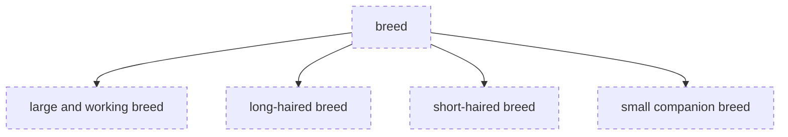

### Taxonomy of cat

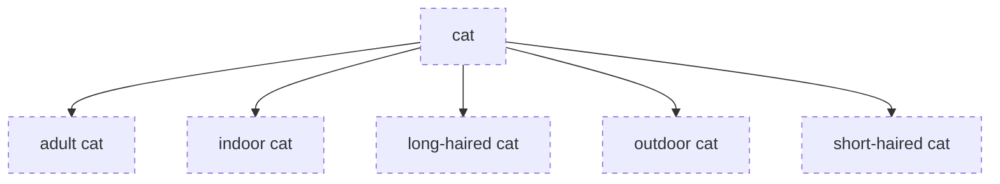

### Taxonomy of dog

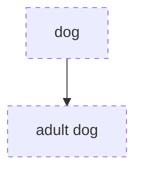

### Taxonomy of food poisonous to dogs

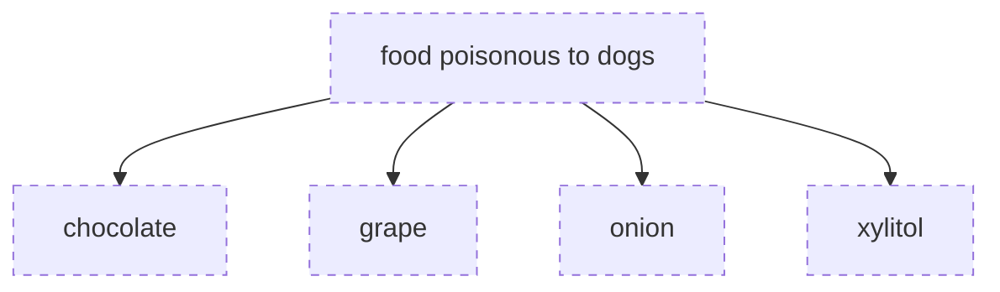

### Taxonomy of grooming

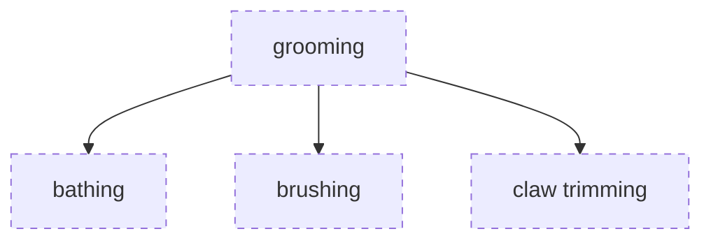

### Taxonomy of leash

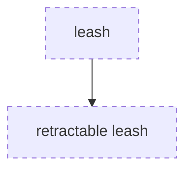

### Taxonomy of litter

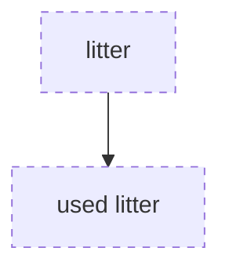

### Taxonomy of noise

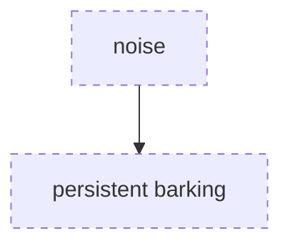

### Taxonomy of pet textile

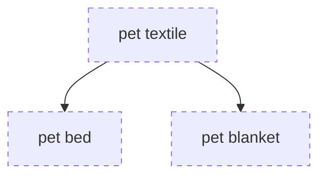

### Taxonomy of resident

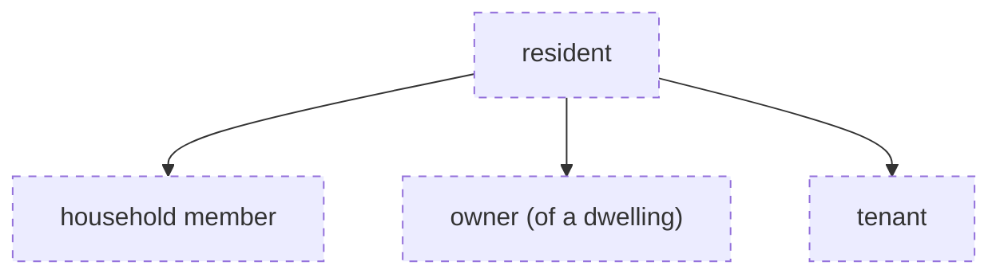

### Taxonomy of vaccination

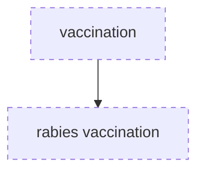

### Other concepts


### Other concepts


### Other concepts


## Concepts and relations

### Relations under balcony


### Relations under bin room


### Relations under breed

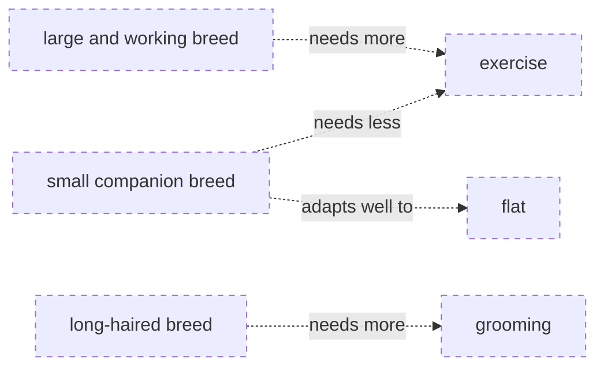

### Relations under building


### Relations under cat

```mermaid
flowchart LR
    classDef draft stroke-dasharray: 5 5
    cn_01M82ASKHG81R2G0W9373Z4V8D["adult cat"]
    cn_01M82AEQW4JVCNX0WEDNNR61W1["brushing"]
    cn_01M82AQDR2NPZDR8C737517K86["cat"]
    cn_01M82AQDR2NPZDR8C737517K88["cat food"]
    cn_01M82B441FVKK345F8CJ12SYK2["cellar"]
    cn_01M82ACZDNRYXG7FZCA8KC7FD5["flat"]
    cn_01M82ARW4GRHWZH2QAVQ4Z6C2V["food bowl"]
    cn_01M82ADJQKNCFSCKCDMA3H0R89["fresh water"]
    cn_01M82AR3FZSQYQ8M2V93VDTTRF["indoor cat"]
    cn_01M82B0RVQB8E3F7FG9YPD26JC["inner yard"]
    cn_01M82AQDR2NPZDR8C737517K89["litter"]
    cn_01M82ARW4GRHWZH2QAVQ4Z6C2S["litter box"]
    cn_01M82AWHXAYC5J29RJ6Y82HD3Z["long-haired cat"]
    cn_01M82ASKHG81R2G0W9373Z4V8G["meal"]
    cn_01M82ASKHG81R2G0W9373Z4V8H["meat-based food"]
    cn_01M82AC66KMJH32E2MQ3Z7ZBKT["microchip"]
    cn_01M82AT58GVN9GHPNG420CQGDG["neutering"]
    cn_01M82AR3FZSQYQ8M2V93VDTTRG["outdoor cat"]
    cn_01M82AR3FZSQYQ8M2V93VDTTRJ["play and climbing place"]
    cn_01M82ARW4GRHWZH2QAVQ4Z6C2X["quiet sleeping place"]
    cn_01M82AE56ZYS5Y2Z0C35ECC9YA["rabies vaccination"]
    cn_01M82ARW4GRHWZH2QAVQ4Z6C2T["scratching post"]
    cn_01M82AWHXAYC5J29RJ6Y82HD3Y["short-haired cat"]
    cn_01M82B3MD8NCJFJC9394MZ8MQR["stairwell"]
    cn_01M82AE56ZYS5Y2Z0C35ECC9Y9["vaccination"]
    cn_01M82AQDR2NPZDR8C737517K8A["veterinary visit"]
    cn_01M82AX2AYWV44F1MEHFVJNNFZ["visit"]
    cn_01M82ARW4GRHWZH2QAVQ4Z6C2W["water bowl"]
    cn_01M82AQDR2NPZDR8C737517K86 -. "needs" .-> cn_01M82AQDR2NPZDR8C737517K88
    cn_01M82AQDR2NPZDR8C737517K86 -. "needs" .-> cn_01M82AQDR2NPZDR8C737517K89
    cn_01M82AQDR2NPZDR8C737517K86 -. "receives" .-> cn_01M82AQDR2NPZDR8C737517K8A
    cn_01M82AQDR2NPZDR8C737517K86 -. "needs" .-> cn_01M82ARW4GRHWZH2QAVQ4Z6C2S
    cn_01M82AQDR2NPZDR8C737517K86 -. "is provided with" .-> cn_01M82ARW4GRHWZH2QAVQ4Z6C2S
    cn_01M82AQDR2NPZDR8C737517K86 -. "uses" .-> cn_01M82ARW4GRHWZH2QAVQ4Z6C2S
    cn_01M82AQDR2NPZDR8C737517K86 -. "needs" .-> cn_01M82ARW4GRHWZH2QAVQ4Z6C2T
    cn_01M82AQDR2NPZDR8C737517K86 -. "needs" .-> cn_01M82ARW4GRHWZH2QAVQ4Z6C2V
    cn_01M82AQDR2NPZDR8C737517K86 -. "needs" .-> cn_01M82ARW4GRHWZH2QAVQ4Z6C2W
    cn_01M82AQDR2NPZDR8C737517K86 -. "needs" .-> cn_01M82ARW4GRHWZH2QAVQ4Z6C2X
    cn_01M82AQDR2NPZDR8C737517K86 -. "needs" .-> cn_01M82ASKHG81R2G0W9373Z4V8H
    cn_01M82AQDR2NPZDR8C737517K86 -. "undergoes" .-> cn_01M82AT58GVN9GHPNG420CQGDG
    cn_01M82AQDR2NPZDR8C737517K86 -. "receives during longer absence" .-> cn_01M82AX2AYWV44F1MEHFVJNNFZ
    cn_01M82AQDR2NPZDR8C737517K86 -. "may move freely in" .-> cn_01M82B0RVQB8E3F7FG9YPD26JC
    cn_01M82AQDR2NPZDR8C737517K86 -. "may not be kept in" .-> cn_01M82B3MD8NCJFJC9394MZ8MQR
    cn_01M82AQDR2NPZDR8C737517K86 -. "may not be kept in" .-> cn_01M82B441FVKK345F8CJ12SYK2
    cn_01M82AR3FZSQYQ8M2V93VDTTRF -. "never leaves" .-> cn_01M82ACZDNRYXG7FZCA8KC7FD5
    cn_01M82AR3FZSQYQ8M2V93VDTTRF -. "needs" .-> cn_01M82AR3FZSQYQ8M2V93VDTTRJ
    cn_01M82AR3FZSQYQ8M2V93VDTTRG -. "must have before first going outside" .-> cn_01M82AC66KMJH32E2MQ3Z7ZBKT
    cn_01M82AR3FZSQYQ8M2V93VDTTRG -. "must have before first going outside" .-> cn_01M82AE56ZYS5Y2Z0C35ECC9Y9
    cn_01M82AR3FZSQYQ8M2V93VDTTRG -. "must be vaccinated with" .-> cn_01M82AE56ZYS5Y2Z0C35ECC9YA
    cn_01M82ASKHG81R2G0W9373Z4V8D -. "needs when alone" .-> cn_01M82ADJQKNCFSCKCDMA3H0R89
    cn_01M82ASKHG81R2G0W9373Z4V8D -. "needs when alone" .-> cn_01M82AQDR2NPZDR8C737517K88
    cn_01M82ASKHG81R2G0W9373Z4V8D -. "needs when alone" .-> cn_01M82ARW4GRHWZH2QAVQ4Z6C2S
    cn_01M82ASKHG81R2G0W9373Z4V8D -. "is fed small meals per day" .-> cn_01M82ASKHG81R2G0W9373Z4V8G
    cn_01M82AWHXAYC5J29RJ6Y82HD3Y -. "needs weekly" .-> cn_01M82AEQW4JVCNX0WEDNNR61W1
    cn_01M82AWHXAYC5J29RJ6Y82HD3Z -. "needs daily" .-> cn_01M82AEQW4JVCNX0WEDNNR61W1
    class cn_01M82ASKHG81R2G0W9373Z4V8D,cn_01M82AEQW4JVCNX0WEDNNR61W1,cn_01M82AQDR2NPZDR8C737517K86,cn_01M82AQDR2NPZDR8C737517K88,cn_01M82B441FVKK345F8CJ12SYK2,cn_01M82ACZDNRYXG7FZCA8KC7FD5,cn_01M82ARW4GRHWZH2QAVQ4Z6C2V,cn_01M82ADJQKNCFSCKCDMA3H0R89,cn_01M82AR3FZSQYQ8M2V93VDTTRF,cn_01M82B0RVQB8E3F7FG9YPD26JC,cn_01M82AQDR2NPZDR8C737517K89,cn_01M82ARW4GRHWZH2QAVQ4Z6C2S,cn_01M82AWHXAYC5J29RJ6Y82HD3Z,cn_01M82ASKHG81R2G0W9373Z4V8G,cn_01M82ASKHG81R2G0W9373Z4V8H,cn_01M82AC66KMJH32E2MQ3Z7ZBKT,cn_01M82AT58GVN9GHPNG420CQGDG,cn_01M82AR3FZSQYQ8M2V93VDTTRG,cn_01M82AR3FZSQYQ8M2V93VDTTRJ,cn_01M82ARW4GRHWZH2QAVQ4Z6C2X,cn_01M82AE56ZYS5Y2Z0C35ECC9YA,cn_01M82ARW4GRHWZH2QAVQ4Z6C2T,cn_01M82AWHXAYC5J29RJ6Y82HD3Y,cn_01M82B3MD8NCJFJC9394MZ8MQR,cn_01M82AE56ZYS5Y2Z0C35ECC9Y9,cn_01M82AQDR2NPZDR8C737517K8A,cn_01M82AX2AYWV44F1MEHFVJNNFZ,cn_01M82ARW4GRHWZH2QAVQ4Z6C2W draft
```

### Relations under cat owner

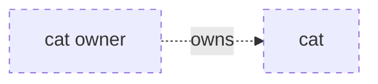

### Relations under clump

```mermaid
flowchart LR
    classDef draft stroke-dasharray: 5 5
    cn_01M82ATVV0G4J5RJ6TZ063RNYP["clump"]
    cn_01M82ARW4GRHWZH2QAVQ4Z6C2S["litter box"]
    cn_01M82ATVV0G4J5RJ6TZ063RNYP -. "is removed from" .-> cn_01M82ARW4GRHWZH2QAVQ4Z6C2S
    class cn_01M82ATVV0G4J5RJ6TZ063RNYP,cn_01M82ARW4GRHWZH2QAVQ4Z6C2S draft
```

### Relations under corridor

```mermaid
flowchart LR
    classDef draft stroke-dasharray: 5 5
    cn_01M82B5BJWECFNN10MNRT4KBXQ["corridor"]
    cn_01M82B5BJWECFNN10MNRT4KBXS["pet equipment"]
    cn_01M82B5BJWECFNN10MNRT4KBXQ -. "must be kept free of" .-> cn_01M82B5BJWECFNN10MNRT4KBXS
    class cn_01M82B5BJWECFNN10MNRT4KBXQ,cn_01M82B5BJWECFNN10MNRT4KBXS draft
```

### Relations under dog

```mermaid
flowchart LR
    classDef draft stroke-dasharray: 5 5
    cn_01M82ADJQKNCFSCKCDMA3H0R86["adult dog"]
    cn_01M82AJ8HWH90DHFSC2JB20DFW["basic command"]
    cn_01M82ACZDNRYXG7FZCA8KC7FCX["breed"]
    cn_01M82AE56ZYS5Y2Z0C35ECC9YC["check-up"]
    cn_01M82AEQW4JVCNX0WEDNNR61W4["claw"]
    cn_01M82AC66KMJH32E2MQ3Z7ZBKP["company"]
    cn_01M82AC66KMJH32E2MQ3Z7ZBKN["daily exercise"]
    cn_01M82AM9P6EWS5D1VJCAH8Z7VF["damage"]
    cn_01M82AC66KMJH32E2MQ3Z7ZBKM["dog"]
    cn_01M82AEQW4JVCNX0WEDNNR61W5["dog bed"]
    cn_01M82ADJQKNCFSCKCDMA3H0R88["feeding"]
    cn_01M82ACZDNRYXG7FZCA8KC7FD5["flat"]
    cn_01M82AFTZDSHCD0SK6T4N2YZW6["leash"]
    cn_01M82AC66KMJH32E2MQ3Z7ZBKS["local authority"]
    cn_01M82AC66KMJH32E2MQ3Z7ZBKT["microchip"]
    cn_01M82AE56ZYS5Y2Z0C35ECC9YA["rabies vaccination"]
    cn_01M82AC66KMJH32E2MQ3Z7ZBKQ["training"]
    cn_01M82AC66KMJH32E2MQ3Z7ZBKR["veterinary care"]
    cn_01M82AFTZDSHCD0SK6T4N2YZWA["walk"]
    cn_01M82AC66KMJH32E2MQ3Z7ZBKM -. "needs" .-> cn_01M82AC66KMJH32E2MQ3Z7ZBKN
    cn_01M82AC66KMJH32E2MQ3Z7ZBKM -. "needs" .-> cn_01M82AC66KMJH32E2MQ3Z7ZBKP
    cn_01M82AC66KMJH32E2MQ3Z7ZBKM -. "needs" .-> cn_01M82AC66KMJH32E2MQ3Z7ZBKQ
    cn_01M82AC66KMJH32E2MQ3Z7ZBKM -. "needs" .-> cn_01M82AC66KMJH32E2MQ3Z7ZBKR
    cn_01M82AC66KMJH32E2MQ3Z7ZBKM -. "is registered with" .-> cn_01M82AC66KMJH32E2MQ3Z7ZBKS
    cn_01M82AC66KMJH32E2MQ3Z7ZBKM -. "carries" .-> cn_01M82AC66KMJH32E2MQ3Z7ZBKT
    cn_01M82AC66KMJH32E2MQ3Z7ZBKM -. "has" .-> cn_01M82ACZDNRYXG7FZCA8KC7FCX
    cn_01M82AC66KMJH32E2MQ3Z7ZBKM -. "is left alone in" .-> cn_01M82ACZDNRYXG7FZCA8KC7FD5
    cn_01M82AC66KMJH32E2MQ3Z7ZBKM -. "receives" .-> cn_01M82AE56ZYS5Y2Z0C35ECC9YA
    cn_01M82AC66KMJH32E2MQ3Z7ZBKM -. "has" .-> cn_01M82AE56ZYS5Y2Z0C35ECC9YC
    cn_01M82AC66KMJH32E2MQ3Z7ZBKM -. "has" .-> cn_01M82AEQW4JVCNX0WEDNNR61W4
    cn_01M82AC66KMJH32E2MQ3Z7ZBKM -. "has" .-> cn_01M82AEQW4JVCNX0WEDNNR61W5
    cn_01M82AC66KMJH32E2MQ3Z7ZBKM -. "is kept on" .-> cn_01M82AFTZDSHCD0SK6T4N2YZW6
    cn_01M82AC66KMJH32E2MQ3Z7ZBKM -. "is kept on" .-> cn_01M82AFTZDSHCD0SK6T4N2YZW6
    cn_01M82AC66KMJH32E2MQ3Z7ZBKM -. "should learn" .-> cn_01M82AJ8HWH90DHFSC2JB20DFW
    cn_01M82AC66KMJH32E2MQ3Z7ZBKM -. "causes" .-> cn_01M82AM9P6EWS5D1VJCAH8Z7VF
    cn_01M82ADJQKNCFSCKCDMA3H0R86 -. "is fed times per day" .-> cn_01M82ADJQKNCFSCKCDMA3H0R88
    cn_01M82ADJQKNCFSCKCDMA3H0R86 -. "needs" .-> cn_01M82AFTZDSHCD0SK6T4N2YZWA
    class cn_01M82ADJQKNCFSCKCDMA3H0R86,cn_01M82AJ8HWH90DHFSC2JB20DFW,cn_01M82ACZDNRYXG7FZCA8KC7FCX,cn_01M82AE56ZYS5Y2Z0C35ECC9YC,cn_01M82AEQW4JVCNX0WEDNNR61W4,cn_01M82AC66KMJH32E2MQ3Z7ZBKP,cn_01M82AC66KMJH32E2MQ3Z7ZBKN,cn_01M82AM9P6EWS5D1VJCAH8Z7VF,cn_01M82AC66KMJH32E2MQ3Z7ZBKM,cn_01M82AEQW4JVCNX0WEDNNR61W5,cn_01M82ADJQKNCFSCKCDMA3H0R88,cn_01M82ACZDNRYXG7FZCA8KC7FD5,cn_01M82AFTZDSHCD0SK6T4N2YZW6,cn_01M82AC66KMJH32E2MQ3Z7ZBKS,cn_01M82AC66KMJH32E2MQ3Z7ZBKT,cn_01M82AE56ZYS5Y2Z0C35ECC9YA,cn_01M82AC66KMJH32E2MQ3Z7ZBKQ,cn_01M82AC66KMJH32E2MQ3Z7ZBKR,cn_01M82AFTZDSHCD0SK6T4N2YZWA draft
```

### Relations under dog food

```mermaid
flowchart LR
    classDef draft stroke-dasharray: 5 5
    cn_01M82AQDR2NPZDR8C737517K86["cat"]
    cn_01M82ASKHG81R2G0W9373Z4V8N["dog food"]
    cn_01M82ASKHG81R2G0W9373Z4V8N -. "is not suitable for" .-> cn_01M82AQDR2NPZDR8C737517K86
    class cn_01M82AQDR2NPZDR8C737517K86,cn_01M82ASKHG81R2G0W9373Z4V8N draft
```

### Relations under dog owner

```mermaid
flowchart LR
    classDef draft stroke-dasharray: 5 5
    cn_01M82AC66KMJH32E2MQ3Z7ZBKM["dog"]
    cn_01M82B3MD8NCJFJC9394MZ8MQN["dog owner"]
    cn_01M82B3MD8NCJFJC9394MZ8MQN -. "owns" .-> cn_01M82AC66KMJH32E2MQ3Z7ZBKM
    class cn_01M82AC66KMJH32E2MQ3Z7ZBKM,cn_01M82B3MD8NCJFJC9394MZ8MQN draft
```

### Relations under dog training course

```mermaid
flowchart LR
    classDef draft stroke-dasharray: 5 5
    cn_01M82AJ8HWH90DHFSC2JB20DFZ["certified trainer"]
    cn_01M82AJ8HWH90DHFSC2JB20DFY["dog training course"]
    cn_01M82AJ8HWH90DHFSC2JB20DFY -. "is given by" .-> cn_01M82AJ8HWH90DHFSC2JB20DFZ
    class cn_01M82AJ8HWH90DHFSC2JB20DFZ,cn_01M82AJ8HWH90DHFSC2JB20DFY draft
```

### Relations under dog waste

```mermaid
flowchart LR
    classDef draft stroke-dasharray: 5 5
    cn_01M82AH1GXVV72WP99JQXMH6XS["dog waste"]
    cn_01M82AH1GXVV72WP99JQXMH6XT["waste bin"]
    cn_01M82AH1GXVV72WP99JQXMH6XS -. "is put in" .-> cn_01M82AH1GXVV72WP99JQXMH6XT
    class cn_01M82AH1GXVV72WP99JQXMH6XS,cn_01M82AH1GXVV72WP99JQXMH6XT draft
```

### Relations under escape route

```mermaid
flowchart LR
    classDef draft stroke-dasharray: 5 5
    cn_01M82B5BJWECFNN10MNRT4KBXR["escape route"]
    cn_01M82B5BJWECFNN10MNRT4KBXS["pet equipment"]
    cn_01M82B5BJWECFNN10MNRT4KBXR -. "must be kept free of" .-> cn_01M82B5BJWECFNN10MNRT4KBXS
    class cn_01M82B5BJWECFNN10MNRT4KBXR,cn_01M82B5BJWECFNN10MNRT4KBXS draft
```

### Relations under family

```mermaid
flowchart LR
    classDef draft stroke-dasharray: 5 5
    cn_01M82AHPS6SQKW9E9EPJYC3KMN["command word"]
    cn_01M82AHPS6SQKW9E9EPJYC3KMP["family"]
    cn_01M82AHPS6SQKW9E9EPJYC3KMP -. "uses" .-> cn_01M82AHPS6SQKW9E9EPJYC3KMN
    class cn_01M82AHPS6SQKW9E9EPJYC3KMN,cn_01M82AHPS6SQKW9E9EPJYC3KMP draft
```

### Relations under flat

```mermaid
flowchart LR
    classDef draft stroke-dasharray: 5 5
    cn_01M82B6NEKKV0CSECXDQRKNHP4["cellar compartment"]
    cn_01M82ACZDNRYXG7FZCA8KC7FD5["flat"]
    cn_01M82ACZDNRYXG7FZCA8KC7FD5 -. "has" .-> cn_01M82B6NEKKV0CSECXDQRKNHP4
    class cn_01M82B6NEKKV0CSECXDQRKNHP4,cn_01M82ACZDNRYXG7FZCA8KC7FD5 draft
```

### Relations under food bowl

```mermaid
flowchart LR
    classDef draft stroke-dasharray: 5 5
    cn_01M82ARW4GRHWZH2QAVQ4Z6C2V["food bowl"]
    cn_01M82ARW4GRHWZH2QAVQ4Z6C2S["litter box"]
    cn_01M82ARW4GRHWZH2QAVQ4Z6C2V -. "is placed away from" .-> cn_01M82ARW4GRHWZH2QAVQ4Z6C2S
    class cn_01M82ARW4GRHWZH2QAVQ4Z6C2V,cn_01M82ARW4GRHWZH2QAVQ4Z6C2S draft
```

### Relations under food poisonous to dogs

```mermaid
flowchart LR
    classDef draft stroke-dasharray: 5 5
    cn_01M82AQDR2NPZDR8C737517K86["cat"]
    cn_01M82ADJQKNCFSCKCDMA3H0R8B["chocolate"]
    cn_01M82AC66KMJH32E2MQ3Z7ZBKM["dog"]
    cn_01M82ADJQKNCFSCKCDMA3H0R8A["food poisonous to dogs"]
    cn_01M82ADJQKNCFSCKCDMA3H0R8D["onion"]
    cn_01M82ADJQKNCFSCKCDMA3H0R8A -. "is poisonous to" .-> cn_01M82AC66KMJH32E2MQ3Z7ZBKM
    cn_01M82ADJQKNCFSCKCDMA3H0R8B -. "is not suitable for" .-> cn_01M82AQDR2NPZDR8C737517K86
    cn_01M82ADJQKNCFSCKCDMA3H0R8D -. "is not suitable for" .-> cn_01M82AQDR2NPZDR8C737517K86
    class cn_01M82AQDR2NPZDR8C737517K86,cn_01M82ADJQKNCFSCKCDMA3H0R8B,cn_01M82AC66KMJH32E2MQ3Z7ZBKM,cn_01M82ADJQKNCFSCKCDMA3H0R8A,cn_01M82ADJQKNCFSCKCDMA3H0R8D draft
```

### Relations under free-running sign

```mermaid
flowchart LR
    classDef draft stroke-dasharray: 5 5
    cn_01M82AM9P6EWS5D1VJCAH8Z7VG["free-running sign"]
    cn_01M82AM9P6EWS5D1VJCAH8Z7VE["public place"]
    cn_01M82AM9P6EWS5D1VJCAH8Z7VG -. "is located in" .-> cn_01M82AM9P6EWS5D1VJCAH8Z7VE
    class cn_01M82AM9P6EWS5D1VJCAH8Z7VG,cn_01M82AM9P6EWS5D1VJCAH8Z7VE draft
```

### Relations under grooming

```mermaid
flowchart LR
    classDef draft stroke-dasharray: 5 5
    cn_01M82AEQW4JVCNX0WEDNNR61W1["brushing"]
    cn_01M82AEQW4JVCNX0WEDNNR61W4["claw"]
    cn_01M82AEQW4JVCNX0WEDNNR61W2["claw trimming"]
    cn_01M82AC66KMJH32E2MQ3Z7ZBKM["dog"]
    cn_01M82AWHXAYC5J29RJ6Y82HD43["matting"]
    cn_01M82AEQW4JVCNX0WEDNNR61W1 -. "is applied to" .-> cn_01M82AC66KMJH32E2MQ3Z7ZBKM
    cn_01M82AEQW4JVCNX0WEDNNR61W1 -. "prevents" .-> cn_01M82AWHXAYC5J29RJ6Y82HD43
    cn_01M82AEQW4JVCNX0WEDNNR61W2 -. "is applied to" .-> cn_01M82AEQW4JVCNX0WEDNNR61W4
    class cn_01M82AEQW4JVCNX0WEDNNR61W1,cn_01M82AEQW4JVCNX0WEDNNR61W4,cn_01M82AEQW4JVCNX0WEDNNR61W2,cn_01M82AC66KMJH32E2MQ3Z7ZBKM,cn_01M82AWHXAYC5J29RJ6Y82HD43 draft
```

### Relations under house management

```mermaid
flowchart LR
    classDef draft stroke-dasharray: 5 5
    cn_01M82B0RVQB8E3F7FG9YPD26JB["building"]
    cn_01M82B0RVQB8E3F7FG9YPD26J7["house management"]
    cn_01M82B0RVQB8E3F7FG9YPD26JD["house rule"]
    cn_01M82B0RVQB8E3F7FG9YPD26J7 -. "administers" .-> cn_01M82B0RVQB8E3F7FG9YPD26JB
    cn_01M82B0RVQB8E3F7FG9YPD26J7 -. "enforces" .-> cn_01M82B0RVQB8E3F7FG9YPD26JD
    class cn_01M82B0RVQB8E3F7FG9YPD26JB,cn_01M82B0RVQB8E3F7FG9YPD26J7,cn_01M82B0RVQB8E3F7FG9YPD26JD draft
```

### Relations under house rule

```mermaid
flowchart LR
    classDef draft stroke-dasharray: 5 5
    cn_01M82B0RVQB8E3F7FG9YPD26JB["building"]
    cn_01M82B0RVQB8E3F7FG9YPD26JD["house rule"]
    cn_01M82B0RVQB8E3F7FG9YPD26JD -. "apply to" .-> cn_01M82B0RVQB8E3F7FG9YPD26JB
    class cn_01M82B0RVQB8E3F7FG9YPD26JB,cn_01M82B0RVQB8E3F7FG9YPD26JD draft
```

### Relations under inner yard

```mermaid
flowchart LR
    classDef draft stroke-dasharray: 5 5
    cn_01M82B0RVQB8E3F7FG9YPD26JC["inner yard"]
    cn_01M82B0RVQB8E3F7FG9YPD26J6["resident"]
    cn_01M82B0RVQB8E3F7FG9YPD26JC -. "is shared by" .-> cn_01M82B0RVQB8E3F7FG9YPD26J6
    class cn_01M82B0RVQB8E3F7FG9YPD26JC,cn_01M82B0RVQB8E3F7FG9YPD26J6 draft
```

### Relations under leash

```mermaid
flowchart LR
    classDef draft stroke-dasharray: 5 5
    cn_01M82AFTZDSHCD0SK6T4N2YZWB["busy street"]
    cn_01M82AFTZDSHCD0SK6T4N2YZW8["collar"]
    cn_01M82AFTZDSHCD0SK6T4N2YZW9["harness"]
    cn_01M82AFTZDSHCD0SK6T4N2YZW6["leash"]
    cn_01M82AFTZDSHCD0SK6T4N2YZW7["retractable leash"]
    cn_01M82AFTZDSHCD0SK6T4N2YZWA["walk"]
    cn_01M82AFTZDSHCD0SK6T4N2YZW6 -. "is attached to" .-> cn_01M82AFTZDSHCD0SK6T4N2YZW8
    cn_01M82AFTZDSHCD0SK6T4N2YZW6 -. "is attached to" .-> cn_01M82AFTZDSHCD0SK6T4N2YZW9
    cn_01M82AFTZDSHCD0SK6T4N2YZW6 -. "is used for" .-> cn_01M82AFTZDSHCD0SK6T4N2YZWA
    cn_01M82AFTZDSHCD0SK6T4N2YZW7 -. "is not suitable in" .-> cn_01M82AFTZDSHCD0SK6T4N2YZWB
    class cn_01M82AFTZDSHCD0SK6T4N2YZWB,cn_01M82AFTZDSHCD0SK6T4N2YZW8,cn_01M82AFTZDSHCD0SK6T4N2YZW9,cn_01M82AFTZDSHCD0SK6T4N2YZW6,cn_01M82AFTZDSHCD0SK6T4N2YZW7,cn_01M82AFTZDSHCD0SK6T4N2YZWA draft
```

### Relations under leash training

```mermaid
flowchart LR
    classDef draft stroke-dasharray: 5 5
    cn_01M82AFTZDSHCD0SK6T4N2YZW6["leash"]
    cn_01M82AG9DZ4Q7M3Z8RX016AKWJ["leash training"]
    cn_01M82AG9DZ4Q7M3Z8RX016AKWJ -. "uses" .-> cn_01M82AFTZDSHCD0SK6T4N2YZW6
    class cn_01M82AFTZDSHCD0SK6T4N2YZW6,cn_01M82AG9DZ4Q7M3Z8RX016AKWJ draft
```

### Relations under lily

```mermaid
flowchart LR
    classDef draft stroke-dasharray: 5 5
    cn_01M82AQDR2NPZDR8C737517K86["cat"]
    cn_01M82ASKHG81R2G0W9373Z4V8J["lily"]
    cn_01M82ASKHG81R2G0W9373Z4V8J -. "is not suitable for" .-> cn_01M82AQDR2NPZDR8C737517K86
    cn_01M82ASKHG81R2G0W9373Z4V8J -. "is highly poisonous to" .-> cn_01M82AQDR2NPZDR8C737517K86
    class cn_01M82AQDR2NPZDR8C737517K86,cn_01M82ASKHG81R2G0W9373Z4V8J draft
```

### Relations under litter

```mermaid
flowchart LR
    classDef draft stroke-dasharray: 5 5
    cn_01M82ATVV0G4J5RJ6TZ063RNYT["compost"]
    cn_01M82ATVV0G4J5RJ6TZ063RNYR["residual waste"]
    cn_01M82B4TJPFJR5BJ36WDBJSZZZ["residual waste bin"]
    cn_01M82ATVV0G4J5RJ6TZ063RNYS["toilet"]
    cn_01M82ATVV0G4J5RJ6TZ063RNYQ["used litter"]
    cn_01M82ATVV0G4J5RJ6TZ063RNYQ -. "goes into" .-> cn_01M82ATVV0G4J5RJ6TZ063RNYR
    cn_01M82ATVV0G4J5RJ6TZ063RNYQ -. "never goes into" .-> cn_01M82ATVV0G4J5RJ6TZ063RNYS
    cn_01M82ATVV0G4J5RJ6TZ063RNYQ -. "never goes into" .-> cn_01M82ATVV0G4J5RJ6TZ063RNYT
    cn_01M82ATVV0G4J5RJ6TZ063RNYQ -. "goes into" .-> cn_01M82B4TJPFJR5BJ36WDBJSZZZ
    class cn_01M82ATVV0G4J5RJ6TZ063RNYT,cn_01M82ATVV0G4J5RJ6TZ063RNYR,cn_01M82B4TJPFJR5BJ36WDBJSZZZ,cn_01M82ATVV0G4J5RJ6TZ063RNYS,cn_01M82ATVV0G4J5RJ6TZ063RNYQ draft
```

### Relations under litter box

```mermaid
flowchart LR
    classDef draft stroke-dasharray: 5 5
    cn_01M82ACZDNRYXG7FZCA8KC7FD5["flat"]
    cn_01M82AQDR2NPZDR8C737517K89["litter"]
    cn_01M82ARW4GRHWZH2QAVQ4Z6C2S["litter box"]
    cn_01M82ARW4GRHWZH2QAVQ4Z6C2S -. "is kept inside" .-> cn_01M82ACZDNRYXG7FZCA8KC7FD5
    cn_01M82ARW4GRHWZH2QAVQ4Z6C2S -. "contains" .-> cn_01M82AQDR2NPZDR8C737517K89
    class cn_01M82ACZDNRYXG7FZCA8KC7FD5,cn_01M82AQDR2NPZDR8C737517K89,cn_01M82ARW4GRHWZH2QAVQ4Z6C2S draft
```

### Relations under maximum time left alone

```mermaid
flowchart LR
    classDef draft stroke-dasharray: 5 5
    cn_01M82ACZDNRYXG7FZCA8KC7FCX["breed"]
    cn_01M82B3MD8NCJFJC9394MZ8MQZ["maximum time left alone"]
    cn_01M82AC66KMJH32E2MQ3Z7ZBKQ["training"]
    cn_01M82B3MD8NCJFJC9394MZ8MQZ -. "depends on" .-> cn_01M82AC66KMJH32E2MQ3Z7ZBKQ
    cn_01M82B3MD8NCJFJC9394MZ8MQZ -. "depends on" .-> cn_01M82ACZDNRYXG7FZCA8KC7FCX
    class cn_01M82ACZDNRYXG7FZCA8KC7FCX,cn_01M82B3MD8NCJFJC9394MZ8MQZ,cn_01M82AC66KMJH32E2MQ3Z7ZBKQ draft
```

### Relations under noise

```mermaid
flowchart LR
    classDef draft stroke-dasharray: 5 5
    cn_01M82ACZDNRYXG7FZCA8KC7FD5["flat"]
    cn_01M82B0RVQB8E3F7FG9YPD26JC["inner yard"]
    cn_01M82B1AN7D1ZA7ABBS5RZ4XK6["noise"]
    cn_01M82B1AN7D1ZA7ABBS5RZ4XK6 -. "can be heard in" .-> cn_01M82ACZDNRYXG7FZCA8KC7FD5
    cn_01M82B1AN7D1ZA7ABBS5RZ4XK6 -. "can be heard in" .-> cn_01M82B0RVQB8E3F7FG9YPD26JC
    class cn_01M82ACZDNRYXG7FZCA8KC7FD5,cn_01M82B0RVQB8E3F7FG9YPD26JC,cn_01M82B1AN7D1ZA7ABBS5RZ4XK6 draft
```

### Relations under owner

```mermaid
flowchart LR
    classDef draft stroke-dasharray: 5 5
    cn_01M82AM9P6EWS5D1VJCAH8Z7VF["damage"]
    cn_01M82AC66KMJH32E2MQ3Z7ZBKM["dog"]
    cn_01M82AH1GXVV72WP99JQXMH6XS["dog waste"]
    cn_01M82ADJQKNCFSCKCDMA3H0R89["fresh water"]
    cn_01M82AE56ZYS5Y2Z0C35ECC9Y8["owner"]
    cn_01M82AK1Z9HNB4ZNT1JN5CCR6R["safe chew toy"]
    cn_01M82AM9P6EWS5D1VJCAH8Z7VA["third-party liability insurance"]
    cn_01M82AE56ZYS5Y2Z0C35ECC9YB["veterinarian"]
    cn_01M82AE56ZYS5Y2Z0C35ECC9Y8 -. "is the lead of" .-> cn_01M82AC66KMJH32E2MQ3Z7ZBKM
    cn_01M82AE56ZYS5Y2Z0C35ECC9Y8 -. "leaves alone" .-> cn_01M82AC66KMJH32E2MQ3Z7ZBKM
    cn_01M82AE56ZYS5Y2Z0C35ECC9Y8 -. "walks before leaving" .-> cn_01M82AC66KMJH32E2MQ3Z7ZBKM
    cn_01M82AE56ZYS5Y2Z0C35ECC9Y8 -. "leaves for the dog" .-> cn_01M82ADJQKNCFSCKCDMA3H0R89
    cn_01M82AE56ZYS5Y2Z0C35ECC9Y8 -. "takes dog to" .-> cn_01M82AE56ZYS5Y2Z0C35ECC9YB
    cn_01M82AE56ZYS5Y2Z0C35ECC9Y8 -. "picks up" .-> cn_01M82AH1GXVV72WP99JQXMH6XS
    cn_01M82AE56ZYS5Y2Z0C35ECC9Y8 -. "leaves for the dog" .-> cn_01M82AK1Z9HNB4ZNT1JN5CCR6R
    cn_01M82AE56ZYS5Y2Z0C35ECC9Y8 -. "holds" .-> cn_01M82AM9P6EWS5D1VJCAH8Z7VA
    cn_01M82AE56ZYS5Y2Z0C35ECC9Y8 -. "is liable for" .-> cn_01M82AM9P6EWS5D1VJCAH8Z7VF
    class cn_01M82AM9P6EWS5D1VJCAH8Z7VF,cn_01M82AC66KMJH32E2MQ3Z7ZBKM,cn_01M82AH1GXVV72WP99JQXMH6XS,cn_01M82ADJQKNCFSCKCDMA3H0R89,cn_01M82AE56ZYS5Y2Z0C35ECC9Y8,cn_01M82AK1Z9HNB4ZNT1JN5CCR6R,cn_01M82AM9P6EWS5D1VJCAH8Z7VA,cn_01M82AE56ZYS5Y2Z0C35ECC9YB draft
```

### Relations under pet

```mermaid
flowchart LR
    classDef draft stroke-dasharray: 5 5
    cn_01M82B0RVQB8E3F7FG9YPD26J7["house management"]
    cn_01M82B2PPZPYF6543TD3RQQKNJ["pet"]
    cn_01M82B0RVQB8E3F7FG9YPD26J6["resident"]
    cn_01M82B2PPZPYF6543TD3RQQKNJ -. "must not disturb" .-> cn_01M82B0RVQB8E3F7FG9YPD26J6
    cn_01M82B2PPZPYF6543TD3RQQKNJ -. "is registered with" .-> cn_01M82B0RVQB8E3F7FG9YPD26J7
    class cn_01M82B0RVQB8E3F7FG9YPD26J7,cn_01M82B2PPZPYF6543TD3RQQKNJ,cn_01M82B0RVQB8E3F7FG9YPD26J6 draft
```

### Relations under pet owner

```mermaid
flowchart LR
    classDef draft stroke-dasharray: 5 5
    cn_01M82B2PPZPYF6543TD3RQQKNJ["pet"]
    cn_01M82B2PQ0Y5BYDSR06NJ167CE["pet owner"]
    cn_01M82B2PQ0Y5BYDSR06NJ167CE -. "owns" .-> cn_01M82B2PPZPYF6543TD3RQQKNJ
    class cn_01M82B2PPZPYF6543TD3RQQKNJ,cn_01M82B2PQ0Y5BYDSR06NJ167CE draft
```

### Relations under pet waste

```mermaid
flowchart LR
    classDef draft stroke-dasharray: 5 5
    cn_01M82B4TJPFJR5BJ36WDBJT000["pet waste"]
    cn_01M82B4TJPFJR5BJ36WDBJSZZZ["residual waste bin"]
    cn_01M82B4TJPFJR5BJ36WDBJT000 -. "goes into" .-> cn_01M82B4TJPFJR5BJ36WDBJSZZZ
    class cn_01M82B4TJPFJR5BJ36WDBJT000,cn_01M82B4TJPFJR5BJ36WDBJSZZZ draft
```

### Relations under resident

```mermaid
flowchart LR
    classDef draft stroke-dasharray: 5 5
    cn_01M82B0RVQB8E3F7FG9YPD26JB["building"]
    cn_01M82B0RVQB8E3F7FG9YPD26JD["house rule"]
    cn_01M82B1AN7D1ZA7ABBS5RZ4XK6["noise"]
    cn_01M82B0RVQB8E3F7FG9YPD26J6["resident"]
    cn_01M82B0RVQB8E3F7FG9YPD26J6 -. "lives in" .-> cn_01M82B0RVQB8E3F7FG9YPD26JB
    cn_01M82B0RVQB8E3F7FG9YPD26J6 -. "must follow" .-> cn_01M82B0RVQB8E3F7FG9YPD26JD
    cn_01M82B0RVQB8E3F7FG9YPD26J6 -. "must avoid during quiet hours" .-> cn_01M82B1AN7D1ZA7ABBS5RZ4XK6
    class cn_01M82B0RVQB8E3F7FG9YPD26JB,cn_01M82B0RVQB8E3F7FG9YPD26JD,cn_01M82B1AN7D1ZA7ABBS5RZ4XK6,cn_01M82B0RVQB8E3F7FG9YPD26J6 draft
```

### Relations under reward

```mermaid
flowchart LR
    classDef draft stroke-dasharray: 5 5
    cn_01M82AHPS6SQKW9E9EPJYC3KMR["good behaviour"]
    cn_01M82AHPS6SQKW9E9EPJYC3KMT["reward"]
    cn_01M82AHPS6SQKW9E9EPJYC3KMT -. "is given for" .-> cn_01M82AHPS6SQKW9E9EPJYC3KMR
    class cn_01M82AHPS6SQKW9E9EPJYC3KMR,cn_01M82AHPS6SQKW9E9EPJYC3KMT draft
```

### Relations under shared laundry room

```mermaid
flowchart LR
    classDef draft stroke-dasharray: 5 5
    cn_01M82B441FVKK345F8CJ12SYK2["cellar"]
    cn_01M82B6NEKKV0CSECXDQRKNHNT["shared laundry room"]
    cn_01M82B6NEKKV0CSECXDQRKNHNT -. "is located in" .-> cn_01M82B441FVKK345F8CJ12SYK2
    class cn_01M82B441FVKK345F8CJ12SYK2,cn_01M82B6NEKKV0CSECXDQRKNHNT draft
```

### Relations under shared washing machine

```mermaid
flowchart LR
    classDef draft stroke-dasharray: 5 5
    cn_01M82B6NEKKV0CSECXDQRKNHNT["shared laundry room"]
    cn_01M82B6NEKKV0CSECXDQRKNHP2["shared washing machine"]
    cn_01M82B6NEKKV0CSECXDQRKNHP2 -. "is located in" .-> cn_01M82B6NEKKV0CSECXDQRKNHNT
    class cn_01M82B6NEKKV0CSECXDQRKNHNT,cn_01M82B6NEKKV0CSECXDQRKNHP2 draft
```

### Relations under stairwell

```mermaid
flowchart LR
    classDef draft stroke-dasharray: 5 5
    cn_01M82B5BJWECFNN10MNRT4KBXS["pet equipment"]
    cn_01M82B3MD8NCJFJC9394MZ8MQR["stairwell"]
    cn_01M82B3MD8NCJFJC9394MZ8MQR -. "must be kept free of" .-> cn_01M82B5BJWECFNN10MNRT4KBXS
    class cn_01M82B5BJWECFNN10MNRT4KBXS,cn_01M82B3MD8NCJFJC9394MZ8MQR draft
```

### Relations under veterinarian

```mermaid
flowchart LR
    classDef draft stroke-dasharray: 5 5
    cn_01M82AWHXAYC5J29RJ6Y82HD42["bathing"]
    cn_01M82AE56ZYS5Y2Z0C35ECC9YB["veterinarian"]
    cn_01M82AE56ZYS5Y2Z0C35ECC9YB -. "advises" .-> cn_01M82AWHXAYC5J29RJ6Y82HD42
    class cn_01M82AWHXAYC5J29RJ6Y82HD42,cn_01M82AE56ZYS5Y2Z0C35ECC9YB draft
```

### Relations under veterinary visit

```mermaid
flowchart LR
    classDef draft stroke-dasharray: 5 5
    cn_01M82AE56ZYS5Y2Z0C35ECC9YB["veterinarian"]
    cn_01M82AQDR2NPZDR8C737517K8A["veterinary visit"]
    cn_01M82AQDR2NPZDR8C737517K8A -. "is a visit to" .-> cn_01M82AE56ZYS5Y2Z0C35ECC9YB
    class cn_01M82AE56ZYS5Y2Z0C35ECC9YB,cn_01M82AQDR2NPZDR8C737517K8A draft
```

### Relations under waste

```mermaid
flowchart LR
    classDef draft stroke-dasharray: 5 5
    cn_01M82B4TJPFJR5BJ36WDBJSZZR["bin room"]
    cn_01M82B4TJPFJR5BJ36WDBJSZZQ["waste"]
    cn_01M82B4TJPFJR5BJ36WDBJSZZQ -. "is sorted in" .-> cn_01M82B4TJPFJR5BJ36WDBJSZZR
    class cn_01M82B4TJPFJR5BJ36WDBJSZZR,cn_01M82B4TJPFJR5BJ36WDBJSZZQ draft
```

### Relations under water bowl

```mermaid
flowchart LR
    classDef draft stroke-dasharray: 5 5
    cn_01M82ARW4GRHWZH2QAVQ4Z6C2S["litter box"]
    cn_01M82ARW4GRHWZH2QAVQ4Z6C2W["water bowl"]
    cn_01M82ARW4GRHWZH2QAVQ4Z6C2W -. "is placed away from" .-> cn_01M82ARW4GRHWZH2QAVQ4Z6C2S
    class cn_01M82ARW4GRHWZH2QAVQ4Z6C2S,cn_01M82ARW4GRHWZH2QAVQ4Z6C2W draft
```

### Relations under window

```mermaid
flowchart LR
    classDef draft stroke-dasharray: 5 5
    cn_01M82ARW4GRHWZH2QAVQ4Z6C30["net"]
    cn_01M82ARW4GRHWZH2QAVQ4Z6C2Y["window"]
    cn_01M82ARW4GRHWZH2QAVQ4Z6C2Y -. "is secured with" .-> cn_01M82ARW4GRHWZH2QAVQ4Z6C30
    class cn_01M82ARW4GRHWZH2QAVQ4Z6C30,cn_01M82ARW4GRHWZH2QAVQ4Z6C2Y draft
```

## Concepts

<a id="cn_01M82AX2AYWV44F1MEHFVJNNFY"></a>
### absence · ● proposed

- **Level:** 2
- **Evidence:** [§46](#su_01M82APMQ7MGEVFK2CW6002H34)

<a id="cn_01M82B2PQ0Y5BYDSR06NJ167CJ"></a>
### acquiring a pet · ● proposed

- **Level:** 2
- **Evidence:** [§22](#su_01M82B00WB34E68SXWEMVZ22EA)

<a id="cn_01M82ASKHG81R2G0W9373Z4V8D"></a>
### adult cat · ● proposed

- **Is a:** [cat](#cn_01M82AQDR2NPZDR8C737517K86)
- **Level:** 2
- **Evidence:** [§19](#su_01M82APMQ7MGEVFK2CW6002H2R), [§46](#su_01M82APMQ7MGEVFK2CW6002H34)

<a id="cn_01M82ADJQKNCFSCKCDMA3H0R86"></a>
### adult dog · ● proposed

- **Is a:** [dog](#cn_01M82AC66KMJH32E2MQ3Z7ZBKM)
- **Level:** 2
- **Evidence:** [§14](#su_01M82ABDR1CAX5PFZ2HWSEQHBH), [§32](#su_01M82ABDR28HTPAFF4C44FRBZG), [§47](#su_01M82ABDR30PE47ZK8WSGY3HX2)

<a id="cn_01M82ARW4GRHWZH2QAVQ4Z6C2Z"></a>
### balcony · ● proposed

- **Level:** 2
- **Evidence:** [§17](#su_01M82APMQ7MGEVFK2CW6002H2P)

<a id="cn_01M82AJ8HWH90DHFSC2JB20DFW"></a>
### basic command · ● proposed

- **Level:** 2
- **Evidence:** [§43](#su_01M82ABDR28HTPAFF4C44FRBZR)

<a id="cn_01M82AWHXAYC5J29RJ6Y82HD42"></a>
### bathing · ● proposed

- **Is a:** [grooming](#cn_01M82ACZDNRYXG7FZCA8KC7FD6)
- **Level:** 2
- **Evidence:** [§41](#su_01M82APMQ7MGEVFK2CW6002H32)

<a id="cn_01M82B4TJPFJR5BJ36WDBJSZZR"></a>
### bin room · ● proposed

- **Level:** 2
- **Evidence:** [§33](#su_01M82B00WB34E68SXWEMVZ22EK)

<a id="cn_01M82AEQW4JVCNX0WEDNNR61W6"></a>
### blanket · ● proposed

- **Synonyms:** blankets
- **Level:** 2
- **Evidence:** [§16](#su_01M82ABDR1CAX5PFZ2HWSEQHBN)

<a id="cn_01M82ACZDNRYXG7FZCA8KC7FCX"></a>
### breed · ● proposed

- **Level:** 2
- **Evidence:** [§5](#su_01M82ABDR1CAX5PFZ2HWSEQHBB), [§9](#su_01M82ABDR1CAX5PFZ2HWSEQHBF)

<a id="cn_01M82AEQW4JVCNX0WEDNNR61W1"></a>
### brushing · ● proposed

- **Is a:** [grooming](#cn_01M82ACZDNRYXG7FZCA8KC7FD6)
- **Level:** 2
- **Evidence:** [§16](#su_01M82ABDR1CAX5PFZ2HWSEQHBN)

<a id="cn_01M82B0RVQB8E3F7FG9YPD26JB"></a>
### building · ● proposed

- **Level:** 2
- **Evidence:** [§4](#su_01M82B00WAF2BQ321TGZ91X4KN), [§42](#su_01M82B00WB34E68SXWEMVZ22EQ)

<a id="cn_01M82B4TJPFJR5BJ36WDBJSZZS"></a>
### building B · ● proposed

- **Level:** 2
- **Evidence:** [§33](#su_01M82B00WB34E68SXWEMVZ22EK)

<a id="cn_01M82B3MD8NCJFJC9394MZ8MQV"></a>
### building complex · ● proposed

- **Level:** 1
- **Evidence:** [§24](#su_01M82B00WB34E68SXWEMVZ22ED)

<a id="cn_01M82AFTZDSHCD0SK6T4N2YZWB"></a>
### busy street · ● proposed

- **Synonyms:** busy streets
- **Level:** 2
- **Evidence:** [§30](#su_01M82ABDR28HTPAFF4C44FRBZC)

<a id="cn_01M82AQDR2NPZDR8C737517K86"></a>
### cat · ● proposed

- **Level:** 1
- **Evidence:** [§1](#su_01M82APMQ68JDJRTYQDVNXFWWJ), [§10](#su_01M82APMQ68JDJRTYQDVNXFWWM), [§17](#su_01M82APMQ7MGEVFK2CW6002H2P), [§19](#su_01M82APMQ7MGEVFK2CW6002H2R), [§20](#su_01M82APMQ7MGEVFK2CW6002H2T), [§21](#su_01M82APMQ7MGEVFK2CW6002H2W), [§29](#su_01M82APMQ7MGEVFK2CW6002H2Y), [§39](#su_01M82APMQ7MGEVFK2CW6002H30), [§41](#su_01M82APMQ7MGEVFK2CW6002H32), [§46](#su_01M82APMQ7MGEVFK2CW6002H34), [§49](#su_01M82APMQ7MGEVFK2CW6002H36)

<a id="cn_01M82AQDR2NPZDR8C737517K88"></a>
### cat food · ● proposed

- **Synonyms:** food
- **Level:** 2
- **Evidence:** [§1](#su_01M82APMQ68JDJRTYQDVNXFWWJ), [§46](#su_01M82APMQ7MGEVFK2CW6002H34)

<a id="cn_01M82AQDR2NPZDR8C737517K87"></a>
### cat owner · ● proposed

- **Level:** 1
- **Evidence:** [§1](#su_01M82APMQ68JDJRTYQDVNXFWWJ)

<a id="cn_01M82B441FVKK345F8CJ12SYK2"></a>
### cellar · ● proposed

- **Level:** 2
- **Evidence:** [§27](#su_01M82B00WB34E68SXWEMVZ22EH), [§45](#su_01M82B00WB34E68SXWEMVZ22ES)

<a id="cn_01M82B6NEKKV0CSECXDQRKNHP4"></a>
### cellar compartment · ● proposed

- **Level:** 2
- **Evidence:** [§45](#su_01M82B00WB34E68SXWEMVZ22ES)

<a id="cn_01M82AJ8HWH90DHFSC2JB20DFZ"></a>
### certified trainer · ● proposed

- **Level:** 2
- **Evidence:** [§44](#su_01M82ABDR28HTPAFF4C44FRBZS)

<a id="cn_01M82AE56ZYS5Y2Z0C35ECC9YC"></a>
### check-up · ● proposed

- **Level:** 2
- **Evidence:** [§15](#su_01M82ABDR1CAX5PFZ2HWSEQHBK)

<a id="cn_01M82ADJQKNCFSCKCDMA3H0R8B"></a>
### chocolate · ● proposed

- **Is a:** [food poisonous to dogs](#cn_01M82ADJQKNCFSCKCDMA3H0R8A)
- **Level:** 2
- **Evidence:** [§14](#su_01M82ABDR1CAX5PFZ2HWSEQHBH)

<a id="cn_01M82AEQW4JVCNX0WEDNNR61W4"></a>
### claw · ● proposed

- **Synonyms:** claws
- **Level:** 2
- **Evidence:** [§16](#su_01M82ABDR1CAX5PFZ2HWSEQHBN)

<a id="cn_01M82AEQW4JVCNX0WEDNNR61W2"></a>
### claw trimming · ● proposed

- **Is a:** [grooming](#cn_01M82ACZDNRYXG7FZCA8KC7FD6)
- **Level:** 2
- **Evidence:** [§16](#su_01M82ABDR1CAX5PFZ2HWSEQHBN)

<a id="cn_01M82ATVV0G4J5RJ6TZ063RNYP"></a>
### clump · ● proposed

- **Level:** 2
- **Evidence:** [§21](#su_01M82APMQ7MGEVFK2CW6002H2W)

<a id="cn_01M82AFTZDSHCD0SK6T4N2YZW8"></a>
### collar · ● proposed

- **Level:** 2
- **Evidence:** [§30](#su_01M82ABDR28HTPAFF4C44FRBZC)

<a id="cn_01M82AHPS6SQKW9E9EPJYC3KMN"></a>
### command word · ● proposed

- **Level:** 2
- **Evidence:** [§35](#su_01M82ABDR28HTPAFF4C44FRBZK)

<a id="cn_01M82AC66KMJH32E2MQ3Z7ZBKP"></a>
### company · ● proposed

- **Level:** 2
- **Evidence:** [§2](#su_01M82ABDR1CAX5PFZ2HWSEQHB8)

<a id="cn_01M82ATVV0G4J5RJ6TZ063RNYT"></a>
### compost · ● proposed

- **Level:** 1
- **Evidence:** [§21](#su_01M82APMQ7MGEVFK2CW6002H2W)

<a id="cn_01M82B5BJWECFNN10MNRT4KBXQ"></a>
### corridor · ● proposed

- **Level:** 2
- **Evidence:** [§40](#su_01M82B00WB34E68SXWEMVZ22EN)

<a id="cn_01M82AC66KMJH32E2MQ3Z7ZBKN"></a>
### daily exercise · ● proposed

- **Level:** 2
- **Evidence:** [§2](#su_01M82ABDR1CAX5PFZ2HWSEQHB8)

<a id="cn_01M82AM9P6EWS5D1VJCAH8Z7VF"></a>
### damage · ● proposed

- **Level:** 2
- **Evidence:** [§52](#su_01M82ABDR30PE47ZK8WSGY3HX7)

<a id="cn_01M82AC66KMJH32E2MQ3Z7ZBKM"></a>
### dog · ● proposed

A social animal.

- **Level:** 1
- **Evidence:** [§2](#su_01M82ABDR1CAX5PFZ2HWSEQHB8), [§3](#su_01M82ABDR1CAX5PFZ2HWSEQHB9), [§14](#su_01M82ABDR1CAX5PFZ2HWSEQHBH), [§15](#su_01M82ABDR1CAX5PFZ2HWSEQHBK), [§16](#su_01M82ABDR1CAX5PFZ2HWSEQHBN), [§28](#su_01M82ABDR28HTPAFF4C44FRBZ9), [§31](#su_01M82ABDR28HTPAFF4C44FRBZE), [§32](#su_01M82ABDR28HTPAFF4C44FRBZG), [§34](#su_01M82ABDR28HTPAFF4C44FRBZJ), [§38](#su_01M82ABDR28HTPAFF4C44FRBZP), [§43](#su_01M82ABDR28HTPAFF4C44FRBZR), [§44](#su_01M82ABDR28HTPAFF4C44FRBZS), [§47](#su_01M82ABDR30PE47ZK8WSGY3HX2), [§48](#su_01M82ABDR30PE47ZK8WSGY3HX3), [§51](#su_01M82ABDR30PE47ZK8WSGY3HX5), [§52](#su_01M82ABDR30PE47ZK8WSGY3HX7)

<a id="cn_01M82AEQW4JVCNX0WEDNNR61W5"></a>
### dog bed · ● proposed

- **Synonyms:** bed
- **Level:** 2
- **Evidence:** [§16](#su_01M82ABDR1CAX5PFZ2HWSEQHBN)

<a id="cn_01M82ASKHG81R2G0W9373Z4V8N"></a>
### dog food · ● proposed

- **Level:** 2
- **Evidence:** [§19](#su_01M82APMQ7MGEVFK2CW6002H2R)

<a id="cn_01M82B3MD8NCJFJC9394MZ8MQN"></a>
### dog owner · ● proposed

- **Synonyms:** owner
- **Sense:** Person who keeps and is responsible for a dog.
- **Level:** 1
- **Evidence:** [§24](#su_01M82B00WB34E68SXWEMVZ22ED), [§25](#su_01M82B00WB34E68SXWEMVZ22EE), [§26](#su_01M82B00WB34E68SXWEMVZ22EF)

<a id="cn_01M82AC66KMJH32E2MQ3Z7ZBKV"></a>
### dog registration · ● proposed

- **Synonyms:** registered
- **Level:** 1
- **Evidence:** [§3](#su_01M82ABDR1CAX5PFZ2HWSEQHB9)

<a id="cn_01M82AJ8HWH90DHFSC2JB20DFY"></a>
### dog training course · ● proposed

- **Level:** 2
- **Evidence:** [§44](#su_01M82ABDR28HTPAFF4C44FRBZS)

<a id="cn_01M82AH1GXVV72WP99JQXMH6XS"></a>
### dog waste · ● proposed

- **Synonyms:** waste
- **Level:** 1
- **Evidence:** [§32](#su_01M82ABDR28HTPAFF4C44FRBZG)

<a id="cn_01M82B5BJWECFNN10MNRT4KBXR"></a>
### escape route · ● proposed

- **Level:** 2
- **Evidence:** [§40](#su_01M82B00WB34E68SXWEMVZ22EN)

<a id="cn_01M82ACZDNRYXG7FZCA8KC7FD7"></a>
### exercise · ● proposed

- **Level:** 2
- **Evidence:** [§6](#su_01M82ABDR1CAX5PFZ2HWSEQHBC), [§7](#su_01M82ABDR1CAX5PFZ2HWSEQHBD)

<a id="cn_01M82AHPS6SQKW9E9EPJYC3KMP"></a>
### family · ● proposed

- **Level:** 2
- **Evidence:** [§35](#su_01M82ABDR28HTPAFF4C44FRBZK)

<a id="cn_01M82ADJQKNCFSCKCDMA3H0R88"></a>
### feeding · ● proposed

- **Level:** 2
- **Evidence:** [§14](#su_01M82ABDR1CAX5PFZ2HWSEQHBH)

<a id="cn_01M82ACZDNRYXG7FZCA8KC7FD5"></a>
### flat · ● proposed

- **Synonyms:** flats
- **Level:** 2
- **Evidence:** [§6](#su_01M82ABDR1CAX5PFZ2HWSEQHBC)

<a id="cn_01M82B3MD8NCJFJC9394MZ8MQT"></a>
### flower bed · ● proposed

- **Level:** 2
- **Evidence:** [§24](#su_01M82B00WB34E68SXWEMVZ22ED)

<a id="cn_01M82ARW4GRHWZH2QAVQ4Z6C2V"></a>
### food bowl · ● proposed

- **Level:** 2
- **Evidence:** [§17](#su_01M82APMQ7MGEVFK2CW6002H2P)

<a id="cn_01M82ADJQKNCFSCKCDMA3H0R8A"></a>
### food poisonous to dogs · ● proposed

- **Synonyms:** poisonous
- **Level:** 2
- **Evidence:** [§14](#su_01M82ABDR1CAX5PFZ2HWSEQHBH)

<a id="cn_01M82AM9P6EWS5D1VJCAH8Z7VG"></a>
### free-running sign · ● proposed

- **Synonyms:** sign allowing free running
- **Level:** 2
- **Evidence:** [§52](#su_01M82ABDR30PE47ZK8WSGY3HX7)

<a id="cn_01M82ADJQKNCFSCKCDMA3H0R89"></a>
### fresh water · ● proposed

- **Synonyms:** water
- **Level:** 2
- **Evidence:** [§14](#su_01M82ABDR1CAX5PFZ2HWSEQHBH), [§48](#su_01M82ABDR30PE47ZK8WSGY3HX3)

<a id="cn_01M82AHPS6SQKW9E9EPJYC3KMR"></a>
### good behaviour · ● proposed

- **Level:** 2
- **Evidence:** [§37](#su_01M82ABDR28HTPAFF4C44FRBZN)

<a id="cn_01M82ADJQKNCFSCKCDMA3H0R8C"></a>
### grape · ● proposed

- **Synonyms:** grapes
- **Is a:** [food poisonous to dogs](#cn_01M82ADJQKNCFSCKCDMA3H0R8A)
- **Level:** 2
- **Evidence:** [§14](#su_01M82ABDR1CAX5PFZ2HWSEQHBH)

<a id="cn_01M82ACZDNRYXG7FZCA8KC7FD6"></a>
### grooming · ● proposed

- **Level:** 2
- **Evidence:** [§8](#su_01M82ABDR1CAX5PFZ2HWSEQHBE), [§16](#su_01M82ABDR1CAX5PFZ2HWSEQHBN)

<a id="cn_01M82AFTZDSHCD0SK6T4N2YZW9"></a>
### harness · ● proposed

- **Level:** 2
- **Evidence:** [§30](#su_01M82ABDR28HTPAFF4C44FRBZC)

<a id="cn_01M82B0RVQB8E3F7FG9YPD26J7"></a>
### house management · ● proposed

Administers the buildings and enforces these rules.

- **Level:** 1
- **Evidence:** [§4](#su_01M82B00WAF2BQ321TGZ91X4KN), [§22](#su_01M82B00WB34E68SXWEMVZ22EA), [§26](#su_01M82B00WB34E68SXWEMVZ22EF), [§33](#su_01M82B00WB34E68SXWEMVZ22EK), [§42](#su_01M82B00WB34E68SXWEMVZ22EQ), [§50](#su_01M82B00WCXHEC1FCHYNF4GYBC), [§53](#su_01M82B00WCXHEC1FCHYNF4GYBE)

<a id="cn_01M82B0RVQB8E3F7FG9YPD26JD"></a>
### house rule · ● proposed

- **Synonyms:** rules
- **Level:** 1
- **Evidence:** [§4](#su_01M82B00WAF2BQ321TGZ91X4KN)

<a id="cn_01M82B0RVQB8E3F7FG9YPD26JA"></a>
### household member · ● proposed

- **Is a:** [resident](#cn_01M82B0RVQB8E3F7FG9YPD26J6)
- **Level:** 2
- **Evidence:** [§4](#su_01M82B00WAF2BQ321TGZ91X4KN)

<a id="cn_01M82AHPS6SQKW9E9EPJYC3KMQ"></a>
### household rule for the dog · ● proposed

- **Level:** 2
- **Evidence:** [§36](#su_01M82ABDR28HTPAFF4C44FRBZM)

<a id="cn_01M82AR3FZSQYQ8M2V93VDTTRF"></a>
### indoor cat · ● proposed

A cat that never leaves the flat.

- **Is a:** [cat](#cn_01M82AQDR2NPZDR8C737517K86)
- **Level:** 2
- **Evidence:** [§11](#su_01M82APMQ68JDJRTYQDVNXFWWN)

<a id="cn_01M82B0RVQB8E3F7FG9YPD26JC"></a>
### inner yard · ● proposed

The yard shared by all residents.

- **Synonyms:** shared inner yard
- **Level:** 2
- **Evidence:** [§4](#su_01M82B00WAF2BQ321TGZ91X4KN), [§13](#su_01M82B00WAF2BQ321TGZ91X4KQ), [§18](#su_01M82B00WAF2BQ321TGZ91X4KS), [§23](#su_01M82B00WB34E68SXWEMVZ22EC), [§24](#su_01M82B00WB34E68SXWEMVZ22ED), [§27](#su_01M82B00WB34E68SXWEMVZ22EH)

<a id="cn_01M82ACZDNRYXG7FZCA8KC7FCZ"></a>
### large and working breed · ● proposed

- **Synonyms:** large and working breeds
- **Is a:** [breed](#cn_01M82ACZDNRYXG7FZCA8KC7FCX)
- **Level:** 2
- **Evidence:** [§7](#su_01M82ABDR1CAX5PFZ2HWSEQHBD)

<a id="cn_01M82AH1GXVV72WP99JQXMH6XQ"></a>
### large breed · ● proposed

- **Level:** 2
- **Evidence:** [§32](#su_01M82ABDR28HTPAFF4C44FRBZG)

<a id="cn_01M82B6NEKKV0CSECXDQRKNHNX"></a>
### laundry slot · ● proposed

- **Synonyms:** slot
- **Level:** 2
- **Evidence:** [§45](#su_01M82B00WB34E68SXWEMVZ22ES)

<a id="cn_01M82AHPS6SQKW9E9EPJYC3KMM"></a>
### lead (leader) · ● proposed

A calm, consistent and confident leader whose signals the dog can trust.

- **Level:** 2
- **Evidence:** [§34](#su_01M82ABDR28HTPAFF4C44FRBZJ), [§38](#su_01M82ABDR28HTPAFF4C44FRBZP)

<a id="cn_01M82AFTZDSHCD0SK6T4N2YZW6"></a>
### leash · ● proposed

- **Synonyms:** lead
- **Level:** 1
- **Evidence:** [§30](#su_01M82ABDR28HTPAFF4C44FRBZC), [§31](#su_01M82ABDR28HTPAFF4C44FRBZE), [§52](#su_01M82ABDR30PE47ZK8WSGY3HX7)

<a id="cn_01M82AG9DZ4Q7M3Z8RX016AKWJ"></a>
### leash training · ● proposed

- **Level:** 2
- **Evidence:** [§31](#su_01M82ABDR28HTPAFF4C44FRBZE)

<a id="cn_01M82AK1Z8YRQBGAGXAECRMD6W"></a>
### leaving the dog alone · ● proposed

- **Level:** 2
- **Evidence:** [§47](#su_01M82ABDR30PE47ZK8WSGY3HX2), [§48](#su_01M82ABDR30PE47ZK8WSGY3HX3)

<a id="cn_01M82B3MD8NCJFJC9394MZ8MQS"></a>
### lift · ● proposed

- **Level:** 2
- **Evidence:** [§23](#su_01M82B00WB34E68SXWEMVZ22EC), [§50](#su_01M82B00WCXHEC1FCHYNF4GYBC)

<a id="cn_01M82ASKHG81R2G0W9373Z4V8J"></a>
### lily · ● proposed

- **Synonyms:** lilies
- **Level:** 2
- **Evidence:** [§19](#su_01M82APMQ7MGEVFK2CW6002H2R)

<a id="cn_01M82AQDR2NPZDR8C737517K89"></a>
### litter · ● proposed

- **Level:** 2
- **Evidence:** [§1](#su_01M82APMQ68JDJRTYQDVNXFWWJ), [§21](#su_01M82APMQ7MGEVFK2CW6002H2W)

<a id="cn_01M82ARW4GRHWZH2QAVQ4Z6C2S"></a>
### litter box · ● proposed

- **Level:** 2
- **Evidence:** [§17](#su_01M82APMQ7MGEVFK2CW6002H2P), [§21](#su_01M82APMQ7MGEVFK2CW6002H2W), [§29](#su_01M82APMQ7MGEVFK2CW6002H2Y), [§39](#su_01M82APMQ7MGEVFK2CW6002H30), [§46](#su_01M82APMQ7MGEVFK2CW6002H34), [§49](#su_01M82APMQ7MGEVFK2CW6002H36)

<a id="cn_01M82AC66KMJH32E2MQ3Z7ZBKS"></a>
### local authority · ● proposed

- **Level:** 1
- **Evidence:** [§3](#su_01M82ABDR1CAX5PFZ2HWSEQHB9), [§9](#su_01M82ABDR1CAX5PFZ2HWSEQHBF), [§52](#su_01M82ABDR30PE47ZK8WSGY3HX7)

<a id="cn_01M82ACZDNRYXG7FZCA8KC7FD0"></a>
### long-haired breed · ● proposed

- **Synonyms:** long-haired breeds
- **Is a:** [breed](#cn_01M82ACZDNRYXG7FZCA8KC7FCX)
- **Level:** 2
- **Evidence:** [§8](#su_01M82ABDR1CAX5PFZ2HWSEQHBE), [§16](#su_01M82ABDR1CAX5PFZ2HWSEQHBN)

<a id="cn_01M82AWHXAYC5J29RJ6Y82HD3Z"></a>
### long-haired cat · ● proposed

- **Is a:** [cat](#cn_01M82AQDR2NPZDR8C737517K86)
- **Level:** 2
- **Evidence:** [§41](#su_01M82APMQ7MGEVFK2CW6002H32)

<a id="cn_01M82AWHXAYC5J29RJ6Y82HD43"></a>
### matting · ● proposed

- **Level:** 2
- **Evidence:** [§41](#su_01M82APMQ7MGEVFK2CW6002H32)

<a id="cn_01M82B3MD8NCJFJC9394MZ8MQZ"></a>
### maximum time left alone · ● proposed

- **Level:** 2
- **Evidence:** [§25](#su_01M82B00WB34E68SXWEMVZ22EE)

<a id="cn_01M82ASKHG81R2G0W9373Z4V8G"></a>
### meal · ● proposed

- **Level:** 2
- **Evidence:** [§19](#su_01M82APMQ7MGEVFK2CW6002H2R)

<a id="cn_01M82ASKHG81R2G0W9373Z4V8H"></a>
### meat-based food · ● proposed

- **Level:** 2
- **Evidence:** [§19](#su_01M82APMQ7MGEVFK2CW6002H2R)

<a id="cn_01M82AC66KMJH32E2MQ3Z7ZBKT"></a>
### microchip · ● proposed

- **Synonyms:** microchipped
- **Level:** 1
- **Evidence:** [§3](#su_01M82ABDR1CAX5PFZ2HWSEQHB9), [§51](#su_01M82ABDR30PE47ZK8WSGY3HX5)

<a id="cn_01M82B2PQ0Y5BYDSR06NJ167CH"></a>
### moving in · ● proposed

- **Level:** 2
- **Evidence:** [§22](#su_01M82B00WB34E68SXWEMVZ22EA)

<a id="cn_01M82ARW4GRHWZH2QAVQ4Z6C30"></a>
### net · ● proposed

- **Level:** 2
- **Evidence:** [§17](#su_01M82APMQ7MGEVFK2CW6002H2P)

<a id="cn_01M82AT58GVN9GHPNG420CQGDG"></a>
### neutering · ● proposed

- **Level:** 2
- **Evidence:** [§20](#su_01M82APMQ7MGEVFK2CW6002H2T)

<a id="cn_01M82B1AN7D1ZA7ABBS5RZ4XK6"></a>
### noise · ● proposed

- **Level:** 2
- **Evidence:** [§13](#su_01M82B00WAF2BQ321TGZ91X4KQ)

<a id="cn_01M82ADJQKNCFSCKCDMA3H0R8D"></a>
### onion · ● proposed

- **Synonyms:** onions
- **Is a:** [food poisonous to dogs](#cn_01M82ADJQKNCFSCKCDMA3H0R8A)
- **Level:** 2
- **Evidence:** [§14](#su_01M82ABDR1CAX5PFZ2HWSEQHBH)

<a id="cn_01M82AR3FZSQYQ8M2V93VDTTRG"></a>
### outdoor cat · ● proposed

A cat that goes outside on its own.

- **Is a:** [cat](#cn_01M82AQDR2NPZDR8C737517K86)
- **Level:** 2
- **Evidence:** [§12](#su_01M82APMQ68JDJRTYQDVNXFWWP), [§20](#su_01M82APMQ7MGEVFK2CW6002H2T), [§49](#su_01M82APMQ7MGEVFK2CW6002H36)

<a id="cn_01M82AE56ZYS5Y2Z0C35ECC9Y8"></a>
### owner · ● proposed

- **Synonyms:** dog owner
- **Level:** 1
- **Evidence:** [§15](#su_01M82ABDR1CAX5PFZ2HWSEQHBK), [§32](#su_01M82ABDR28HTPAFF4C44FRBZG), [§38](#su_01M82ABDR28HTPAFF4C44FRBZP), [§48](#su_01M82ABDR30PE47ZK8WSGY3HX3), [§52](#su_01M82ABDR30PE47ZK8WSGY3HX7)

<a id="cn_01M82B0RVQB8E3F7FG9YPD26J9"></a>
### owner (of a dwelling) · ● proposed

- **Synonyms:** owner
- **Sense:** Owner of a dwelling in the buildings, one kind of resident.
- **Is a:** [resident](#cn_01M82B0RVQB8E3F7FG9YPD26J6)
- **Level:** 2
- **Evidence:** [§4](#su_01M82B00WAF2BQ321TGZ91X4KN)

<a id="cn_01M82B1AN7D1ZA7ABBS5RZ4XK9"></a>
### persistent barking · ● proposed

- **Is a:** [noise](#cn_01M82B1AN7D1ZA7ABBS5RZ4XK6)
- **Level:** 2
- **Evidence:** [§13](#su_01M82B00WAF2BQ321TGZ91X4KQ), [§26](#su_01M82B00WB34E68SXWEMVZ22EF)

<a id="cn_01M82B2PPZPYF6543TD3RQQKNJ"></a>
### pet · ● proposed

A dog or a cat.

- **Level:** 1
- **Evidence:** [§22](#su_01M82B00WB34E68SXWEMVZ22EA)

<a id="cn_01M82B6NEKKV0CSECXDQRKNHP1"></a>
### pet bed · ● proposed

- **Is a:** [pet textile](#cn_01M82B6NEKKV0CSECXDQRKNHNZ)
- **Level:** 2
- **Evidence:** [§45](#su_01M82B00WB34E68SXWEMVZ22ES)

<a id="cn_01M82B6NEKKV0CSECXDQRKNHP0"></a>
### pet blanket · ● proposed

- **Is a:** [pet textile](#cn_01M82B6NEKKV0CSECXDQRKNHNZ)
- **Level:** 2
- **Evidence:** [§45](#su_01M82B00WB34E68SXWEMVZ22ES)

<a id="cn_01M82B5BJWECFNN10MNRT4KBXS"></a>
### pet equipment · ● proposed

- **Level:** 2
- **Evidence:** [§40](#su_01M82B00WB34E68SXWEMVZ22EN)

<a id="cn_01M82B2PQ0Y5BYDSR06NJ167CE"></a>
### pet owner · ● proposed

- **Level:** 1
- **Evidence:** [§22](#su_01M82B00WB34E68SXWEMVZ22EA)

<a id="cn_01M82B2PQ0Y5BYDSR06NJ167CG"></a>
### pet registration · ● proposed

- **Synonyms:** registered
- **Level:** 1
- **Evidence:** [§22](#su_01M82B00WB34E68SXWEMVZ22EA)

<a id="cn_01M82B6NEKKV0CSECXDQRKNHNZ"></a>
### pet textile · ● proposed

- **Synonyms:** pet textiles
- **Level:** 1
- **Evidence:** [§45](#su_01M82B00WB34E68SXWEMVZ22ES)

<a id="cn_01M82B4TJPFJR5BJ36WDBJT000"></a>
### pet waste · ● proposed

- **Level:** 1
- **Evidence:** [§33](#su_01M82B00WB34E68SXWEMVZ22EK)

<a id="cn_01M82AVWYQTEWX0BYTM82R487J"></a>
### play · ● proposed

- **Level:** 2
- **Evidence:** [§39](#su_01M82APMQ7MGEVFK2CW6002H30)

<a id="cn_01M82AR3FZSQYQ8M2V93VDTTRJ"></a>
### play and climbing place · ● proposed

- **Synonyms:** play and climbing places
- **Level:** 2
- **Evidence:** [§11](#su_01M82APMQ68JDJRTYQDVNXFWWN)

<a id="cn_01M82AM9P6EWS5D1VJCAH8Z7VE"></a>
### public place · ● proposed

- **Level:** 2
- **Evidence:** [§52](#su_01M82ABDR30PE47ZK8WSGY3HX7)

<a id="cn_01M82AVWYQTEWX0BYTM82R487K"></a>
### punishment · ● proposed

- **Level:** 2
- **Evidence:** [§39](#su_01M82APMQ7MGEVFK2CW6002H30)

<a id="cn_01M82B1AN7D1ZA7ABBS5RZ4XK4"></a>
### quiet hours · ● proposed

From 22:00 to 07:00 on weekdays and from 22:00 to 09:00 on weekends and public holidays.

- **Level:** 2
- **Evidence:** [§13](#su_01M82B00WAF2BQ321TGZ91X4KQ), [§18](#su_01M82B00WAF2BQ321TGZ91X4KS)

<a id="cn_01M82ARW4GRHWZH2QAVQ4Z6C2X"></a>
### quiet sleeping place · ● proposed

- **Synonyms:** quiet place to sleep
- **Level:** 2
- **Evidence:** [§17](#su_01M82APMQ7MGEVFK2CW6002H2P)

<a id="cn_01M82AE56ZYS5Y2Z0C35ECC9YA"></a>
### rabies vaccination · ● proposed

- **Is a:** [vaccination](#cn_01M82AE56ZYS5Y2Z0C35ECC9Y9)
- **Level:** 2
- **Evidence:** [§15](#su_01M82ABDR1CAX5PFZ2HWSEQHBK), [§51](#su_01M82ABDR30PE47ZK8WSGY3HX5)

<a id="cn_01M82B0RVQB8E3F7FG9YPD26J6"></a>
### resident · ● proposed

Anyone who lives in one of the buildings: tenants, owners and their household members.

- **Synonyms:** residents
- **Level:** 1
- **Evidence:** [§4](#su_01M82B00WAF2BQ321TGZ91X4KN), [§13](#su_01M82B00WAF2BQ321TGZ91X4KQ), [§18](#su_01M82B00WAF2BQ321TGZ91X4KS), [§22](#su_01M82B00WB34E68SXWEMVZ22EA), [§42](#su_01M82B00WB34E68SXWEMVZ22EQ)

<a id="cn_01M82ATVV0G4J5RJ6TZ063RNYR"></a>
### residual waste · ● proposed

- **Level:** 1
- **Evidence:** [§21](#su_01M82APMQ7MGEVFK2CW6002H2W)

<a id="cn_01M82B4TJPFJR5BJ36WDBJSZZZ"></a>
### residual waste bin · ● proposed

- **Level:** 1
- **Evidence:** [§33](#su_01M82B00WB34E68SXWEMVZ22EK)

<a id="cn_01M82AFTZDSHCD0SK6T4N2YZW7"></a>
### retractable leash · ● proposed

- **Is a:** [leash](#cn_01M82AFTZDSHCD0SK6T4N2YZW6)
- **Level:** 2
- **Evidence:** [§30](#su_01M82ABDR28HTPAFF4C44FRBZC)

<a id="cn_01M82AHPS6SQKW9E9EPJYC3KMT"></a>
### reward · ● proposed

- **Level:** 2
- **Evidence:** [§37](#su_01M82ABDR28HTPAFF4C44FRBZN)

<a id="cn_01M82AK1Z9HNB4ZNT1JN5CCR6R"></a>
### safe chew toy · ● proposed

- **Synonyms:** chew toy
- **Level:** 2
- **Evidence:** [§48](#su_01M82ABDR30PE47ZK8WSGY3HX3)

<a id="cn_01M82ARW4GRHWZH2QAVQ4Z6C2T"></a>
### scratching post · ● proposed

- **Level:** 2
- **Evidence:** [§17](#su_01M82APMQ7MGEVFK2CW6002H2P), [§39](#su_01M82APMQ7MGEVFK2CW6002H30)

<a id="cn_01M82B5BJWECFNN10MNRT4KBXN"></a>
### shared indoor space · ● proposed

- **Level:** 2
- **Evidence:** [§40](#su_01M82B00WB34E68SXWEMVZ22EN)

<a id="cn_01M82B6NEKKV0CSECXDQRKNHNT"></a>
### shared laundry room · ● proposed

- **Level:** 2
- **Evidence:** [§45](#su_01M82B00WB34E68SXWEMVZ22ES)

<a id="cn_01M82B6NEKKV0CSECXDQRKNHP2"></a>
### shared washing machine · ● proposed

- **Synonyms:** shared washing machines
- **Level:** 2
- **Evidence:** [§45](#su_01M82B00WB34E68SXWEMVZ22ES)

<a id="cn_01M82ACZDNRYXG7FZCA8KC7FD1"></a>
### short-haired breed · ● proposed

- **Synonyms:** short-haired breeds
- **Is a:** [breed](#cn_01M82ACZDNRYXG7FZCA8KC7FCX)
- **Level:** 2
- **Evidence:** [§8](#su_01M82ABDR1CAX5PFZ2HWSEQHBE)

<a id="cn_01M82AWHXAYC5J29RJ6Y82HD3Y"></a>
### short-haired cat · ● proposed

- **Is a:** [cat](#cn_01M82AQDR2NPZDR8C737517K86)
- **Level:** 2
- **Evidence:** [§41](#su_01M82APMQ7MGEVFK2CW6002H32)

<a id="cn_01M82AH1GXVV72WP99JQXMH6XP"></a>
### small breed · ● proposed

- **Level:** 2
- **Evidence:** [§32](#su_01M82ABDR28HTPAFF4C44FRBZG)

<a id="cn_01M82ACZDNRYXG7FZCA8KC7FCY"></a>
### small companion breed · ● proposed

- **Synonyms:** small companion breeds
- **Is a:** [breed](#cn_01M82ACZDNRYXG7FZCA8KC7FCX)
- **Level:** 2
- **Evidence:** [§6](#su_01M82ABDR1CAX5PFZ2HWSEQHBC)

<a id="cn_01M82B3MD8NCJFJC9394MZ8MQR"></a>
### stairwell · ● proposed

- **Level:** 2
- **Evidence:** [§23](#su_01M82B00WB34E68SXWEMVZ22EC), [§27](#su_01M82B00WB34E68SXWEMVZ22EH), [§40](#su_01M82B00WB34E68SXWEMVZ22EN)

<a id="cn_01M82B0RVQB8E3F7FG9YPD26J8"></a>
### tenant · ● proposed

- **Is a:** [resident](#cn_01M82B0RVQB8E3F7FG9YPD26J6)
- **Level:** 2
- **Evidence:** [§4](#su_01M82B00WAF2BQ321TGZ91X4KN)

<a id="cn_01M82AM9P6EWS5D1VJCAH8Z7VA"></a>
### third-party liability insurance · ● proposed

- **Level:** 2
- **Evidence:** [§52](#su_01M82ABDR30PE47ZK8WSGY3HX7)

<a id="cn_01M82ATVV0G4J5RJ6TZ063RNYS"></a>
### toilet · ● proposed

- **Level:** 1
- **Evidence:** [§21](#su_01M82APMQ7MGEVFK2CW6002H2W)

<a id="cn_01M82AC66KMJH32E2MQ3Z7ZBKQ"></a>
### training · ● proposed

- **Synonyms:** education
- **Level:** 2
- **Evidence:** [§2](#su_01M82ABDR1CAX5PFZ2HWSEQHB8)

<a id="cn_01M82AJ8HWH90DHFSC2JB20DFX"></a>
### training session · ● proposed

- **Level:** 2
- **Evidence:** [§43](#su_01M82ABDR28HTPAFF4C44FRBZR)

<a id="cn_01M82AHPS6SQKW9E9EPJYC3KMS"></a>
### unwanted behaviour · ● proposed

- **Level:** 2
- **Evidence:** [§37](#su_01M82ABDR28HTPAFF4C44FRBZN)

<a id="cn_01M82ATVV0G4J5RJ6TZ063RNYQ"></a>
### used litter · ● proposed

- **Synonyms:** used cat litter
- **Is a:** [litter](#cn_01M82AQDR2NPZDR8C737517K89)
- **Level:** 1
- **Evidence:** [§21](#su_01M82APMQ7MGEVFK2CW6002H2W)

<a id="cn_01M82AE56ZYS5Y2Z0C35ECC9Y9"></a>
### vaccination · ● proposed

- **Synonyms:** vaccinated
- **Level:** 2
- **Evidence:** [§15](#su_01M82ABDR1CAX5PFZ2HWSEQHBK)

<a id="cn_01M82AE56ZYS5Y2Z0C35ECC9YB"></a>
### veterinarian · ● proposed

- **Level:** 2
- **Evidence:** [§15](#su_01M82ABDR1CAX5PFZ2HWSEQHBK)

<a id="cn_01M82AC66KMJH32E2MQ3Z7ZBKR"></a>
### veterinary care · ● proposed

- **Level:** 2
- **Evidence:** [§2](#su_01M82ABDR1CAX5PFZ2HWSEQHB8)

<a id="cn_01M82AQDR2NPZDR8C737517K8A"></a>
### veterinary visit · ● proposed

- **Level:** 2
- **Evidence:** [§1](#su_01M82APMQ68JDJRTYQDVNXFWWJ), [§20](#su_01M82APMQ7MGEVFK2CW6002H2T)

<a id="cn_01M82AX2AYWV44F1MEHFVJNNFZ"></a>
### visit · ● proposed

- **Level:** 2
- **Evidence:** [§46](#su_01M82APMQ7MGEVFK2CW6002H34)

<a id="cn_01M82AFTZDSHCD0SK6T4N2YZWA"></a>
### walk · ● proposed

- **Synonyms:** everyday walks
- **Level:** 2
- **Evidence:** [§30](#su_01M82ABDR28HTPAFF4C44FRBZC), [§32](#su_01M82ABDR28HTPAFF4C44FRBZG), [§48](#su_01M82ABDR30PE47ZK8WSGY3HX3)

<a id="cn_01M82B4TJPFJR5BJ36WDBJSZZQ"></a>
### waste · ● proposed

- **Level:** 2
- **Evidence:** [§33](#su_01M82B00WB34E68SXWEMVZ22EK)

<a id="cn_01M82AH1GXVV72WP99JQXMH6XT"></a>
### waste bin · ● proposed

- **Level:** 1
- **Evidence:** [§32](#su_01M82ABDR28HTPAFF4C44FRBZG)

<a id="cn_01M82ARW4GRHWZH2QAVQ4Z6C2W"></a>
### water bowl · ● proposed

- **Level:** 2
- **Evidence:** [§17](#su_01M82APMQ7MGEVFK2CW6002H2P)

<a id="cn_01M82ARW4GRHWZH2QAVQ4Z6C2Y"></a>
### window · ● proposed

- **Level:** 2
- **Evidence:** [§17](#su_01M82APMQ7MGEVFK2CW6002H2P)

<a id="cn_01M82AH1GXVV72WP99JQXMH6XR"></a>
### working breed · ● proposed

- **Level:** 2
- **Evidence:** [§32](#su_01M82ABDR28HTPAFF4C44FRBZG)

<a id="cn_01M82ADJQKNCFSCKCDMA3H0R8E"></a>
### xylitol · ● proposed

- **Is a:** [food poisonous to dogs](#cn_01M82ADJQKNCFSCKCDMA3H0R8A)
- **Level:** 2
- **Evidence:** [§14](#su_01M82ABDR1CAX5PFZ2HWSEQHBH)

## Relations

<a id="rl_01M82ACZDNRYXG7FZCA8KC7FDA"></a>
### adapts well to · ● proposed

- [small companion breed](#cn_01M82ACZDNRYXG7FZCA8KC7FCY) — adapts well to → [flat](#cn_01M82ACZDNRYXG7FZCA8KC7FD5)
- **Level:** 2
- **Evidence:** [§6](#su_01M82ABDR1CAX5PFZ2HWSEQHBC)

<a id="rl_01M82B0RVQB8E3F7FG9YPD26JF"></a>
### administers · ● proposed

- [house management](#cn_01M82B0RVQB8E3F7FG9YPD26J7) — administers → [building](#cn_01M82B0RVQB8E3F7FG9YPD26JB)
- **Level:** 1
- **Evidence:** [§4](#su_01M82B00WAF2BQ321TGZ91X4KN)

<a id="rl_01M82AWHXAYC5J29RJ6Y82HD47"></a>
### advises · ● proposed

- [veterinarian](#cn_01M82AE56ZYS5Y2Z0C35ECC9YB) — advises → [bathing](#cn_01M82AWHXAYC5J29RJ6Y82HD42)
- **Level:** 2
- **Evidence:** [§41](#su_01M82APMQ7MGEVFK2CW6002H32)

<a id="rl_01M82B0RVQB8E3F7FG9YPD26JJ"></a>
### apply to · ● proposed

- [house rule](#cn_01M82B0RVQB8E3F7FG9YPD26JD) — apply to → [building](#cn_01M82B0RVQB8E3F7FG9YPD26JB)
- **Level:** 1
- **Evidence:** [§4](#su_01M82B00WAF2BQ321TGZ91X4KN)

<a id="rl_01M82B1AN7D1ZA7ABBS5RZ4XKD"></a>
### can be heard in · ● proposed

- [noise](#cn_01M82B1AN7D1ZA7ABBS5RZ4XK6) — can be heard in → [flat](#cn_01M82ACZDNRYXG7FZCA8KC7FD5)
- **Level:** 2
- **Evidence:** [§13](#su_01M82B00WAF2BQ321TGZ91X4KQ)

<a id="rl_01M82B1AN7D1ZA7ABBS5RZ4XKE"></a>
### can be heard in · ● proposed

- [noise](#cn_01M82B1AN7D1ZA7ABBS5RZ4XK6) — can be heard in → [inner yard](#cn_01M82B0RVQB8E3F7FG9YPD26JC)
- **Level:** 2
- **Evidence:** [§13](#su_01M82B00WAF2BQ321TGZ91X4KQ)

<a id="rl_01M82AC66KMJH32E2MQ3Z7ZBM1"></a>
### carries · ● proposed

- [dog](#cn_01M82AC66KMJH32E2MQ3Z7ZBKM) — carries → [microchip](#cn_01M82AC66KMJH32E2MQ3Z7ZBKT)
- **Level:** 1
- **Evidence:** [§3](#su_01M82ABDR1CAX5PFZ2HWSEQHB9)

<a id="rl_01M82AM9P6EWS5D1VJCAH8Z7VJ"></a>
### causes · ● proposed

- [dog](#cn_01M82AC66KMJH32E2MQ3Z7ZBKM) — causes → [damage](#cn_01M82AM9P6EWS5D1VJCAH8Z7VF)
- **Level:** 2
- **Evidence:** [§52](#su_01M82ABDR30PE47ZK8WSGY3HX7)

<a id="rl_01M82ATVV0G4J5RJ6TZ063RNYW"></a>
### contains · ● proposed

- [litter box](#cn_01M82ARW4GRHWZH2QAVQ4Z6C2S) — contains → [litter](#cn_01M82AQDR2NPZDR8C737517K89)
- **Level:** 2
- **Evidence:** [§21](#su_01M82APMQ7MGEVFK2CW6002H2W)

<a id="rl_01M82B3MD8NCJFJC9394MZ8MR5"></a>
### depends on · ● proposed

- [maximum time left alone](#cn_01M82B3MD8NCJFJC9394MZ8MQZ) — depends on → [training](#cn_01M82AC66KMJH32E2MQ3Z7ZBKQ)
- **Level:** 2
- **Evidence:** [§25](#su_01M82B00WB34E68SXWEMVZ22EE)

<a id="rl_01M82B3MD8NCJFJC9394MZ8MR6"></a>
### depends on · ● proposed

- [maximum time left alone](#cn_01M82B3MD8NCJFJC9394MZ8MQZ) — depends on → [breed](#cn_01M82ACZDNRYXG7FZCA8KC7FCX)
- **Level:** 2
- **Evidence:** [§25](#su_01M82B00WB34E68SXWEMVZ22EE)

<a id="rl_01M82B0RVQB8E3F7FG9YPD26JG"></a>
### enforces · ● proposed

- [house management](#cn_01M82B0RVQB8E3F7FG9YPD26J7) — enforces → [house rule](#cn_01M82B0RVQB8E3F7FG9YPD26JD)
- **Level:** 1
- **Evidence:** [§4](#su_01M82B00WAF2BQ321TGZ91X4KN)

<a id="rl_01M82ATVV0G4J5RJ6TZ063RNYY"></a>
### goes into · ● proposed

- [used litter](#cn_01M82ATVV0G4J5RJ6TZ063RNYQ) — goes into → [residual waste](#cn_01M82ATVV0G4J5RJ6TZ063RNYR)
- **Level:** 1
- **Evidence:** [§21](#su_01M82APMQ7MGEVFK2CW6002H2W)

<a id="rl_01M82B4TJPFJR5BJ36WDBJT006"></a>
### goes into · ● proposed

- [pet waste](#cn_01M82B4TJPFJR5BJ36WDBJT000) — goes into → [residual waste bin](#cn_01M82B4TJPFJR5BJ36WDBJSZZZ)
- **Level:** 1
- **Evidence:** [§33](#su_01M82B00WB34E68SXWEMVZ22EK)

<a id="rl_01M82B4TJPFJR5BJ36WDBJT007"></a>
### goes into · ● proposed

- [used litter](#cn_01M82ATVV0G4J5RJ6TZ063RNYQ) — goes into → [residual waste bin](#cn_01M82B4TJPFJR5BJ36WDBJSZZZ)
- **Level:** 1
- **Evidence:** [§33](#su_01M82B00WB34E68SXWEMVZ22EK)

<a id="rl_01M82AE56ZYS5Y2Z0C35ECC9YF"></a>
### has · ● proposed

- [dog](#cn_01M82AC66KMJH32E2MQ3Z7ZBKM) — has → [check-up](#cn_01M82AE56ZYS5Y2Z0C35ECC9YC)
- **Level:** 2
- **Evidence:** [§15](#su_01M82ABDR1CAX5PFZ2HWSEQHBK)

<a id="rl_01M82AEQW4JVCNX0WEDNNR61W7"></a>
### has · ● proposed

- [dog](#cn_01M82AC66KMJH32E2MQ3Z7ZBKM) — has → [claw](#cn_01M82AEQW4JVCNX0WEDNNR61W4)
- **Level:** 2
- **Evidence:** [§16](#su_01M82ABDR1CAX5PFZ2HWSEQHBN)

<a id="rl_01M82AEQW4JVCNX0WEDNNR61WA"></a>
### has · ● proposed

- [dog](#cn_01M82AC66KMJH32E2MQ3Z7ZBKM) — has → [dog bed](#cn_01M82AEQW4JVCNX0WEDNNR61W5)
- **Level:** 2
- **Evidence:** [§16](#su_01M82ABDR1CAX5PFZ2HWSEQHBN)

<a id="rl_01M82B3MD8NCJFJC9394MZ8MR7"></a>
### has · ● proposed

- [dog](#cn_01M82AC66KMJH32E2MQ3Z7ZBKM) — has → [breed](#cn_01M82ACZDNRYXG7FZCA8KC7FCX)
- **Level:** 2
- **Evidence:** [§25](#su_01M82B00WB34E68SXWEMVZ22EE)

<a id="rl_01M82B6NEKKV0CSECXDQRKNHP9"></a>
### has · ● proposed

- [flat](#cn_01M82ACZDNRYXG7FZCA8KC7FD5) — has → [cellar compartment](#cn_01M82B6NEKKV0CSECXDQRKNHP4)
- **Cardinality:** at least 1, at most 1
- **Level:** 2
- **Evidence:** [§45](#su_01M82B00WB34E68SXWEMVZ22ES)

<a id="rl_01M82AM9P6EWS5D1VJCAH8Z7VP"></a>
### holds · ● proposed

- [owner](#cn_01M82AE56ZYS5Y2Z0C35ECC9Y8) — holds → [third-party liability insurance](#cn_01M82AM9P6EWS5D1VJCAH8Z7VA)
- **Level:** 2
- **Evidence:** [§52](#su_01M82ABDR30PE47ZK8WSGY3HX7)

<a id="rl_01M82AT58GVN9GHPNG420CQGDP"></a>
### is a visit to · ● proposed

- [veterinary visit](#cn_01M82AQDR2NPZDR8C737517K8A) — is a visit to → [veterinarian](#cn_01M82AE56ZYS5Y2Z0C35ECC9YB)
- **Level:** 2
- **Evidence:** [§20](#su_01M82APMQ7MGEVFK2CW6002H2T)

<a id="rl_01M82AEQW4JVCNX0WEDNNR61W8"></a>
### is applied to · ● proposed

- [claw trimming](#cn_01M82AEQW4JVCNX0WEDNNR61W2) — is applied to → [claw](#cn_01M82AEQW4JVCNX0WEDNNR61W4)
- **Level:** 2
- **Evidence:** [§16](#su_01M82ABDR1CAX5PFZ2HWSEQHBN)

<a id="rl_01M82AEQW4JVCNX0WEDNNR61W9"></a>
### is applied to · ● proposed

- [brushing](#cn_01M82AEQW4JVCNX0WEDNNR61W1) — is applied to → [dog](#cn_01M82AC66KMJH32E2MQ3Z7ZBKM)
- **Level:** 2
- **Evidence:** [§16](#su_01M82ABDR1CAX5PFZ2HWSEQHBN)

<a id="rl_01M82AFTZDSHCD0SK6T4N2YZWC"></a>
### is attached to · ● proposed

- [leash](#cn_01M82AFTZDSHCD0SK6T4N2YZW6) — is attached to → [collar](#cn_01M82AFTZDSHCD0SK6T4N2YZW8)
- **Level:** 2
- **Evidence:** [§30](#su_01M82ABDR28HTPAFF4C44FRBZC)

<a id="rl_01M82AFTZDSHCD0SK6T4N2YZWD"></a>
### is attached to · ● proposed

- [leash](#cn_01M82AFTZDSHCD0SK6T4N2YZW6) — is attached to → [harness](#cn_01M82AFTZDSHCD0SK6T4N2YZW9)
- **Level:** 2
- **Evidence:** [§30](#su_01M82ABDR28HTPAFF4C44FRBZC)

<a id="rl_01M82B6NEKKV0CSECXDQRKNHP8"></a>
### is booked on · ● proposed

- [laundry slot](#cn_01M82B6NEKKV0CSECXDQRKNHNX) — is booked on → booking list
- **Level:** 2
- **Evidence:** [§45](#su_01M82B00WB34E68SXWEMVZ22ES)

<a id="rl_01M82ASKHG81R2G0W9373Z4V8P"></a>
### is fed small meals per day · ● proposed

- [adult cat](#cn_01M82ASKHG81R2G0W9373Z4V8D) — is fed small meals per day → [meal](#cn_01M82ASKHG81R2G0W9373Z4V8G)
- **Cardinality:** at least 2, at most 3
- **Level:** 2
- **Evidence:** [§19](#su_01M82APMQ7MGEVFK2CW6002H2R)

<a id="rl_01M82ADJQKNCFSCKCDMA3H0R8G"></a>
### is fed times per day · ● proposed

- [adult dog](#cn_01M82ADJQKNCFSCKCDMA3H0R86) — is fed times per day → [feeding](#cn_01M82ADJQKNCFSCKCDMA3H0R88)
- **Cardinality:** at least 2, at most 2
- **Level:** 2
- **Evidence:** [§14](#su_01M82ABDR1CAX5PFZ2HWSEQHBH)

<a id="rl_01M82AJ8HWH90DHFSC2JB20DG4"></a>
### is given by · ● proposed

- [dog training course](#cn_01M82AJ8HWH90DHFSC2JB20DFY) — is given by → [certified trainer](#cn_01M82AJ8HWH90DHFSC2JB20DFZ)
- **Level:** 2
- **Evidence:** [§44](#su_01M82ABDR28HTPAFF4C44FRBZS)

<a id="rl_01M82AHPS6SQKW9E9EPJYC3KMX"></a>
### is given for · ● proposed

- [reward](#cn_01M82AHPS6SQKW9E9EPJYC3KMT) — is given for → [good behaviour](#cn_01M82AHPS6SQKW9E9EPJYC3KMR)
- **Level:** 2
- **Evidence:** [§37](#su_01M82ABDR28HTPAFF4C44FRBZN)

<a id="rl_01M82ASKHG81R2G0W9373Z4V8T"></a>
### is highly poisonous to · ● proposed

- [lily](#cn_01M82ASKHG81R2G0W9373Z4V8J) — is highly poisonous to → [cat](#cn_01M82AQDR2NPZDR8C737517K86)
- **Level:** 2
- **Evidence:** [§19](#su_01M82APMQ7MGEVFK2CW6002H2R)

<a id="rl_01M82B441FVKK345F8CJ12SYK8"></a>
### is kept inside · ● proposed

- [litter box](#cn_01M82ARW4GRHWZH2QAVQ4Z6C2S) — is kept inside → [flat](#cn_01M82ACZDNRYXG7FZCA8KC7FD5)
- **Level:** 1
- **Evidence:** [§27](#su_01M82B00WB34E68SXWEMVZ22EH)

<a id="rl_01M82AM9P6EWS5D1VJCAH8Z7VM"></a>
### is kept on · ● proposed

- [dog](#cn_01M82AC66KMJH32E2MQ3Z7ZBKM) — is kept on → [leash](#cn_01M82AFTZDSHCD0SK6T4N2YZW6)
- **Level:** 1
- **Evidence:** [§52](#su_01M82ABDR30PE47ZK8WSGY3HX7)

<a id="rl_01M82B3MD8NCJFJC9394MZ8MR3"></a>
### is kept on · ● proposed

- [dog](#cn_01M82AC66KMJH32E2MQ3Z7ZBKM) — is kept on → [leash](#cn_01M82AFTZDSHCD0SK6T4N2YZW6)
- **Level:** 1
- **Evidence:** [§23](#su_01M82B00WB34E68SXWEMVZ22EC)

<a id="rl_01M82B3MD8NCJFJC9394MZ8MR8"></a>
### is left alone in · ● proposed

- [dog](#cn_01M82AC66KMJH32E2MQ3Z7ZBKM) — is left alone in → [flat](#cn_01M82ACZDNRYXG7FZCA8KC7FD5)
- **Level:** 2
- **Evidence:** [§25](#su_01M82B00WB34E68SXWEMVZ22EE)

<a id="rl_01M82AM9P6EWS5D1VJCAH8Z7VH"></a>
### is liable for · ● proposed

- [owner](#cn_01M82AE56ZYS5Y2Z0C35ECC9Y8) — is liable for → [damage](#cn_01M82AM9P6EWS5D1VJCAH8Z7VF)
- **Level:** 1
- **Evidence:** [§52](#su_01M82ABDR30PE47ZK8WSGY3HX7)

<a id="rl_01M82B0RVQB8E3F7FG9YPD26JK"></a>
### is located around · ● proposed

- [building](#cn_01M82B0RVQB8E3F7FG9YPD26JB) — is located around → [inner yard](#cn_01M82B0RVQB8E3F7FG9YPD26JC)
- **Level:** 2
- **Evidence:** [§4](#su_01M82B00WAF2BQ321TGZ91X4KN)

<a id="rl_01M82AM9P6EWS5D1VJCAH8Z7VN"></a>
### is located in · ● proposed

- [free-running sign](#cn_01M82AM9P6EWS5D1VJCAH8Z7VG) — is located in → [public place](#cn_01M82AM9P6EWS5D1VJCAH8Z7VE)
- **Level:** 2
- **Evidence:** [§52](#su_01M82ABDR30PE47ZK8WSGY3HX7)

<a id="rl_01M82B4TJPFJR5BJ36WDBJT004"></a>
### is located in · ● proposed

- [bin room](#cn_01M82B4TJPFJR5BJ36WDBJSZZR) — is located in → [building B](#cn_01M82B4TJPFJR5BJ36WDBJSZZS)
- **Level:** 2
- **Evidence:** [§33](#su_01M82B00WB34E68SXWEMVZ22EK)

<a id="rl_01M82B6NEKKV0CSECXDQRKNHP6"></a>
### is located in · ● proposed

- [shared laundry room](#cn_01M82B6NEKKV0CSECXDQRKNHNT) — is located in → [cellar](#cn_01M82B441FVKK345F8CJ12SYK2)
- **Level:** 2
- **Evidence:** [§45](#su_01M82B00WB34E68SXWEMVZ22ES)

<a id="rl_01M82B6NEKKV0CSECXDQRKNHPA"></a>
### is located in · ● proposed

- [shared washing machine](#cn_01M82B6NEKKV0CSECXDQRKNHP2) — is located in → [shared laundry room](#cn_01M82B6NEKKV0CSECXDQRKNHNT)
- **Level:** 2
- **Evidence:** [§45](#su_01M82B00WB34E68SXWEMVZ22ES)

<a id="rl_01M82ASKHG81R2G0W9373Z4V8S"></a>
### is not suitable for · ● proposed

- [lily](#cn_01M82ASKHG81R2G0W9373Z4V8J) — is not suitable for → [cat](#cn_01M82AQDR2NPZDR8C737517K86)
- **Level:** 2
- **Evidence:** [§19](#su_01M82APMQ7MGEVFK2CW6002H2R)

<a id="rl_01M82ASKHG81R2G0W9373Z4V8V"></a>
### is not suitable for · ● proposed

- [onion](#cn_01M82ADJQKNCFSCKCDMA3H0R8D) — is not suitable for → [cat](#cn_01M82AQDR2NPZDR8C737517K86)
- **Level:** 2
- **Evidence:** [§19](#su_01M82APMQ7MGEVFK2CW6002H2R)

<a id="rl_01M82ASKHG81R2G0W9373Z4V8W"></a>
### is not suitable for · ● proposed

- [chocolate](#cn_01M82ADJQKNCFSCKCDMA3H0R8B) — is not suitable for → [cat](#cn_01M82AQDR2NPZDR8C737517K86)
- **Level:** 2
- **Evidence:** [§19](#su_01M82APMQ7MGEVFK2CW6002H2R)

<a id="rl_01M82ASKHG81R2G0W9373Z4V8X"></a>
### is not suitable for · ● proposed

- [dog food](#cn_01M82ASKHG81R2G0W9373Z4V8N) — is not suitable for → [cat](#cn_01M82AQDR2NPZDR8C737517K86)
- **Level:** 2
- **Evidence:** [§19](#su_01M82APMQ7MGEVFK2CW6002H2R)

<a id="rl_01M82AFTZDSHCD0SK6T4N2YZWF"></a>
### is not suitable in · ● proposed

- [retractable leash](#cn_01M82AFTZDSHCD0SK6T4N2YZW7) — is not suitable in → [busy street](#cn_01M82AFTZDSHCD0SK6T4N2YZWB)
- **Level:** 2
- **Evidence:** [§30](#su_01M82ABDR28HTPAFF4C44FRBZC)

<a id="rl_01M82ARW4GRHWZH2QAVQ4Z6C36"></a>
### is placed away from · ● proposed

- [food bowl](#cn_01M82ARW4GRHWZH2QAVQ4Z6C2V) — is placed away from → [litter box](#cn_01M82ARW4GRHWZH2QAVQ4Z6C2S)
- **Level:** 2
- **Evidence:** [§17](#su_01M82APMQ7MGEVFK2CW6002H2P)

<a id="rl_01M82ARW4GRHWZH2QAVQ4Z6C37"></a>
### is placed away from · ● proposed

- [water bowl](#cn_01M82ARW4GRHWZH2QAVQ4Z6C2W) — is placed away from → [litter box](#cn_01M82ARW4GRHWZH2QAVQ4Z6C2S)
- **Level:** 2
- **Evidence:** [§17](#su_01M82APMQ7MGEVFK2CW6002H2P)

<a id="rl_01M82ADJQKNCFSCKCDMA3H0R8F"></a>
### is poisonous to · ● proposed

- [food poisonous to dogs](#cn_01M82ADJQKNCFSCKCDMA3H0R8A) — is poisonous to → [dog](#cn_01M82AC66KMJH32E2MQ3Z7ZBKM)
- **Level:** 2
- **Evidence:** [§14](#su_01M82ABDR1CAX5PFZ2HWSEQHBH)

<a id="rl_01M82ATVV0G4J5RJ6TZ063RNYV"></a>
### is provided with · ● proposed

- [cat](#cn_01M82AQDR2NPZDR8C737517K86) — is provided with → [litter box](#cn_01M82ARW4GRHWZH2QAVQ4Z6C2S)
- **Level:** 2
- **Evidence:** [§21](#su_01M82APMQ7MGEVFK2CW6002H2W)

<a id="rl_01M82AH1GXVV72WP99JQXMH6XY"></a>
### is put in · ● proposed

- [dog waste](#cn_01M82AH1GXVV72WP99JQXMH6XS) — is put in → [waste bin](#cn_01M82AH1GXVV72WP99JQXMH6XT)
- **Level:** 1
- **Evidence:** [§32](#su_01M82ABDR28HTPAFF4C44FRBZG)

<a id="rl_01M82AC66KMJH32E2MQ3Z7ZBM0"></a>
### is registered with · ● proposed

- [dog](#cn_01M82AC66KMJH32E2MQ3Z7ZBKM) — is registered with → [local authority](#cn_01M82AC66KMJH32E2MQ3Z7ZBKS)
- **Level:** 1
- **Evidence:** [§3](#su_01M82ABDR1CAX5PFZ2HWSEQHB9)

<a id="rl_01M82B2PQ0Y5BYDSR06NJ167CK"></a>
### is registered with · ● proposed

- [pet](#cn_01M82B2PPZPYF6543TD3RQQKNJ) — is registered with → [house management](#cn_01M82B0RVQB8E3F7FG9YPD26J7)
- **Level:** 1
- **Evidence:** [§22](#su_01M82B00WB34E68SXWEMVZ22EA)

<a id="rl_01M82ATVV0G4J5RJ6TZ063RNYX"></a>
### is removed from · ● proposed

- [clump](#cn_01M82ATVV0G4J5RJ6TZ063RNYP) — is removed from → [litter box](#cn_01M82ARW4GRHWZH2QAVQ4Z6C2S)
- **Level:** 2
- **Evidence:** [§21](#su_01M82APMQ7MGEVFK2CW6002H2W)

<a id="rl_01M82ARW4GRHWZH2QAVQ4Z6C38"></a>
### is secured with · ● proposed

- [window](#cn_01M82ARW4GRHWZH2QAVQ4Z6C2Y) — is secured with → [net](#cn_01M82ARW4GRHWZH2QAVQ4Z6C30)
- **Level:** 2
- **Evidence:** [§17](#su_01M82APMQ7MGEVFK2CW6002H2P)

<a id="rl_01M82ARW4GRHWZH2QAVQ4Z6C39"></a>
### is secured with · ● proposed

- [balcony](#cn_01M82ARW4GRHWZH2QAVQ4Z6C2Z) — is secured with → [net](#cn_01M82ARW4GRHWZH2QAVQ4Z6C30)
- **Level:** 2
- **Evidence:** [§17](#su_01M82APMQ7MGEVFK2CW6002H2P)

<a id="rl_01M82B273V2ZBJ1A5ME4ECN7TX"></a>
### is shared by · ● proposed

- [inner yard](#cn_01M82B0RVQB8E3F7FG9YPD26JC) — is shared by → [resident](#cn_01M82B0RVQB8E3F7FG9YPD26J6)
- **Level:** 2
- **Evidence:** [§18](#su_01M82B00WAF2BQ321TGZ91X4KS)

<a id="rl_01M82B4TJPFJR5BJ36WDBJT005"></a>
### is sorted in · ● proposed

- [waste](#cn_01M82B4TJPFJR5BJ36WDBJSZZQ) — is sorted in → [bin room](#cn_01M82B4TJPFJR5BJ36WDBJSZZR)
- **Level:** 2
- **Evidence:** [§33](#su_01M82B00WB34E68SXWEMVZ22EK)

<a id="rl_01M82AHPS6SQKW9E9EPJYC3KMV"></a>
### is the lead of · ● proposed

- [owner](#cn_01M82AE56ZYS5Y2Z0C35ECC9Y8) — is the lead of → [dog](#cn_01M82AC66KMJH32E2MQ3Z7ZBKM)
- **Level:** 2
- **Evidence:** [§34](#su_01M82ABDR28HTPAFF4C44FRBZJ), [§38](#su_01M82ABDR28HTPAFF4C44FRBZP)

<a id="rl_01M82AFTZDSHCD0SK6T4N2YZWE"></a>
### is used for · ● proposed

- [leash](#cn_01M82AFTZDSHCD0SK6T4N2YZW6) — is used for → [walk](#cn_01M82AFTZDSHCD0SK6T4N2YZWA)
- **Level:** 2
- **Evidence:** [§30](#su_01M82ABDR28HTPAFF4C44FRBZC)

<a id="rl_01M82AK1Z9HNB4ZNT1JN5CCR6V"></a>
### leaves alone · ● proposed

- [owner](#cn_01M82AE56ZYS5Y2Z0C35ECC9Y8) — leaves alone → [dog](#cn_01M82AC66KMJH32E2MQ3Z7ZBKM)
- **Level:** 2
- **Evidence:** [§47](#su_01M82ABDR30PE47ZK8WSGY3HX2), [§48](#su_01M82ABDR30PE47ZK8WSGY3HX3)

<a id="rl_01M82AK1Z9HNB4ZNT1JN5CCR6X"></a>
### leaves for the dog · ● proposed

- [owner](#cn_01M82AE56ZYS5Y2Z0C35ECC9Y8) — leaves for the dog → [fresh water](#cn_01M82ADJQKNCFSCKCDMA3H0R89)
- **Level:** 2
- **Evidence:** [§48](#su_01M82ABDR30PE47ZK8WSGY3HX3)

<a id="rl_01M82AK1Z9HNB4ZNT1JN5CCR6Y"></a>
### leaves for the dog · ● proposed

- [owner](#cn_01M82AE56ZYS5Y2Z0C35ECC9Y8) — leaves for the dog → [safe chew toy](#cn_01M82AK1Z9HNB4ZNT1JN5CCR6R)
- **Level:** 2
- **Evidence:** [§48](#su_01M82ABDR30PE47ZK8WSGY3HX3)

<a id="rl_01M82B0RVQB8E3F7FG9YPD26JE"></a>
### lives in · ● proposed

- [resident](#cn_01M82B0RVQB8E3F7FG9YPD26J6) — lives in → [building](#cn_01M82B0RVQB8E3F7FG9YPD26JB)
- **Level:** 1
- **Evidence:** [§4](#su_01M82B00WAF2BQ321TGZ91X4KN)

<a id="rl_01M82B441FVKK345F8CJ12SYK5"></a>
### may move freely in · ● proposed

- [cat](#cn_01M82AQDR2NPZDR8C737517K86) — may move freely in → [inner yard](#cn_01M82B0RVQB8E3F7FG9YPD26JC)
- **Level:** 2
- **Evidence:** [§27](#su_01M82B00WB34E68SXWEMVZ22EH)

<a id="rl_01M82B441FVKK345F8CJ12SYK6"></a>
### may not be kept in · ● proposed

- [cat](#cn_01M82AQDR2NPZDR8C737517K86) — may not be kept in → [stairwell](#cn_01M82B3MD8NCJFJC9394MZ8MQR)
- **Level:** 1
- **Evidence:** [§27](#su_01M82B00WB34E68SXWEMVZ22EH)

<a id="rl_01M82B441FVKK345F8CJ12SYK7"></a>
### may not be kept in · ● proposed

- [cat](#cn_01M82AQDR2NPZDR8C737517K86) — may not be kept in → [cellar](#cn_01M82B441FVKK345F8CJ12SYK2)
- **Level:** 1
- **Evidence:** [§27](#su_01M82B00WB34E68SXWEMVZ22EH)

<a id="rl_01M82B1AN7D1ZA7ABBS5RZ4XKC"></a>
### must avoid during quiet hours · ● proposed

- [resident](#cn_01M82B0RVQB8E3F7FG9YPD26J6) — must avoid during quiet hours → [noise](#cn_01M82B1AN7D1ZA7ABBS5RZ4XK6)
- **Level:** 1
- **Evidence:** [§13](#su_01M82B00WAF2BQ321TGZ91X4KQ)

<a id="rl_01M82B5BJWECFNN10MNRT4KBXW"></a>
### must be kept free of · ● proposed

- [stairwell](#cn_01M82B3MD8NCJFJC9394MZ8MQR) — must be kept free of → [pet equipment](#cn_01M82B5BJWECFNN10MNRT4KBXS)
- **Level:** 2
- **Evidence:** [§40](#su_01M82B00WB34E68SXWEMVZ22EN)

<a id="rl_01M82B5BJWECFNN10MNRT4KBXX"></a>
### must be kept free of · ● proposed

- [corridor](#cn_01M82B5BJWECFNN10MNRT4KBXQ) — must be kept free of → [pet equipment](#cn_01M82B5BJWECFNN10MNRT4KBXS)
- **Level:** 2
- **Evidence:** [§40](#su_01M82B00WB34E68SXWEMVZ22EN)

<a id="rl_01M82B5BJWECFNN10MNRT4KBXY"></a>
### must be kept free of · ● proposed

- [escape route](#cn_01M82B5BJWECFNN10MNRT4KBXR) — must be kept free of → [pet equipment](#cn_01M82B5BJWECFNN10MNRT4KBXS)
- **Level:** 2
- **Evidence:** [§40](#su_01M82B00WB34E68SXWEMVZ22EN)

<a id="rl_01M82AT58GVN9GHPNG420CQGDM"></a>
### must be vaccinated with · ● proposed

- [outdoor cat](#cn_01M82AR3FZSQYQ8M2V93VDTTRG) — must be vaccinated with → [rabies vaccination](#cn_01M82AE56ZYS5Y2Z0C35ECC9YA)
- **Level:** 2
- **Evidence:** [§20](#su_01M82APMQ7MGEVFK2CW6002H2T)

<a id="rl_01M82B0RVQB8E3F7FG9YPD26JH"></a>
### must follow · ● proposed

- [resident](#cn_01M82B0RVQB8E3F7FG9YPD26J6) — must follow → [house rule](#cn_01M82B0RVQB8E3F7FG9YPD26JD)
- **Level:** 1
- **Evidence:** [§4](#su_01M82B00WAF2BQ321TGZ91X4KN)

<a id="rl_01M82AR3FZSQYQ8M2V93VDTTRQ"></a>
### must have before first going outside · ● proposed

- [outdoor cat](#cn_01M82AR3FZSQYQ8M2V93VDTTRG) — must have before first going outside → [vaccination](#cn_01M82AE56ZYS5Y2Z0C35ECC9Y9)
- **Level:** 2
- **Evidence:** [§12](#su_01M82APMQ68JDJRTYQDVNXFWWP)

<a id="rl_01M82AR3FZSQYQ8M2V93VDTTRR"></a>
### must have before first going outside · ● proposed

- [outdoor cat](#cn_01M82AR3FZSQYQ8M2V93VDTTRG) — must have before first going outside → [microchip](#cn_01M82AC66KMJH32E2MQ3Z7ZBKT)
- **Level:** 2
- **Evidence:** [§12](#su_01M82APMQ68JDJRTYQDVNXFWWP)

<a id="rl_01M82B2PQ0Y5BYDSR06NJ167CN"></a>
### must not disturb · ● proposed

- [pet](#cn_01M82B2PPZPYF6543TD3RQQKNJ) — must not disturb → [resident](#cn_01M82B0RVQB8E3F7FG9YPD26J6)
- **Level:** 1
- **Evidence:** [§22](#su_01M82B00WB34E68SXWEMVZ22EA)

<a id="rl_01M82AC66KMJH32E2MQ3Z7ZBKW"></a>
### needs · ● proposed

- [dog](#cn_01M82AC66KMJH32E2MQ3Z7ZBKM) — needs → [daily exercise](#cn_01M82AC66KMJH32E2MQ3Z7ZBKN)
- **Level:** 2
- **Evidence:** [§2](#su_01M82ABDR1CAX5PFZ2HWSEQHB8)

<a id="rl_01M82AC66KMJH32E2MQ3Z7ZBKX"></a>
### needs · ● proposed

- [dog](#cn_01M82AC66KMJH32E2MQ3Z7ZBKM) — needs → [company](#cn_01M82AC66KMJH32E2MQ3Z7ZBKP)
- **Level:** 2
- **Evidence:** [§2](#su_01M82ABDR1CAX5PFZ2HWSEQHB8)

<a id="rl_01M82AC66KMJH32E2MQ3Z7ZBKY"></a>
### needs · ● proposed

- [dog](#cn_01M82AC66KMJH32E2MQ3Z7ZBKM) — needs → [training](#cn_01M82AC66KMJH32E2MQ3Z7ZBKQ)
- **Level:** 2
- **Evidence:** [§2](#su_01M82ABDR1CAX5PFZ2HWSEQHB8)

<a id="rl_01M82AC66KMJH32E2MQ3Z7ZBKZ"></a>
### needs · ● proposed

- [dog](#cn_01M82AC66KMJH32E2MQ3Z7ZBKM) — needs → [veterinary care](#cn_01M82AC66KMJH32E2MQ3Z7ZBKR)
- **Level:** 2
- **Evidence:** [§2](#su_01M82ABDR1CAX5PFZ2HWSEQHB8)

<a id="rl_01M82AH1GXVV72WP99JQXMH6XW"></a>
### needs · ● proposed

- [adult dog](#cn_01M82ADJQKNCFSCKCDMA3H0R86) — needs → [walk](#cn_01M82AFTZDSHCD0SK6T4N2YZWA)
- **Cardinality:** at least 2
- **Level:** 2
- **Evidence:** [§32](#su_01M82ABDR28HTPAFF4C44FRBZG)

<a id="rl_01M82AQDR2NPZDR8C737517K8E"></a>
### needs · ● proposed

- [cat](#cn_01M82AQDR2NPZDR8C737517K86) — needs → [cat food](#cn_01M82AQDR2NPZDR8C737517K88)
- **Level:** 2
- **Evidence:** [§1](#su_01M82APMQ68JDJRTYQDVNXFWWJ)

<a id="rl_01M82AQDR2NPZDR8C737517K8F"></a>
### needs · ● proposed

- [cat](#cn_01M82AQDR2NPZDR8C737517K86) — needs → [litter](#cn_01M82AQDR2NPZDR8C737517K89)
- **Level:** 2
- **Evidence:** [§1](#su_01M82APMQ68JDJRTYQDVNXFWWJ)

<a id="rl_01M82AR3FZSQYQ8M2V93VDTTRP"></a>
### needs · ● proposed

- [indoor cat](#cn_01M82AR3FZSQYQ8M2V93VDTTRF) — needs → [play and climbing place](#cn_01M82AR3FZSQYQ8M2V93VDTTRJ)
- **Level:** 2
- **Evidence:** [§11](#su_01M82APMQ68JDJRTYQDVNXFWWN)

<a id="rl_01M82ARW4GRHWZH2QAVQ4Z6C31"></a>
### needs · ● proposed

- [cat](#cn_01M82AQDR2NPZDR8C737517K86) — needs → [litter box](#cn_01M82ARW4GRHWZH2QAVQ4Z6C2S)
- **Level:** 2
- **Evidence:** [§17](#su_01M82APMQ7MGEVFK2CW6002H2P)

<a id="rl_01M82ARW4GRHWZH2QAVQ4Z6C32"></a>
### needs · ● proposed

- [cat](#cn_01M82AQDR2NPZDR8C737517K86) — needs → [scratching post](#cn_01M82ARW4GRHWZH2QAVQ4Z6C2T)
- **Level:** 2
- **Evidence:** [§17](#su_01M82APMQ7MGEVFK2CW6002H2P)

<a id="rl_01M82ARW4GRHWZH2QAVQ4Z6C33"></a>
### needs · ● proposed

- [cat](#cn_01M82AQDR2NPZDR8C737517K86) — needs → [food bowl](#cn_01M82ARW4GRHWZH2QAVQ4Z6C2V)
- **Level:** 2
- **Evidence:** [§17](#su_01M82APMQ7MGEVFK2CW6002H2P)

<a id="rl_01M82ARW4GRHWZH2QAVQ4Z6C34"></a>
### needs · ● proposed

- [cat](#cn_01M82AQDR2NPZDR8C737517K86) — needs → [water bowl](#cn_01M82ARW4GRHWZH2QAVQ4Z6C2W)
- **Level:** 2
- **Evidence:** [§17](#su_01M82APMQ7MGEVFK2CW6002H2P)

<a id="rl_01M82ARW4GRHWZH2QAVQ4Z6C35"></a>
### needs · ● proposed

- [cat](#cn_01M82AQDR2NPZDR8C737517K86) — needs → [quiet sleeping place](#cn_01M82ARW4GRHWZH2QAVQ4Z6C2X)
- **Level:** 2
- **Evidence:** [§17](#su_01M82APMQ7MGEVFK2CW6002H2P)

<a id="rl_01M82ASKHG81R2G0W9373Z4V8R"></a>
### needs · ● proposed

- [cat](#cn_01M82AQDR2NPZDR8C737517K86) — needs → [meat-based food](#cn_01M82ASKHG81R2G0W9373Z4V8H)
- **Level:** 2
- **Evidence:** [§19](#su_01M82APMQ7MGEVFK2CW6002H2R)

<a id="rl_01M82AWHXAYC5J29RJ6Y82HD49"></a>
### needs daily · ● proposed

- [long-haired cat](#cn_01M82AWHXAYC5J29RJ6Y82HD3Z) — needs daily → [brushing](#cn_01M82AEQW4JVCNX0WEDNNR61W1)
- **Level:** 2
- **Evidence:** [§41](#su_01M82APMQ7MGEVFK2CW6002H32)

<a id="rl_01M82ACZDNRYXG7FZCA8KC7FDD"></a>
### needs less · ● proposed

- [small companion breed](#cn_01M82ACZDNRYXG7FZCA8KC7FCY) — needs less → [exercise](#cn_01M82ACZDNRYXG7FZCA8KC7FD7)
- **Level:** 2
- **Evidence:** [§6](#su_01M82ABDR1CAX5PFZ2HWSEQHBC)

<a id="rl_01M82ACZDNRYXG7FZCA8KC7FDB"></a>
### needs more · ● proposed

- [long-haired breed](#cn_01M82ACZDNRYXG7FZCA8KC7FD0) — needs more → [grooming](#cn_01M82ACZDNRYXG7FZCA8KC7FD6)
- **Level:** 2
- **Evidence:** [§8](#su_01M82ABDR1CAX5PFZ2HWSEQHBE)

<a id="rl_01M82ACZDNRYXG7FZCA8KC7FDC"></a>
### needs more · ● proposed

- [large and working breed](#cn_01M82ACZDNRYXG7FZCA8KC7FCZ) — needs more → [exercise](#cn_01M82ACZDNRYXG7FZCA8KC7FD7)
- **Level:** 2
- **Evidence:** [§7](#su_01M82ABDR1CAX5PFZ2HWSEQHBD)

<a id="rl_01M82AWHXAYC5J29RJ6Y82HD48"></a>
### needs weekly · ● proposed

- [short-haired cat](#cn_01M82AWHXAYC5J29RJ6Y82HD3Y) — needs weekly → [brushing](#cn_01M82AEQW4JVCNX0WEDNNR61W1)
- **Level:** 2
- **Evidence:** [§41](#su_01M82APMQ7MGEVFK2CW6002H32)

<a id="rl_01M82AX2AYWV44F1MEHFVJNNG0"></a>
### needs when alone · ● proposed

- [adult cat](#cn_01M82ASKHG81R2G0W9373Z4V8D) — needs when alone → [cat food](#cn_01M82AQDR2NPZDR8C737517K88)
- **Level:** 2
- **Evidence:** [§46](#su_01M82APMQ7MGEVFK2CW6002H34)

<a id="rl_01M82AX2AYWV44F1MEHFVJNNG1"></a>
### needs when alone · ● proposed

- [adult cat](#cn_01M82ASKHG81R2G0W9373Z4V8D) — needs when alone → [fresh water](#cn_01M82ADJQKNCFSCKCDMA3H0R89)
- **Level:** 2
- **Evidence:** [§46](#su_01M82APMQ7MGEVFK2CW6002H34)

<a id="rl_01M82AX2AYWV44F1MEHFVJNNG2"></a>
### needs when alone · ● proposed

- [adult cat](#cn_01M82ASKHG81R2G0W9373Z4V8D) — needs when alone → [litter box](#cn_01M82ARW4GRHWZH2QAVQ4Z6C2S)
- **Level:** 2
- **Evidence:** [§46](#su_01M82APMQ7MGEVFK2CW6002H34)

<a id="rl_01M82ATVV0G4J5RJ6TZ063RNYZ"></a>
### never goes into · ● proposed

- [used litter](#cn_01M82ATVV0G4J5RJ6TZ063RNYQ) — never goes into → [toilet](#cn_01M82ATVV0G4J5RJ6TZ063RNYS)
- **Level:** 1
- **Evidence:** [§21](#su_01M82APMQ7MGEVFK2CW6002H2W)

<a id="rl_01M82ATVV0G4J5RJ6TZ063RNZ0"></a>
### never goes into · ● proposed

- [used litter](#cn_01M82ATVV0G4J5RJ6TZ063RNYQ) — never goes into → [compost](#cn_01M82ATVV0G4J5RJ6TZ063RNYT)
- **Level:** 1
- **Evidence:** [§21](#su_01M82APMQ7MGEVFK2CW6002H2W)

<a id="rl_01M82AR3FZSQYQ8M2V93VDTTRN"></a>
### never leaves · ● proposed

- [indoor cat](#cn_01M82AR3FZSQYQ8M2V93VDTTRF) — never leaves → [flat](#cn_01M82ACZDNRYXG7FZCA8KC7FD5)
- **Level:** 2
- **Evidence:** [§11](#su_01M82APMQ68JDJRTYQDVNXFWWN)

<a id="rl_01M82AQDR2NPZDR8C737517K8D"></a>
### owns · ● proposed

- [cat owner](#cn_01M82AQDR2NPZDR8C737517K87) — owns → [cat](#cn_01M82AQDR2NPZDR8C737517K86)
- **Level:** 1
- **Evidence:** [§1](#su_01M82APMQ68JDJRTYQDVNXFWWJ)

<a id="rl_01M82B2PQ0Y5BYDSR06NJ167CM"></a>
### owns · ● proposed

- [pet owner](#cn_01M82B2PQ0Y5BYDSR06NJ167CE) — owns → [pet](#cn_01M82B2PPZPYF6543TD3RQQKNJ)
- **Level:** 1
- **Evidence:** [§22](#su_01M82B00WB34E68SXWEMVZ22EA)

<a id="rl_01M82B3MD8NCJFJC9394MZ8MR4"></a>
### owns · ● proposed

- [dog owner](#cn_01M82B3MD8NCJFJC9394MZ8MQN) — owns → [dog](#cn_01M82AC66KMJH32E2MQ3Z7ZBKM)
- **Level:** 1
- **Evidence:** [§24](#su_01M82B00WB34E68SXWEMVZ22ED), [§25](#su_01M82B00WB34E68SXWEMVZ22EE)

<a id="rl_01M82AH1GXVV72WP99JQXMH6XX"></a>
### picks up · ● proposed

- [owner](#cn_01M82AE56ZYS5Y2Z0C35ECC9Y8) — picks up → [dog waste](#cn_01M82AH1GXVV72WP99JQXMH6XS)
- **Level:** 1
- **Evidence:** [§32](#su_01M82ABDR28HTPAFF4C44FRBZG)

<a id="rl_01M82AWHXAYC5J29RJ6Y82HD46"></a>
### prevents · ● proposed

- [brushing](#cn_01M82AEQW4JVCNX0WEDNNR61W1) — prevents → [matting](#cn_01M82AWHXAYC5J29RJ6Y82HD43)
- **Level:** 2
- **Evidence:** [§41](#su_01M82APMQ7MGEVFK2CW6002H32)

<a id="rl_01M82AE56ZYS5Y2Z0C35ECC9YG"></a>
### receives · ● proposed

- [dog](#cn_01M82AC66KMJH32E2MQ3Z7ZBKM) — receives → [rabies vaccination](#cn_01M82AE56ZYS5Y2Z0C35ECC9YA)
- **Level:** 2
- **Evidence:** [§15](#su_01M82ABDR1CAX5PFZ2HWSEQHBK)

<a id="rl_01M82AQDR2NPZDR8C737517K8G"></a>
### receives · ● proposed

- [cat](#cn_01M82AQDR2NPZDR8C737517K86) — receives → [veterinary visit](#cn_01M82AQDR2NPZDR8C737517K8A)
- **Level:** 2
- **Evidence:** [§1](#su_01M82APMQ68JDJRTYQDVNXFWWJ)

<a id="rl_01M82AX2AYWV44F1MEHFVJNNG3"></a>
### receives during longer absence · ● proposed

- [cat](#cn_01M82AQDR2NPZDR8C737517K86) — receives during longer absence → [visit](#cn_01M82AX2AYWV44F1MEHFVJNNFZ)
- **Level:** 2
- **Evidence:** [§46](#su_01M82APMQ7MGEVFK2CW6002H34)

<a id="rl_01M82AJ8HWH90DHFSC2JB20DG3"></a>
### should learn · ● proposed

- [dog](#cn_01M82AC66KMJH32E2MQ3Z7ZBKM) — should learn → [basic command](#cn_01M82AJ8HWH90DHFSC2JB20DFW)
- **Cardinality:** at least 5, at most 5
- **Level:** 2
- **Evidence:** [§43](#su_01M82ABDR28HTPAFF4C44FRBZR)

<a id="rl_01M82AE56ZYS5Y2Z0C35ECC9YE"></a>
### takes dog to · ● proposed

- [owner](#cn_01M82AE56ZYS5Y2Z0C35ECC9Y8) — takes dog to → [veterinarian](#cn_01M82AE56ZYS5Y2Z0C35ECC9YB)
- **Level:** 2
- **Evidence:** [§15](#su_01M82ABDR1CAX5PFZ2HWSEQHBK)

<a id="rl_01M82AT58GVN9GHPNG420CQGDN"></a>
### undergoes · ● proposed

- [cat](#cn_01M82AQDR2NPZDR8C737517K86) — undergoes → [neutering](#cn_01M82AT58GVN9GHPNG420CQGDG)
- **Level:** 2
- **Evidence:** [§20](#su_01M82APMQ7MGEVFK2CW6002H2T)

<a id="rl_01M82AG9DZ4Q7M3Z8RX016AKWQ"></a>
### uses · ● proposed

- [leash training](#cn_01M82AG9DZ4Q7M3Z8RX016AKWJ) — uses → [leash](#cn_01M82AFTZDSHCD0SK6T4N2YZW6)
- **Level:** 2
- **Evidence:** [§31](#su_01M82ABDR28HTPAFF4C44FRBZE)

<a id="rl_01M82AHPS6SQKW9E9EPJYC3KMW"></a>
### uses · ● proposed

- [family](#cn_01M82AHPS6SQKW9E9EPJYC3KMP) — uses → [command word](#cn_01M82AHPS6SQKW9E9EPJYC3KMN)
- **Level:** 2
- **Evidence:** [§35](#su_01M82ABDR28HTPAFF4C44FRBZK)

<a id="rl_01M82AVWYQTEWX0BYTM82R487N"></a>
### uses · ● proposed

- [cat](#cn_01M82AQDR2NPZDR8C737517K86) — uses → [litter box](#cn_01M82ARW4GRHWZH2QAVQ4Z6C2S)
- **Level:** 2
- **Evidence:** [§39](#su_01M82APMQ7MGEVFK2CW6002H30)

<a id="rl_01M82AK1Z9HNB4ZNT1JN5CCR6W"></a>
### walks before leaving · ● proposed

- [owner](#cn_01M82AE56ZYS5Y2Z0C35ECC9Y8) — walks before leaving → [dog](#cn_01M82AC66KMJH32E2MQ3Z7ZBKM)
- **Level:** 2
- **Evidence:** [§48](#su_01M82ABDR30PE47ZK8WSGY3HX3)

## Rules

<a id="ru_01M82AX2AYWV44F1MEHFVJNNG4"></a>
### Adult cat may stay alone up to 24 hours · ● proposed

owner **may** leave an adult cat alone

- **When:** the cat has enough food, fresh water and a clean litter box
- **Limit:** ≤ 24 hours
- **Refers to:** [fresh water](#cn_01M82ADJQKNCFSCKCDMA3H0R89), [cat food](#cn_01M82AQDR2NPZDR8C737517K88), [litter box](#cn_01M82ARW4GRHWZH2QAVQ4Z6C2S), [adult cat](#cn_01M82ASKHG81R2G0W9373Z4V8D), [needs when alone](#rl_01M82AX2AYWV44F1MEHFVJNNG0), [needs when alone](#rl_01M82AX2AYWV44F1MEHFVJNNG1), [needs when alone](#rl_01M82AX2AYWV44F1MEHFVJNNG2)
- **Applies to:** co_01M82APMQ5V0PTBT5SDYAF1JAP
- **Level:** 2
- **Evidence:** [§46](#su_01M82APMQ7MGEVFK2CW6002H34)

<a id="ru_01M82AK1Z9HNB4ZNT1JN5CCR70"></a>
### Adult dog alone at most 6 hours · ● proposed

owner **must not** leave an adult dog alone at home for more than 6 hours

- **Limit:** ≤ 6 h
- **Refers to:** [adult dog](#cn_01M82ADJQKNCFSCKCDMA3H0R86), [owner](#cn_01M82AE56ZYS5Y2Z0C35ECC9Y8), [leaving the dog alone](#cn_01M82AK1Z8YRQBGAGXAECRMD6W), [leaves alone](#rl_01M82AK1Z9HNB4ZNT1JN5CCR6V)
- **Applies to:** co_01M82ABDR0997QP7DGZPPDNF4H
- **Level:** 2
- **Evidence:** [§47](#su_01M82ABDR30PE47ZK8WSGY3HX2)

<a id="ru_01M82AH1GXVV72WP99JQXMH6XZ"></a>
### Adult dog needs at least two walks a day · ● proposed

owner **must** take an adult dog for walks every day

- **When:** the dog is an adult dog
- **Limit:** ≥ 2 walks per day
- **Refers to:** [adult dog](#cn_01M82ADJQKNCFSCKCDMA3H0R86), [walk](#cn_01M82AFTZDSHCD0SK6T4N2YZWA), [needs](#rl_01M82AH1GXVV72WP99JQXMH6XW)
- **Applies to:** co_01M82ABDR0997QP7DGZPPDNF4H
- **Level:** 2
- **Evidence:** [§32](#su_01M82ABDR28HTPAFF4C44FRBZG)

<a id="ru_01M82AH1GXVV72WP99JQXMH6Y3"></a>
### Always pick up dog waste and put it in a waste bin · ● proposed

owner **must** always pick up the dog's waste and put it in a waste bin

- **Refers to:** [owner](#cn_01M82AE56ZYS5Y2Z0C35ECC9Y8), [dog waste](#cn_01M82AH1GXVV72WP99JQXMH6XS), [waste bin](#cn_01M82AH1GXVV72WP99JQXMH6XT), [picks up](#rl_01M82AH1GXVV72WP99JQXMH6XX), [is put in](#rl_01M82AH1GXVV72WP99JQXMH6XY)
- **Applies to:** co_01M82ABDR0997QP7DGZPPDNF4H
- **Level:** 1
- **Evidence:** [§32](#su_01M82ABDR28HTPAFF4C44FRBZG)

<a id="ru_01M82AX2AYWV44F1MEHFVJNNG5"></a>
### Arrange daily visit for longer absences · ● proposed

owner **must** arrange for someone to visit the cat at least once a day

- **When:** the absence is longer than 24 hours
- **Refers to:** [cat](#cn_01M82AQDR2NPZDR8C737517K86), [absence](#cn_01M82AX2AYWV44F1MEHFVJNNFY), [visit](#cn_01M82AX2AYWV44F1MEHFVJNNFZ), [receives during longer absence](#rl_01M82AX2AYWV44F1MEHFVJNNG3)
- **Applies to:** co_01M82APMQ5V0PTBT5SDYAF1JAP
- **Level:** 2
- **Evidence:** [§46](#su_01M82APMQ7MGEVFK2CW6002H34)

<a id="ru_01M82AFTZDSHCD0SK6T4N2YZWK"></a>
### Attach leash to well-fitting collar or harness · ● proposed

dog owner **must** attach the leash to a well-fitting collar or harness

- **Refers to:** [leash](#cn_01M82AFTZDSHCD0SK6T4N2YZW6), [collar](#cn_01M82AFTZDSHCD0SK6T4N2YZW8), [harness](#cn_01M82AFTZDSHCD0SK6T4N2YZW9), [is attached to](#rl_01M82AFTZDSHCD0SK6T4N2YZWC), [is attached to](#rl_01M82AFTZDSHCD0SK6T4N2YZWD)
- **Applies to:** co_01M82ABDR0997QP7DGZPPDNF4H
- **Level:** 2
- **Evidence:** [§30](#su_01M82ABDR28HTPAFF4C44FRBZC)

<a id="ru_01M82B1AN7D1ZA7ABBS5RZ4XKF"></a>
### Avoid audible noise during quiet hours · ● proposed

resident **must** avoid noise that can be heard in other flats or in the inner yard, including music, drilling and persistent barking

- **When:** during quiet hours
- **Refers to:** [flat](#cn_01M82ACZDNRYXG7FZCA8KC7FD5), [resident](#cn_01M82B0RVQB8E3F7FG9YPD26J6), [inner yard](#cn_01M82B0RVQB8E3F7FG9YPD26JC), [quiet hours](#cn_01M82B1AN7D1ZA7ABBS5RZ4XK4), [noise](#cn_01M82B1AN7D1ZA7ABBS5RZ4XK6), [persistent barking](#cn_01M82B1AN7D1ZA7ABBS5RZ4XK9), music, drilling, [must avoid during quiet hours](#rl_01M82B1AN7D1ZA7ABBS5RZ4XKC), [can be heard in](#rl_01M82B1AN7D1ZA7ABBS5RZ4XKD), [can be heard in](#rl_01M82B1AN7D1ZA7ABBS5RZ4XKE)
- **Applies to:** co_01M82B00W91390459HX0FJMY3T
- **Level:** 2
- **Evidence:** [§13](#su_01M82B00WAF2BQ321TGZ91X4KQ)

<a id="ru_01M82B273WM9S0TB245E76BCN8"></a>
### Barbecues only in the marked barbecue area · ● proposed

resident **must** hold barbecues only in the marked barbecue area

- **Refers to:** barbecue, barbecue area, is allowed only in
- **Applies to:** co_01M82B00W91390459HX0FJMY3T
- **Level:** 2
- **Evidence:** [§18](#su_01M82B00WAF2BQ321TGZ91X4KS)

<a id="ru_01M82B273WM9S0TB245E76BCN7"></a>
### Bicycles only in bicycle racks · ● proposed

resident **must** park bicycles in the bicycle racks only

- **Refers to:** bicycle, bicycle rack, is parked in
- **Applies to:** co_01M82B00W91390459HX0FJMY3T
- **Level:** 2
- **Evidence:** [§18](#su_01M82B00WAF2BQ321TGZ91X4KS)

<a id="ru_01M82B6NEKKV0CSECXDQRKNHPC"></a>
### Book a laundry slot · ● proposed

resident **must** book a slot on the list at the door

- **When:** before using the shared laundry room
- **Refers to:** [laundry slot](#cn_01M82B6NEKKV0CSECXDQRKNHNX), booking list, [is booked on](#rl_01M82B6NEKKV0CSECXDQRKNHP8)
- **Applies to:** co_01M82B00W91390459HX0FJMY3T
- **Level:** 2
- **Evidence:** [§45](#su_01M82B00WB34E68SXWEMVZ22ES)

<a id="ru_01M82ARW4GRHWZH2QAVQ4Z6C3D"></a>
### Bowls placed away from litter box · ● proposed

cat owner **must** place the food and water bowls away from the litter box

- **Refers to:** [litter box](#cn_01M82ARW4GRHWZH2QAVQ4Z6C2S), [food bowl](#cn_01M82ARW4GRHWZH2QAVQ4Z6C2V), [water bowl](#cn_01M82ARW4GRHWZH2QAVQ4Z6C2W), [is placed away from](#rl_01M82ARW4GRHWZH2QAVQ4Z6C36), [is placed away from](#rl_01M82ARW4GRHWZH2QAVQ4Z6C37)
- **Applies to:** co_01M82APMQ5V0PTBT5SDYAF1JAP
- **Level:** 2
- **Evidence:** [§17](#su_01M82APMQ7MGEVFK2CW6002H2P)

<a id="ru_01M82AEQW4JVCNX0WEDNNR61WB"></a>
### Brush dog at least once a week · ● proposed

dog owner **must** brush the dog at least once a week

- **Limit:** ≥ 1 times per week
- **Refers to:** [dog](#cn_01M82AC66KMJH32E2MQ3Z7ZBKM), [brushing](#cn_01M82AEQW4JVCNX0WEDNNR61W1), [is applied to](#rl_01M82AEQW4JVCNX0WEDNNR61W9)
- **Applies to:** co_01M82ABDR0997QP7DGZPPDNF4H
- **Level:** 2
- **Evidence:** [§16](#su_01M82ABDR1CAX5PFZ2HWSEQHBN)

<a id="ru_01M82AEQW4JVCNX0WEDNNR61WC"></a>
### Brush long-haired breeds daily · ● proposed

dog owner **must** brush the dog every day

- **When:** the dog is of a long-haired breed
- **Limit:** = 1 times per day
- **Refers to:** [long-haired breed](#cn_01M82ACZDNRYXG7FZCA8KC7FD0), [brushing](#cn_01M82AEQW4JVCNX0WEDNNR61W1)
- **Applies to:** co_01M82ABDR0997QP7DGZPPDNF4H
- **Level:** 2
- **Evidence:** [§16](#su_01M82ABDR1CAX5PFZ2HWSEQHBN)

<a id="ru_01M82AWHXAYC5J29RJ6Y82HD4B"></a>
### Brush long-haired cats every day · ● proposed

cat owner **must** brush a long-haired cat every day to prevent matting

- **Limit:** = 1 times per day
- **Refers to:** [brushing](#cn_01M82AEQW4JVCNX0WEDNNR61W1), [long-haired cat](#cn_01M82AWHXAYC5J29RJ6Y82HD3Z), [matting](#cn_01M82AWHXAYC5J29RJ6Y82HD43), [prevents](#rl_01M82AWHXAYC5J29RJ6Y82HD46), [needs daily](#rl_01M82AWHXAYC5J29RJ6Y82HD49)
- **Applies to:** co_01M82APMQ5V0PTBT5SDYAF1JAP
- **Level:** 2
- **Evidence:** [§41](#su_01M82APMQ7MGEVFK2CW6002H32)

<a id="ru_01M82AWHXAYC5J29RJ6Y82HD4A"></a>
### Brush short-haired cats once a week · ● proposed

cat owner **must** brush a short-haired cat once a week to reduce hair in the flat

- **Limit:** = 1 times per week
- **Refers to:** [flat](#cn_01M82ACZDNRYXG7FZCA8KC7FD5), [brushing](#cn_01M82AEQW4JVCNX0WEDNNR61W1), [short-haired cat](#cn_01M82AWHXAYC5J29RJ6Y82HD3Y), [needs weekly](#rl_01M82AWHXAYC5J29RJ6Y82HD48)
- **Applies to:** co_01M82APMQ5V0PTBT5SDYAF1JAP
- **Level:** 2
- **Evidence:** [§41](#su_01M82APMQ7MGEVFK2CW6002H32)

<a id="ru_01M82B441FVKK345F8CJ12SYK9"></a>
### Cats may move freely in the inner yard · ● proposed

cat **may** move freely in the inner yard

- **Refers to:** [cat](#cn_01M82AQDR2NPZDR8C737517K86), [inner yard](#cn_01M82B0RVQB8E3F7FG9YPD26JC), [may move freely in](#rl_01M82B441FVKK345F8CJ12SYK5)
- **Applies to:** co_01M82B00W91390459HX0FJMY3T
- **Level:** 2
- **Evidence:** [§27](#su_01M82B00WB34E68SXWEMVZ22EH)

<a id="ru_01M82B441FVKK345F8CJ12SYKA"></a>
### Cats not kept in stairwells · ● proposed

cat owner **must not** keep a cat in the stairwells

- **Refers to:** [cat](#cn_01M82AQDR2NPZDR8C737517K86), [stairwell](#cn_01M82B3MD8NCJFJC9394MZ8MQR), [may not be kept in](#rl_01M82B441FVKK345F8CJ12SYK6)
- **Applies to:** co_01M82B00W91390459HX0FJMY3T
- **Level:** 2
- **Evidence:** [§27](#su_01M82B00WB34E68SXWEMVZ22EH)

<a id="ru_01M82B441FVKK345F8CJ12SYKB"></a>
### Cats not kept in the cellar · ● proposed

cat owner **must not** keep a cat in the cellar

- **Refers to:** [cat](#cn_01M82AQDR2NPZDR8C737517K86), [cellar](#cn_01M82B441FVKK345F8CJ12SYK2), [may not be kept in](#rl_01M82B441FVKK345F8CJ12SYK7)
- **Applies to:** co_01M82B00W91390459HX0FJMY3T
- **Level:** 2
- **Evidence:** [§27](#su_01M82B00WB34E68SXWEMVZ22EH)

<a id="ru_01M82AC66KMJH32E2MQ3Z7ZBM2"></a>
### Check fit before getting a dog · ● proposed

person who wants to get a dog **must** check that their home, working hours and budget fit the dog they want

- **When:** before getting a dog
- **Refers to:** [dog](#cn_01M82AC66KMJH32E2MQ3Z7ZBKM)
- **Applies to:** co_01M82ABDR0997QP7DGZPPDNF4H
- **Level:** 2
- **Evidence:** [§2](#su_01M82ABDR1CAX5PFZ2HWSEQHB8)

<a id="ru_01M82B273WM9S0TB245E76BCN6"></a>
### Children may play in the yard during set hours · ● proposed

child **may** play in the inner yard

- **When:** between 08:00 and 20:00
- **Refers to:** [inner yard](#cn_01M82B0RVQB8E3F7FG9YPD26JC), child, may play in
- **Applies to:** co_01M82B00W91390459HX0FJMY3T
- **Level:** 2
- **Evidence:** [§18](#su_01M82B00WAF2BQ321TGZ91X4KS)

<a id="ru_01M82AR3FZSQYQ8M2V93VDTTRS"></a>
### Decide indoor or outdoor early · ● proposed

cat owner **must** decide early whether the cat will be an indoor cat or an outdoor cat

- **Refers to:** [cat](#cn_01M82AQDR2NPZDR8C737517K86), [indoor cat](#cn_01M82AR3FZSQYQ8M2V93VDTTRF), [outdoor cat](#cn_01M82AR3FZSQYQ8M2V93VDTTRG)
- **Applies to:** co_01M82APMQ5V0PTBT5SDYAF1JAP
- **Level:** 2
- **Evidence:** [§10](#su_01M82APMQ68JDJRTYQDVNXFWWM)

<a id="ru_01M82AWHXAYC5J29RJ6Y82HD4C"></a>
### Do not bathe a cat without vet advice · ● proposed

cat owner **must not** bathe a cat

- **When:** unless the veterinarian advises it
- **Refers to:** [veterinarian](#cn_01M82AE56ZYS5Y2Z0C35ECC9YB), [cat](#cn_01M82AQDR2NPZDR8C737517K86), [bathing](#cn_01M82AWHXAYC5J29RJ6Y82HD42), [advises](#rl_01M82AWHXAYC5J29RJ6Y82HD47)
- **Applies to:** co_01M82APMQ5V0PTBT5SDYAF1JAP
- **Level:** 2
- **Evidence:** [§41](#su_01M82APMQ7MGEVFK2CW6002H32)

<a id="ru_01M82ASKHG81R2G0W9373Z4V91"></a>
### Do not feed cats lilies, onions, chocolate or dog food · ● proposed

owner **must not** give the cat lilies, onions, chocolate or dog food

- **Refers to:** [chocolate](#cn_01M82ADJQKNCFSCKCDMA3H0R8B), [onion](#cn_01M82ADJQKNCFSCKCDMA3H0R8D), [cat](#cn_01M82AQDR2NPZDR8C737517K86), [lily](#cn_01M82ASKHG81R2G0W9373Z4V8J), [dog food](#cn_01M82ASKHG81R2G0W9373Z4V8N), [is not suitable for](#rl_01M82ASKHG81R2G0W9373Z4V8S), [is not suitable for](#rl_01M82ASKHG81R2G0W9373Z4V8V), [is not suitable for](#rl_01M82ASKHG81R2G0W9373Z4V8W), [is not suitable for](#rl_01M82ASKHG81R2G0W9373Z4V8X)
- **Applies to:** co_01M82APMQ5V0PTBT5SDYAF1JAP
- **Level:** 2
- **Evidence:** [§19](#su_01M82APMQ7MGEVFK2CW6002H2R)

<a id="ru_01M82AHPS6SQKW9E9EPJYC3KN3"></a>
### Do not shout at unwanted behaviour · ● proposed

owner **must not** shout at the dog for unwanted behaviour

- **Refers to:** [owner](#cn_01M82AE56ZYS5Y2Z0C35ECC9Y8), [unwanted behaviour](#cn_01M82AHPS6SQKW9E9EPJYC3KMS)
- **Applies to:** co_01M82ABDR0997QP7DGZPPDNF4H
- **Level:** 2
- **Evidence:** [§37](#su_01M82ABDR28HTPAFF4C44FRBZN)

<a id="ru_01M82AC66KMJH32E2MQ3Z7ZBM4"></a>
### Dog microchip · ● proposed

dog owner **must** ensure the dog carries a microchip

- **When:** the dog is older than 4 months
- **Limit:** &gt; 4 months
- **Refers to:** [dog](#cn_01M82AC66KMJH32E2MQ3Z7ZBKM), [microchip](#cn_01M82AC66KMJH32E2MQ3Z7ZBKT), [carries](#rl_01M82AC66KMJH32E2MQ3Z7ZBM1)
- **Applies to:** co_01M82ABDR0997QP7DGZPPDNF4H
- **Level:** 1
- **Evidence:** [§3](#su_01M82ABDR1CAX5PFZ2HWSEQHB9)

<a id="ru_01M82AC66KMJH32E2MQ3Z7ZBM3"></a>
### Dog registration · ● proposed

dog owner **must** register the dog with the local authority

- **When:** the dog is older than 4 months
- **Limit:** &gt; 4 months
- **Refers to:** [dog](#cn_01M82AC66KMJH32E2MQ3Z7ZBKM), [local authority](#cn_01M82AC66KMJH32E2MQ3Z7ZBKS), [dog registration](#cn_01M82AC66KMJH32E2MQ3Z7ZBKV), [is registered with](#rl_01M82AC66KMJH32E2MQ3Z7ZBM0)
- **Applies to:** co_01M82ABDR0997QP7DGZPPDNF4H
- **Level:** 1
- **Evidence:** [§3](#su_01M82ABDR1CAX5PFZ2HWSEQHB9)

<a id="ru_01M82AJ8HWH90DHFSC2JB20DG7"></a>
### Dog should learn five basic commands · ● proposed

dog **must** learn the five basic commands sit, down, stay, come and leave it

- **Refers to:** [dog](#cn_01M82AC66KMJH32E2MQ3Z7ZBKM), [basic command](#cn_01M82AJ8HWH90DHFSC2JB20DFW), [should learn](#rl_01M82AJ8HWH90DHFSC2JB20DG3)
- **Applies to:** co_01M82ABDR0997QP7DGZPPDNF4H
- **Level:** 2
- **Evidence:** [§43](#su_01M82ABDR28HTPAFF4C44FRBZR)

<a id="ru_01M82B3MD8NCJFJC9394MZ8MRB"></a>
### Dogs on lead in shared areas · ● proposed

dog owner **must** keep the dog on a lead at all times in the inner yard, the stairwells and the lifts

- **Refers to:** [dog](#cn_01M82AC66KMJH32E2MQ3Z7ZBKM), [leash](#cn_01M82AFTZDSHCD0SK6T4N2YZW6), [inner yard](#cn_01M82B0RVQB8E3F7FG9YPD26JC), [stairwell](#cn_01M82B3MD8NCJFJC9394MZ8MQR), [lift](#cn_01M82B3MD8NCJFJC9394MZ8MQS), [is kept on](#rl_01M82B3MD8NCJFJC9394MZ8MR3)
- **Applies to:** co_01M82B00W91390459HX0FJMY3T
- **Level:** 1
- **Evidence:** [§23](#su_01M82B00WB34E68SXWEMVZ22EC)

<a id="ru_01M82AJ8HWH90DHFSC2JB20DGA"></a>
### End training with a success · ● proposed

owner **must** always end a training session with a success

- **Refers to:** [training session](#cn_01M82AJ8HWH90DHFSC2JB20DFX)
- **Applies to:** co_01M82ABDR0997QP7DGZPPDNF4H
- **Level:** 2
- **Evidence:** [§43](#su_01M82ABDR28HTPAFF4C44FRBZR)

<a id="ru_01M82AFTZDSHCD0SK6T4N2YZWG"></a>
### Everyday leash at least 1.5 m · ● proposed

dog owner **must** use a leash of at least 1.5 metres for everyday walks

- **When:** on everyday walks
- **Limit:** ≥ 1.5 m
- **Refers to:** [leash](#cn_01M82AFTZDSHCD0SK6T4N2YZW6), [walk](#cn_01M82AFTZDSHCD0SK6T4N2YZWA), [is used for](#rl_01M82AFTZDSHCD0SK6T4N2YZWE)
- **Applies to:** co_01M82ABDR0997QP7DGZPPDNF4H
- **Level:** 2
- **Evidence:** [§30](#su_01M82ABDR28HTPAFF4C44FRBZC)

<a id="ru_01M82AFTZDSHCD0SK6T4N2YZWH"></a>
### Everyday leash at most 2 m · ● proposed

dog owner **must** use a leash of at most 2 metres for everyday walks

- **When:** on everyday walks
- **Limit:** ≤ 2 m
- **Refers to:** [leash](#cn_01M82AFTZDSHCD0SK6T4N2YZW6), [walk](#cn_01M82AFTZDSHCD0SK6T4N2YZWA), [is used for](#rl_01M82AFTZDSHCD0SK6T4N2YZWE)
- **Applies to:** co_01M82ABDR0997QP7DGZPPDNF4H
- **Level:** 2
- **Evidence:** [§30](#su_01M82ABDR28HTPAFF4C44FRBZC)

<a id="ru_01M82ASKHG81R2G0W9373Z4V8Y"></a>
### Feed an adult cat two to three small meals a day · ● proposed

owner **must** feed an adult cat two to three small meals a day

- **Cardinality:** at least 2, at most 3 of [is fed small meals per day](#rl_01M82ASKHG81R2G0W9373Z4V8P)
- **Refers to:** [feeding](#cn_01M82ADJQKNCFSCKCDMA3H0R88), [adult cat](#cn_01M82ASKHG81R2G0W9373Z4V8D), [meal](#cn_01M82ASKHG81R2G0W9373Z4V8G), [is fed small meals per day](#rl_01M82ASKHG81R2G0W9373Z4V8P)
- **Applies to:** co_01M82APMQ5V0PTBT5SDYAF1JAP
- **Level:** 2
- **Evidence:** [§19](#su_01M82APMQ7MGEVFK2CW6002H2R)

<a id="ru_01M82ADJQKNCFSCKCDMA3H0R8J"></a>
### Feed an adult dog twice a day · ● proposed

owner **must** feed an adult dog twice a day

- **Limit:** = 2 times per day
- **Refers to:** [adult dog](#cn_01M82ADJQKNCFSCKCDMA3H0R86), [feeding](#cn_01M82ADJQKNCFSCKCDMA3H0R88), [is fed times per day](#rl_01M82ADJQKNCFSCKCDMA3H0R8G)
- **Applies to:** co_01M82ABDR0997QP7DGZPPDNF4H
- **Level:** 2
- **Evidence:** [§14](#su_01M82ABDR1CAX5PFZ2HWSEQHBH)

<a id="ru_01M82ADJQKNCFSCKCDMA3H0R8M"></a>
### Fresh water always available · ● proposed

owner **must** keep fresh water always available to the dog

- **Refers to:** [dog](#cn_01M82AC66KMJH32E2MQ3Z7ZBKM), [fresh water](#cn_01M82ADJQKNCFSCKCDMA3H0R89)
- **Applies to:** co_01M82ABDR0997QP7DGZPPDNF4H
- **Level:** 2
- **Evidence:** [§14](#su_01M82ABDR1CAX5PFZ2HWSEQHBH)

<a id="ru_01M82ASKHG81R2G0W9373Z4V90"></a>
### Give cats meat-based food · ● proposed

owner **must** give the cat meat-based food

- **Refers to:** [cat](#cn_01M82AQDR2NPZDR8C737517K86), [meat-based food](#cn_01M82ASKHG81R2G0W9373Z4V8H), [needs](#rl_01M82ASKHG81R2G0W9373Z4V8R)
- **Applies to:** co_01M82APMQ5V0PTBT5SDYAF1JAP
- **Level:** 2
- **Evidence:** [§19](#su_01M82APMQ7MGEVFK2CW6002H2R)

<a id="ru_01M82AQDR2NPZDR8C737517K8N"></a>
### Give daily attention, play and a clean environment · ● proposed

cat owner **must** give the cat daily attention, play and a clean environment

- **Refers to:** [cat](#cn_01M82AQDR2NPZDR8C737517K86), [cat owner](#cn_01M82AQDR2NPZDR8C737517K87)
- **Applies to:** co_01M82APMQ5V0PTBT5SDYAF1JAP
- **Level:** 2
- **Evidence:** [§1](#su_01M82APMQ68JDJRTYQDVNXFWWJ)

<a id="ru_01M82B0RVQB8E3F7FG9YPD26JN"></a>
### House management enforces the house rules · ● proposed

house management **must** enforce the house rules

- **Refers to:** [house management](#cn_01M82B0RVQB8E3F7FG9YPD26J7), [house rule](#cn_01M82B0RVQB8E3F7FG9YPD26JD), [enforces](#rl_01M82B0RVQB8E3F7FG9YPD26JG)
- **Applies to:** co_01M82B00W91390459HX0FJMY3T
- **Level:** 1
- **Evidence:** [§4](#su_01M82B00WAF2BQ321TGZ91X4KN)

<a id="ru_01M82AHPS6SQKW9E9EPJYC3KN2"></a>
### Ignore unwanted behaviour instead of shouting · ● proposed

owner **must** ignore unwanted behaviour instead of shouting

- **Refers to:** [owner](#cn_01M82AE56ZYS5Y2Z0C35ECC9Y8), [unwanted behaviour](#cn_01M82AHPS6SQKW9E9EPJYC3KMS)
- **Applies to:** co_01M82ABDR0997QP7DGZPPDNF4H
- **Level:** 2
- **Evidence:** [§37](#su_01M82ABDR28HTPAFF4C44FRBZN)

<a id="ru_01M82AR3FZSQYQ8M2V93VDTTRT"></a>
### Indoor cat never leaves the flat · ● proposed

indoor cat **must not** leave the flat

- **Refers to:** [flat](#cn_01M82ACZDNRYXG7FZCA8KC7FD5), [indoor cat](#cn_01M82AR3FZSQYQ8M2V93VDTTRF), [never leaves](#rl_01M82AR3FZSQYQ8M2V93VDTTRN)
- **Applies to:** co_01M82APMQ5V0PTBT5SDYAF1JAP
- **Level:** 2
- **Evidence:** [§11](#su_01M82APMQ68JDJRTYQDVNXFWWN)

<a id="ru_01M82AK1Z9HNB4ZNT1JN5CCR74"></a>
### Keep departure low-key · ● proposed

owner **must** keep the departure low-key

- **When:** when leaving the dog alone
- **Refers to:** [owner](#cn_01M82AE56ZYS5Y2Z0C35ECC9Y8), [leaving the dog alone](#cn_01M82AK1Z8YRQBGAGXAECRMD6W)
- **Applies to:** co_01M82ABDR0997QP7DGZPPDNF4H
- **Level:** 2
- **Evidence:** [§48](#su_01M82ABDR30PE47ZK8WSGY3HX3)

<a id="ru_01M82B5BJWECFNN10MNRT4KBXZ"></a>
### Keep stairwells, corridors and escape routes free of objects · ● proposed

resident **must** keep stairwells, corridors and escape routes free of objects, including prams, shoes and pet equipment

- **Refers to:** [stairwell](#cn_01M82B3MD8NCJFJC9394MZ8MQR), [corridor](#cn_01M82B5BJWECFNN10MNRT4KBXQ), [escape route](#cn_01M82B5BJWECFNN10MNRT4KBXR), [pet equipment](#cn_01M82B5BJWECFNN10MNRT4KBXS), pram, shoe, [must be kept free of](#rl_01M82B5BJWECFNN10MNRT4KBXW), [must be kept free of](#rl_01M82B5BJWECFNN10MNRT4KBXX), [must be kept free of](#rl_01M82B5BJWECFNN10MNRT4KBXY)
- **Applies to:** co_01M82B00W91390459HX0FJMY3T
- **Level:** 2
- **Evidence:** [§40](#su_01M82B00WB34E68SXWEMVZ22EN)

<a id="ru_01M82B6NEKKV0CSECXDQRKNHPB"></a>
### Laundry room usage hours · ● proposed

resident **may** use the shared laundry room from 07:00 to 21:00

- **Refers to:** [shared laundry room](#cn_01M82B6NEKKV0CSECXDQRKNHNT)
- **Applies to:** co_01M82B00W91390459HX0FJMY3T
- **Level:** 2
- **Evidence:** [§45](#su_01M82B00WB34E68SXWEMVZ22ES)

<a id="ru_01M82AM9P6EWS5D1VJCAH8Z7VT"></a>
### Leash in public places · ● proposed

dog owner **must** keep the dog on a leash in public places

- **When:** unless a sign allows free running
- **Refers to:** [dog](#cn_01M82AC66KMJH32E2MQ3Z7ZBKM), [leash](#cn_01M82AFTZDSHCD0SK6T4N2YZW6), [public place](#cn_01M82AM9P6EWS5D1VJCAH8Z7VE), [free-running sign](#cn_01M82AM9P6EWS5D1VJCAH8Z7VG), [is kept on](#rl_01M82AM9P6EWS5D1VJCAH8Z7VM), [is located in](#rl_01M82AM9P6EWS5D1VJCAH8Z7VN)
- **Applies to:** co_01M82ABDR0997QP7DGZPPDNF4H
- **Level:** 1
- **Evidence:** [§52](#su_01M82ABDR30PE47ZK8WSGY3HX7)

<a id="ru_01M82AK1Z9HNB4ZNT1JN5CCR73"></a>
### Leave water and a safe chew toy · ● proposed

owner **must** leave water and a safe chew toy for the dog

- **When:** before leaving the dog alone
- **Refers to:** [fresh water](#cn_01M82ADJQKNCFSCKCDMA3H0R89), [owner](#cn_01M82AE56ZYS5Y2Z0C35ECC9Y8), [safe chew toy](#cn_01M82AK1Z9HNB4ZNT1JN5CCR6R), [leaves for the dog](#rl_01M82AK1Z9HNB4ZNT1JN5CCR6X), [leaves for the dog](#rl_01M82AK1Z9HNB4ZNT1JN5CCR6Y)
- **Applies to:** co_01M82ABDR0997QP7DGZPPDNF4H
- **Level:** 2
- **Evidence:** [§48](#su_01M82ABDR30PE47ZK8WSGY3HX3)

<a id="ru_01M82AM9P6EWS5D1VJCAH8Z7VR"></a>
### Liability insurance recommended · ● proposed

dog owner **may** take out third-party liability insurance (strongly recommended)

- **Refers to:** [owner](#cn_01M82AE56ZYS5Y2Z0C35ECC9Y8), [third-party liability insurance](#cn_01M82AM9P6EWS5D1VJCAH8Z7VA), [holds](#rl_01M82AM9P6EWS5D1VJCAH8Z7VP)
- **Applies to:** co_01M82ABDR0997QP7DGZPPDNF4H
- **Level:** 2
- **Evidence:** [§52](#su_01M82ABDR30PE47ZK8WSGY3HX7)

<a id="ru_01M82B441FVKK345F8CJ12SYKC"></a>
### Litter boxes kept inside the flat · ● proposed

cat owner **must** keep litter boxes inside the flat

- **Refers to:** [flat](#cn_01M82ACZDNRYXG7FZCA8KC7FD5), [litter box](#cn_01M82ARW4GRHWZH2QAVQ4Z6C2S), [is kept inside](#rl_01M82B441FVKK345F8CJ12SYK8)
- **Applies to:** co_01M82B00W91390459HX0FJMY3T
- **Level:** 2
- **Evidence:** [§27](#su_01M82B00WB34E68SXWEMVZ22EH)

<a id="ru_01M82B3MD8NCJFJC9394MZ8MRC"></a>
### Maximum lead length · ● proposed

dog owner **must not** use a lead longer than 2 metres

- **Limit:** ≤ 2 m
- **Refers to:** [leash](#cn_01M82AFTZDSHCD0SK6T4N2YZW6), [is kept on](#rl_01M82B3MD8NCJFJC9394MZ8MR3)
- **Applies to:** co_01M82B00W91390459HX0FJMY3T
- **Level:** 1
- **Evidence:** [§23](#su_01M82B00WB34E68SXWEMVZ22EC)

<a id="ru_01M82AT58GVN9GHPNG420CQGDS"></a>
### Neuter the cat at about 5 to 6 months · ● proposed

cat owner **must** neuter the cat at about 5 to 6 months of age

- **Refers to:** [cat](#cn_01M82AQDR2NPZDR8C737517K86), [neutering](#cn_01M82AT58GVN9GHPNG420CQGDG), [undergoes](#rl_01M82AT58GVN9GHPNG420CQGDN)
- **Applies to:** co_01M82APMQ5V0PTBT5SDYAF1JAP
- **Level:** 2
- **Evidence:** [§20](#su_01M82APMQ7MGEVFK2CW6002H2T)

<a id="ru_01M82AG9DZ4Q7M3Z8RX016AKWV"></a>
### Never jerk the leash · ● proposed

owner **must not** jerk the leash

- **Refers to:** [leash](#cn_01M82AFTZDSHCD0SK6T4N2YZW6), [uses](#rl_01M82AG9DZ4Q7M3Z8RX016AKWQ)
- **Applies to:** co_01M82ABDR0997QP7DGZPPDNF4H
- **Level:** 2
- **Evidence:** [§31](#su_01M82ABDR28HTPAFF4C44FRBZE)

<a id="ru_01M82AVWYQTEWX0BYTM82R487T"></a>
### Never punish a cat physically · ● proposed

cat owner **must not** punish the cat physically

- **Refers to:** [cat](#cn_01M82AQDR2NPZDR8C737517K86), [punishment](#cn_01M82AVWYQTEWX0BYTM82R487K)
- **Applies to:** co_01M82APMQ5V0PTBT5SDYAF1JAP
- **Level:** 2
- **Evidence:** [§39](#su_01M82APMQ7MGEVFK2CW6002H30)

<a id="ru_01M82B273WM9S0TB245E76BCN9"></a>
### No barbecues during quiet hours · ● proposed

resident **must not** hold a barbecue

- **When:** during quiet hours
- **Refers to:** [quiet hours](#cn_01M82B1AN7D1ZA7ABBS5RZ4XK4), barbecue, is not allowed during
- **Applies to:** co_01M82B00W91390459HX0FJMY3T
- **Level:** 2
- **Evidence:** [§18](#su_01M82B00WAF2BQ321TGZ91X4KS)

<a id="ru_01M82B6NEKKV0CSECXDQRKNHPE"></a>
### No flammable liquids in cellar compartment · ● proposed

resident **must not** store flammable liquids in the cellar compartment

- **Refers to:** [cellar compartment](#cn_01M82B6NEKKV0CSECXDQRKNHP4), flammable liquid
- **Applies to:** co_01M82B00W91390459HX0FJMY3T
- **Level:** 2
- **Evidence:** [§45](#su_01M82B00WB34E68SXWEMVZ22ES)

<a id="ru_01M82B5BJWECFNN10MNRT4KBY0"></a>
### No pet equipment in stairwells, corridors or escape routes · ● proposed

pet owner **must not** leave pet equipment in stairwells, corridors or escape routes

- **Refers to:** [stairwell](#cn_01M82B3MD8NCJFJC9394MZ8MQR), [corridor](#cn_01M82B5BJWECFNN10MNRT4KBXQ), [escape route](#cn_01M82B5BJWECFNN10MNRT4KBXR), [pet equipment](#cn_01M82B5BJWECFNN10MNRT4KBXS), [must be kept free of](#rl_01M82B5BJWECFNN10MNRT4KBXW), [must be kept free of](#rl_01M82B5BJWECFNN10MNRT4KBXX), [must be kept free of](#rl_01M82B5BJWECFNN10MNRT4KBXY)
- **Applies to:** co_01M82B00W91390459HX0FJMY3T
- **Level:** 2
- **Evidence:** [§40](#su_01M82B00WB34E68SXWEMVZ22EN)

<a id="ru_01M82B6NEKKV0CSECXDQRKNHPD"></a>
### No pet textiles in shared washing machines · ● proposed

pet owner **must not** wash pet blankets, pet beds or other pet textiles in the shared washing machines

- **Refers to:** [pet textile](#cn_01M82B6NEKKV0CSECXDQRKNHNZ), [pet blanket](#cn_01M82B6NEKKV0CSECXDQRKNHP0), [pet bed](#cn_01M82B6NEKKV0CSECXDQRKNHP1), [shared washing machine](#cn_01M82B6NEKKV0CSECXDQRKNHP2)
- **Applies to:** co_01M82B00W91390459HX0FJMY3T
- **Level:** 1
- **Evidence:** [§45](#su_01M82B00WB34E68SXWEMVZ22ES)

<a id="ru_01M82B3MD8NCJFJC9394MZ8MRD"></a>
### No relieving in yard or flower beds · ● proposed

dog owner **must not** let the dog relieve itself in the inner yard or the flower beds

- **Refers to:** [dog](#cn_01M82AC66KMJH32E2MQ3Z7ZBKM), [inner yard](#cn_01M82B0RVQB8E3F7FG9YPD26JC), [flower bed](#cn_01M82B3MD8NCJFJC9394MZ8MQT)
- **Applies to:** co_01M82B00W91390459HX0FJMY3T
- **Level:** 1
- **Evidence:** [§24](#su_01M82B00WB34E68SXWEMVZ22ED)

<a id="ru_01M82AFTZDSHCD0SK6T4N2YZWJ"></a>
### No retractable leash in busy streets · ● proposed

dog owner **must not** use a retractable leash

- **When:** in busy streets
- **Refers to:** [retractable leash](#cn_01M82AFTZDSHCD0SK6T4N2YZW7), [busy street](#cn_01M82AFTZDSHCD0SK6T4N2YZWB), [is not suitable in](#rl_01M82AFTZDSHCD0SK6T4N2YZWF)
- **Applies to:** co_01M82ABDR0997QP7DGZPPDNF4H
- **Level:** 2
- **Evidence:** [§30](#su_01M82ABDR28HTPAFF4C44FRBZC)

<a id="ru_01M82B5BJWECFNN10MNRT4KBY1"></a>
### No smoking in shared indoor spaces · ● proposed

resident **must not** smoke in any shared indoor space

- **Refers to:** [shared indoor space](#cn_01M82B5BJWECFNN10MNRT4KBXN)
- **Applies to:** co_01M82B00W91390459HX0FJMY3T
- **Level:** 2
- **Evidence:** [§40](#su_01M82B00WB34E68SXWEMVZ22EN)

<a id="ru_01M82ATVV0G4J5RJ6TZ063RNZ6"></a>
### No used litter in the compost · ● proposed

cat owner **must not** put used litter into the compost

- **Refers to:** [used litter](#cn_01M82ATVV0G4J5RJ6TZ063RNYQ), [compost](#cn_01M82ATVV0G4J5RJ6TZ063RNYT), [never goes into](#rl_01M82ATVV0G4J5RJ6TZ063RNZ0)
- **Applies to:** co_01M82APMQ5V0PTBT5SDYAF1JAP
- **Level:** 1
- **Evidence:** [§21](#su_01M82APMQ7MGEVFK2CW6002H2W)

<a id="ru_01M82ATVV0G4J5RJ6TZ063RNZ5"></a>
### No used litter in the toilet · ● proposed

cat owner **must not** put used litter into the toilet

- **Refers to:** [used litter](#cn_01M82ATVV0G4J5RJ6TZ063RNYQ), [toilet](#cn_01M82ATVV0G4J5RJ6TZ063RNYS), [never goes into](#rl_01M82ATVV0G4J5RJ6TZ063RNYZ)
- **Applies to:** co_01M82APMQ5V0PTBT5SDYAF1JAP
- **Level:** 1
- **Evidence:** [§21](#su_01M82APMQ7MGEVFK2CW6002H2W)

<a id="ru_01M82B6NEKKV0CSECXDQRKNHPF"></a>
### One cellar compartment per flat · ● proposed

flat **may** have one cellar compartment

- **Cardinality:** at least 1, at most 1 of [has](#rl_01M82B6NEKKV0CSECXDQRKNHP9)
- **Refers to:** [flat](#cn_01M82ACZDNRYXG7FZCA8KC7FD5), [cellar compartment](#cn_01M82B6NEKKV0CSECXDQRKNHP4), [has](#rl_01M82B6NEKKV0CSECXDQRKNHP9)
- **Applies to:** co_01M82B00W91390459HX0FJMY3T
- **Level:** 2
- **Evidence:** [§45](#su_01M82B00WB34E68SXWEMVZ22ES)

<a id="ru_01M82ATVV0G4J5RJ6TZ063RNZ1"></a>
### One litter box per cat plus one extra · ● proposed

cat owner **must** provide one litter box per cat plus one extra

- **Cardinality:**  of [is provided with](#rl_01M82ATVV0G4J5RJ6TZ063RNYV)
- **Refers to:** [cat](#cn_01M82AQDR2NPZDR8C737517K86), [litter box](#cn_01M82ARW4GRHWZH2QAVQ4Z6C2S), [is provided with](#rl_01M82ATVV0G4J5RJ6TZ063RNYV)
- **Applies to:** co_01M82APMQ5V0PTBT5SDYAF1JAP
- **Level:** 2
- **Evidence:** [§21](#su_01M82APMQ7MGEVFK2CW6002H2W)

<a id="ru_01M82AR3FZSQYQ8M2V93VDTTRW"></a>
### Outdoor cat microchipped before first going outside · ● proposed

outdoor cat **must** be microchipped

- **When:** before it goes outside for the first time
- **Refers to:** [microchip](#cn_01M82AC66KMJH32E2MQ3Z7ZBKT), [outdoor cat](#cn_01M82AR3FZSQYQ8M2V93VDTTRG), [must have before first going outside](#rl_01M82AR3FZSQYQ8M2V93VDTTRR)
- **Applies to:** co_01M82APMQ5V0PTBT5SDYAF1JAP
- **Level:** 2
- **Evidence:** [§12](#su_01M82APMQ68JDJRTYQDVNXFWWP)

<a id="ru_01M82AT58GVN9GHPNG420CQGDQ"></a>
### Outdoor cat must be vaccinated against rabies · ● proposed

owner of a cat that goes outdoors **must** have the cat vaccinated against rabies

- **When:** the cat goes outdoors
- **Refers to:** [rabies vaccination](#cn_01M82AE56ZYS5Y2Z0C35ECC9YA), [outdoor cat](#cn_01M82AR3FZSQYQ8M2V93VDTTRG), [must be vaccinated with](#rl_01M82AT58GVN9GHPNG420CQGDM)
- **Applies to:** co_01M82APMQ5V0PTBT5SDYAF1JAP
- **Level:** 2
- **Evidence:** [§20](#su_01M82APMQ7MGEVFK2CW6002H2T)

<a id="ru_01M82AR3FZSQYQ8M2V93VDTTRV"></a>
### Outdoor cat vaccinated before first going outside · ● proposed

outdoor cat **must** be vaccinated

- **When:** before it goes outside for the first time
- **Refers to:** [vaccination](#cn_01M82AE56ZYS5Y2Z0C35ECC9Y9), [outdoor cat](#cn_01M82AR3FZSQYQ8M2V93VDTTRG), [must have before first going outside](#rl_01M82AR3FZSQYQ8M2V93VDTTRQ)
- **Applies to:** co_01M82APMQ5V0PTBT5SDYAF1JAP
- **Level:** 2
- **Evidence:** [§12](#su_01M82APMQ68JDJRTYQDVNXFWWP)

<a id="ru_01M82AM9P6EWS5D1VJCAH8Z7VQ"></a>
### Owner is liable for dog damage · ● proposed

dog owner **must** be liable for any damage the dog causes

- **Refers to:** [owner](#cn_01M82AE56ZYS5Y2Z0C35ECC9Y8), [damage](#cn_01M82AM9P6EWS5D1VJCAH8Z7VF), [is liable for](#rl_01M82AM9P6EWS5D1VJCAH8Z7VH), [causes](#rl_01M82AM9P6EWS5D1VJCAH8Z7VJ)
- **Applies to:** co_01M82ABDR0997QP7DGZPPDNF4H
- **Level:** 1
- **Evidence:** [§52](#su_01M82ABDR30PE47ZK8WSGY3HX7)

<a id="ru_01M82B3MD8NCJFJC9394MZ8MRF"></a>
### Owner knows alone-time limit · ● proposed

dog owner **must** know the maximum time their dog may be left alone in the flat

- **Refers to:** [dog](#cn_01M82AC66KMJH32E2MQ3Z7ZBKM), [flat](#cn_01M82ACZDNRYXG7FZCA8KC7FD5), [maximum time left alone](#cn_01M82B3MD8NCJFJC9394MZ8MQZ), [depends on](#rl_01M82B3MD8NCJFJC9394MZ8MR5), [depends on](#rl_01M82B3MD8NCJFJC9394MZ8MR6), [is left alone in](#rl_01M82B3MD8NCJFJC9394MZ8MR8)
- **Applies to:** co_01M82B00W91390459HX0FJMY3T
- **Level:** 2
- **Evidence:** [§25](#su_01M82B00WB34E68SXWEMVZ22EE)

<a id="ru_01M82AHPS6SQKW9E9EPJYC3KMY"></a>
### Owner must be the dog's lead · ● proposed

owner **must** be the dog's lead: a calm, consistent and confident leader whose signals it can trust

- **Refers to:** [dog](#cn_01M82AC66KMJH32E2MQ3Z7ZBKM), [owner](#cn_01M82AE56ZYS5Y2Z0C35ECC9Y8), [lead (leader)](#cn_01M82AHPS6SQKW9E9EPJYC3KMM), [is the lead of](#rl_01M82AHPS6SQKW9E9EPJYC3KMV)
- **Applies to:** co_01M82ABDR0997QP7DGZPPDNF4H
- **Level:** 2
- **Evidence:** [§34](#su_01M82ABDR28HTPAFF4C44FRBZJ)

<a id="ru_01M82ARW4GRHWZH2QAVQ4Z6C3A"></a>
### Owner must provide a litter box · ● proposed

cat owner **must** provide a litter box for the cat

- **Refers to:** [cat](#cn_01M82AQDR2NPZDR8C737517K86), [litter box](#cn_01M82ARW4GRHWZH2QAVQ4Z6C2S), [needs](#rl_01M82ARW4GRHWZH2QAVQ4Z6C31)
- **Applies to:** co_01M82APMQ5V0PTBT5SDYAF1JAP
- **Level:** 2
- **Evidence:** [§17](#su_01M82APMQ7MGEVFK2CW6002H2P)

<a id="ru_01M82ARW4GRHWZH2QAVQ4Z6C3E"></a>
### Owner must provide a quiet sleeping place · ● proposed

cat owner **must** provide a quiet place for the cat to sleep

- **Refers to:** [cat](#cn_01M82AQDR2NPZDR8C737517K86), [quiet sleeping place](#cn_01M82ARW4GRHWZH2QAVQ4Z6C2X), [needs](#rl_01M82ARW4GRHWZH2QAVQ4Z6C35)
- **Applies to:** co_01M82APMQ5V0PTBT5SDYAF1JAP
- **Level:** 2
- **Evidence:** [§17](#su_01M82APMQ7MGEVFK2CW6002H2P)

<a id="ru_01M82ARW4GRHWZH2QAVQ4Z6C3B"></a>
### Owner must provide a scratching post · ● proposed

cat owner **must** provide a scratching post for the cat

- **Refers to:** [cat](#cn_01M82AQDR2NPZDR8C737517K86), [scratching post](#cn_01M82ARW4GRHWZH2QAVQ4Z6C2T), [needs](#rl_01M82ARW4GRHWZH2QAVQ4Z6C32)
- **Applies to:** co_01M82APMQ5V0PTBT5SDYAF1JAP
- **Level:** 2
- **Evidence:** [§17](#su_01M82APMQ7MGEVFK2CW6002H2P)

<a id="ru_01M82ARW4GRHWZH2QAVQ4Z6C3C"></a>
### Owner must provide food and water bowls · ● proposed

cat owner **must** provide food and water bowls for the cat

- **Refers to:** [cat](#cn_01M82AQDR2NPZDR8C737517K86), [food bowl](#cn_01M82ARW4GRHWZH2QAVQ4Z6C2V), [water bowl](#cn_01M82ARW4GRHWZH2QAVQ4Z6C2W), [needs](#rl_01M82ARW4GRHWZH2QAVQ4Z6C33), [needs](#rl_01M82ARW4GRHWZH2QAVQ4Z6C34)
- **Applies to:** co_01M82APMQ5V0PTBT5SDYAF1JAP
- **Level:** 2
- **Evidence:** [§17](#su_01M82APMQ7MGEVFK2CW6002H2P)

<a id="ru_01M82B2PQ0Y5BYDSR06NJ167CQ"></a>
### Pet must not disturb residents · ● proposed

pet owner **must** make sure that their pet does not disturb other residents

- **Refers to:** [resident](#cn_01M82B0RVQB8E3F7FG9YPD26J6), [pet](#cn_01M82B2PPZPYF6543TD3RQQKNJ), [pet owner](#cn_01M82B2PQ0Y5BYDSR06NJ167CE), [must not disturb](#rl_01M82B2PQ0Y5BYDSR06NJ167CN)
- **Applies to:** co_01M82B00W91390459HX0FJMY3T
- **Level:** 1
- **Evidence:** [§22](#su_01M82B00WB34E68SXWEMVZ22EA)

<a id="ru_01M82B4TJPFJR5BJ36WDBJT009"></a>
### Pet waste only into residual waste bin · ● proposed

pet owner **must** put pet waste into the residual waste bin only

- **Refers to:** [residual waste bin](#cn_01M82B4TJPFJR5BJ36WDBJSZZZ), [pet waste](#cn_01M82B4TJPFJR5BJ36WDBJT000), [goes into](#rl_01M82B4TJPFJR5BJ36WDBJT006)
- **Applies to:** co_01M82B00W91390459HX0FJMY3T
- **Level:** 1
- **Evidence:** [§33](#su_01M82B00WB34E68SXWEMVZ22EK)

<a id="ru_01M82AQDR2NPZDR8C737517K8J"></a>
### Plan for food and litter · ● proposed

cat owner **must** plan for food and litter for the cat

- **Refers to:** [cat owner](#cn_01M82AQDR2NPZDR8C737517K87), [cat food](#cn_01M82AQDR2NPZDR8C737517K88), [litter](#cn_01M82AQDR2NPZDR8C737517K89), [needs](#rl_01M82AQDR2NPZDR8C737517K8E), [needs](#rl_01M82AQDR2NPZDR8C737517K8F)
- **Applies to:** co_01M82APMQ5V0PTBT5SDYAF1JAP
- **Level:** 2
- **Evidence:** [§1](#su_01M82APMQ68JDJRTYQDVNXFWWJ)

<a id="ru_01M82AQDR2NPZDR8C737517K8K"></a>
### Plan yearly veterinary visits · ● proposed

cat owner **must** plan for yearly veterinary visits for the cat

- **Refers to:** [cat owner](#cn_01M82AQDR2NPZDR8C737517K87), [veterinary visit](#cn_01M82AQDR2NPZDR8C737517K8A), [receives](#rl_01M82AQDR2NPZDR8C737517K8G)
- **Applies to:** co_01M82APMQ5V0PTBT5SDYAF1JAP
- **Level:** 2
- **Evidence:** [§1](#su_01M82APMQ68JDJRTYQDVNXFWWJ)

<a id="ru_01M82AVWYQTEWX0BYTM82R487S"></a>
### Play with cat at least 15 minutes twice a day · ● proposed

cat owner **must** play with the cat for at least 15 minutes, twice a day

- **Limit:** ≥ 15 minutes
- **Refers to:** [cat](#cn_01M82AQDR2NPZDR8C737517K86), [play](#cn_01M82AVWYQTEWX0BYTM82R487J)
- **Applies to:** co_01M82APMQ5V0PTBT5SDYAF1JAP
- **Level:** 2
- **Evidence:** [§39](#su_01M82APMQ7MGEVFK2CW6002H30)

<a id="ru_01M82AE56ZYS5Y2Z0C35ECC9YH"></a>
### Rabies vaccination is mandatory · ● proposed

owner **must** have the dog vaccinated against rabies

- **Refers to:** [dog](#cn_01M82AC66KMJH32E2MQ3Z7ZBKM), [owner](#cn_01M82AE56ZYS5Y2Z0C35ECC9Y8), [rabies vaccination](#cn_01M82AE56ZYS5Y2Z0C35ECC9YA), [receives](#rl_01M82AE56ZYS5Y2Z0C35ECC9YG)
- **Applies to:** co_01M82ABDR0997QP7DGZPPDNF4H
- **Level:** 2
- **Evidence:** [§15](#su_01M82ABDR1CAX5PFZ2HWSEQHBK)

<a id="ru_01M82AE56ZYS5Y2Z0C35ECC9YJ"></a>
### Rabies vaccination renewed every year · ● proposed

owner **must** renew the dog's rabies vaccination every year

- **Limit:** ≤ 1 year
- **Refers to:** [dog](#cn_01M82AC66KMJH32E2MQ3Z7ZBKM), [rabies vaccination](#cn_01M82AE56ZYS5Y2Z0C35ECC9YA), [receives](#rl_01M82AE56ZYS5Y2Z0C35ECC9YG)
- **Applies to:** co_01M82ABDR0997QP7DGZPPDNF4H
- **Level:** 2
- **Evidence:** [§15](#su_01M82ABDR1CAX5PFZ2HWSEQHBK)

<a id="ru_01M82AT58GVN9GHPNG420CQGDR"></a>
### Rabies vaccination renewed every year · ● proposed

owner of a cat that goes outdoors **must** renew the cat's rabies vaccination every year

- **When:** the cat goes outdoors
- **Limit:** = 1 year
- **Refers to:** [rabies vaccination](#cn_01M82AE56ZYS5Y2Z0C35ECC9YA), [outdoor cat](#cn_01M82AR3FZSQYQ8M2V93VDTTRG)
- **Applies to:** co_01M82APMQ5V0PTBT5SDYAF1JAP
- **Level:** 2
- **Evidence:** [§20](#su_01M82APMQ7MGEVFK2CW6002H2T)

<a id="ru_01M82B2PQ0Y5BYDSR06NJ167CP"></a>
### Register pet within 14 days · ● proposed

pet owner **must** register the pet (dog or cat) with the house management

- **When:** within 14 days of moving in or acquiring the pet
- **Limit:** ≤ 14 days
- **Refers to:** [house management](#cn_01M82B0RVQB8E3F7FG9YPD26J7), [pet](#cn_01M82B2PPZPYF6543TD3RQQKNJ), [pet owner](#cn_01M82B2PQ0Y5BYDSR06NJ167CE), [pet registration](#cn_01M82B2PQ0Y5BYDSR06NJ167CG), [moving in](#cn_01M82B2PQ0Y5BYDSR06NJ167CH), [acquiring a pet](#cn_01M82B2PQ0Y5BYDSR06NJ167CJ), [is registered with](#rl_01M82B2PQ0Y5BYDSR06NJ167CK)
- **Applies to:** co_01M82B00W91390459HX0FJMY3T
- **Level:** 1
- **Evidence:** [§22](#su_01M82B00WB34E68SXWEMVZ22EA)

<a id="ru_01M82ATVV0G4J5RJ6TZ063RNZ2"></a>
### Remove clumps daily · ● proposed

cat owner **must** remove clumps from the litter box every day

- **Refers to:** [litter box](#cn_01M82ARW4GRHWZH2QAVQ4Z6C2S), [clump](#cn_01M82ATVV0G4J5RJ6TZ063RNYP), [is removed from](#rl_01M82ATVV0G4J5RJ6TZ063RNYX)
- **Applies to:** co_01M82APMQ5V0PTBT5SDYAF1JAP
- **Level:** 2
- **Evidence:** [§21](#su_01M82APMQ7MGEVFK2CW6002H2W)

<a id="ru_01M82ATVV0G4J5RJ6TZ063RNZ3"></a>
### Replace all litter weekly · ● proposed

cat owner **must** replace all litter once a week

- **Refers to:** [litter](#cn_01M82AQDR2NPZDR8C737517K89), [litter box](#cn_01M82ARW4GRHWZH2QAVQ4Z6C2S)
- **Applies to:** co_01M82APMQ5V0PTBT5SDYAF1JAP
- **Level:** 2
- **Evidence:** [§21](#su_01M82APMQ7MGEVFK2CW6002H2W)

<a id="ru_01M82B0RVQB8E3F7FG9YPD26JM"></a>
### Residents must follow the house rules · ● proposed

resident **must** follow the house rules

- **Refers to:** [resident](#cn_01M82B0RVQB8E3F7FG9YPD26J6), [house rule](#cn_01M82B0RVQB8E3F7FG9YPD26JD), [must follow](#rl_01M82B0RVQB8E3F7FG9YPD26JH)
- **Applies to:** co_01M82B00W91390459HX0FJMY3T
- **Level:** 1
- **Evidence:** [§4](#su_01M82B00WAF2BQ321TGZ91X4KN)

<a id="ru_01M82AHPS6SQKW9E9EPJYC3KN1"></a>
### Reward good behaviour immediately · ● proposed

owner **must** reward good behaviour immediately

- **Refers to:** [owner](#cn_01M82AE56ZYS5Y2Z0C35ECC9Y8), [good behaviour](#cn_01M82AHPS6SQKW9E9EPJYC3KMR), [reward](#cn_01M82AHPS6SQKW9E9EPJYC3KMT), [is given for](#rl_01M82AHPS6SQKW9E9EPJYC3KMX)
- **Applies to:** co_01M82ABDR0997QP7DGZPPDNF4H
- **Level:** 2
- **Evidence:** [§37](#su_01M82ABDR28HTPAFF4C44FRBZN)

<a id="ru_01M82AG9DZ4Q7M3Z8RX016AKWS"></a>
### Reward the dog when the leash is loose · ● proposed

owner **must** reward the dog

- **When:** when the leash is loose
- **Refers to:** [dog](#cn_01M82AC66KMJH32E2MQ3Z7ZBKM), [leash](#cn_01M82AFTZDSHCD0SK6T4N2YZW6), [leash training](#cn_01M82AG9DZ4Q7M3Z8RX016AKWJ)
- **Applies to:** co_01M82ABDR0997QP7DGZPPDNF4H
- **Level:** 2
- **Evidence:** [§31](#su_01M82ABDR28HTPAFF4C44FRBZE)

<a id="ru_01M82ARW4GRHWZH2QAVQ4Z6C3F"></a>
### Secure windows and balconies with a net · ● proposed

cat owner **must** secure windows and balconies with a net

- **When:** because cats can fall from height
- **Refers to:** [window](#cn_01M82ARW4GRHWZH2QAVQ4Z6C2Y), [balcony](#cn_01M82ARW4GRHWZH2QAVQ4Z6C2Z), [net](#cn_01M82ARW4GRHWZH2QAVQ4Z6C30), [is secured with](#rl_01M82ARW4GRHWZH2QAVQ4Z6C38), [is secured with](#rl_01M82ARW4GRHWZH2QAVQ4Z6C39)
- **Applies to:** co_01M82APMQ5V0PTBT5SDYAF1JAP
- **Level:** 2
- **Evidence:** [§17](#su_01M82APMQ7MGEVFK2CW6002H2P)

<a id="ru_01M82AHPS6SQKW9E9EPJYC3KN0"></a>
### Set clear rules and keep them · ● proposed

owner **must** set clear rules for the dog (for example, whether it may lie on the sofa) and keep them

- **Refers to:** [dog](#cn_01M82AC66KMJH32E2MQ3Z7ZBKM), [owner](#cn_01M82AE56ZYS5Y2Z0C35ECC9Y8), [household rule for the dog](#cn_01M82AHPS6SQKW9E9EPJYC3KMQ)
- **Applies to:** co_01M82ABDR0997QP7DGZPPDNF4H
- **Level:** 2
- **Evidence:** [§36](#su_01M82ABDR28HTPAFF4C44FRBZM)

<a id="ru_01M82AG9DZ4Q7M3Z8RX016AKWT"></a>
### Stop walking when the dog pulls · ● proposed

owner **must** stop walking

- **When:** when the dog pulls
- **Refers to:** [dog](#cn_01M82AC66KMJH32E2MQ3Z7ZBKM), [leash training](#cn_01M82AG9DZ4Q7M3Z8RX016AKWJ)
- **Applies to:** co_01M82ABDR0997QP7DGZPPDNF4H
- **Level:** 2
- **Evidence:** [§31](#su_01M82ABDR28HTPAFF4C44FRBZE)

<a id="ru_01M82B3MD8NCJFJC9394MZ8MRE"></a>
### Take dog outside complex to relieve · ● proposed

dog owner **must** take the dog outside the building complex to relieve itself

- **Refers to:** [dog](#cn_01M82AC66KMJH32E2MQ3Z7ZBKM), [building complex](#cn_01M82B3MD8NCJFJC9394MZ8MQV)
- **Applies to:** co_01M82B00W91390459HX0FJMY3T
- **Level:** 1
- **Evidence:** [§24](#su_01M82B00WB34E68SXWEMVZ22ED)

<a id="ru_01M82AH1GXVV72WP99JQXMH6Y1"></a>
### Total daily walk time for large and working breeds · ● proposed

owner **must** walk an adult large or working breed dog up to 2 hours in total per day

- **When:** the adult dog is of a large or working breed
- **Limit:** ≤ 2 hours per day
- **Refers to:** [adult dog](#cn_01M82ADJQKNCFSCKCDMA3H0R86), [walk](#cn_01M82AFTZDSHCD0SK6T4N2YZWA), [large breed](#cn_01M82AH1GXVV72WP99JQXMH6XQ), [working breed](#cn_01M82AH1GXVV72WP99JQXMH6XR)
- **Applies to:** co_01M82ABDR0997QP7DGZPPDNF4H
- **Level:** 2
- **Evidence:** [§32](#su_01M82ABDR28HTPAFF4C44FRBZG)

<a id="ru_01M82AH1GXVV72WP99JQXMH6Y0"></a>
### Total daily walk time for small breeds · ● proposed

owner **must** walk an adult small-breed dog 30 to 60 minutes in total per day

- **When:** the adult dog is of a small breed
- **Refers to:** [adult dog](#cn_01M82ADJQKNCFSCKCDMA3H0R86), [walk](#cn_01M82AFTZDSHCD0SK6T4N2YZWA), [small breed](#cn_01M82AH1GXVV72WP99JQXMH6XP)
- **Applies to:** co_01M82ABDR0997QP7DGZPPDNF4H
- **Level:** 2
- **Evidence:** [§32](#su_01M82ABDR28HTPAFF4C44FRBZG)

<a id="ru_01M82AJ8HWH90DHFSC2JB20DGB"></a>
### Training course recommended in first year · ● proposed

owner **may** attend a dog training course with a certified trainer

- **When:** in the dog's first year (recommended)
- **Refers to:** [dog training course](#cn_01M82AJ8HWH90DHFSC2JB20DFY), [certified trainer](#cn_01M82AJ8HWH90DHFSC2JB20DFZ), [is given by](#rl_01M82AJ8HWH90DHFSC2JB20DG4)
- **Applies to:** co_01M82ABDR0997QP7DGZPPDNF4H
- **Level:** 2
- **Evidence:** [§44](#su_01M82ABDR28HTPAFF4C44FRBZS)

<a id="ru_01M82AJ8HWH90DHFSC2JB20DG8"></a>
### Training session at least 5 minutes · ● proposed

owner **must** train in sessions of at least 5 minutes

- **Limit:** ≥ 5 min
- **Refers to:** [training session](#cn_01M82AJ8HWH90DHFSC2JB20DFX)
- **Applies to:** co_01M82ABDR0997QP7DGZPPDNF4H
- **Level:** 2
- **Evidence:** [§43](#su_01M82ABDR28HTPAFF4C44FRBZR)

<a id="ru_01M82AJ8HWH90DHFSC2JB20DG9"></a>
### Training session at most 10 minutes · ● proposed

owner **must** train in short sessions of at most 10 minutes, several times a day

- **Limit:** ≤ 10 min
- **Refers to:** [training session](#cn_01M82AJ8HWH90DHFSC2JB20DFX)
- **Applies to:** co_01M82ABDR0997QP7DGZPPDNF4H
- **Level:** 2
- **Evidence:** [§43](#su_01M82ABDR28HTPAFF4C44FRBZR)

<a id="ru_01M82AEQW4JVCNX0WEDNNR61WD"></a>
### Trim claws when they click · ● proposed

dog owner **must** trim the dog's claws

- **When:** the claws can be heard clicking on the floor
- **Refers to:** [claw trimming](#cn_01M82AEQW4JVCNX0WEDNNR61W2), [claw](#cn_01M82AEQW4JVCNX0WEDNNR61W4), [is applied to](#rl_01M82AEQW4JVCNX0WEDNNR61W8)
- **Applies to:** co_01M82ABDR0997QP7DGZPPDNF4H
- **Level:** 2
- **Evidence:** [§16](#su_01M82ABDR1CAX5PFZ2HWSEQHBN)

<a id="ru_01M82AFTZDSHCD0SK6T4N2YZWM"></a>
### Two fingers fit under collar · ● proposed

dog owner **must** be able to slide two fingers under the collar

- **Limit:** = 2 fingers
- **Refers to:** [collar](#cn_01M82AFTZDSHCD0SK6T4N2YZW8)
- **Applies to:** co_01M82ABDR0997QP7DGZPPDNF4H
- **Level:** 2
- **Evidence:** [§30](#su_01M82ABDR28HTPAFF4C44FRBZC)

<a id="ru_01M82AHPS6SQKW9E9EPJYC3KMZ"></a>
### Use the same command words every time · ● proposed

owner **must** use the same command words every time and make sure everyone in the family uses them too

- **Refers to:** [owner](#cn_01M82AE56ZYS5Y2Z0C35ECC9Y8), [command word](#cn_01M82AHPS6SQKW9E9EPJYC3KMN), [family](#cn_01M82AHPS6SQKW9E9EPJYC3KMP), [uses](#rl_01M82AHPS6SQKW9E9EPJYC3KMW)
- **Applies to:** co_01M82ABDR0997QP7DGZPPDNF4H
- **Level:** 2
- **Evidence:** [§35](#su_01M82ABDR28HTPAFF4C44FRBZK)

<a id="ru_01M82B4TJQ99E974JCJPXB3VN6"></a>
### Used cat litter only into residual waste bin · ● proposed

pet owner **must** put used cat litter into the residual waste bin only

- **Refers to:** [used litter](#cn_01M82ATVV0G4J5RJ6TZ063RNYQ), [residual waste bin](#cn_01M82B4TJPFJR5BJ36WDBJSZZZ), [goes into](#rl_01M82B4TJPFJR5BJ36WDBJT007)
- **Applies to:** co_01M82B00W91390459HX0FJMY3T
- **Level:** 1
- **Evidence:** [§33](#su_01M82B00WB34E68SXWEMVZ22EK)

<a id="ru_01M82ATVV0G4J5RJ6TZ063RNZ4"></a>
### Used litter into residual waste · ● proposed

cat owner **must** put used litter into the residual waste

- **Refers to:** [used litter](#cn_01M82ATVV0G4J5RJ6TZ063RNYQ), [residual waste](#cn_01M82ATVV0G4J5RJ6TZ063RNYR), [goes into](#rl_01M82ATVV0G4J5RJ6TZ063RNYY)
- **Applies to:** co_01M82APMQ5V0PTBT5SDYAF1JAP
- **Level:** 1
- **Evidence:** [§21](#su_01M82APMQ7MGEVFK2CW6002H2W)

<a id="ru_01M82AT58GVN9GHPNG420CQGDT"></a>
### Visit the veterinarian at least once a year · ● proposed

cat owner **must** visit the veterinarian at least once a year

- **Limit:** ≥ 1 visit per year
- **Refers to:** [veterinarian](#cn_01M82AE56ZYS5Y2Z0C35ECC9YB), [veterinary visit](#cn_01M82AQDR2NPZDR8C737517K8A), [is a visit to](#rl_01M82AT58GVN9GHPNG420CQGDP)
- **Applies to:** co_01M82APMQ5V0PTBT5SDYAF1JAP
- **Level:** 2
- **Evidence:** [§20](#su_01M82APMQ7MGEVFK2CW6002H2T)

<a id="ru_01M82AK1Z9HNB4ZNT1JN5CCR72"></a>
### Walk the dog before leaving · ● proposed

owner **must** walk the dog

- **When:** before leaving the dog alone
- **Refers to:** [owner](#cn_01M82AE56ZYS5Y2Z0C35ECC9Y8), [walk](#cn_01M82AFTZDSHCD0SK6T4N2YZWA), [walks before leaving](#rl_01M82AK1Z9HNB4ZNT1JN5CCR6W)
- **Applies to:** co_01M82ABDR0997QP7DGZPPDNF4H
- **Level:** 2
- **Evidence:** [§48](#su_01M82ABDR30PE47ZK8WSGY3HX3)

<a id="ru_01M82AEQW4JVCNX0WEDNNR61WE"></a>
### Wash bed and blankets weekly at 60 °C · ● proposed

dog owner **must** wash the dog's bed and blankets once a week

- **Limit:** = 1 times per week
- **Refers to:** [dog bed](#cn_01M82AEQW4JVCNX0WEDNNR61W5), [blanket](#cn_01M82AEQW4JVCNX0WEDNNR61W6), [has](#rl_01M82AEQW4JVCNX0WEDNNR61WA)
- **Applies to:** co_01M82ABDR0997QP7DGZPPDNF4H
- **Level:** 2
- **Evidence:** [§16](#su_01M82ABDR1CAX5PFZ2HWSEQHBN)

<a id="ru_01M82B4TJQ99E974JCJPXB3VN8"></a>
### Waste is sorted in the bin room · ● proposed

resident **must** sort waste in the bin room of building B into paper, plastic, glass, organic waste and residual waste

- **Refers to:** [waste](#cn_01M82B4TJPFJR5BJ36WDBJSZZQ), [bin room](#cn_01M82B4TJPFJR5BJ36WDBJSZZR), [building B](#cn_01M82B4TJPFJR5BJ36WDBJSZZS), [is sorted in](#rl_01M82B4TJPFJR5BJ36WDBJT005)
- **Applies to:** co_01M82B00W91390459HX0FJMY3T
- **Level:** 2
- **Evidence:** [§33](#su_01M82B00WB34E68SXWEMVZ22EK)

<a id="ru_01M82AE56ZYS5Y2Z0C35ECC9YK"></a>
### Yearly veterinary check-up · ● proposed

owner **must** take the dog to the veterinarian for a check-up at least once a year

- **Limit:** ≥ 1 per year
- **Refers to:** [dog](#cn_01M82AC66KMJH32E2MQ3Z7ZBKM), [owner](#cn_01M82AE56ZYS5Y2Z0C35ECC9Y8), [veterinarian](#cn_01M82AE56ZYS5Y2Z0C35ECC9YB), [check-up](#cn_01M82AE56ZYS5Y2Z0C35ECC9YC), [takes dog to](#rl_01M82AE56ZYS5Y2Z0C35ECC9YE), [has](#rl_01M82AE56ZYS5Y2Z0C35ECC9YF)
- **Applies to:** co_01M82ABDR0997QP7DGZPPDNF4H
- **Level:** 2
- **Evidence:** [§15](#su_01M82ABDR1CAX5PFZ2HWSEQHBK)

## Properties

<a id="pr_01M82ASKHG81R2G0W9373Z4V93"></a>
### Adult cat meal size · ● proposed

- **Of:** [is fed small meals per day](#rl_01M82ASKHG81R2G0W9373Z4V8P)
- **meal size:** small
- **Level:** 2
- **Evidence:** [§19](#su_01M82APMQ7MGEVFK2CW6002H2R)

<a id="pr_01M82ADJQKNCFSCKCDMA3H0R8N"></a>
### Adult dog feeding frequency · ● proposed

- **Of:** [adult dog](#cn_01M82ADJQKNCFSCKCDMA3H0R86)
- **feeding frequency:** 2 times per day
- **Level:** 2
- **Evidence:** [§14](#su_01M82ABDR1CAX5PFZ2HWSEQHBH)

<a id="pr_01M82B4TJQ99E974JCJPXB3VN9"></a>
### Bin room location · ● proposed

- **Of:** [bin room](#cn_01M82B4TJPFJR5BJ36WDBJSZZR)
- **location:** building B
- **Level:** 2
- **Evidence:** [§33](#su_01M82B00WB34E68SXWEMVZ22EK)

<a id="pr_01M82AWHXAYC5J29RJ6Y82HD4E"></a>
### Brushing frequency of long-haired cats · ● proposed

- **Of:** [long-haired cat](#cn_01M82AWHXAYC5J29RJ6Y82HD3Z)
- **brushing frequency:** every day
- **Level:** 2
- **Evidence:** [§41](#su_01M82APMQ7MGEVFK2CW6002H32)

<a id="pr_01M82AWHXAYC5J29RJ6Y82HD4D"></a>
### Brushing frequency of short-haired cats · ● proposed

- **Of:** [short-haired cat](#cn_01M82AWHXAYC5J29RJ6Y82HD3Y)
- **brushing frequency:** once a week
- **Level:** 2
- **Evidence:** [§41](#su_01M82APMQ7MGEVFK2CW6002H32)

<a id="pr_01M82B0RVQB8E3F7FG9YPD26JP"></a>
### Buildings covered by the rules · ● proposed

- **Of:** [house rule](#cn_01M82B0RVQB8E3F7FG9YPD26JD)
- **applies to buildings:** A, B and C
- **Level:** 1
- **Evidence:** [§4](#su_01M82B00WAF2BQ321TGZ91X4KN)

<a id="pr_01M82AQDR2NPZDR8C737517K8P"></a>
### Cat lifespan · ● proposed

- **Of:** [cat](#cn_01M82AQDR2NPZDR8C737517K86)
- **lifespan:** 12 to 18 years
- **Level:** 1
- **Evidence:** [§1](#su_01M82APMQ68JDJRTYQDVNXFWWJ)

<a id="pr_01M82AQDR2NPZDR8C737517K8Q"></a>
### Cats are independent · ● proposed

- **Of:** [cat](#cn_01M82AQDR2NPZDR8C737517K86)
- **temperament:** independent
- **Level:** 2
- **Evidence:** [§1](#su_01M82APMQ68JDJRTYQDVNXFWWJ)

<a id="pr_01M82B273WM9S0TB245E76BCNB"></a>
### Children play hours end · ● proposed

- **Of:** [Children may play in the yard during set hours](#ru_01M82B273WM9S0TB245E76BCN6)
- **end time:** 20:00
- **Level:** 2
- **Evidence:** [§18](#su_01M82B00WAF2BQ321TGZ91X4KS)

<a id="pr_01M82B273WM9S0TB245E76BCNA"></a>
### Children play hours start · ● proposed

- **Of:** [Children may play in the yard during set hours](#ru_01M82B273WM9S0TB245E76BCN6)
- **start time:** 08:00
- **Level:** 2
- **Evidence:** [§18](#su_01M82B00WAF2BQ321TGZ91X4KS)

<a id="pr_01M82ATVV0G4J5RJ6TZ063RNZ8"></a>
### Clump removal frequency · ● proposed

- **Of:** [Remove clumps daily](#ru_01M82ATVV0G4J5RJ6TZ063RNZ2)
- **frequency:** every day
- **Level:** 2
- **Evidence:** [§21](#su_01M82APMQ7MGEVFK2CW6002H2W)

<a id="pr_01M82AFTZDSHCD0SK6T4N2YZWP"></a>
### Collar fit · ● proposed

- **Of:** [collar](#cn_01M82AFTZDSHCD0SK6T4N2YZW8)
- **fit:** two fingers can slide under the collar
- **Level:** 2
- **Evidence:** [§30](#su_01M82ABDR28HTPAFF4C44FRBZC)

<a id="pr_01M82AH1GXVV72WP99JQXMH6Y5"></a>
### Daily walk time of large breeds · ● proposed

- **Of:** [large breed](#cn_01M82AH1GXVV72WP99JQXMH6XQ)
- **total daily walk time:** up to 2 hours
- **Level:** 2
- **Evidence:** [§32](#su_01M82ABDR28HTPAFF4C44FRBZG)

<a id="pr_01M82AH1GXVV72WP99JQXMH6Y4"></a>
### Daily walk time of small breeds · ● proposed

- **Of:** [small breed](#cn_01M82AH1GXVV72WP99JQXMH6XP)
- **total daily walk time:** 30 to 60 minutes
- **Level:** 2
- **Evidence:** [§32](#su_01M82ABDR28HTPAFF4C44FRBZG)

<a id="pr_01M82AH1GXVV72WP99JQXMH6Y6"></a>
### Daily walk time of working breeds · ● proposed

- **Of:** [working breed](#cn_01M82AH1GXVV72WP99JQXMH6XR)
- **total daily walk time:** up to 2 hours
- **Level:** 2
- **Evidence:** [§32](#su_01M82ABDR28HTPAFF4C44FRBZG)

<a id="pr_01M82AC66KMJH32E2MQ3Z7ZBM5"></a>
### Dog lifespan · ● proposed

- **Of:** [dog](#cn_01M82AC66KMJH32E2MQ3Z7ZBKM)
- **lifespan:** 10 to 15 years
- **Level:** 2
- **Evidence:** [§2](#su_01M82ABDR1CAX5PFZ2HWSEQHB8)

<a id="pr_01M82AFTZDSHCD0SK6T4N2YZWN"></a>
### Everyday leash length · ● proposed

- **Of:** [leash](#cn_01M82AFTZDSHCD0SK6T4N2YZW6)
- **length for everyday walks:** 1.5 to 2 m
- **Level:** 2
- **Evidence:** [§30](#su_01M82ABDR28HTPAFF4C44FRBZC)

<a id="pr_01M82ACZDNRYXG7FZCA8KC7FDJ"></a>
### Exercise need of large and working breeds · ● proposed

- **Of:** [large and working breed](#cn_01M82ACZDNRYXG7FZCA8KC7FCZ)
- **exercise need:** more
- **Level:** 2
- **Evidence:** [§7](#su_01M82ABDR1CAX5PFZ2HWSEQHBD)

<a id="pr_01M82ACZDNRYXG7FZCA8KC7FDG"></a>
### Exercise need of small companion breeds · ● proposed

- **Of:** [small companion breed](#cn_01M82ACZDNRYXG7FZCA8KC7FCY)
- **exercise need:** less
- **Level:** 2
- **Evidence:** [§6](#su_01M82ABDR1CAX5PFZ2HWSEQHBC)

<a id="pr_01M82ACZDNRYXG7FZCA8KC7FDM"></a>
### Grooming need of long-haired breeds · ● proposed

- **Of:** [long-haired breed](#cn_01M82ACZDNRYXG7FZCA8KC7FD0)
- **grooming need:** more than short-haired breeds
- **Level:** 2
- **Evidence:** [§8](#su_01M82ABDR1CAX5PFZ2HWSEQHBE)

<a id="pr_01M82AR3FZSQYQ8M2V93VDTTRX"></a>
### Indoor cat lifespan · ● proposed

- **Of:** [indoor cat](#cn_01M82AR3FZSQYQ8M2V93VDTTRF)
- **lifespan:** longer on average
- **Level:** 2
- **Evidence:** [§11](#su_01M82APMQ68JDJRTYQDVNXFWWN)

<a id="pr_01M82B6NEKKV0CSECXDQRKNHPH"></a>
### Laundry room location · ● proposed

- **Of:** [shared laundry room](#cn_01M82B6NEKKV0CSECXDQRKNHNT)
- **location:** cellar of building A
- **Level:** 2
- **Evidence:** [§45](#su_01M82B00WB34E68SXWEMVZ22ES)

<a id="pr_01M82B6NEKKV0CSECXDQRKNHPG"></a>
### Laundry room opening hours · ● proposed

- **Of:** [shared laundry room](#cn_01M82B6NEKKV0CSECXDQRKNHNT)
- **opening hours:** 07:00 to 21:00
- **Level:** 2
- **Evidence:** [§45](#su_01M82B00WB34E68SXWEMVZ22ES)

<a id="pr_01M82ASKHG81R2G0W9373Z4V92"></a>
### Lily toxicity to cats · ● proposed

- **Of:** [lily](#cn_01M82ASKHG81R2G0W9373Z4V8J)
- **toxicity to cats:** highly poisonous
- **Level:** 2
- **Evidence:** [§19](#su_01M82APMQ7MGEVFK2CW6002H2R)

<a id="pr_01M82ATVV0G4J5RJ6TZ063RNZ9"></a>
### Litter replacement frequency · ● proposed

- **Of:** [Replace all litter weekly](#ru_01M82ATVV0G4J5RJ6TZ063RNZ3)
- **frequency:** once a week
- **Level:** 2
- **Evidence:** [§21](#su_01M82APMQ7MGEVFK2CW6002H2W)

<a id="pr_01M82AX2AYWV44F1MEHFVJNNG6"></a>
### Maximum time an adult cat can stay alone · ● proposed

- **Of:** [adult cat](#cn_01M82ASKHG81R2G0W9373Z4V8D)
- **maximum time alone:** 24 hours
- **Level:** 2
- **Evidence:** [§46](#su_01M82APMQ7MGEVFK2CW6002H34)

<a id="pr_01M82AK1Z9HNB4ZNT1JN5CCR76"></a>
### Maximum time an adult dog may be alone · ● proposed

- **Of:** [adult dog](#cn_01M82ADJQKNCFSCKCDMA3H0R86)
- **maximum time alone at home:** 6 h
- **Level:** 2
- **Evidence:** [§47](#su_01M82ABDR30PE47ZK8WSGY3HX2)

<a id="pr_01M82ACZDNRYXG7FZCA8KC7FDK"></a>
### Mental work need of large and working breeds · ● proposed

- **Of:** [large and working breed](#cn_01M82ACZDNRYXG7FZCA8KC7FCZ)
- **mental work need:** more
- **Level:** 2
- **Evidence:** [§7](#su_01M82ABDR1CAX5PFZ2HWSEQHBD)

<a id="pr_01M82AX2AYWV44F1MEHFVJNNG7"></a>
### Minimum visit frequency during longer absence · ● proposed

- **Of:** [visit](#cn_01M82AX2AYWV44F1MEHFVJNNFZ)
- **minimum frequency:** once a day
- **Level:** 2
- **Evidence:** [§46](#su_01M82APMQ7MGEVFK2CW6002H34)

<a id="pr_01M82AH1GXVV72WP99JQXMH6Y8"></a>
### Minimum walks per day for an adult dog · ● proposed

- **Of:** [adult dog](#cn_01M82ADJQKNCFSCKCDMA3H0R86)
- **minimum walks per day:** 2 walks
- **Level:** 2
- **Evidence:** [§32](#su_01M82ABDR28HTPAFF4C44FRBZG)

<a id="pr_01M82AT58GVN9GHPNG420CQGDW"></a>
### Neutering age · ● proposed

- **Of:** [neutering](#cn_01M82AT58GVN9GHPNG420CQGDG)
- **recommended age:** about 5 to 6 months
- **Level:** 2
- **Evidence:** [§20](#su_01M82APMQ7MGEVFK2CW6002H2T)

<a id="pr_01M82AJ8HWH90DHFSC2JB20DGD"></a>
### Number of basic commands · ● proposed

- **Of:** [basic command](#cn_01M82AJ8HWH90DHFSC2JB20DFW)
- **count:** 5
- **Level:** 2
- **Evidence:** [§43](#su_01M82ABDR28HTPAFF4C44FRBZR)

<a id="pr_01M82ATVV0G4J5RJ6TZ063RNZ7"></a>
### Number of litter boxes · ● proposed

- **Of:** [litter box](#cn_01M82ARW4GRHWZH2QAVQ4Z6C2S)
- **number required:** one per cat plus one extra
- **Level:** 2
- **Evidence:** [§21](#su_01M82APMQ7MGEVFK2CW6002H2W)

<a id="pr_01M82AR3FZSQYQ8M2V93VDTTRY"></a>
### Outdoor cat goes outside alone · ● proposed

- **Of:** [outdoor cat](#cn_01M82AR3FZSQYQ8M2V93VDTTRG)
- **goes outside:** on its own
- **Level:** 2
- **Evidence:** [§12](#su_01M82APMQ68JDJRTYQDVNXFWWP)

<a id="pr_01M82AVWYQTEWX0BYTM82R487W"></a>
### Play frequency · ● proposed

- **Of:** [Play with cat at least 15 minutes twice a day](#ru_01M82AVWYQTEWX0BYTM82R487S)
- **frequency:** 2 times per day
- **Level:** 2
- **Evidence:** [§39](#su_01M82APMQ7MGEVFK2CW6002H30)

<a id="pr_01M82AHPS6SQKW9E9EPJYC3KN4"></a>
### Qualities of a good lead · ● proposed

- **Of:** [lead (leader)](#cn_01M82AHPS6SQKW9E9EPJYC3KMM)
- **qualities:** calm, consistent and confident; signals the dog can trust
- **Level:** 2
- **Evidence:** [§34](#su_01M82ABDR28HTPAFF4C44FRBZJ)

<a id="pr_01M82B1AN7D1ZA7ABBS5RZ4XKG"></a>
### Quiet hours on weekdays · ● proposed

- **Of:** [quiet hours](#cn_01M82B1AN7D1ZA7ABBS5RZ4XK4)
- **weekday time span:** 22:00 to 07:00
- **Level:** 2
- **Evidence:** [§13](#su_01M82B00WAF2BQ321TGZ91X4KQ)

<a id="pr_01M82B1AN7D1ZA7ABBS5RZ4XKH"></a>
### Quiet hours on weekends and public holidays · ● proposed

- **Of:** [quiet hours](#cn_01M82B1AN7D1ZA7ABBS5RZ4XK4)
- **weekend and public holiday time span:** 22:00 to 09:00
- **Level:** 2
- **Evidence:** [§13](#su_01M82B00WAF2BQ321TGZ91X4KQ)

<a id="pr_01M82AT58HE9HK9PHHKPR792E9"></a>
### Rabies renewal interval · ● proposed

- **Of:** [rabies vaccination](#cn_01M82AE56ZYS5Y2Z0C35ECC9YA)
- **renewal interval:** 1 year
- **Level:** 2
- **Evidence:** [§20](#su_01M82APMQ7MGEVFK2CW6002H2T)

<a id="pr_01M82AE56ZYS5Y2Z0C35ECC9YN"></a>
### Rabies vaccination renewal interval · ● proposed

- **Of:** [rabies vaccination](#cn_01M82AE56ZYS5Y2Z0C35ECC9YA)
- **renewal interval:** 1 year
- **Level:** 2
- **Evidence:** [§15](#su_01M82ABDR1CAX5PFZ2HWSEQHBK)

<a id="pr_01M82B2PQ0Y5BYDSR06NJ167CR"></a>
### Registration deadline · ● proposed

- **Of:** [pet registration](#cn_01M82B2PQ0Y5BYDSR06NJ167CG)
- **deadline:** 14 days after moving in or acquiring the pet
- **Level:** 1
- **Evidence:** [§22](#su_01M82B00WB34E68SXWEMVZ22EA)

<a id="pr_01M82ACZDNRYXG7FZCA8KC7FDH"></a>
### Space need of large and working breeds · ● proposed

- **Of:** [large and working breed](#cn_01M82ACZDNRYXG7FZCA8KC7FCZ)
- **space need:** more
- **Level:** 2
- **Evidence:** [§7](#su_01M82ABDR1CAX5PFZ2HWSEQHBD)

<a id="pr_01M82ACZDNRYXG7FZCA8KC7FDF"></a>
### Space need of small companion breeds · ● proposed

- **Of:** [small companion breed](#cn_01M82ACZDNRYXG7FZCA8KC7FCY)
- **space need:** less
- **Level:** 2
- **Evidence:** [§6](#su_01M82ABDR1CAX5PFZ2HWSEQHBC)

<a id="pr_01M82AJ8HWH90DHFSC2JB20DGF"></a>
### Training session frequency · ● proposed

- **Of:** [training session](#cn_01M82AJ8HWH90DHFSC2JB20DFX)
- **frequency:** several times a day
- **Level:** 2
- **Evidence:** [§43](#su_01M82ABDR28HTPAFF4C44FRBZR)

<a id="pr_01M82AJ8HWH90DHFSC2JB20DGE"></a>
### Training session length · ● proposed

- **Of:** [training session](#cn_01M82AJ8HWH90DHFSC2JB20DFX)
- **duration:** 5 to 10 min
- **Level:** 2
- **Evidence:** [§43](#su_01M82ABDR28HTPAFF4C44FRBZR)

<a id="pr_01M82AQDR2NPZDR8C737517K8R"></a>
### Veterinary visit frequency · ● proposed

- **Of:** [veterinary visit](#cn_01M82AQDR2NPZDR8C737517K8A)
- **frequency:** yearly
- **Level:** 2
- **Evidence:** [§1](#su_01M82APMQ68JDJRTYQDVNXFWWJ)

<a id="pr_01M82AEQW4JVCNX0WEDNNR61WF"></a>
### Wash temperature for bed and blankets · ● proposed

- **Of:** [Wash bed and blankets weekly at 60 °C](#ru_01M82AEQW4JVCNX0WEDNNR61WE)
- **washing temperature:** 60 °C
- **Level:** 2
- **Evidence:** [§16](#su_01M82ABDR1CAX5PFZ2HWSEQHBN)

<a id="pr_01M82B4TJQ99E974JCJPXB3VNA"></a>
### Waste fractions · ● proposed

- **Of:** [waste](#cn_01M82B4TJPFJR5BJ36WDBJSZZQ)
- **sorting categories:** paper, plastic, glass, organic waste, residual waste
- **Level:** 2
- **Evidence:** [§33](#su_01M82B00WB34E68SXWEMVZ22EK)

## Statements

<a id="st_01M82AX2AYWV44F1MEHFVJNNFG"></a>
### Adult cat alone up to 24 hours · ● proposed

An adult cat can stay alone for up to 24 hours if it has enough food, fresh water and a clean litter box.

- **Level:** 2
- **Evidence:** [§46](#su_01M82APMQ7MGEVFK2CW6002H34)

<a id="st_01M82ASKHFBYSNYN4MRYSFQKXG"></a>
### Adult cat meals per day · ● proposed

An adult cat should be fed two to three small meals a day.

- **Level:** 2
- **Evidence:** [§19](#su_01M82APMQ7MGEVFK2CW6002H2R)

<a id="st_01M82AK1Z8YRQBGAGXAECRMD6C"></a>
### Adult dog alone at most 6 hours · ● proposed

An adult dog must never be left alone at home for more than 6 hours.

- **Level:** 2
- **Evidence:** [§47](#su_01M82ABDR30PE47ZK8WSGY3HX2)

<a id="st_01M82ADJQKNCFSCKCDMA3H0R7R"></a>
### Adult dog feeding frequency · ● proposed

An adult dog is fed twice a day.

- **Level:** 2
- **Evidence:** [§14](#su_01M82ABDR1CAX5PFZ2HWSEQHBH)

<a id="st_01M82AH1GXVV72WP99JQXMH6X5"></a>
### Adult dog walk frequency · ● proposed

An adult dog needs at least two walks a day.

- **Level:** 2
- **Evidence:** [§32](#su_01M82ABDR28HTPAFF4C44FRBZG)

<a id="st_01M82B3MD8NCJFJC9394MZ8MQ2"></a>
### Alone time depends on training and breed · ● proposed

The maximum time a dog may be left alone in a flat depends on the dog's training and its specific breed.

- **Level:** 2
- **Evidence:** [§25](#su_01M82B00WB34E68SXWEMVZ22EE)

<a id="st_01M82ARW4GRHWZH2QAVQ4Z6C2B"></a>
### Bowls away from litter box · ● proposed

A cat's food and water bowls are placed away from the litter box.

- **Level:** 2
- **Evidence:** [§17](#su_01M82APMQ7MGEVFK2CW6002H2P)

<a id="st_01M82ACZDMSZ5RR2QTW9X92PB7"></a>
### Breeds differ · ● proposed

Breeds differ in size, energy and the care they need.

- **Level:** 2
- **Evidence:** [§5](#su_01M82ABDR1CAX5PFZ2HWSEQHBB)

<a id="st_01M82AWHX95SVMSNEZPEX87TRD"></a>
### Brush long-haired cats daily · ● proposed

Long-haired cats need brushing every day to prevent matting.

- **Level:** 2
- **Evidence:** [§41](#su_01M82APMQ7MGEVFK2CW6002H32)

<a id="st_01M82AWHX95SVMSNEZPEX87TRC"></a>
### Brush short-haired cats weekly · ● proposed

Short-haired cats should be brushed once a week to reduce hair in the flat.

- **Level:** 2
- **Evidence:** [§41](#su_01M82APMQ7MGEVFK2CW6002H32)

<a id="st_01M82AQDR2NPZDR8C737517K7W"></a>
### Cat daily needs · ● proposed

Cats need daily attention, play and a clean environment.

- **Level:** 2
- **Evidence:** [§1](#su_01M82APMQ68JDJRTYQDVNXFWWJ)

<a id="st_01M82AQDR2NPZDR8C737517K7T"></a>
### Cat lifespan · ● proposed

A cat lives 12 to 18 years.

- **Level:** 1
- **Evidence:** [§1](#su_01M82APMQ68JDJRTYQDVNXFWWJ)

<a id="st_01M82ARW4GRHWZH2QAVQ4Z6C2A"></a>
### Cat needs food and water bowls · ● proposed

Every cat needs food and water bowls.

- **Level:** 2
- **Evidence:** [§17](#su_01M82APMQ7MGEVFK2CW6002H2P)

<a id="st_01M82ARW4GRHWZH2QAVQ4Z6C28"></a>
### Cat needs litter box · ● proposed

Every cat needs a litter box.

- **Level:** 2
- **Evidence:** [§17](#su_01M82APMQ7MGEVFK2CW6002H2P)

<a id="st_01M82ARW4GRHWZH2QAVQ4Z6C2C"></a>
### Cat needs quiet sleeping place · ● proposed

Every cat needs a quiet place to sleep.

- **Level:** 2
- **Evidence:** [§17](#su_01M82APMQ7MGEVFK2CW6002H2P)

<a id="st_01M82ARW4GRHWZH2QAVQ4Z6C29"></a>
### Cat needs scratching post · ● proposed

Every cat needs a scratching post.

- **Level:** 2
- **Evidence:** [§17](#su_01M82APMQ7MGEVFK2CW6002H2P)

<a id="st_01M82AQDR2NPZDR8C737517K7V"></a>
### Cats are independent · ● proposed

Cats are independent.

- **Level:** 2
- **Evidence:** [§1](#su_01M82APMQ68JDJRTYQDVNXFWWJ)

<a id="st_01M82ARW4GRHWZH2QAVQ4Z6C2E"></a>
### Cats can fall from height · ● proposed

Cats can fall from height.

- **Level:** 2
- **Evidence:** [§17](#su_01M82APMQ7MGEVFK2CW6002H2P)

<a id="st_01M82B441E6BBHH3GXQY9DWSBS"></a>
### Cats may roam inner yard · ● proposed

Cats may move freely in the inner yard.

- **Level:** 2
- **Evidence:** [§27](#su_01M82B00WB34E68SXWEMVZ22EH)

<a id="st_01M82ASKHG81R2G0W9373Z4V80"></a>
### Cats need meat-based food · ● proposed

Cats need meat-based food.

- **Level:** 2
- **Evidence:** [§19](#su_01M82APMQ7MGEVFK2CW6002H2R)

<a id="st_01M82B441E6BBHH3GXQY9DWSBT"></a>
### Cats not kept in stairwells or cellar · ● proposed

Cats may not be kept in the stairwells or the cellar.

- **Level:** 1
- **Evidence:** [§27](#su_01M82B00WB34E68SXWEMVZ22EH)

<a id="st_01M82AC66KMJH32E2MQ3Z7ZBK9"></a>
### Check fit before getting a dog · ● proposed

Before you get a dog, check that your home, your working hours and your budget fit the dog you want.

- **Level:** 2
- **Evidence:** [§2](#su_01M82ABDR1CAX5PFZ2HWSEQHB8)

<a id="st_01M82AEQW4JVCNX0WEDNNR61VQ"></a>
### Claw trimming · ● proposed

Trim the dog's claws when you can hear them clicking on the floor.

- **Level:** 2
- **Evidence:** [§16](#su_01M82ABDR1CAX5PFZ2HWSEQHBN)

<a id="st_01M82AFTZDSHCD0SK6T4N2YZVZ"></a>
### Collar fit check · ● proposed

You should be able to slide two fingers under the collar.

- **Level:** 2
- **Evidence:** [§30](#su_01M82ABDR28HTPAFF4C44FRBZC)

<a id="st_01M82AEQW4JVCNX0WEDNNR61VP"></a>
### Daily brushing for long-haired breeds · ● proposed

Long-haired breeds need brushing every day.

- **Level:** 2
- **Evidence:** [§16](#su_01M82ABDR1CAX5PFZ2HWSEQHBN)

<a id="st_01M82ATVV0G4J5RJ6TZ063RNY8"></a>
### Daily clump removal · ● proposed

Clumps are removed from the litter box every day.

- **Level:** 2
- **Evidence:** [§21](#su_01M82APMQ7MGEVFK2CW6002H2W)

<a id="st_01M82AVWYQTEWX0BYTM82R4873"></a>
### Daily play with a cat · ● proposed

Play with your cat for at least 15 minutes twice a day.

- **Level:** 2
- **Evidence:** [§39](#su_01M82APMQ7MGEVFK2CW6002H30)

<a id="st_01M82AX2AYWV44F1MEHFVJNNFH"></a>
### Daily visit for longer absences · ● proposed

For absences longer than 24 hours, someone must be arranged to visit the cat at least once a day.

- **Level:** 2
- **Evidence:** [§46](#su_01M82APMQ7MGEVFK2CW6002H34)

<a id="st_01M82AR3FY4ER2X3BN6TNX7ARJ"></a>
### Decide indoor or outdoor early · ● proposed

A cat owner should decide early whether the cat will be an indoor cat or an outdoor cat.

- **Level:** 2
- **Evidence:** [§10](#su_01M82APMQ68JDJRTYQDVNXFWWM)

<a id="st_01M82AC66KMJH32E2MQ3Z7ZBK7"></a>
### Dog lifespan · ● proposed

A dog lives 10 to 15 years.

- **Level:** 1
- **Evidence:** [§2](#su_01M82ABDR1CAX5PFZ2HWSEQHB8)

<a id="st_01M82AHPS6SQKW9E9EPJYC3KMB"></a>
### Dog looks to owner for direction · ● proposed

A dog looks to its owner for direction.

- **Level:** 2
- **Evidence:** [§34](#su_01M82ABDR28HTPAFF4C44FRBZJ)

<a id="st_01M82AC66KMJH32E2MQ3Z7ZBKB"></a>
### Dog microchip · ● proposed

A dog older than 4 months must carry a microchip.

- **Level:** 1
- **Evidence:** [§3](#su_01M82ABDR1CAX5PFZ2HWSEQHB9)

<a id="st_01M82AC66KMJH32E2MQ3Z7ZBKA"></a>
### Dog registration · ● proposed

A dog older than 4 months must be registered with the local authority.

- **Level:** 1
- **Evidence:** [§3](#su_01M82ABDR1CAX5PFZ2HWSEQHB9)

<a id="st_01M82AK1Z8YRQBGAGXAECRMD6B"></a>
### Dogs are social · ● proposed

Dogs are social animals.

- **Level:** 2
- **Evidence:** [§47](#su_01M82ABDR30PE47ZK8WSGY3HX2)

<a id="st_01M82AJ8HWH90DHFSC2JB20DFR"></a>
### End with a success · ● proposed

A training session should always end with a success.

- **Level:** 2
- **Evidence:** [§43](#su_01M82ABDR28HTPAFF4C44FRBZR)

<a id="st_01M82AFTZDSHCD0SK6T4N2YZVW"></a>
### Everyday leash length · ● proposed

A leash of 1.5 to 2 metres should be used for everyday walks.

- **Level:** 2
- **Evidence:** [§30](#su_01M82ABDR28HTPAFF4C44FRBZC)

<a id="st_01M82AJ8HWH90DHFSC2JB20DFP"></a>
### Five basic commands · ● proposed

Every dog should learn five basic commands: sit, down, stay, come and leave it.

- **Level:** 2
- **Evidence:** [§43](#su_01M82ABDR28HTPAFF4C44FRBZR)

<a id="st_01M82ADJQKNCFSCKCDMA3H0R7V"></a>
### Foods poisonous to dogs · ● proposed

Chocolate, grapes, onions and xylitol are poisonous to dogs.

- **Level:** 2
- **Evidence:** [§14](#su_01M82ABDR1CAX5PFZ2HWSEQHBH)

<a id="st_01M82ADJQKNCFSCKCDMA3H0R7T"></a>
### Fresh water always available · ● proposed

Fresh water must always be available.

- **Level:** 2
- **Evidence:** [§14](#su_01M82ABDR1CAX5PFZ2HWSEQHBH)

<a id="st_01M82B0RVQB8E3F7FG9YPD26HV"></a>
### House management administers buildings · ● proposed

The house management administers the buildings.

- **Level:** 1
- **Evidence:** [§4](#su_01M82B00WAF2BQ321TGZ91X4KN)

<a id="st_01M82B0RVQB8E3F7FG9YPD26HW"></a>
### House management enforces rules · ● proposed

The house management enforces these rules.

- **Level:** 1
- **Evidence:** [§4](#su_01M82B00WAF2BQ321TGZ91X4KN)

<a id="st_01M82AHPS6SQKW9E9EPJYC3KMG"></a>
### Ignore unwanted behaviour · ● proposed

Unwanted behaviour should be ignored instead of shouting.

- **Level:** 2
- **Evidence:** [§37](#su_01M82ABDR28HTPAFF4C44FRBZN)

<a id="st_01M82AR3FY4ER2X3BN6TNX7ARM"></a>
### Indoor cat lives longer · ● proposed

On average an indoor cat lives longer.

- **Level:** 2
- **Evidence:** [§11](#su_01M82APMQ68JDJRTYQDVNXFWWN)

<a id="st_01M82AR3FY4ER2X3BN6TNX7ARN"></a>
### Indoor cat needs play and climbing places · ● proposed

An indoor cat needs more play and climbing places.

- **Level:** 2
- **Evidence:** [§11](#su_01M82APMQ68JDJRTYQDVNXFWWN)

<a id="st_01M82AR3FY4ER2X3BN6TNX7ARK"></a>
### Indoor cat never leaves the flat · ● proposed

An indoor cat never leaves the flat.

- **Level:** 2
- **Evidence:** [§11](#su_01M82APMQ68JDJRTYQDVNXFWWN)

<a id="st_01M82B273V2ZBJ1A5ME4ECN7T8"></a>
### Inner yard shared by all residents · ● proposed

The inner yard is shared by all residents.

- **Level:** 2
- **Evidence:** [§18](#su_01M82B00WAF2BQ321TGZ91X4KS)

<a id="st_01M82ACZDNRYXG7FZCA8KC7FCE"></a>
### Large and working breeds need more · ● proposed

Large and working breeds need more space, more exercise and more mental work.

- **Level:** 2
- **Evidence:** [§7](#su_01M82ABDR1CAX5PFZ2HWSEQHBD)

<a id="st_01M82B6NEKKV0CSECXDQRKNHN9"></a>
### Laundry room hours · ● proposed

The shared laundry room may be used from 07:00 to 21:00.

- **Level:** 2
- **Evidence:** [§45](#su_01M82B00WB34E68SXWEMVZ22ES)

<a id="st_01M82B6NEKKV0CSECXDQRKNHN8"></a>
### Laundry room location · ● proposed

The shared laundry room is in the cellar of building A.

- **Level:** 2
- **Evidence:** [§45](#su_01M82B00WB34E68SXWEMVZ22ES)

<a id="st_01M82B6NEKKV0CSECXDQRKNHNA"></a>
### Laundry slot booking · ● proposed

A slot for the laundry room is booked on the list at the door.

- **Level:** 2
- **Evidence:** [§45](#su_01M82B00WB34E68SXWEMVZ22ES)

<a id="st_01M82B3MD77GTCF7Q7S02RS3Q4"></a>
### Lead required in shared areas · ● proposed

Dogs must be kept on a lead at all times in the inner yard, the stairwells and the lifts.

- **Level:** 1
- **Evidence:** [§23](#su_01M82B00WB34E68SXWEMVZ22EC)

<a id="st_01M82AFTZDSHCD0SK6T4N2YZVY"></a>
### Leash attachment · ● proposed

The leash is attached to a well-fitting collar or harness.

- **Level:** 2
- **Evidence:** [§30](#su_01M82ABDR28HTPAFF4C44FRBZC)

<a id="st_01M82AM9P6EWS5D1VJCAH8Z7TY"></a>
### Leash in public places · ● proposed

In public places, a dog must be kept on a leash unless a sign allows free running.

- **Level:** 1
- **Evidence:** [§52](#su_01M82ABDR30PE47ZK8WSGY3HX7)

<a id="st_01M82AM9P5HMXJKJ1997DWSW21"></a>
### Liability insurance recommended · ● proposed

Third-party liability insurance for dog owners is strongly recommended.

- **Level:** 2
- **Evidence:** [§52](#su_01M82ABDR30PE47ZK8WSGY3HX7)

<a id="st_01M82AC66KMJH32E2MQ3Z7ZBK8"></a>
### Lifelong needs of a dog · ● proposed

A dog needs daily exercise, company, training and veterinary care for its whole life.

- **Level:** 1
- **Evidence:** [§2](#su_01M82ABDR1CAX5PFZ2HWSEQHB8)

<a id="st_01M82ASKHG81R2G0W9373Z4V82"></a>
### Lilies are highly poisonous · ● proposed

Lilies are highly poisonous to cats.

- **Level:** 2
- **Evidence:** [§19](#su_01M82APMQ7MGEVFK2CW6002H2R)

<a id="st_01M82B441E6BBHH3GXQY9DWSBV"></a>
### Litter boxes inside the flat · ● proposed

Litter boxes must be kept inside the flat.

- **Level:** 1
- **Evidence:** [§27](#su_01M82B00WB34E68SXWEMVZ22EH)

<a id="st_01M82ATVV0G4J5RJ6TZ063RNY7"></a>
### Litter boxes per cat · ● proposed

An owner provides one litter box per cat plus one extra.

- **Level:** 2
- **Evidence:** [§21](#su_01M82APMQ7MGEVFK2CW6002H2W)

<a id="st_01M82ACZDNRYXG7FZCA8KC7FCF"></a>
### Long-haired breeds need more grooming · ● proposed

Long-haired breeds need more grooming than short-haired breeds.

- **Level:** 2
- **Evidence:** [§8](#su_01M82ABDR1CAX5PFZ2HWSEQHBE)

<a id="st_01M82B3MD8NCJFJC9394MZ8MPZ"></a>
### Maximum lead length · ● proposed

The lead may not be longer than 2 metres.

- **Level:** 1
- **Evidence:** [§23](#su_01M82B00WB34E68SXWEMVZ22EC)

<a id="st_01M82AT58GVN9GHPNG420CQGD9"></a>
### Neutering age · ● proposed

A cat should be neutered at about 5 to 6 months of age.

- **Level:** 2
- **Evidence:** [§20](#su_01M82APMQ7MGEVFK2CW6002H2T)

<a id="st_01M82AG9DZ4Q7M3Z8RX016AKWD"></a>
### Never jerk the leash · ● proposed

The leash is never jerked.

- **Level:** 2
- **Evidence:** [§31](#su_01M82ABDR28HTPAFF4C44FRBZE)

<a id="st_01M82AWHX95SVMSNEZPEX87TRE"></a>
### No bathing without vet advice · ● proposed

A cat should not be bathed unless the veterinarian advises it.

- **Level:** 2
- **Evidence:** [§41](#su_01M82APMQ7MGEVFK2CW6002H32)

<a id="st_01M82B2PPZPYF6543TD3RQQKNA"></a>
### No disturbance of residents · ● proposed

A pet owner must make sure that their pet does not disturb other residents.

- **Level:** 1
- **Evidence:** [§22](#su_01M82B00WB34E68SXWEMVZ22EA)

<a id="st_01M82B6NEKKV0CSECXDQRKNHNB"></a>
### No pet textiles in shared machines · ● proposed

Pet blankets, pet beds and other pet textiles may not be washed in the shared washing machines.

- **Level:** 1
- **Evidence:** [§45](#su_01M82B00WB34E68SXWEMVZ22ES)

<a id="st_01M82AVWYQTEWX0BYTM82R4875"></a>
### No physical punishment of cats · ● proposed

Never punish a cat physically.

- **Level:** 2
- **Evidence:** [§39](#su_01M82APMQ7MGEVFK2CW6002H30)

<a id="st_01M82B3MD8NCJFJC9394MZ8MQ0"></a>
### No relieving in yard or flower beds · ● proposed

Dogs may not relieve themselves in the inner yard or the flower beds.

- **Level:** 1
- **Evidence:** [§24](#su_01M82B00WB34E68SXWEMVZ22ED)

<a id="st_01M82B5BJWECFNN10MNRT4KBXD"></a>
### No smoking in shared indoor spaces · ● proposed

Smoking is not allowed in any shared indoor space.

- **Level:** 2
- **Evidence:** [§40](#su_01M82B00WB34E68SXWEMVZ22EN)

<a id="st_01M82B6NEKKV0CSECXDQRKNHNC"></a>
### One cellar compartment per flat · ● proposed

Each flat has one cellar compartment.

- **Level:** 2
- **Evidence:** [§45](#su_01M82B00WB34E68SXWEMVZ22ES)

<a id="st_01M82AR3FY4ER2X3BN6TNX7ARP"></a>
### Outdoor cat goes outside alone · ● proposed

An outdoor cat goes outside on its own.

- **Level:** 2
- **Evidence:** [§12](#su_01M82APMQ68JDJRTYQDVNXFWWP)

<a id="st_01M82AT58GVN9GHPNG420CQGD7"></a>
### Outdoor cat rabies vaccination · ● proposed

A cat that goes outdoors must also be vaccinated against rabies.

- **Level:** 2
- **Evidence:** [§20](#su_01M82APMQ7MGEVFK2CW6002H2T)

<a id="st_01M82AR3FY4ER2X3BN6TNX7ARQ"></a>
### Outdoor cat vaccinated and microchipped first · ● proposed

An outdoor cat must be vaccinated and microchipped before it goes outside for the first time.

- **Level:** 2
- **Evidence:** [§12](#su_01M82APMQ68JDJRTYQDVNXFWWP)

<a id="st_01M82B3MD8NCJFJC9394MZ8MQ3"></a>
### Owner knows alone-time limit · ● proposed

Owners are responsible for knowing the alone-time limit that applies to their dog.

- **Level:** 2
- **Evidence:** [§25](#su_01M82B00WB34E68SXWEMVZ22EE)

<a id="st_01M82AM9P5HMXJKJ1997DWSW20"></a>
### Owner liable for dog damage · ● proposed

The dog owner is liable for any damage the dog causes.

- **Level:** 1
- **Evidence:** [§52](#su_01M82ABDR30PE47ZK8WSGY3HX7)

<a id="st_01M82AHPS6SQKW9E9EPJYC3KMC"></a>
### Owner should be the dog's lead · ● proposed

The owner should be the dog's lead: a calm, consistent and confident leader whose signals the dog can trust.

- **Level:** 2
- **Evidence:** [§34](#su_01M82ABDR28HTPAFF4C44FRBZJ)

<a id="st_01M82B1AN7D1ZA7ABBS5RZ4XJX"></a>
### Persistent barking counts as noise · ● proposed

Noise to be avoided during quiet hours includes music, drilling and persistent barking.

- **Level:** 1
- **Evidence:** [§13](#su_01M82B00WAF2BQ321TGZ91X4KQ)

<a id="st_01M82B5BJWECFNN10MNRT4KBXC"></a>
### Pet equipment not allowed in routes · ● proposed

The objects that must not be left in stairwells, corridors and escape routes include prams, shoes and pet equipment.

- **Level:** 2
- **Evidence:** [§40](#su_01M82B00WB34E68SXWEMVZ22EN)

<a id="st_01M82B2PPZPYF6543TD3RQQKN8"></a>
### Pet registration · ● proposed

Every pet (dog or cat) must be registered with the house management.

- **Level:** 1
- **Evidence:** [§22](#su_01M82B00WB34E68SXWEMVZ22EA)

<a id="st_01M82B4TJPFJR5BJ36WDBJSZZF"></a>
### Pet waste goes into residual waste · ● proposed

Pet waste and used cat litter go into the residual waste bin only.

- **Level:** 1
- **Evidence:** [§33](#su_01M82B00WB34E68SXWEMVZ22EK)

<a id="st_01M82AH1GXVV72WP99JQXMH6X9"></a>
### Pick up dog waste · ● proposed

The owner must always pick up the dog's waste and put it in a waste bin.

- **Level:** 1
- **Evidence:** [§32](#su_01M82ABDR28HTPAFF4C44FRBZG)

<a id="st_01M82AQDR2NPZDR8C737517K7X"></a>
### Plan for food and litter · ● proposed

A future cat owner should plan for food and litter.

- **Level:** 2
- **Evidence:** [§1](#su_01M82APMQ68JDJRTYQDVNXFWWJ)

<a id="st_01M82AQDR2NPZDR8C737517K7Y"></a>
### Plan yearly veterinary visits · ● proposed

A future cat owner should plan for yearly veterinary visits.

- **Level:** 2
- **Evidence:** [§1](#su_01M82APMQ68JDJRTYQDVNXFWWJ)

<a id="st_01M82AK1Z8YRQBGAGXAECRMD6E"></a>
### Preparing before leaving · ● proposed

Before leaving, the owner should walk the dog, leave water and a safe chew toy, and keep the departure low-key.

- **Level:** 2
- **Evidence:** [§48](#su_01M82ABDR30PE47ZK8WSGY3HX3)

<a id="st_01M82B1AN7D1ZA7ABBS5RZ4XJT"></a>
### Quiet hours on weekdays · ● proposed

Quiet hours are from 22:00 to 07:00 on weekdays.

- **Level:** 2
- **Evidence:** [§13](#su_01M82B00WAF2BQ321TGZ91X4KQ)

<a id="st_01M82B1AN7D1ZA7ABBS5RZ4XJV"></a>
### Quiet hours on weekends and public holidays · ● proposed

Quiet hours are from 22:00 to 09:00 on weekends and public holidays.

- **Level:** 2
- **Evidence:** [§13](#su_01M82B00WAF2BQ321TGZ91X4KQ)

<a id="st_01M82AE56ZYS5Y2Z0C35ECC9Y3"></a>
### Rabies vaccination mandatory · ● proposed

The rabies vaccination is mandatory.

- **Level:** 2
- **Evidence:** [§15](#su_01M82ABDR1CAX5PFZ2HWSEQHBK)

<a id="st_01M82AE56ZYS5Y2Z0C35ECC9Y4"></a>
### Rabies vaccination renewed yearly · ● proposed

The rabies vaccination must be renewed every year.

- **Level:** 2
- **Evidence:** [§15](#su_01M82ABDR1CAX5PFZ2HWSEQHBK)

<a id="st_01M82AT58GVN9GHPNG420CQGD8"></a>
### Rabies vaccination renewed yearly · ● proposed

The rabies vaccination of an outdoor cat is renewed every year.

- **Level:** 2
- **Evidence:** [§20](#su_01M82APMQ7MGEVFK2CW6002H2T)

<a id="st_01M82B2PPZPYF6543TD3RQQKN9"></a>
### Registration deadline · ● proposed

A pet must be registered within 14 days of moving in or acquiring the pet.

- **Level:** 1
- **Evidence:** [§22](#su_01M82B00WB34E68SXWEMVZ22EA)

<a id="st_01M82B3MD8NCJFJC9394MZ8MQ1"></a>
### Relieving outside the complex · ● proposed

Dog owners take their dogs outside the building complex to relieve themselves.

- **Level:** 1
- **Evidence:** [§24](#su_01M82B00WB34E68SXWEMVZ22ED)

<a id="st_01M82B0RVQB8E3F7FG9YPD26HT"></a>
### Resident definition · ● proposed

A resident is anyone who lives in one of the buildings: tenants, owners and their household members.

- **Level:** 1
- **Evidence:** [§4](#su_01M82B00WAF2BQ321TGZ91X4KN)

<a id="st_01M82B1AN7D1ZA7ABBS5RZ4XJW"></a>
### Residents avoid audible noise during quiet hours · ● proposed

During quiet hours, residents must avoid noise that can be heard in other flats or in the inner yard.

- **Level:** 1
- **Evidence:** [§13](#su_01M82B00WAF2BQ321TGZ91X4KQ)

<a id="st_01M82B0RVQB8E3F7FG9YPD26HX"></a>
### Residents must follow the rules · ● proposed

Every resident must follow these rules.

- **Level:** 1
- **Evidence:** [§4](#su_01M82B00WAF2BQ321TGZ91X4KN)

<a id="st_01M82AFTZDSHCD0SK6T4N2YZVX"></a>
### Retractable leash in busy streets · ● proposed

A retractable leash is not suitable in busy streets.

- **Level:** 2
- **Evidence:** [§30](#su_01M82ABDR28HTPAFF4C44FRBZC)

<a id="st_01M82AHPS6SQKW9E9EPJYC3KMF"></a>
### Reward good behaviour immediately · ● proposed

Good behaviour should be rewarded immediately.

- **Level:** 2
- **Evidence:** [§37](#su_01M82ABDR28HTPAFF4C44FRBZN)

<a id="st_01M82AG9DZ4Q7M3Z8RX016AKWB"></a>
### Reward loose leash · ● proposed

The dog is rewarded when the leash is loose.

- **Level:** 2
- **Evidence:** [§31](#su_01M82ABDR28HTPAFF4C44FRBZE)

<a id="st_01M82B0RVQB8E3F7FG9YPD26HS"></a>
### Scope of the rules · ● proposed

These rules apply to buildings A, B and C around the shared inner yard.

- **Level:** 1
- **Evidence:** [§4](#su_01M82B00WAF2BQ321TGZ91X4KN)

<a id="st_01M82ARW4GRHWZH2QAVQ4Z6C2D"></a>
### Secure windows and balconies with net · ● proposed

Windows and balconies are to be secured with a net.

- **Level:** 2
- **Evidence:** [§17](#su_01M82APMQ7MGEVFK2CW6002H2P)

<a id="st_01M82AHPS6SQKW9E9EPJYC3KME"></a>
### Set and keep clear rules for the dog · ● proposed

The owner should set clear rules for the dog, such as whether it may lie on the sofa, and keep them.

- **Level:** 2
- **Evidence:** [§36](#su_01M82ABDR28HTPAFF4C44FRBZM)

<a id="st_01M82B5BJWECFNN10MNRT4KBXB"></a>
### Shared routes kept free of objects · ● proposed

Stairwells, corridors and escape routes must be kept free of objects.

- **Level:** 2
- **Evidence:** [§40](#su_01M82B00WB34E68SXWEMVZ22EN)

<a id="st_01M82AWHX95SVMSNEZPEX87TRB"></a>
### Short-haired cats groom themselves · ● proposed

Short-haired cats groom themselves.

- **Level:** 2
- **Evidence:** [§41](#su_01M82APMQ7MGEVFK2CW6002H32)

<a id="st_01M82ACZDNRYXG7FZCA8KC7FCD"></a>
### Small companion breeds suit flats · ● proposed

Small companion breeds need less space and less exercise and adapt well to flats.

- **Level:** 2
- **Evidence:** [§6](#su_01M82ABDR1CAX5PFZ2HWSEQHBC)

<a id="st_01M82AG9DZ4Q7M3Z8RX016AKWC"></a>
### Stop when dog pulls · ● proposed

The walk is stopped when the dog pulls.

- **Level:** 2
- **Evidence:** [§31](#su_01M82ABDR28HTPAFF4C44FRBZE)

<a id="st_01M82AJ8HWH90DHFSC2JB20DFS"></a>
### Training course recommended · ● proposed

A dog training course with a certified trainer is recommended in the first year.

- **Level:** 2
- **Evidence:** [§44](#su_01M82ABDR28HTPAFF4C44FRBZS)

<a id="st_01M82AJ8HWH90DHFSC2JB20DFQ"></a>
### Training session length · ● proposed

Training is done in short sessions of 5 to 10 minutes, several times a day.

- **Level:** 2
- **Evidence:** [§43](#su_01M82ABDR28HTPAFF4C44FRBZR)

<a id="st_01M82ASKHG81R2G0W9373Z4V81"></a>
### Unsuitable foods for cats · ● proposed

Lilies, onions, chocolate and dog food are not suitable for cats.

- **Level:** 2
- **Evidence:** [§19](#su_01M82APMQ7MGEVFK2CW6002H2R)

<a id="st_01M82AHPS6SQKW9E9EPJYC3KMD"></a>
### Use the same command words · ● proposed

The same command words should be used every time, and everyone in the family should use them too.

- **Level:** 2
- **Evidence:** [§35](#su_01M82ABDR28HTPAFF4C44FRBZK)

<a id="st_01M82ATVV0G4J5RJ6TZ063RNYA"></a>
### Used litter disposal · ● proposed

Used litter goes into the residual waste, never into the toilet or the compost.

- **Level:** 1
- **Evidence:** [§21](#su_01M82APMQ7MGEVFK2CW6002H2W)

<a id="st_01M82AH1GXVV72WP99JQXMH6X7"></a>
### Walk time for large and working breeds · ● proposed

Large and working breeds need up to 2 hours of walking a day.

- **Level:** 2
- **Evidence:** [§32](#su_01M82ABDR28HTPAFF4C44FRBZG)

<a id="st_01M82AH1GXVV72WP99JQXMH6X6"></a>
### Walk time for small breeds · ● proposed

Small breeds need 30 to 60 minutes of walking a day in total.

- **Level:** 2
- **Evidence:** [§32](#su_01M82ABDR28HTPAFF4C44FRBZG)

<a id="st_01M82AEQW4JVCNX0WEDNNR61VR"></a>
### Washing bed and blankets · ● proposed

Wash the dog's bed and blankets once a week at 60 °C.

- **Level:** 2
- **Evidence:** [§16](#su_01M82ABDR1CAX5PFZ2HWSEQHBN)

<a id="st_01M82B4TJPFJR5BJ36WDBJSZZE"></a>
### Waste sorted in bin room · ● proposed

Waste is sorted in the bin room of building B into paper, plastic, glass, organic waste and residual waste.

- **Level:** 2
- **Evidence:** [§33](#su_01M82B00WB34E68SXWEMVZ22EK)

<a id="st_01M82AEQW4JVCNX0WEDNNR61VN"></a>
### Weekly brushing · ● proposed

A dog should be brushed at least once a week.

- **Level:** 2
- **Evidence:** [§16](#su_01M82ABDR1CAX5PFZ2HWSEQHBN)

<a id="st_01M82ATVV0G4J5RJ6TZ063RNY9"></a>
### Weekly litter replacement · ● proposed

All litter in the litter box is replaced once a week.

- **Level:** 2
- **Evidence:** [§21](#su_01M82APMQ7MGEVFK2CW6002H2W)

<a id="st_01M82AT58GVN9GHPNG420CQGDA"></a>
### Yearly vet visit · ● proposed

The pet should visit the veterinarian at least once a year.

- **Level:** 2
- **Evidence:** [§20](#su_01M82APMQ7MGEVFK2CW6002H2T)

<a id="st_01M82AE56ZYS5Y2Z0C35ECC9Y5"></a>
### Yearly veterinary check-up · ● proposed

The owner must take the dog to the veterinarian for a check-up at least once a year.

- **Level:** 2
- **Evidence:** [§15](#su_01M82ABDR1CAX5PFZ2HWSEQHBK)

## Evidence

<a id="su_01M82APMQ68JDJRTYQDVNXFWWJ"></a>
**§1** · 01-before-you-get-a-cat.md › 1. Before You Get a Cat

> A cat lives 12 to 18 years. Cats are independent, but they still need daily attention, play and a clean environment. Plan for food, litter, yearly veterinary visits and someone to look after the cat when you travel.

<a id="su_01M82ABDR1CAX5PFZ2HWSEQHB8"></a>
**§2** · 01-before-you-get-a-dog.md › 1. Before You Get a Dog

> A dog lives 10 to 15 years. It needs daily exercise, company, training and veterinary care for its whole life. Before you get a dog, check that your home, your working hours and your budget fit the dog you want.

<a id="su_01M82ABDR1CAX5PFZ2HWSEQHB9"></a>
**§3** · 01-before-you-get-a-dog.md › 1. Before You Get a Dog

> A dog older than 4 months must be registered with the local authority and must carry a microchip.

<a id="su_01M82B00WAF2BQ321TGZ91X4KN"></a>
**§4** · 01-scope-and-definitions.md › 1. Scope and Definitions

> These rules apply to buildings A, B and C around the shared inner yard. A **resident** is anyone who lives in one of the buildings: tenants, owners and their household members. The **house management** administers the buildings and enforces these rules. Every resident must follow them.

<a id="su_01M82ABDR1CAX5PFZ2HWSEQHBB"></a>
**§5** · 02-choosing-a-breed.md › 2. Choosing a Breed

> Breeds differ in size, energy and the care they need.

<a id="su_01M82ABDR1CAX5PFZ2HWSEQHBC"></a>
**§6** · 02-choosing-a-breed.md › 2. Choosing a Breed

> **Small companion breeds** (for example, Maltese or Pug) need less space and less exercise and adapt well to flats.

<a id="su_01M82ABDR1CAX5PFZ2HWSEQHBD"></a>
**§7** · 02-choosing-a-breed.md › 2. Choosing a Breed

> **Large and working breeds** (for example, Border Collie or German Shepherd) need more space, more exercise and more mental work.

<a id="su_01M82ABDR1CAX5PFZ2HWSEQHBE"></a>
**§8** · 02-choosing-a-breed.md › 2. Choosing a Breed

> **Long-haired breeds** need more grooming than short-haired breeds.

<a id="su_01M82ABDR1CAX5PFZ2HWSEQHBF"></a>
**§9** · 02-choosing-a-breed.md › 2. Choosing a Breed

> Some breeds are classified as dangerous by the local authority. Check the local list before you choose a breed.

<a id="su_01M82APMQ68JDJRTYQDVNXFWWM"></a>
**§10** · 02-indoor-or-outdoor-cat.md › 2. Indoor or Outdoor Cat

> Decide early whether your cat will be an indoor cat or an outdoor cat.

<a id="su_01M82APMQ68JDJRTYQDVNXFWWN"></a>
**§11** · 02-indoor-or-outdoor-cat.md › 2. Indoor or Outdoor Cat

> An **indoor cat** never leaves the flat. On average it lives longer, but it needs more play and climbing places.

<a id="su_01M82APMQ68JDJRTYQDVNXFWWP"></a>
**§12** · 02-indoor-or-outdoor-cat.md › 2. Indoor or Outdoor Cat

> An **outdoor cat** goes outside on its own. It must be vaccinated and microchipped before it goes outside for the first time.

<a id="su_01M82B00WAF2BQ321TGZ91X4KQ"></a>
**§13** · 02-quiet-hours.md › 2. Quiet Hours

> Quiet hours are from 22:00 to 07:00 on weekdays and from 22:00 to 09:00 on weekends and public holidays. During quiet hours, residents must avoid noise that can be heard in other flats or in the inner yard, including music, drilling and persistent barking.

<a id="su_01M82ABDR1CAX5PFZ2HWSEQHBH"></a>
**§14** · 03-health-and-care/01-feeding.md › 3. Health and Care — 3.1 Feeding

> Feed an adult dog twice a day and a puppy three to four times a day. Fresh water must always be available. Chocolate, grapes, onions and xylitol are poisonous to dogs.

<a id="su_01M82ABDR1CAX5PFZ2HWSEQHBK"></a>
**§15** · 03-health-and-care/02-vaccination-and-the-veterinarian.md › 3. Health and Care — 3.2 Vaccination and the Veterinarian

> A puppy receives its first vaccinations at 8 weeks of age. The rabies vaccination is mandatory and must be renewed every year. Take your dog to the veterinarian for a check-up at least once a year.

<a id="su_01M82ABDR1CAX5PFZ2HWSEQHBN"></a>
**§16** · 03-health-and-care/03-grooming-and-hygiene.md › 3. Health and Care — 3.3 Grooming and Hygiene

> Brush your dog at least once a week; long-haired breeds need brushing every day. Trim the claws when you can hear them clicking on the floor. Wash your dog's bed and blankets once a week at 60 °C.

<a id="su_01M82APMQ7MGEVFK2CW6002H2P"></a>
**§17** · 03-home-and-equipment.md › 3. Home and Equipment

> Every cat needs a litter box, a scratching post, food and water bowls placed away from the litter box, and a quiet place to sleep. Secure windows and balconies with a net, because cats can fall from height.

<a id="su_01M82B00WAF2BQ321TGZ91X4KS"></a>
**§18** · 03-the-shared-inner-yard.md › 3. The Shared Inner Yard

> The inner yard is shared by all residents. Children may play there between 08:00 and 20:00. Bicycles must be parked in the bicycle racks only. Barbecues are allowed only in the marked barbecue area and never during quiet hours.

<a id="su_01M82APMQ7MGEVFK2CW6002H2R"></a>
**§19** · 04-health-and-care/01-feeding.md › 4. Health and Care — 4.1 Feeding

> Feed an adult cat two to three small meals a day; kittens need four meals a day. Cats need meat-based food. Lilies, onions, chocolate and dog food are not suitable for cats; lilies are highly poisonous.

<a id="su_01M82APMQ7MGEVFK2CW6002H2T"></a>
**§20** · 04-health-and-care/02-vaccination-and-the-veterinarian.md › 4. Health and Care — 4.2 Vaccination and the Veterinarian

> A kitten receives its first vaccinations at 8 weeks of age. A cat that goes outdoors must also be vaccinated against rabies, renewed every year. Neuter your cat at about 5 to 6 months of age. Visit the veterinarian at least once a year.

<a id="su_01M82APMQ7MGEVFK2CW6002H2W"></a>
**§21** · 04-health-and-care/03-litter-box-hygiene.md › 4. Health and Care — 4.3 Litter Box Hygiene

> Provide one litter box per cat plus one extra. Remove clumps every day and replace all litter once a week. Used litter goes into the residual waste, never into the toilet or the compost.

<a id="su_01M82B00WB34E68SXWEMVZ22EA"></a>
**§22** · 04-pets/01-registering-pets.md › 4. Pets — 4.1 Registering Pets

> Every pet (dog or cat) must be registered with the house management within 14 days of moving in or acquiring the pet. A pet owner must make sure that their pet does not disturb other residents.

<a id="su_01M82B00WB34E68SXWEMVZ22EC"></a>
**§23** · 04-pets/02-dogs.md › 4. Pets — 4.2 Dogs

> Dogs must be kept on a lead at all times in the inner yard, the stairwells and the lifts. The lead may not be longer than 2 metres.

<a id="su_01M82B00WB34E68SXWEMVZ22ED"></a>
**§24** · 04-pets/02-dogs.md › 4. Pets — 4.2 Dogs

> Dogs may not relieve themselves in the inner yard or the flower beds. Dog owners take their dogs outside the building complex for this.

<a id="su_01M82B00WB34E68SXWEMVZ22EE"></a>
**§25** · 04-pets/02-dogs.md › 4. Pets — 4.2 Dogs

> The maximum time a dog may be left alone in a flat depends on the dog's education (training) and its specific breed. Owners are responsible for knowing the limit that applies to their dog.

<a id="su_01M82B00WB34E68SXWEMVZ22EF"></a>
**§26** · 04-pets/02-dogs.md › 4. Pets — 4.2 Dogs

> If a dog barks persistently while left alone, the house management may require the owner to arrange care.

<a id="su_01M82B00WB34E68SXWEMVZ22EH"></a>
**§27** · 04-pets/03-cats.md › 4. Pets — 4.3 Cats

> Cats may move freely in the inner yard. Cats may not be kept in the stairwells or the cellar. Litter boxes must be kept inside the flat.

<a id="su_01M82ABDR28HTPAFF4C44FRBZ9"></a>
**§28** · 04-puppy-basics.md › 4. Puppy Basics

> A puppy is a dog younger than 6 months. Puppies should not leave their mother before 8 weeks of age.

<a id="su_01M82APMQ7MGEVFK2CW6002H2Y"></a>
**§29** · 05-kittens.md › 5. Kittens

> A kitten is a cat younger than 6 months. Kittens should not leave their mother before 12 weeks of age. Let a new kitten explore one room first, then the rest of the flat. Kittens learn to use the litter box quickly if it is easy to reach.

<a id="su_01M82ABDR28HTPAFF4C44FRBZC"></a>
**§30** · 05-walking-and-the-leash/01-choosing-a-leash.md › 5. Walking and the Leash — 5.1 Choosing a Leash

> Use a leash of 1.5 to 2 metres for everyday walks. A retractable leash is not suitable in busy streets. Attach the leash to a well-fitting collar or harness: you should be able to slide two fingers under the collar.

<a id="su_01M82ABDR28HTPAFF4C44FRBZE"></a>
**§31** · 05-walking-and-the-leash/02-leash-training.md › 5. Walking and the Leash — 5.2 Leash Training

> Start leash training when the puppy is 8 to 10 weeks old. Reward the dog when the leash is loose, and stop walking when the dog pulls. Never jerk the leash.

<a id="su_01M82ABDR28HTPAFF4C44FRBZG"></a>
**§32** · 05-walking-and-the-leash/03-daily-walks.md › 5. Walking and the Leash — 5.3 Daily Walks

> An adult dog needs at least two walks a day: 30 to 60 minutes in total for small breeds and up to 2 hours for large and working breeds. A puppy must be taken outside to relieve itself every 2 to 3 hours. Always pick up your dog's waste and put it in a waste bin.

<a id="su_01M82B00WB34E68SXWEMVZ22EK"></a>
**§33** · 05-waste-and-recycling.md › 5. Waste and Recycling

> Waste is sorted in the bin room of building B: paper, plastic, glass, organic waste and residual waste. Pet waste and used cat litter go into the residual waste bin only. Bulky items must be booked for collection with the house management.

<a id="su_01M82ABDR28HTPAFF4C44FRBZJ"></a>
**§34** · 06-being-a-good-lead-for-your-dog.md › 6. Being a Good Lead for Your Dog

> Your dog looks to you for direction. Be its lead: a calm, consistent and confident leader whose signals it can trust.

<a id="su_01M82ABDR28HTPAFF4C44FRBZK"></a>
**§35** · 06-being-a-good-lead-for-your-dog.md › 6. Being a Good Lead for Your Dog

> Use the same command words every time, and make sure everyone in the family uses them too.

<a id="su_01M82ABDR28HTPAFF4C44FRBZM"></a>
**§36** · 06-being-a-good-lead-for-your-dog.md › 6. Being a Good Lead for Your Dog

> Set clear rules (for example, whether the dog may lie on the sofa) and keep them.

<a id="su_01M82ABDR28HTPAFF4C44FRBZN"></a>
**§37** · 06-being-a-good-lead-for-your-dog.md › 6. Being a Good Lead for Your Dog

> Reward good behaviour immediately; ignore unwanted behaviour instead of shouting.

<a id="su_01M82ABDR28HTPAFF4C44FRBZP"></a>
**§38** · 06-being-a-good-lead-for-your-dog.md › 6. Being a Good Lead for Your Dog

> A dog that does not see its owner as a reliable lead may become anxious or try to take control.

<a id="su_01M82APMQ7MGEVFK2CW6002H30"></a>
**§39** · 06-play-and-behaviour.md › 6. Play and Behaviour

> Play with your cat for at least 15 minutes twice a day. A cat that scratches furniture usually needs a better scratching post, not punishment. Never punish a cat physically. A cat that suddenly stops using its litter box may be ill and should see a veterinarian.

<a id="su_01M82B00WB34E68SXWEMVZ22EN"></a>
**§40** · 06-shared-spaces-and-escape-routes.md › 6. Shared Spaces and Escape Routes

> Stairwells, corridors and escape routes must be kept free of objects, including prams, shoes and pet equipment. Smoking is not allowed in any shared indoor space.

<a id="su_01M82APMQ7MGEVFK2CW6002H32"></a>
**§41** · 07-grooming.md › 7. Grooming

> Short-haired cats groom themselves; brush them once a week to reduce hair in the flat. Long-haired cats need brushing every day to prevent matting. Do not bathe a cat unless the veterinarian advises it.

<a id="su_01M82B00WB34E68SXWEMVZ22EQ"></a>
**§42** · 07-security-and-access.md › 7. Security and Access

> The main doors of each building stay closed and locked from 22:00 to 06:00; residents open them with their own key. Do not let strangers into the building. Lost keys must be reported to the house management at once.

<a id="su_01M82ABDR28HTPAFF4C44FRBZR"></a>
**§43** · 07-training-and-commands.md › 7. Training and Commands

> Every dog should learn five basic commands: *sit*, *down*, *stay*, *come* and *leave it*. Train in short sessions of 5 to 10 minutes, several times a day, and always end with a success.

<a id="su_01M82ABDR28HTPAFF4C44FRBZS"></a>
**§44** · 07-training-and-commands.md › 7. Training and Commands

> A dog training course with a certified trainer is recommended in the first year. Dogs of breeds classified as dangerous must pass an obedience test.

<a id="su_01M82B00WB34E68SXWEMVZ22ES"></a>
**§45** · 08-laundry-and-cellar.md › 8. Laundry and Cellar

> The shared laundry room is in the cellar of building A and may be used from 07:00 to 21:00. Book a slot on the list at the door. Pet blankets, pet beds and other pet textiles may not be washed in the shared washing machines. Each flat has one cellar compartment; flammable liquids may not be stored there.

<a id="su_01M82APMQ7MGEVFK2CW6002H34"></a>
**§46** · 08-leaving-your-cat-alone.md › 8. Leaving Your Cat Alone

> An adult cat can stay alone for up to 24 hours if it has enough food, fresh water and a clean litter box. For longer absences, arrange for someone to visit the cat at least once a day.

<a id="su_01M82ABDR30PE47ZK8WSGY3HX2"></a>
**§47** · 08-leaving-your-dog-alone.md › 8. Leaving Your Dog Alone

> Dogs are social animals. **Never leave an adult dog alone at home for more than 6 hours.** Puppies should not be left alone for more than 2 hours.

<a id="su_01M82ABDR30PE47ZK8WSGY3HX3"></a>
**§48** · 08-leaving-your-dog-alone.md › 8. Leaving Your Dog Alone

> Before you leave, walk the dog, leave water and a safe chew toy, and keep your departure low-key. If your dog barks or howls while you are away, train it to be alone step by step, starting with a few minutes.

<a id="su_01M82APMQ7MGEVFK2CW6002H36"></a>
**§49** · 09-moving-house-with-a-cat.md › 9. Moving House with a Cat

> Cats are attached to their territory. On moving day, keep the cat in a closed room with its litter box. After the move, keep an outdoor cat indoors for at least 2 weeks before you let it outside, so that it learns its new home.

<a id="su_01M82B00WCXHEC1FCHYNF4GYBC"></a>
**§50** · 09-renovation-and-moving.md › 9. Renovation and Moving

> Noisy work such as drilling is allowed on weekdays from 08:00 to 12:00 and from 14:00 to 18:00, and on Saturdays from 09:00 to 12:00. Announce a move to the house management at least 7 days in advance, and protect the lift with the covers provided.

<a id="su_01M82ABDR30PE47ZK8WSGY3HX5"></a>
**§51** · 09-travelling-with-your-dog.md › 9. Travelling with Your Dog

> In a car, a dog must travel in a crate or wear a safety harness attached to the seat belt. Never leave a dog in a parked car in warm weather. For travel abroad, your dog needs a pet passport, a microchip and a valid rabies vaccination.

<a id="su_01M82ABDR30PE47ZK8WSGY3HX7"></a>
**§52** · 10-legal-obligations-and-responsibility.md › 10. Legal Obligations and Responsibility

> You are liable for any damage your dog causes. Third-party liability insurance for dog owners is strongly recommended, and it is mandatory for breeds classified as dangerous by the local authority. In public places, your dog must be kept on a leash unless a sign allows free running.

<a id="su_01M82B00WCXHEC1FCHYNF4GYBE"></a>
**§53** · 10-reporting-and-enforcement.md › 10. Reporting and Enforcement

> Report damage, noise complaints and rule violations to the house management in writing. Repeated violations after a written warning may lead to termination of the tenancy.
