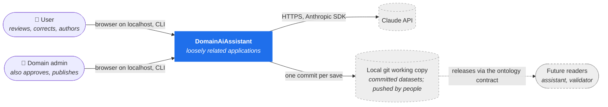
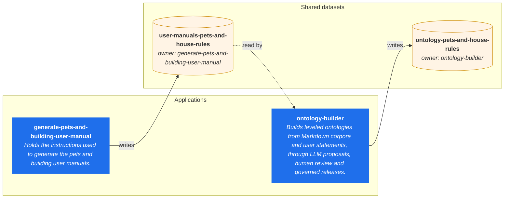
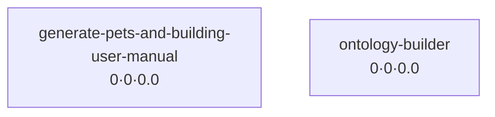
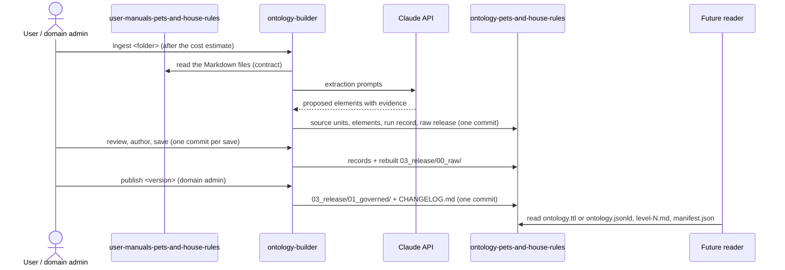

# DomainAiAssistant · System architecture

- **Last updated:** 2026-11-22
- **Reflects:** the apps `generate-pets-and-building-user-manual` and `ontology-builder` as built for [spec 0002](../specs/0002-ontology-builder/spec.md); the readers of the ontology (idea 0001's assistant, a validator) are not built yet
- **Decisions:** [root ADR index](adr/README.md) · **Metrics:** [latest](metrics/latest.md)

> **How to maintain this document.** This is the **system level** of a two-level architecture (ADR-0011): which applications exist, what they share (code and data), and the rules that hold across all of them. Each app's insides are described in `apps/<app>/docs/architecture/architecture.md`; don't repeat them here, link to them. It shows the *current* state; the ADRs explain how it got here. The system map in section 3 is generated from [components.json](components.json) by `tools/monorepo/system-map.sh`, and the coupling diagram in section 5 by `/arch-metrics`. Don't edit either by hand.

## 1. Purpose and scope

DomainAiAssistant turns a domain's user manuals, plus what its experts know, into material that AI tools can rely on, starting with the domain of pet ownership in a residential complex. One app holds the instructions that generated the pet and building manuals (`user-manuals-pets-and-house-rules`). `ontology-builder` reads them and, with Claude's proposals and human review, builds a leveled ontology (level-1 to level-3, plus ignorable passages) that it publishes as a raw and a governed release in the dataset `ontology-pets-and-house-rules` ([spec 0002](../specs/0002-ontology-builder/spec.md), [ADR-0019](adr/0019-ontology-builder-app-and-shared-ontology-contract.md)). Future apps, such as the ontology-backed assistant of idea 0001 or a text validator, are meant to read those releases through the [`ontology` contract](../../libs/contracts/ontology/README.md). The apps share no code and talk to each other only through datasets. The monorepo deliberately has no server deployment, no multi-user editing, no shared libraries yet (they come with the readers' specs) and nothing that pushes to GitHub on its own.

## 2. System context

Who uses the applications, and which external systems they depend on.

| Actor / external system | Kind | Which apps it touches | Protocol / interface |
|-------------------------|------|-----------------------|----------------------|
| User | person | ontology-builder | local GUI on `127.0.0.1` (session cookie names the handle and role), CLI |
| Domain admin | person | ontology-builder | as a user, plus governing actions and publishing (GUI only) |
| Claude API | external service | ontology-builder (ingestion, evaluation) | Anthropic SDK over HTTPS; `ANTHROPIC_API_KEY`, `CLAUDE_MODEL` from the base `.env` |
| Local git working copy | tool | ontology-builder (commits), every app (the repo) | `git` CLI with the repo's hooks; apps never push |
| Future readers (idea 0001 assistant, validator) | apps, not built | read `ontology-<name>` | files of `03_release/` per the [`ontology` contract](../../libs/contracts/ontology/README.md) |

## 3. System map: applications, shared datasets, libraries

Arrows: an app **writes** a dataset it owns, a dataset is **read by** other apps, a unit **uses** libraries. Apps never depend on each other directly (ADR-0010); every dataset has exactly one owner, its only writer (ADR-0013).

<!-- system-map:begin (generated by tools/monorepo/system-map.sh from components.json, do not edit) -->

| App | Responsibility | Writes | Reads | Uses libraries | Docs |
|-----|----------------|--------|-------|----------------|------|
| **generate-pets-and-building-user-manual** | Holds the instructions used to generate the pets and building user manuals. | user-manuals-pets-and-house-rules | — | — | [architecture](../../apps/generate-pets-and-building-user-manual/docs/architecture/architecture.md) · [specs](../../apps/generate-pets-and-building-user-manual/docs/specs/README.md) · [ADRs](../../apps/generate-pets-and-building-user-manual/docs/architecture/adr/README.md) |
| **ontology-builder** | Builds leveled ontologies from Markdown corpora and user statements, through LLM proposals, human review and governed releases. | ontology-pets-and-house-rules | user-manuals-pets-and-house-rules | — | [architecture](../../apps/ontology-builder/docs/architecture/architecture.md) · [specs](../../apps/ontology-builder/docs/specs/README.md) · [ADRs](../../apps/ontology-builder/docs/architecture/adr/README.md) |

| Dataset | Owner (only writer) | Read by | Contract | Description |
|---------|---------------------|---------|----------|-------------|
| **user-manuals-pets-and-house-rules** | generate-pets-and-building-user-manual | ontology-builder | [libs/contracts/user-manuals-pets-and-house-rules/](../../libs/contracts/user-manuals-pets-and-house-rules/README.md) | Dog owner's, cat owner's and building rules manuals, one Markdown file per chapter, with seeded quality issues for testing a manual assistant. |
| **ontology-pets-and-house-rules** | ontology-builder | — | [libs/contracts/ontology-pets-and-house-rules/](../../libs/contracts/ontology-pets-and-house-rules/README.md) | Ontology of pet ownership and the house rules, built from the pet and building manuals: source registry, user statements and the raw and governed releases. |
<!-- system-map:end -->

## 4. Rules that hold across all applications

| Rule | Enforced by | ADR |
|------|-------------|-----|
| Apps never import from each other; they share code only through the public entry points of libraries in `libs/<lib>`, which may use other libraries but never an app | `system-map.sh` (declarations), per-language boundary checker (imports) | [ADR-0010](adr/0010-monorepo-of-loosely-coupled-applications.md), [ADR-0015](adr/0015-libraries-in-libs-folder.md) |
| Each shared dataset has one owner, its only writer; readers depend on the contract in `libs/contracts/<dataset>/`, not on the owner's code | `system-map.sh`, contract review | [ADR-0013](adr/0013-shared-data-through-owned-datasets-and-contracts.md), [ADR-0015](adr/0015-libraries-in-libs-folder.md) |
| Configuration comes from layered `.env` files: process env > `apps/<app>/.env` > root `.env` | `tools/env/with-env.sh` | [ADR-0012](adr/0012-layered-environment-configuration.md) |
| Decisions that another app can see are root ADRs; the rest are app ADRs | `/adr`, review | [ADR-0011](adr/0011-two-level-documentation-and-architecture.md) |

## 5. Coupling between apps and libraries

Measured from the code by `/arch-metrics` at system level: edges between apps and libraries, labelled with reference counts. Any edge between two apps is a violation and is drawn red. Definitions and thresholds: [metrics/README.md](metrics/README.md).

<!-- coupling:begin (generated, do not edit) -->
_No dependencies between components measured yet._ _Nodes: name, Ca·Ce·I. Edges: number of import statements. Red: violation._

<!-- coupling:end -->

## 6. Key cross-app flows

**From manuals to a governed ontology.** The manuals dataset is the input; the ontology dataset is the output that future readers pick up. Each step is a git commit, so readers can pin a commit or a published version. The steps inside `ontology-builder` are in [its architecture](../../apps/ontology-builder/docs/architecture/architecture.md#5-key-runtime-flows).

## 7. Cross-cutting concerns

| Concern | Approach | ADR |
|---------|----------|-----|
| Configuration and secrets | Layered `.env` files; secrets only in git-ignored `.env` files or the process environment | [ADR-0012](adr/0012-layered-environment-configuration.md), [ADR-0008](adr/0008-security-checks-for-a-public-repository.md) |
| Shared data | Owned datasets with versioned contracts under `${SHARED_DATA_DIR}` | [ADR-0013](adr/0013-shared-data-through-owned-datasets-and-contracts.md) |
| LLM access | `ANTHROPIC_API_KEY` and `CLAUDE_MODEL` from the base `.env`; apps may override the model | [ADR-0012](adr/0012-layered-environment-configuration.md) |
| Error handling | Writes to a dataset are all-or-nothing: a change is staged, swapped in, then committed, and swapped back if a hook or git refuses (ontology-builder/ADR-0004). A refused use case is a message, not a stack trace: exit code 1 in the CLI, a 4xx/5xx with the reason in the API. An interrupted LLM run resumes from its cache | [ontology-builder/ADR-0004](../../apps/ontology-builder/docs/architecture/adr/0004-pending-change-set-atomic-save-one-commit.md) |
| Logging and observability | `LOG_LEVEL` from the base `.env`. The durable record is in the datasets and git, not in log files: git history for every change, `02_decisions/<date>.jsonl` for every review and governance decision, `02_decisions/runs/` for each LLM run (model, tokens in and out, status), and the release manifest for what a release was built from | [ADR-0013](adr/0013-shared-data-through-owned-datasets-and-contracts.md) |
| Security and privacy | Public repo: gitleaks and the other checks run locally and in CI, secrets only in git-ignored `.env` files. Apps run locally only: the GUI binds to `127.0.0.1` and checks the Host, the Origin and a custom header on writes; roles are self-declared (no real authentication in v1). Users are recorded by handle, never by name or email. Apps never push and never bypass hooks | [ADR-0008](adr/0008-security-checks-for-a-public-repository.md), [ADR-0009](adr/0009-github-repository-protection.md), [spec 0002](../specs/0002-ontology-builder/spec.md) |
| Testing strategy | Test-first, per acceptance criterion; contract tests for every dataset reader | [ADR-0002](adr/0002-specification-driven-development.md), [ADR-0013](adr/0013-shared-data-through-owned-datasets-and-contracts.md) |
