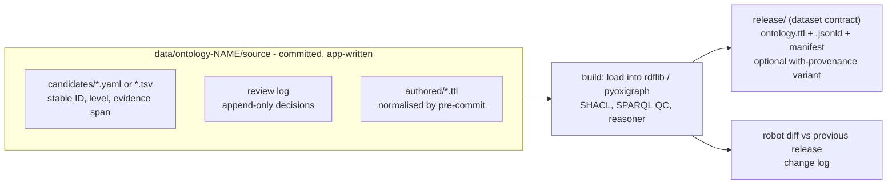
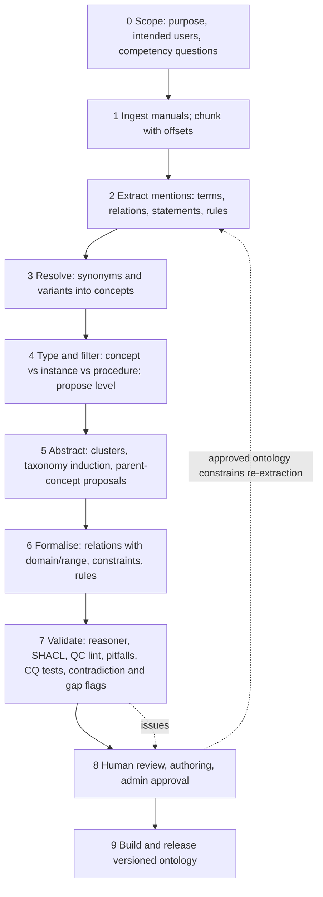
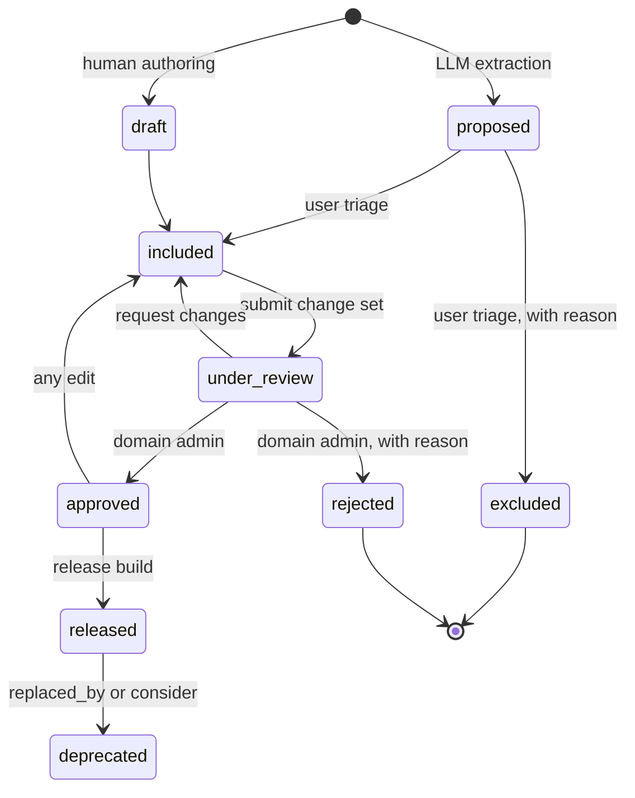

# Curate candidates as records, release ontologies as RDF

> **Research report, 2026-11-20.** Research files are evidence, not decisions: specs and ADRs take precedence, and figures quoted here should be re-checked before they drive a decision. Context: [idea 0002 · OntologyBuilder](../../ideas/0002-ontology-builder.md). Supporting notes: [formats and specs](../notes/Ontology%20formats%20and%20building%20process/formats_and_specs.md) · [storage architecture](../notes/Ontology%20formats%20and%20building%20process/storage_architecture.md) · [ontology learning pipeline](../notes/Ontology%20formats%20and%20building%20process/ontology_learning_pipeline.md) · [scoping and exclusion](../notes/Ontology%20formats%20and%20building%20process/scoping_and_exclusion.md) · [governance process](../notes/Ontology%20formats%20and%20building%20process/governance_process.md) · [existing tools](../notes/Ontology%20formats%20and%20building%20process/existing_tools.md).

## Executive summary

No single format, store or product fits OntologyBuilder as is. Mature practice points to one architecture. Keep the **working material** (LLM-extracted candidates with evidence, proposed levels, review decisions and authored content) as **git-friendly records**: YAML/JSON or sorted TSV with stable IDs, described by a schema such as LinkML. **Generate** the released ontology from those records as standard RDF: SKOS for vocabulary, OWL 2 for axioms, SHACL for constraints, PROV-O for provenance, written as deterministic Turtle in a single release file per artefact. This is how the OBO/ODK community already works (a small editable source plus a build that produces releases, [OBO Academy ODK](https://oboacademy.github.io/obook/reference/odk/)). It is also how the leading LLM ontology tools work: they make the LLM fill JSON/YAML records against a schema, then convert to OWL ([SPIRES](https://arxiv.org/html/2304.02711v2), [DRAGON-AI](https://pmc.ncbi.nlm.nih.gov/articles/PMC11484368/)). A graph database is not needed at hundreds to tens of thousands of statements. An embedded store (rdflib or pyoxigraph) loaded at build time covers SPARQL, SHACL and reasoning. The building process follows the classical "layer cake": terms, synonyms, concepts, hierarchy, relations, axioms and rules. The LLM-era pipelines add chunking, entity resolution and clustering ([GraphRAG](https://microsoft.github.io/graphrag/index/default_dataflow), [KGGen](https://arxiv.org/html/2502.09956v2)). Human review is essential: LLMs remain weak at term typing and non-taxonomic relations ([LLMs4OL 2024](https://arxiv.org/html/2409.10146v1)), and assigning a level is a term-typing problem. Exclusion has principled grounds: types (TBox) belong in the ontology, while particulars, anecdotes (ABox) and step-by-step procedures do not ([Baader et al.](https://www.cse.sc.edu/~mgv/csce781sp13/presentations/BaHS07a.pdf), [PROHOW](https://arxiv.org/pdf/1410.8808v1.pdf)). Governance converges on one spine: proposed → under review → approved → deprecated, with separate proposer and approver roles and never-delete obsoletion ([OBO Principle 19](https://obofoundry.org/principles/fp-019-term-stability.html)). Commercial platforms (PoolParty, TopBraid EDG, metaphactory) cover parts of this. **No tool found offers importance levels or contradiction detection across source documents.** These two features, along with the evidence-linked candidate queue, are what OntologyBuilder would have to build itself.

## 1. A W3C stack on RDF covers every layer, but no single format does

Most ontology formats are one family of W3C standards built on a single data model, **RDF**. Vocabularies layer on top of it. **RDFS** gives classes, subclasses, domain and range ([RDF Schema 1.1](https://www.w3.org/TR/rdf-schema/)). **OWL 2** adds description-logic axioms (disjointness, cardinality, class expressions) and three tractable profiles: EL for large terminologies, QL for query rewriting and RL for rule engines ([OWL 2 Profiles](https://www.w3.org/TR/owl2-profiles/)). **SKOS** models concept schemes with prefLabel/altLabel and broader/narrower, which are deliberately *not* subclass relations ([SKOS Reference](https://www.w3.org/TR/skos-reference/)). SKOS-XL turns labels into resources so that each label can carry its own source and status ([SKOS-XL](https://www.w3.org/TR/skos-reference/skos-xl.html)). **OntoLex-Lemon** separates words and senses from the concepts they name ([OntoLex](https://www.w3.org/2016/05/ontolex/)). **PROV-O** records which activity generated a statement, from which source, and attributed to which agent ([PROV-O](https://www.w3.org/TR/prov-o/)). **Dublin Core Terms** supplies creator, created, source and similar fields ([DCMI Terms](https://www.dublincore.org/specifications/dublin-core/dcmi-terms/)).

Constraints and rules sit beside these vocabularies. **SHACL** validates data under a closed-world reading, whereas OWL infers under an open-world one ([SHACL](https://www.w3.org/TR/shacl/)). **ShEx** is a Community Group alternative ([ShEx 2.1](https://shex.io/shex-semantics/)). Rules are the weak spot. **SWRL** was never more than a Member Submission ([SWRL](https://www.w3.org/submissions/SWRL/)). **RIF** became a Recommendation but saw little adoption ([RIF Overview](https://www.w3.org/TR/rif-overview/)). In practice SPARQL CONSTRUCT queries serve as rules ([SHACL-AF](https://www.w3.org/TR/shacl-af/)). The newest candidate, **SHACL 1.2 Rules** with its compact SRL syntax, derives new triples by stratified fixed-point evaluation, but it is still a Working Draft ([SHACL 1.2 Rules WD](https://www.w3.org/TR/2026/WD-shacl12-rules-20260810/)).

Serialisation status matters in 2026. **RDF 1.1** (Turtle, TriG, N-Triples, N-Quads, RDF/XML, JSON-LD 1.1) is the current Recommendation. **RDF 1.2**, which absorbs RDF-star's triple terms and reifiers for statements about statements, reached Candidate Recommendation for Concepts and Semantics on 2026-04-07. Its syntaxes are still Working Drafts, and the Turtle draft is dated 2026-11-11 ([What's New in RDF 1.2](https://www.w3.org/TR/rdf12-new/), [RDF 1.2 Turtle](https://www.w3.org/TR/rdf12-turtle/)). SHACL 1.2 Core was also still a Working Draft in August 2026 ([SHACL 1.2 Core WD](https://www.w3.org/TR/2026/WD-shacl12-core-20260828/)).

Outside the W3C family there are several options. **ISO Common Logic** covers full first-order logic ([ISO/IEC 24707](https://www.iso.org/standard/66249.html)). **Topic Maps** are now legacy ([ISO/IEC 13250](https://www.iso.org/standard/38068.html)). **GQL**, published 2024-04-12, is the first ISO query language for property graphs but defines no file format ([IEC webstore](https://webstore.iec.ch/publication/94107)); GraphML covers graph exchange ([GraphML](http://graphml.graphdrawing.org/)). The **OBO 1.4 flat file** is a stanza format that maps to a subset of OWL ([OBO 1.4](https://owlcollab.github.io/oboformat/doc/obo-syntax.html)). **LinkML** is a YAML schema language that generates OWL, SHACL, ShEx, JSON Schema, Pydantic, SQL DDL and more ([LinkML](https://linkml.io/linkml/)). **Nanopublications** package each claim as four named graphs (head, assertion, provenance, publication info), preferably in TriG ([Nanopub guidelines](https://raw.githubusercontent.com/Nanopublication/Guidelines/8388dd90795b264f4b01c64d0f7218babcae4871/index.html)).

Because each format covers only some layers, the practical answer is a split by component type:

| Ontology component | Best-fit standard | Notes |
|---|---|---|
| Terms, labels, synonyms | SKOS (+ SKOS-XL, OntoLex-Lemon) | SKOS-XL for per-label provenance |
| Concepts and hierarchy | SKOS (informal) or OWL 2 / RDFS (formal) | broader ≠ subClassOf |
| Relations and facts | RDF triples, OWL object properties | property graphs if analytics dominate |
| Axioms | OWL 2 (EL profile if large) | annotations on axioms carry no logic |
| Constraints | SHACL 1.0 | 1.2 still a draft |
| Rules | SPARQL CONSTRUCT today; SHACL 1.2 Rules later; SWRL legacy | no stable, well-adopted standard |
| Statement metadata (level, status, provenance) | Named graphs (nanopub pattern), RDF 1.2 reifiers, OWL axiom annotations + PROV-O/DCTERMS | no standard "review status" or "confidence" property |

The last row matters most for OntologyBuilder. Five mechanisms can attach a level, a review status and a source span to an individual statement. Classic RDF reification (`rdf:Statement`) is verbose but supported everywhere. **Named graphs** work per set of triples and are supported by every quad store. **RDF 1.2 reifiers and annotations** work per triple and can leave the triple *unasserted*, which suits "proposed, not yet approved" ([RDF 1.2 Turtle](https://www.w3.org/TR/rdf12-turtle/)). **OWL axiom annotations** work per axiom ([OWL 2 §10](https://www.w3.org/TR/owl2-syntax/#Annotations)). Property-graph edge properties work per edge. **No standard vocabulary exists for review status or confidence**, so every project defines its own properties ([formats notes](../notes/Ontology%20formats%20and%20building%20process/formats_and_specs.md)).

## 2. Turtle and LinkML lead on git and LLM fitness; RDF/XML trails

The alternatives differ most on four practical axes: how they diff in git, how well LLMs read and write them, whether a reasoner can use them, and how they validate. The OBO community's experience is explicit. RDF/XML is "a pretty ugly format… not suitable for manual review" and survives only as a legacy default. OWL Functional Syntax "look[s] nice in diff tools such as `git diff`". OBO format is "the most easy to read of all the serialisations", which is why Mondo and Uberon edit in it ([OBO Academy format variants](https://oboacademy.github.io/obook/explanation/owl-format-variants)). ODK even moved intermediate files from RDF/XML to `.ofn` for smaller files and cleaner diffs ([ODK releases](https://www.github.com/INCATools/ontology-development-kit/releases)).

LLM evidence is weaker than intuition suggests. **LLM-KG-Bench 3.0 tested more than 30 models and found no significant Turtle-versus-JSON-LD preference on most tasks.** JSON-LD won the syntax-repair task (16 of 36 models), and Turtle leaned ahead on answering questions from a graph ([LLM-KG-Bench 3.0](https://arxiv.org/html/2505.13098v1)). OWL-generation studies choose Turtle because models have seen it often in training ([ESWC 2024](https://2024.eswc-conferences.org/wp-content/uploads/2024/04/146640137.pdf)). The decisive practical advantage belongs to **JSON/YAML validated against a JSON Schema**, because structured-output decoding can enforce that schema at extraction time. LinkML generates exactly such schemas ([LinkML](https://linkml.io/linkml/)).

| Format | Expressiveness | Reasoning | Human read | Git diff/merge | LLM read/write | Adoption |
|---|---|---|---|---|---|---|
| Turtle / TriG | carries RDFS, OWL, SKOS, SHACL | via OWL/RDFS reasoners | good | good if canonicalised | good; most-used in LLM papers | very high |
| N-Triples / N-Quads | same | same | poor | excellent when sorted | ok, verbose | high |
| JSON-LD | same | same | ok | ok-poor (nesting) | good; JSON tooling | very high (web) |
| RDF/XML | same | same | poor | poor | poor | legacy default |
| OWL Functional | full OWL 2 | DL reasoners | ok | very good | moderate | OBO/ODK |
| Manchester | full OWL 2 | DL reasoners | best for logic | ok | good for single axioms | Protégé |
| OBO 1.4 | OWL subset | via conversion | very good | very good | good | biomedical |
| LinkML YAML | schema, enums, constraints; not full DL | via generated OWL | very good | very good | very good | growing |
| Property graph (GQL/Cypher) | nodes and edges with properties; no standard semantics | none standard | ok | poor as a DB | good for Cypher | high in industry |
| SWRL / RIF / Common Logic | rules / full FOL | niche engines | ok-poor | ok-poor | low | low |

*Ratings are the researcher's judgement from the cited findings ([formats notes](../notes/Ontology%20formats%20and%20building%20process/formats_and_specs.md)).*

Two cross-cutting points matter more than the format itself. First, **diff stability depends on a deterministic serialiser, not on the syntax**. Blank nodes get relabelled after small edits and flood diffs with false changes in any RDF syntax ([W3C list, 2024-09](https://lists.w3.org/Archives/Public/semantic-web/2024Sep/0016.html)). The fix is to normalise every write: rdflib's `longturtle` with `canon=True` ([rdflib longturtle](https://rdflib.readthedocs.io/en/stable/apidocs/rdflib.plugins.serializers.longturtle/)), the EDM Council rdf-toolkit as a pre-commit hook ([rdf-toolkit](https://www.github.com/edmcouncil/rdf-toolkit)), or ROBOT/OWL API for OFN. Use `robot diff` for semantic review ([ROBOT diff](https://robot.obolibrary.org/diff)). Second, **property graphs trade semantics for convenience**. Neo4j's n10s ontology loader imports only classes, hierarchies, property definitions, domain/range and restrictions, ignores everything else, and by default keeps one value per literal property ([n10s](https://neo4j.com/labs/neosemantics/4.3/importing-ontologies/), [n10s import](https://neo4j.com/labs/neosemantics/5.14/import/)). That makes property graphs a poor canonical store for OWL axioms and rules.

Neither question has quantitative evidence behind it. No benchmark measured LLM accuracy writing OFN, Manchester, OBO, LinkML or SHACL against Turtle, and no study measured merge-conflict rates per format.

## 3. Use modular source files in git, a generated single-file release, and no database yet

The answer is **"multiple files for the source, a single file per release artefact, and a store only as a disposable build-time index."** Every established project separates an editable source from generated releases. ODK's Makefile "encodes the rules by which ontology release files should be derived from the source of truth (the edit file)", merging imports and components into full and base releases ([OBO Academy ODK](https://oboacademy.github.io/obook/reference/odk/), [release artefacts](https://oboacademy.github.io/obook/reference/release-artefacts/)). Gene Ontology tests every PR in CI and builds monthly releases as go.obo, go.owl and go.json ([go-ontology](https://github.com/geneontology/go-ontology), [GO downloads](https://geneontology.org/docs/download-ontology/)). Schema.org keeps its vocabulary as Turtle in `data/` ([schema.org developers](https://auto.schema.org/docs/developers.html)). SNOMED CT publishes tab-delimited Full, Snapshot and Delta files, where Full holds the complete history ([SNOMED RF2](https://docs.snomed.org/snomed-ct-specifications/snomed-ct-release-file-specification/release-types-packages-and-files/3.2-release-types)). That model is a precedent for an append-only review log. The tabular ROBOT template, one row per term with a header row of template strings, closely matches a table of extracted candidates ([ROBOT template](https://robot.obolibrary.org/template)).

A **single edit file** is simple and opens in Protégé. But merge conflicts concentrate in it ([OBO Academy: fixing conflicts](https://oboacademy.github.io/obook/howto/fixing-conflicts)), editors with different serialisers cause churn ([Git4Voc](https://arxiv.org/pdf/1601.02433)), and it cannot hold review state cleanly. **File-per-item or sorted TSV per component type** gives the clearest per-item history and the fewest conflicts, at the cost of a loader step; this is the researcher's inference, with no primary source. A **server triplestore** is warranted for live multi-user writes, millions of triples or more, an always-on SPARQL endpoint or heavy query-time reasoning. None of these applies here. A server store also adds a second source of truth and breaks review by PR diff. Jena TDB2 allows one writer and warns that sharing its files across JVMs risks corruption ([Jena TDB transactions](https://jena.apache.org/documentation/tdb/tdb_transactions.html)). Wikidata needed a dedicated store and a graph split only at a scale many orders of magnitude larger ([WDQS graph split](https://meta.wikimedia.org/wiki/WikiCite/WDQS_graph_split)). Embedded engines such as **pyoxigraph/oxrdflib** cover build-time SPARQL and validation without a server ([oxrdflib](https://pypi.org/project/oxrdflib)). The hybrid pattern (git files plus build-time services) is exactly what VoCol demonstrated over a plain repository ([VoCol](https://link.springer.com/doi/10.1007/978-3-319-49004-5_20)).

The size thresholds are the researcher's rule of thumb, not vendor-neutral facts. In-memory stores suffice below roughly 1M triples; embedded persistent stores fit from 1M to 100M; server stores beyond that or with many concurrent writers ([storage notes](../notes/Ontology%20formats%20and%20building%20process/storage_architecture.md)). OntologyBuilder's expected volume sits far below the first threshold. The upgrade path, if real-time collaborative editing becomes a requirement, is to load git into Fuseki or an Oxigraph server as a **derived** index. The source of truth moves into a database (the Wikibase model) only if PR review itself becomes the bottleneck.

## 4. Ontology building climbs a layer cake from terms to axioms

The classical model from Buitelaar, Cimiano and Magnini (2005) stacks the work in layers of rising difficulty: **terms → synonyms → concepts → concept hierarchy → relations → axioms/rules**. Each layer consumes the one below ([Wikipedia: Ontology learning](https://www.wikipedia.org/wiki/Ontology_learning)). The manual methodologies agree on the same backbone and add a scoping step at the front and testing at the end. Ontology Development 101 has seven steps: determine domain and scope, consider reuse, enumerate terms, define classes and hierarchy, define properties, define facets (constraints), create instances ([Noy & McGuinness](https://protege.stanford.edu/publications/ontology_development/ontology101-noy-mcguinness.html)). METHONTOLOGY's conceptualisation runs glossary → concept taxonomy → binary-relations diagram → concept dictionary → attribute tables, then axioms, rules and instances ([Keet §6.1](https://eng.libretexts.org/Bookshelves/Computer_Science/Programming_and_Computation_Fundamentals/An_Introduction_to_Ontology_Engineering_(Keet)/06%3A_Methods_and_Methodologies/6.01%3A_Methodologies_for_Ontology_Development)). UPON Lite yields a usable output at every step: lexicon, glossary, taxonomy, predication, parthood ([UPON Lite](https://ceur-ws.org/Vol-2835/paper7.pdf)). eXtreme Design makes the loop test-driven: user stories become **competency questions (CQs)**, which are matched to ontology design patterns and then tested ([NeOn D2.5.2](https://research-archive.stem.open.ac.uk/stemra-data/uploads/sites/136/2025/03/NeOn_2010_D252.pdf)).

LLM-era pipelines keep the layers but change the mechanics. Microsoft GraphRAG's default dataflow is the best-documented example. It chunks documents into **TextUnits** of 1,200 tokens by default. Per chunk, it extracts entities (title, type, description) and relationships. It merges duplicates by title and type and has the LLM summarise their descriptions. Optionally it extracts claims with status and time bounds. Then it runs hierarchical Leiden community detection, writes community reports bottom-up, and embeds everything, with extracted items referencing their TextUnits for provenance ([GraphRAG dataflow](https://microsoft.github.io/graphrag/index/default_dataflow)). iText2KG adds *incremental* entity and relation resolution as documents arrive ([iText2KG](https://arxiv.org/pdf/2409.03284)). KGGen adds a clustering pass that merges equivalent nodes and edges ([KGGen](https://arxiv.org/html/2502.09956v2)). Schema-guided extractors (LangChain `allowed_nodes`/`allowed_relationships`, LlamaIndex `SchemaLLMPathExtractor`) let the approved ontology constrain the next extraction round ([LangChain](https://reference.langchain.com/v0.3/python/experimental/graph_transformers/langchain_experimental.graph_transformers.llm.LLMGraphTransformer.html), [LlamaIndex](https://developers.llamaindex.ai/python/framework/module_guides/indexing/lpg_index_guide/)).

Combining the classical and LLM views gives a pipeline that matches idea 0002's way of working:

Abstraction (step 5, idea 0002's "propose higher-level concepts") uses three techniques. *Grouping* covers synonym clustering, entity-resolution clustering and community detection. *Hierarchy induction* covers is-a pair classification and whole-subgraph generation: OLLM generates taxonomy subgraphs end to end to avoid compounding pairwise errors ([OLLM](https://arxiv.org/abs/2410.23584v1)). *Group summarisation* covers GraphRAG community reports. Ontology 101's **bottom-up** strategy, generalising specific classes into broader ones, is what an extraction pipeline does by nature. Communities are navigation aids, not is-a classes, and should stay separate from concepts.

The weakest stage is formalisation. **Non-taxonomic relation extraction remained the hardest LLMs4OL task in 2024** ([LLMs4OL 2024](https://arxiv.org/html/2409.10146v1)). Joint term-and-type extraction from raw documents scored only about **0.44–0.65 F1** in a 2025 participant system ([arXiv 2508.19428](https://arxiv.org/html/2508.19428v1)). The sources found say almost nothing about inducing rules or axioms (disjointness, cardinality, conditional rules) from text, which matters because manuals are full of "if X then Y" warnings. Validation (step 7) combines reasoners (HermiT/ELK), SHACL, the OOPS! pitfall catalogue ([OOPS!](https://econpapers.repec.org/RePEc:igg:jswis0:v:10:y:2014:i:2:p:7-34)) and CQs turned into SPARQL ([arXiv 2604.23090](https://arxiv.org/html/2604.23090v1)). One caution: **automated repair loops helped only under conservative stopping policies, and aggressive CQ-driven repair made ontologies worse** ([CEUR Vol-4246 llms4kgoe-6](https://ceur-ws.org/Vol-4246/llms4kgoe-6.pdf)).

## 5. Exclude particulars, procedures and one-document vocabulary

Scoping is decided by purpose, not by the corpus. NeOn's Ontology Requirements Specification Document (ORSD) records "why the ontology is being built, what its intended uses are, who the end-users are, and which requirements the ontology should fulfill". It expresses functional requirements as prioritised groups of CQs and derives a **pre-glossary** of CQ terms with frequencies ([Suárez-Figueroa et al.](https://link.springer.com/doi/10.1007/978-3-642-05151-7_16)). Ontology 101 states the exclusion principle directly: "The ontology should not contain all the possible information about the domain." Its wine example needs neither label paper nor shrimp recipes ([Noy & McGuinness](https://protege.stanford.edu/publications/ontology_development/ontology101-noy-mcguinness.html)). The CQs become "the litmus test" for whether something belongs.

Two distinctions draw the line in a principled way, and they line up with idea 0002's "ignorable" examples. The **TBox/ABox** split separates knowledge about "the structure of the domain (similar to a database schema)" from "knowledge about a concrete situation" ([Baader, Horrocks & Sattler](https://www.cse.sc.edu/~mgv/csce781sp13/presentations/BaHS07a.pdf)). BFO/OBO realism holds that ontology terms denote **universals**, which are repeatable, while **particulars** belong to data ([Smith & Ceusters](https://philarchive.org/archive/SMIORA-2)). A specific dog's story or one owner's anecdote is a particular, so it is out. **Procedural knowledge** ("how humans do things… step-by-step instructions") is modelled as a separate kind of knowledge with its own ontologies, PROHOW and PKO, not inside a declarative domain ontology ([Pareti, PROHOW](https://arxiv.org/pdf/1410.8808v1.pdf), [PKO](https://arxiv.org/abs/2503.20634)). That excludes CLI commands for landing zones and cookbook recipes. A useful middle ground is to keep the *task type* ("deploy a service", "house-train a puppy") as a concept and drop the step sequence. Ontology 101 adds a third filter: "numbers, colors, locations are slot values and do not cause the creation of new classes" ([§4.5](https://protege.stanford.edu/publications/ontology_development/ontology101-noy-mcguinness.html)). Version strings and UI labels likewise become attribute values or are dropped.

Statistical term-recognition measures make these judgements computable. **C-value/NC-value** scores the termhood of multi-word, nested terms ([Frantzi et al. 2000](https://link.springer.com/article/10.1007/s007999900023)). **Weirdness** compares a word's frequency in the domain corpus with a general reference corpus, which filters out generic words ([Ahmad et al., TREC-8](https://trec.nist.gov/pubs/trec8/papers/surrey2.pdf)). OntoLearn's **domain consensus** requires a term to be spread evenly across many documents, "simulat[ing] specialist consensus" ([Navigli & Velardi 2004](https://direct.mit.edu/coli/article/30/2/151/1851/Learning-Domain-Ontologies-from-Document)). Domain consensus is a natural **anecdote filter**: a pet's name concentrated in one manual scores low. The researcher notes one interaction no source names: weirdness over-promotes CLI flags and SKUs, so an explicit instance-versus-type check has to run alongside it.

The levels themselves have partial theoretical support. **Rosch's basic-level categories** (*chair*, *car*) carry the most information and are what people name first ([Rosch et al. 1976](https://www.cns.nyu.edu/~msl/courses/2223/Readings/Rosch-CogPsych1976.pdf)). The basic level shifts with expertise ([Tanaka & Taylor 1991](https://www.ece.uvic.ca/~bctill/papers/learning/Tanaka_Taylor_1991.pdf)), so level-1 must be calibrated to the intended user. Guarino separates domain, task and application ontologies ([Guarino 1998](https://www.loa.istc.cnr.it/wp-content/uploads/2020/03/FOIS98.pdf)), which roughly maps to level-1 (domain core), level-2 (task/happy path) and level-3 (application detail and exceptions). Peroni, Motta and d'Aquin's **Key Concept Extraction** combines name simplicity, density, coverage and popularity, and correlated strongly with experts' choices ([Peroni et al. 2008](https://research-archive.stem.open.ac.uk/stemra-data/uploads/files/Paper191.pdf)). Its *coverage* term prevents a lopsided level-1 drawn only from the most verbose manual sections.

Leaving the level to the LLM alone is risky. Assigning a level is structurally **term typing, which was the hardest zero-shot LLMs4OL task** ([LLMs4OL](https://arxiv.org/pdf/2307.16648)). LLM verbalised confidence is systematically overconfident ([Xiong et al.](https://arxiv.org/pdf/2306.13063)) and coarse: one model used only eight distinct values ([ACL Findings 2026](https://aclanthology.org/2026.findings-acl.1671.pdf)). Errors made early propagate downstream, which motivates deterministic vocabulary-constrained filters ([arXiv 2608.27101](https://arxiv.org/pdf/2608.27101)). A defensible design runs deterministic exclusion rules first: proper names, code literals, version strings and numbered step lists go to *ignorable*. The LLM then classifies with a per-level rubric, few-shot hard negatives and the source passage. Corpus statistics (consensus, C-value, centrality) and cross-prompt agreement inform the result, not the raw confidence number. **No published study evaluates LLMs on importance-tier classification or anecdote/procedure exclusion**, so the expected failure modes (tier inflation, class/instance confusion, vivid anecdotes being promoted) are extrapolations.

## 6. Eight intermediate artefacts sit between a manual and an ontology

Each pipeline step produces a distinct artefact, and the literature names most of them. Text2Onto's **Probabilistic Ontology Model** is the template for the overall store. It holds every learned object with a confidence value, is independent of the target language so it can be exported to OWL or RDFS later, and updates incrementally when documents change ([Text2Onto](https://www.aifb.kit.edu/images/archive/2/21/20090816103033%212005_907_Cimiano_Text2Onto_-_A_F_1.pdf)). The table below combines the layer cake, METHONTOLOGY's intermediate representations, GraphRAG's dataflow and XD's requirements artefacts.

| Artefact | Produced by | Precedent |
|---|---|---|
| Scope / ORSD: purpose, users, prioritised competency questions, pre-glossary | scoping | [NeOn ORSD](https://link.springer.com/doi/10.1007/978-3-642-05151-7_16), [OntoChat](https://arxiv.org/html/2403.05921v2) |
| Document and Chunk (TextUnit) with offsets | ingestion | [GraphRAG](https://microsoft.github.io/graphrag/index/default_dataflow) |
| Mention / candidate term, candidate relation (triple), claim or statement with conditions | per-chunk extraction | GraphRAG entities, relationships, claims |
| Term variant / synonym set, concept (label, definition, instances, linked terms) | entity resolution | layer cake, [KGGen](https://arxiv.org/html/2502.09956v2), [iText2KG](https://arxiv.org/pdf/2409.03284) |
| Glossary, concept dictionary, attribute tables | conceptualisation | [METHONTOLOGY](https://www.inf.ed.ac.uk/teaching/courses/kmm/PDF/L2-methodology.pdf) |
| Cluster/community and community report; proposed parent concept + subClassOf edge | abstraction | GraphRAG communities, [OLLM](https://arxiv.org/abs/2410.23584v1) |
| Relation with domain/range, axiom, rule, constraint | formalisation | layer cake, [ROBOT template](https://robot.obolibrary.org/template) |
| Validation issue (source, severity, element), CQ test query and test run | validation | [ROBOT report](https://robot.obolibrary.org/report), [OOPS!](https://econpapers.repec.org/RePEc:igg:jswis0:v:10:y:2014:i:2:p:7-34) |
| Review decision, change set, release with version IRI and change log | governance | see section 7 |

Three design rules follow from these precedents. First, **every artefact links back to its evidence**. GraphRAG confirms this at chunk level, and span-level (character offset) provenance is a desirable extension that none of the tools reviewed documents. This makes re-ingesting one manual a selective update, as in Text2Onto's change discovery. Second, **clusters are not concepts**: a community groups things for navigation, while a concept has an intension and a place in the is-a hierarchy. Third, **the LLM's output format should be the artefact's schema**. OntoGPT/SPIRES has the LLM fill a user-defined LinkML schema recursively and then grounds values to ontology identifiers, which gives "far more consistent" IDs than unconstrained output ([SPIRES](https://pmc.ncbi.nlm.nih.gov/articles/PMC10924283)). DRAGON-AI represents each term as a JSON object (id, label, definition, relationships, logical definitions) ([DRAGON-AI](https://pmc.ncbi.nlm.nih.gov/articles/PMC11484368/)).

Contradictions, gaps and ambiguity (idea 0002 step 7) derive from these artefacts, though the literature is thin. **LLMs struggle with subtle cross-document inconsistencies** ([MAGIC](https://arxiv.org/html/2507.21544v3), [arXiv 2504.00180](https://arxiv.org/html/2504.00180v1)). CLAIRE flags corpus-level conflicting claims for human review rather than resolving them ([CLAIRE](https://arxiv.org/html/2509.23233v1)). Reasoners catch only logical inconsistency inside the ontology. A workable mapping, which is a design inference: *contradictions* are statement pairs with the same subject and predicate but incompatible objects or conditions, plus reasoner unsatisfiability. *Ambiguity* is a term linked to more than one concept, or a low-agreement definition. *Terminology drift* is several term variants for one concept distributed unevenly across manuals. *Gaps* are unanswered CQs, concepts without a definition or parent, and relations without domain or range.

## 7. Governance separates proposers from approvers and never deletes

Every mature platform keeps the people who propose or edit content apart from the people who approve and publish it. VocBench 3 defines administrators, ontology editors, term editors, validators and publishers, and holds editors' changes until a validator approves them ([VocBench 3, SWJ](https://semantic-web-journal.net/content/vocbench-3-collaborative-semantic-web-editor-ontologies-thesauri-and-lexicons-1)). TopBraid EDG restricts "Approve changes" to governance roles such as data governor or business steward ([EDG workflow templates](https://www.topquadrant.com/doc/8.4/quick_start_guides/edg_workflow_template/index.html)). In PoolParty, a reviewer can approve, reject with a note, or reassign a draft for clarification ([PoolParty workflow](https://help.poolparty.biz/en/user-guide-for-knowledge-engineers/enterprise-features/the-workflow-dashboard/approval-workflow/workflow-in-action.html)). DAMA-style data governance supplies the organisational frame: a business-led **owner with approval authority** plus stewards who curate day to day ([CDMP study guide](https://open-exam-prep.com/study-guides/cdmp/data-governance-b/data-stewardship), secondary). Idea 0002's "domain admin" corresponds to that owner/governor. **No published RACI matrix for ontology governance was found.**

Status models share one spine: **draft/proposed → under review → approved → deprecated**. The variants differ mainly in granularity. PoolParty tracks status per concept (Draft, Suggested, Approved, Deprecated), and *any edit to an approved concept returns it to Draft* ([PoolParty approval workflow](https://help.poolparty.biz/en/user-guide-for-knowledge-engineers/enterprise-features/the-workflow-dashboard/approval-workflow.html)). EDG tracks status per change set (Uncommitted → Under review → Approved → Committed), isolated from production until committed ([EDG workflows](https://www.topquadrant.com/doc/8.4/user_guide/workflows/index.html)). ISO/IEC 11179-6 offers a finer registration ladder: Candidate → Recorded → Qualified → Standard → Preferred → Superseded/Retired ([METEOR](https://meteor.aihw.gov.au/content/752877)). OBO Principle 19 sets the deprecation rules. **A term whose meaning changes gets a new IRI**, and an obsolete term is marked `owl:deprecated`, stripped of logical axioms, and pointed to `term replaced by` or `consider`, never deleted ([OBO P19](https://obofoundry.org/principles/fp-019-term-stability.html)).

*The diagram is a synthesis for OntologyBuilder built from the PoolParty, EDG and OBO patterns, not a published standard.*

Change management makes releases immutable and diffable. OBO Principle 4 requires a **unique version IRI per release**, with a date or a semantic version ([OBO P4](https://obofoundry.org/principles/fp-004-versioning.html)). The ODK release workflow builds every artefact, reviews it, merges it and tags a GitHub release ([ODK release workflow](https://obofoundry.org/COB/odk-workflows/ReleaseWorkflow/)). `robot diff`, Bubastis and ecco produce axiom-level change logs ([Bubastis](https://github.com/EBISPOT/bubastis)). KGCL argues that these are lower-level than how editors think about changes, and proposes a higher-level change language ([KGCL](https://arxiv.org/pdf/2409.13906)). No community standard defines major, minor and patch versions for ontologies.

Quality gates are layered. **`robot report` exits non-zero on ERROR-level findings, which makes it a release gate**; WARN and INFO are configurable ([ROBOT report](https://robot.obolibrary.org/report)). `robot verify` fails on any result from a custom SPARQL check ([Mondo QC](https://mondo.readthedocs.io/en/latest/editors-guide/quality-control/)). EDG can force SHACL conformance before a commit. The ODK editor workflow uses a feature branch, a PR, required review and merging only after QC passes ([ODK editors workflow](https://berkeleybop.org/artificial-intelligence-ontology/odk-workflows/EditorsWorkflow/)), which maps directly onto this monorepo's PR flow. For LLM content, two findings constrain the design. Calibrated auto-acceptance of high-confidence items with expert review of ambiguous ones reached **F1 0.97 against a 0.68 human baseline** in taxonomy alignment ([arXiv 2506.08422](https://arxiv.org/pdf/2506.08422)). But in OE-Assist, **19 ontology engineers performed worse when the LLM's guidance was wrong** ([arXiv 2507.14552](https://arxiv.org/html/2507.14552v1)). Raw LLM confidence is not on a common scale with other scores ([PROV-CRED](https://ceur-ws.org/Vol-4293/paper67.pdf)), so it should sort the queue but not auto-approve.

Conflict resolution in practice means discussion plus a decision-maker: threaded comments (WebProtégé), GitHub issues (GO), reassignment (PoolParty), or "request changes" (EDG). Wikidata shows why the decision-maker matters: **more than half of controversial discussions ended without consensus** ([arXiv 2306.11766](https://arxiv.org/html/2306.11766v3)).

## 8. Applications exist for each stage, but none covers the whole flow

**Commercial semantic platforms** cover governance well and extraction partially. Graphwise PoolParty (formed when Semantic Web Company and Ontotext merged in October 2024, [KMWorld](https://www.kmworld.com/Articles/News/News/Semantic-Web-Company-and-Ontotext-merge-to-rebrand-as-knowledge-graph-and-AI-powerhouse-Graphwise-166526.aspx)) is the only platform with true **corpus analysis**. It suggests terms and relations, scores terms by relevance and flags taxonomy gaps ([PoolParty corpus analysis](https://poolparty.biz/text-corpus-analysis)), and has a concept-level approval workflow. TopBraid EDG added voting workflows (9.2), human-in-the-loop approval steps and an MCP server (9.3) on a SHACL foundation ([EDG 9.2](https://www.topquadrant.com/?p=23925), [EDG 9.3](https://www.topquadrant.com/?p=24889)). metaphactory offers term-level provenance, modular ontology management, deprecation, concurrent editing and, from 6.0 (July 2026), an AI modelling assistant inside its visual editor ([metaphactory 5.10](https://metaphacts.com/metaphactory-5-10), [6.0](https://metaphacts.com/metaphactory-6-0)). Progress Semaphore's AI Model Builder suggests child concepts and labels that a human must validate ([Progress](https://www.progress.com/blogs/how-to-boost-semantic-projects-with-semaphore-ai-model-builder)). Stardog Voicebox drafts models from descriptions but says Designer is not meant to replace Protégé ([Stardog](https://www.stardog.com/blog/stardog-voicebox-makes-building-data-models-dead-simple/)). Lettria Perseus returns extracted entities with source attribution and proposes class hierarchies from documents; its accuracy figures are vendor-reported ([Lettria](https://www.lettria.com/perseus)). None publishes pricing.

**Open-source editors** cover authoring and roles but extract nothing. VocBench 3 (BSD-3) is actively maintained, with release 15.1.2 on 2026-07-16 ([vocbench-user](https://groups.google.com/g/vocbench-user/c/pjIfpsgPC3E)). WebProtégé and Protégé are the standard authoring tools. **Research ontology tools** come closest to ontology semantics: OntoGPT/SPIRES (schema-driven, grounded extraction), DRAGON-AI (in CurateGPT; its authors stress that curators must drive generation, [arXiv 2312.10904](https://arxiv.org/pdf/2312.10904)), OntoChat (requirements and CQs), Ontogenia, OntoKGen ([arXiv 2412.00608](https://arxiv.org/pdf/2412.00608)) and the 2026 OntoLearner library ([arXiv 2607.01977](https://arxiv.org/pdf/2607.01977)). **LLM graph-extraction frameworks** produce instance-level property graphs for RAG rather than governed ontologies: GraphRAG, Neo4j LLM Graph Builder ([Neo4j Labs](https://neo4j.com/labs/genai-ecosystem/llm-graph-builder)), LangChain, LlamaIndex, KGGen, Graphiti. Cognee is notable as the only framework found that **validates extraction against a supplied OWL ontology**, though it has no authoring ([Cognee](https://docs.cognee.ai/core-concepts/ontologies)). Text2Onto and OntoGen are legacy.

| Capability in idea 0002 | Best existing coverage | Gap |
|---|---|---|
| Ingest manuals, extract terms/relations | PoolParty, OntoGPT, DRAGON-AI, GraphRAG, Lettria | rules from procedural text |
| Propose higher-level concepts | DRAGON-AI, Semaphore, metaphactory, Lettria; GraphRAG communities | — |
| **Assign level-1/2/3/ignorable** | **none** (PoolParty term scores, community levels as heuristics) | must be custom |
| Review, author, approve | EDG, PoolParty, metaphactory, VocBench | reviewing *candidates with evidence*, not ontology edits |
| Provenance to source text | Lettria, metaphactory, GraphRAG (chunk level) | span-level evidence |
| **Contradictions across manuals** | **none** (reasoners/SHACL check only within the ontology) | must be custom |
| Formal OWL/SKOS output | Protégé, VocBench, EDG, PoolParty | — |

The nearest commercial match is PoolParty plus an LLM assistant. The nearest open-source combination is **OntoGPT/SPIRES or DRAGON-AI for extraction plus VocBench 3 or WebProtégé for authoring and review**, joined by custom glue. That glue is most of what makes OntologyBuilder distinctive: an evidence-linked candidate queue, importance levels and cross-document contradiction detection. A 2025 systematic review lists such hybrid LLM-plus-human workflows as an open challenge ([SWJ swj4001](https://www.semantic-web-journal.net/system/files/swj4001.pdf)). No public benchmark compares these tools on user-manual corpora.

## Implications for OntologyBuilder

The evidence supports a clear default architecture. These are recommendations for `/spec` and `/plan` to confirm or override, with ADRs at the right level.

**Store working state as schema-defined records, not RDF.** Define `Document`, `Chunk`, `Candidate` (term, concept, relation, statement, rule), `Level`, `Evidence` (document, chunk, quoted span), `ReviewDecision`, `CompetencyQuestion` and `Issue` once, ideally in LinkML. That single schema then generates the JSON Schema for LLM structured output, the SHACL shapes for validation and the OWL/SKOS export mapping, as SPIRES does. Commit records under `data/ontology-<name>/source/` as one YAML file per item or sorted TSV per type, keyed by stable IDs, with an append-only review log in SNOMED-Delta style. Keep LLM `excluded` and admin `rejected` items with their rationale, so the same proposal is not re-suggested.

**Release a single deterministic RDF file per artefact as the dataset contract.** Readers (ADR-0013) should depend on `release/ontology.ttl` (SKOS + OWL 2, written as RDF 1.1 Turtle by a canonicalising serialiser), a JSON-LD twin and a manifest with the version IRI. They should not depend on the internal source layout. Carry the level as a custom annotation property, because no standard exists. Offer an optional "with-provenance" variant that uses PROV-O and named graphs, mirroring ODK base versus full. Defer RDF 1.2 reifiers and SHACL 1.2 Rules until they reach Recommendation. For extracted rules, keep a structured `Rule` record (condition, action, scope) and export to SPARQL CONSTRUCT or annotations for now.

**Use no database in v1.** Load the records into rdflib or pyoxigraph at build time to run SHACL, SPARQL QC queries, a reasoner (ELK/HermiT if OWL axioms are produced) and CQ tests. Add Fuseki or an Oxigraph server later only as a derived index, if real-time multi-user editing becomes a requirement.

**Make scoping a first-class input.** Each ontology should start with an ORSD-style scope record: purpose, intended users (which calibrates the basic level for level-1), prioritised CQs and ignore rules. Let level assignment combine deterministic exclusion rules, an LLM rubric with few-shot hard negatives and grounding passages, and corpus statistics (domain consensus, C-value, centrality with a coverage constraint). Never use raw LLM confidence as an auto-accept threshold. Use it to order the review queue, and show the evidence before the LLM's verdict to limit automation bias.

**Reuse the monorepo's PR flow as the governance backbone.** An extraction run plus edits forms a change set, which maps to a branch and a PR. Per-component statuses live inside the change set. The domain admin's approval maps to required PR review under a four-eyes rule, with self-approval at most a visible policy. Release gates are `robot report`-style ERROR checks, zero unresolved contradiction issues, every included component approved, a version IRI and a generated change log. After first release, adopt OBO-style obsoletion with no hard deletes.

**Build what no tool provides and borrow the rest.** The custom core is the evidence-linked candidate queue, level assignment and cross-manual contradiction, drift and gap detection. The pet-manuals corpus with its seeded contradictions and answer key ([corpus notes](../notes/pet-manuals-corpus/README.md)) is a ready-made test set for the contradiction and gap detection. Treat OntoGPT/SPIRES (pattern or library), GraphRAG-style chunking and community summaries, KGGen-style clustering and ROBOT for QC and diff as candidate building blocks to evaluate in `/plan`. The open questions to resolve there are rule extraction from procedural text, span-level provenance, and whether domain admins need a non-git review UI, which would be the trigger for a derived store.

## Addendum (2026-11-21): standard format or custom format?

The user added five requirements: (1) cardinality on relations, e.g. "an owner can have at most 2 house pets according to the building rules"; (2) evidence links by stable ID on every element; (3) a level-1/2/3 classification on every element; (4) version control in git; (5) room to add new properties to terms, concepts, relations and rules later.

**Recommendation: use a custom data model written in standard formats, not a custom file format.** Define the OntologyBuilder model in **LinkML**, a standard schema language. Store the working records as YAML that the schema validates. Generate the release as standard **OWL 2 + SKOS + SHACL in Turtle**. This is the same split recommended above. The new requirements confirm it rather than change it.

| Requirement | OWL 2 / SKOS in Turtle as the *source* | Fully custom JSON/YAML (no schema standard) | LinkML YAML source → generated OWL/SKOS/SHACL release |
|---|---|---|---|
| 1. Cardinality | ✅ OWL qualified cardinality (`owl:maxQualifiedCardinality 2`); SHACL `sh:qualifiedMaxCount` for checking data. SKOS alone ❌ | ✅ any field we like, but no reasoner or validator understands it | ✅ `max: 2` field on a Rule/Relation record, exported to both OWL and SHACL |
| 2. Evidence by stable ID | ⚠️ needs OWL axiom annotations, which RDF writes as `owl:Axiom` blank nodes: verbose and noisy in diffs | ✅ | ✅ `evidence:` list of IDs (document, chunk, span) on every record; exported as PROV-O / annotations |
| 3. Levels | ⚠️ custom annotation property: no standard exists in any format (§1) | ✅ | ✅ `level` enum in the schema, exported as a custom annotation property |
| 4. Git | ⚠️ OK only with a canonical serialiser; blank nodes destabilise diffs (§2–3) | ✅ file-per-record diffs well | ✅ file-per-record YAML in git; Turtle release written deterministically |
| 5. Extensibility | ✅ any new annotation property | ✅ but no validation and nothing generated from it | ✅ add a slot to the schema; validation, JSON Schema for LLM output and the export mapping are regenerated |
| Interoperability (Protégé, reasoners, SPARQL, idea 0001's assistant) | ✅ | ❌ we would build every tool ourselves | ✅ via the generated release |

Why not OWL/Turtle as the editable source: four of the five requirements are metadata on statements (evidence, level, status, future properties). In OWL that metadata is attached through axiom annotations, which are the least diff-friendly and least LLM-friendly part of RDF. A level or review-status property would be custom in OWL anyway.

Why not a fully custom format: we would lose the reasoner, the SHACL validation, viewing in Protégé, SPARQL querying and a standard contract for readers of `data/ontology-<name>/`. We would gain nothing that LinkML does not already give us.

**Cardinality caveats to settle in `/spec`.**
- OWL reasons under the open-world assumption. `Owner ⊑ ≤2 hasHousePet.HousePet` will not flag a third pet unless the pets are known to be different individuals. Checking instance data against the rule is SHACL's job, so emit both.
- "According to the building rules" is a sourced and possibly local rule, not a universal truth about owners. Model it as a Rule record that has its own evidence and scope, and links to the relation it constrains, rather than as a bare number on the relation. Then a conflicting value in another manual becomes a detectable contradiction instead of an overwrite.

**Stable IDs.** Mint opaque IDs (e.g. `concept:000123`) that never derive from labels, so renaming a term never breaks a link (OBO practice). Evidence IDs point to document path + chunk ID + character span.

This is evidence for a decision, not the decision itself. Record the choice as an app ADR in `/plan`.

## Addendum (2026-11-21): review GUI, existing tools or custom?

The user wants a rich GUI for both **textual review** (accept, reject or correct extracted statements) and **visual review** (taxonomy and ontology diagrams), plus: filtering by level, colour-coding by status (approved / under review / just proposed), typing corrected or new statements, and an approval workflow with roles. Notes: [review GUI tools](../notes/Ontology%20formats%20and%20building%20process/review_gui_tools.md).

**No existing tool covers all six features.**
- **Workflow and forms:** VocBench 3 (open source), TopBraid EDG, PoolParty and metaphactory are strong at roles, approval workflows and form-based editing.
- **Diagrams:** in all of them the diagrams are mainly for exploring, with nodes coloured by type rather than by a custom status or level. PoolParty GraphViews is a viewer only. VocBench's graph view is a force-directed layout without a tree view.
- **Closest overall:** metaphactory 6. It has a visual editor, custom metadata on elements, a review workflow and an AI assistant. PoolParty Enterprise is second. Neither publishes prices.
- **Missing in every tool:** source evidence shown next to each LLM-extracted candidate, and diagram nodes coloured by review status. These are the two features most specific to reviewing LLM output.
- **No direct YAML/LinkML editing:** every tool needs an RDF/OWL import into its own store. A round trip back to the YAML would be lossy: level, status and evidence would become annotations, each tool keeps its own workflow state, and cardinality restrictions are hard to map back.
- **Discontinued:** Gra.fo (data.world ended it on 2026-03-13), Ontodia (archived; Reactodia is the maintained fork) and ProtégéVOWL (never released).

**A custom GUI should read and write the editable YAML, and only read the generated files.**
- **YAML (read and write):** the YAML is the only place that holds everything the GUI needs: pending, excluded and rejected candidates, their level and status, and the evidence that links to source text. It is also the only thing users may change. Every edit, approval and new statement in the GUI is written as a YAML record through the same LinkML validation as everything else.
- **Build output (read only):** generated files, validation reports, the inferred hierarchy from the reasoner, and contradiction, gap and ambiguity issues are shown as overlays (warning badges, inferred edges in another style). The GUI never writes them. They are refreshed by re-running the build after a save.
- **Diagrams** are drawn from the in-memory model loaded from the YAML, not from the Turtle. Diagrams of the release would miss pending and rejected items and could not be coloured by status.
- **External tools** (Protégé, WebVOWL, GraphDB) stay useful as read-only viewers of the release Turtle, for checking reasoning or sharing.

Suggested building blocks to evaluate in `/plan`: a small backend that owns YAML reads and writes, validation and git operations (commit per review session, PR as the release gate), and a web front end. For diagrams: **Cytoscape.js + elkjs** (MIT) for both trees and graphs, with styling and filtering by data attributes such as level and status. **React Flow / xyflow** is the alternative if editable node cards matter more than graph size. Reactodia is worth evaluating because it reads RDF. Mermaid is only for static documentation and PR previews. The closest published precedent for "files in git, PR as approval" is SkoHub Vocabs.

Open questions for `/spec`: single user at a time on a local machine, or several users at once on a shared server (concurrent YAML edits need locking or merge handling); how roles are authenticated; whether approval is a status change in the GUI, a PR approval in GitHub, or both.

## Addendum (2026-11-21): which files the consumers read

The user named three consumers: (1) **education**, i.e. human-friendly `level-1.md`, `level-2.md` and `level-3.md` files with diagrams (taxonomy, ontology) and catalogues (concepts, relations, rules), each in a *raw* version (including unapproved elements) and a *governed* version (approved only); (2) a **domain AI assistant/agent** that combines keyword search, RAG and knowledge-graph search with the ontology; (3) **validation** of texts against the governed ontology, finding contradictions and terminology drift.

**Recommendation: no consumer reads the YAML. All three read generated release files, and the release is built in two variants, governed and raw.**

The YAML is OntologyBuilder's internal working state. Its layout changes whenever the LinkML schema changes, and it mixes approved, pending and rejected items. Under ADR-0013 readers of `data/ontology-<name>/` rely only on the dataset contract (in `libs/contracts/ontology/`, per ADR-0015). So the contract should describe the release, and the YAML stays private to the owner app. This also keeps one rule simple to enforce: unapproved content can never reach the assistant or the validator by accident.

| | **Governed release** (approved only) | **Raw release** (everything not rejected, with status) |
|---|---|---|
| Turtle: OWL 2 + SKOS + SHACL | ✅ the main machine contract | ✅ elements carry a status annotation |
| JSON-LD (same graph) | ✅ for apps that prefer JSON | optional |
| `level-1.md`, `level-2.md`, `level-3.md` (Mermaid diagrams + catalogues) | ✅ | ✅ unapproved elements marked, e.g. badges or a "proposed" diagram style |
| `manifest.json` (version, build date, counts, checksums) | ✅ | ✅ |

The raw variant replaces the earlier "with-provenance" idea: one second variant, not two.

**Per use case:**
- **Education.** The `level-N.md` files are build outputs produced in the same build step as the Turtle, from the same model, so the Markdown and the Turtle can never disagree. Levels are cumulative (level-2 includes level-1) unless `/spec` decides otherwise. Diagrams are Mermaid (ADR-0004); a level-3 ontology graph will likely be too big for one diagram, so split it by topic or by top-level concept. A reader in this use case needs no ontology tooling at all.
- **AI assistant (idea 0001).** Load the **governed Turtle** into an embedded store (rdflib or pyoxigraph) and use SPARQL for multi-hop questions ("3+ hops along the ontology"), SKOS labels and synonyms for query expansion and entity linking, the level annotation to pick how deep an answer goes, and rules and cardinalities as checkable facts. The **evidence IDs** in the release let the assistant cite the manual passage and join ontology hits with RAG hits on the same chunk. For that join, the chunk IDs must be stable and resolvable, so the corpus chunking must itself be part of a contract (on the manuals dataset or in the ontology release). A compact JSON export of the level-1 core is worth considering as a ready-made system prompt context.
- **Validation.** Use the **governed Turtle**. Terminology drift needs the release to include more than the approved terms: preferred labels, allowed synonyms (`skos:altLabel`), known variants not to be used (`skos:hiddenLabel` or a custom "non-preferred" label), scope notes separating senses (e.g. *lead* the rope vs *lead* the role), and deprecated terms with `replaced_by`. Contradiction checks compare claims extracted from the new text against the release's rules and cardinalities. SHACL validates structured claims, and an LLM does the semantic comparison with the rule and its evidence in the prompt. The extraction step is the same one OntologyBuilder uses at ingestion, so it is a candidate for a shared library.

**Code sharing.** If the assistant and the validator both need to load and query the release, put that loader (and maybe the claim extractor) in a library under `libs/` (rule 6), rather than letting either app import from OntologyBuilder.

Open questions for `/spec`: are levels cumulative; is validation a separate app or an OntologyBuilder feature (an app's own feature may read its own YAML, a separate app may not); is the raw variant committed to git or only built locally; and which chunk-ID scheme is part of the contract.
